# 2026 衛星數位應用創新大賽　創意構想書（完整版・母檔）

> 本檔為天相星所有內容的完整母檔，新增資料一律先併入此檔；投稿用的版本另見《創意構想書 v8》與《v8（30頁版）》。修訂紀錄見附錄四。

| 選題名稱 | 題目六：偏鄉農林牧智慧連線與精準作業定位 |
|---|---|
| 參賽隊伍名稱 | 天相星 |
| 作品名稱 | 天相星 SkyAide：公所災後勘查衛星快篩平台 |
| 作品標語 | 天象天相，無相萬象。 |

## 一、作品摘要

我國農業天災救助的瓶頸在公所勘查。公所須於公告後 30 日內逐筆確認作物與損失率，農業課平均卻只有 4 人；須現勘的案件平均 58 天才撥款，具客觀證明而免勘者只要 24–30 天。現行規定已允許免勘，免勘案件卻僅占 3.7%，10 個縣市因擔心溢領而維持逐筆現勘〔42〕。公所缺的不是規定，而是一份可以採信、事後經得起查核的證據。

天相星 SkyAide 平時以衛星替轄區每塊田累積紀錄，災後依「先看證據、再看損失」把申請案件分為四類：證據有缺失者列 **C 缺失**，通知補件；證據完整且損失區間整個落在 20% 門檻同一側者為 **A 達標**或 **A 未達標**，可直接判定；區間跨過門檻者為 **B 邊緣**，由公所到場確認。系統本身分 **丙（收集）、乙（考察）、甲（參與判定）** 三等，數字達標、連續多場災害驗證並通過政府審核後，A 級才參與判定，且逐作物、逐災害類型評等。整套處理訂為八步標準作業流程：每個輸入檔記錄來源與雜湊，計算版本於災害開始時鎖定，每份存證報告附數位簽章與時戳；任何人掃描查驗碼即可確認報告未經改動，審計可用同一批輸入重算出同一份報告。

**衛星必要性**：災前狀態無法事後補拍，只有衛星能持續保存全轄區的災前紀錄；雷達可在颱風後穿雲取像，道路中斷、人到不了的偏鄉田區也有依據。衛星影像由第三方取得、附官方產品編號與檢查碼，申請人與系統營運者都無法改寫。

**概念創新性**：衛星比對不再只是一張監測圖，而是嵌入法定流程的分級清單、預填申請與存證報告。分級先檢核證據、再看損失，「資料不夠」與「數字太接近」分開處理；系統的地位依實測結果升降，任一場災害後精確度下界不足即降等，降等只會讓更多案件到場，不會產生錯誤的免勘或駁回。

**技術可行性**：以免費的 Sentinel-1／2 為主、臺灣自主的福衛八號與未來的福衛九號補強，結合 e-GNSS 定位與衛星通訊。判讀由已發表的模型組成：作物以時序 Transformer 與 Presto 預訓練模型，淹水以三法投票（含 Prithvi 地理基礎模型），損失以 LightGBM 分位數迴歸輸出區間並以保形校準；全國約 200 萬筆坵塊跑一輪作物判釋，單張 GPU 約 27 分鐘。方向已以三項示範驗證：丹娜絲颱風真實影像的災前災後比對、模擬工況的分級流程，以及通過 12 項竄改、偽造與品質評估測試的作業流程原型；農民端與公所端共 12 個畫面已依分級與系統等級完成可互動原型。

**社會與商業價值**：在不裁減人力的前提下，系統達甲等、直接判定率 50% 時，一場大型災害的實地現勘可減少約 12.6 萬筆（約 4 成），約 6.7 萬件提早約 28 天完成審核，公所勘查需求由量能的 113% 降至 86%。甲等之前，熱區圖、現勘排序與預填申請已可使用。基礎版由政府統一採購、公所與農民免費使用，新增支出約為增聘人力方案的二至四成；進階版供農會與產險採購。

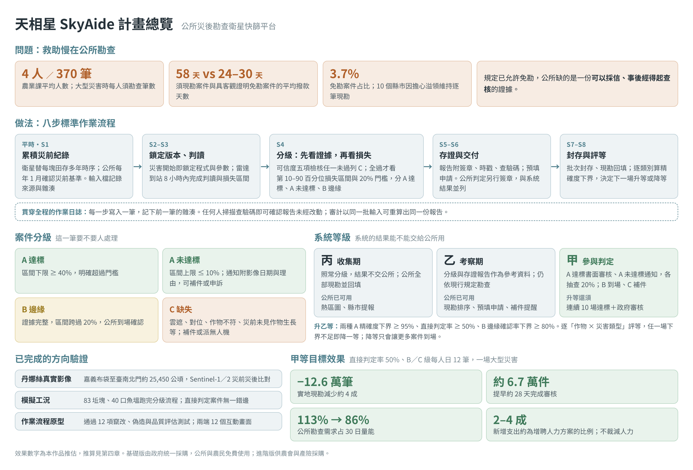

**圖 1　計畫總覽。** 問題、八步標準作業流程、案件分級與系統等級、已完成的方向驗證及甲等目標效果；效果數字的推算見第四章。

## 二、需求分析

**公所農業課平均 4 人，大型災害時每人約須勘查 370 筆，撥款平均 55 天、超過法定 44 天；制度已允許免勘，公所缺乏可採信、經得起事後查核的客觀證據。**

本章依序說明農業天災的損失規模、2025 年災例所揭示的救助延遲、公所在救助流程中的位置與困境，以及現行制度中可供本作品銜接的法定接點；最後回顧國內外相關方案，界定本作品所要填補的缺口。

### 1. 應用需求分析

**209,189 件救助案件中，須現勘案件平均 58 天撥款，免勘案件 24–30 天，免勘與視同案件合計僅占 3.7%〔42〕。**

**(1) 問題規模：農業天災損失與救助**

農業天然災害對我國農業的衝擊具有高頻且高額的特性。依農業部統計，近 10 年農作物天災損失合計 844.5 億元，平均每年 84.5 億元，單年最高為 2016 年的 272.8 億元〔12〕（表 1）。另依農業金融局十年資料分析，現金救助約占農損的 25%〔13〕，顯示救助作業涉及的金額與案件量均相當可觀。

**表 1　近年農業天災損失規模**

| 項目 | 數據 | 來源 |
|---|---|---|
| 近 10 年農作物天災損失（農業部統計） | 合計 844.5 億元，平均每年 84.5 億元 | 〔12〕 |
| 單年最高 | 2016 年 272.8 億元 | 〔12〕 |
| 單一事件前三名 | 2016 年梅姬颱風與 9 月豪雨 169.3 億元；2015 年蘇迪勒颱風 96.7 億元；2019 年 1–2 月乾旱等 47.3 億元 | 〔12〕 |
| 現金救助占農損比例 | 約 25%（以農業金融局十年資料分析） | 〔13〕 |

**(2) 2025 年災例：五起颱風豪雨，農損 50.7 億元**

2025 年共有五起颱風豪雨事件公告救助（表 2、圖 2），合計農業損失 50.66 億元，平均每起 10.1 億元、中位數 5.65 億元，災害發生至首次公告平均約 2.7 天。其中丹娜絲颱風與 0708 豪雨造成 32.81 億元損失，占全年五起的 65%，並另造成漁產損失約 7.7 億元（臺南約 5.4 億、嘉義約 2.1 億）〔49〕；年初寒害亦已用去約 22 億元救助經費〔47〕。值得注意的是，丹娜絲的損失在兩週內由 10.05 億元上修約 3.3 倍，0728 豪雨最末報較首報增加約 20 倍，顯示災損常於災後陸續浮現，查報工作具持續性。

**表 2　2025 年颱風豪雨農業災例**

| 災害 | 發生 | 農業損失 | 首次公告 | 對公所的意義 | 來源 |
|---|---|---|---|---|---|
| 丹娜絲＋0708 豪雨 | 7/6 | 32.81 億元；作物被害 19,433 公頃、損害 37%；臺南 45%、嘉義縣 22%、雲林 16% | 7/7 晚間 | 損失兩週內上修約 3.3 倍，查報持續增加 | 〔49〕 |
| 樺加沙 | 9/23 | 6.04 億元，花蓮占 99%，主要為農田埋沒 | 9/24 | 作物已無法現場辨認，改用前一年資料認定種植 | 〔50〕 |
| 楊柳 | 8/13 | 5.65 億元；被害 4,374 公頃、損害 27%；臺東占 57% | 8/14 | 臺東僅 5 項免勘，其餘仍須現勘 | 〔50〕〔9〕 |
| 0728 豪雨 | 7/28 起 | 4.94 億元；首報 2,438 萬元，最末報增約 20 倍 | 分批受理 | 災損在雨停後陸續浮現 | 〔50〕 |
| 鳳凰 | 11/12 | 1.24 億元（速報） | 11/14 | 花蓮分 8 波公告、跨 52 天 | 〔50〕 |

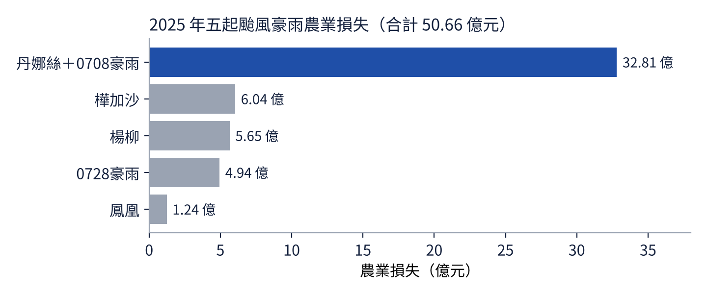{width=72%}

**圖 2　2025 年颱風豪雨農業損失。** 資料來源：農業部統計處〔49〕〔50〕。

公告雖快，撥款卻慢。審計部統計 2021 年 8 月豪雨 209,189 件救助案件，申請到撥款平均 55 天，超過法定 44 天；若依勘查方式區分（表 3），須現勘損失率的一般案件平均 58 天，具客觀證明而免勘的案件僅 30 天，無證明而視同具種植事實者更僅 24 天〔42〕。

**表 3　不同勘查方式的救助案件數與平均撥款天數（2021 年 8 月豪雨）**

| 案件類型 | 件數 | 平均撥款天數 |
|---|---|---|
| 須現勘損失率的一般案件 | 134,006 | 58 |
| 簡化措施但仍現勘種植事實 | 67,535 | 51 |
| 有客觀證明、免勘查 | 5,932 | 30 |
| 無證明、視同具種植事實 | 1,716 | 24 |

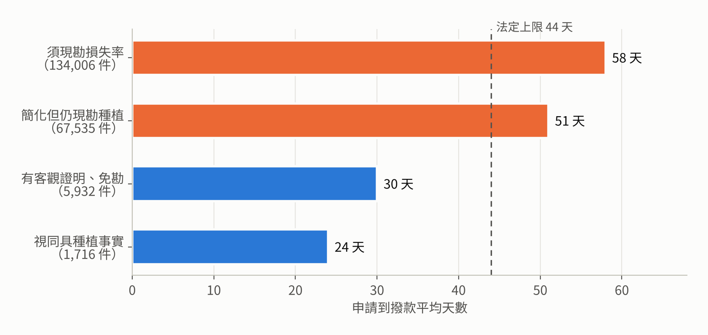{width=72%}

**圖 3　不同勘查方式的申請到撥款平均天數。** 資料來源：監察院（2023），2021 年 8 月豪雨 209,189 件。

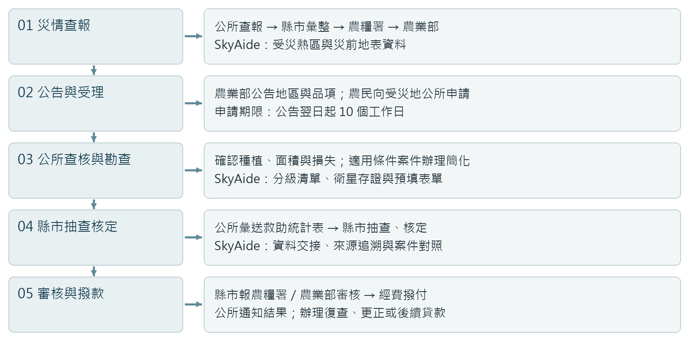

**圖 4　官方撥款天數統計原表。** 保留各縣市、四種勘查方式及合計數。資料來源：監察院調查報告，原表資料由審計部整理自農糧署〔125〕。

由表 3 與圖 3 可知，勘查方式與撥款速度之間存在近一個月的差距；然而免勘與視同案件合計僅占全部案件的 3.7%。同一份報告指出，10 個縣市因擔心溢領而維持逐筆現勘，照相 App 照片亦僅被當作佐證〔42〕。換言之，制度已允許免勘，真正欠缺的是公所敢於採信的客觀證據。此一延遲亦反映在資金流動上：丹娜絲災後 86 天，公所初勘合格 51.5 億元，縣府提報 34.6 億元，農業部核撥 30.18 億元，僅占初勘合格金額的 59%，約三分之一的金額停滯於「公所勘查至縣府提報」之間〔46〕（圖 5）。

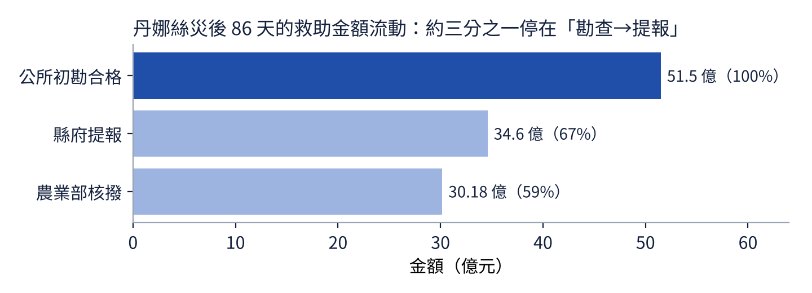

**圖 5　丹娜絲災後 86 天的救助金額流動。** 約三分之一停滯於「公所勘查至縣府提報」之間。資料來源：經濟日報〔46〕。

除 2025 年災例外，近年其他代表案例亦呈現相同的結構性困境（表 4）：受害面積龐大且分散（凱米颱風）、平均損害恰落於 20% 門檻而最易爭議（山陀兒颱風）、延遲性災損須隔年才公告（丹娜絲後臺南文旦）、單一品項申請量超出公所負荷（雲林麻竹筍）、偏鄉田區因無法即時存證而被判不合格（古坑竹林），以及損失發生於水下而現勘僅能確認養殖事實（丹娜絲沿海魚塭）。

**表 4　其他代表案例**

| 災害 | 數據 | 對公所的意義 | 來源 |
|---|---|---|---|
| 凱米颱風（2024/7） | 農產與設施 27.16 億元；作物受害 21,712 公頃、損害 28% | 受害面積逾 2 萬公頃，分散於 7 個縣市 | 〔14〕 |
| 山陀兒颱風（2024/10） | 4.24 億元；作物 4,670 公頃、平均損害 20% | 平均損害恰在 20% 門檻，最易爭議 | 〔15〕 |
| 丹娜絲文旦延續性災損 | 2025/7 受災，2026/7/1 才公告 | 延遲性災損隔 360 天 | 〔52〕 |
| 雲林麻竹筍 | 單次逾 10,000 筆；2023–2025 年農損 19 億元 | 公所全員投入仍難如期 | 〔4〕 |
| 古坑深山竹林（2023） | 無法即時存證，被判不合格 | 偏鄉田區最吃虧 | 〔8〕 |
| 丹娜絲沿海魚塭 | 停電使增氧機停擺，虱目魚與文蛤大量死亡 | 損失在水下，現勘只能確認養殖事實 | 〔83〕〔84〕 |

**(3) 公所在救助流程中的位置與時限**

現金救助自災害發生至撥款，須經法定的層級與期限（表 5）。在各步驟中，提報、公告、申請與撥款均已有固定時限或資訊系統支援，唯有第 5 步「公所勘查」仍須人力逐筆到場，是整個流程中最慢、最易延誤的環節〔42〕〔77〕〔103〕。如圖 6 所示，本作品僅於第 2 步（以災後熱區圖支援縣市提報）與第 5 步（分級清單與存證報告）介入判讀，並於第 4 步替農民預填申請表，其餘法定流程維持不變。

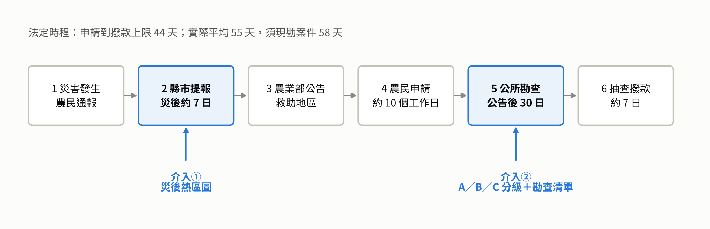

**圖 6　救助流程與天相星介入點。** 資料來源：監察院（2023）、農業部（2025）。

**表 5　現金救助流程、法定時限與負責單位**

| 步驟 | 內容 | 法定或公告時限 | 負責單位 |
|---|---|---|---|
| 1. 災害發生 | 農民通報公所，可用農業部現地照相 App 拍照存證 | — | 農民、公所 |
| 2. 提報 | 公所查報，縣市彙整提報救助 | 災後約 7 日內 | 公所、縣市政府 |
| 3. 公告 | 農業部公告救助地區、品項與每公頃救助額度 | — | 農業部 |
| 4. 申請 | 農民攜證件、存摺、土地證明向受災地公所申請 | 公告翌日起 10 個工作日，逾期不受理 | 農民 |
| **5. 勘查** | **確認作物、面積與損失率是否達 20%** | **公告翌日起 30 日內** | **公所** |
| 6. 報送、抽查與撥款 | 公所報送救助統計表；縣府抽查；農糧署審核撥款 | 各 7 日內 | 公所、縣市政府、農業部 |
| 7. 復查與更正 | 農民對結果有疑義申請復查；登錄錯誤申請更正增撥 | 接獲通知後 7 日內；更正限 4 個月內 | 農民、公所 |

{width=88%}

**圖 7　現金救助流程與天相星在各環節的角色。** 申請期為公告翌日起 10 個工作日，勘查期為 30 日，其後報送、縣府抽查、農糧署審核各 7 日〔77〕〔103〕。

**(4) 公所面臨的痛點：範圍廣、人到不了、訊號斷**

**題目六所述「作業範圍廣、人力巡檢成本高、通訊涵蓋不足」，正是颱風後公所勘查的處境。**

綜合前述資料，公所勘查工作面臨的困境可歸納為四類（表 6）。其一為量能不足：30 日期限內須完成上千筆勘查，撥款因而普遍逾期，且上游催促的壓力集中於公所。其二為人到不了：現勘僅能觀察災後的田，無法確認災前是否種植；人員到不了的偏鄉田區無從存證，雲林古坑深山竹林即因勘災不易、無法即時存證而被判不合格〔8〕，勘災人員亦曾於山區受傷〔4〕。其三為訊號中斷：颱風後停電斷網，公所既收不到清單，農民也傳不出照片；農災 App 須有人到場，手機定位約 ±20 公尺〔83〕〔101〕。其四為判定困難：大量案件落於 20% 門檻附近，地號與實際耕作範圍常不一致，天氣參數受測站盲區與適用品項所限，而判定結果又須經得起審計查核。至於由農民自行拍照補證的做法，歐盟經驗顯示約一半申請者未使用手機提供照片〔27〕，在我國高齡農民比例較高的情況下，此一限制可能更為明顯。

**表 6　公所勘查工作的主要困境**

| 類型 | 痛點 | 具體事實 | 來源 |
|---|---|---|---|
| 量能不足 | 期限短、案件多 | 30 日內須完成勘查；農業課平均 4 人，大型災害每人約 370 筆；雲林單一品項曾逾 10,000 件申請 | 〔2〕〔4〕〔42〕 |
| 量能不足 | 撥款逾期 | 申請到撥款平均 55 天，超過法定 44 天；最長 100 天 | 〔42〕 |
| 人到不了 | 人到不了的田 | 古坑深山竹林無法即時存證，申請被判不合格；2025 年 9 月古坑山區勘災人員受傷送醫 | 〔4〕〔8〕 |
| 人到不了 | 災前狀態無從確認 | 現勘只看得到災後的田，無法確認災前是否種植、種植何種作物 | — |
| 訊號中斷 | 停電斷網 | 颱風後停電斷網，清單與照片無法傳遞；農災 App 須有人到場、手機定位約 ±20 公尺 | 〔83〕〔101〕 |
| 訊號中斷 | 農民自行拍照不普及 | 歐盟約一半申請者未使用手機提供照片 | 〔27〕 |
| 判定困難 | 門檻邊緣最難判 | 山陀兒平均損害 20%、凱米 28%，大量案件落在 20% 門檻附近；未達標準仍獲救助 2.615 億元 | 〔14〕〔15〕〔42〕 |
| 判定困難 | 地號與實際耕作對不上 | 溢領多與地號內夾雜農路、未種植仍申報有關；部分地籍圖仍沿用日治時期圖解地籍圖 | 〔42〕〔80〕 |
| 判定困難 | 判定需經得起查核 | 審計單位已開始以衛星植生指標比對災損熱區 | 〔4〕 |
| 判定困難 | 天氣參數不足 | 依氣象站點資料，測站間有盲區；災損天氣參數僅適用約 40 種品項 | 〔4〕〔19〕 |

**(5) 使用情境**

以典型情境而言，颱風過境後第二天，鄉公所農業課僅有兩、三位承辦人員，卻須於 30 日內處理全鄉數千筆申請，且部分山區道路仍中斷。此時承辦人員最需要的是兩項資訊：一份區分「可依客觀證據直接處理」與「必須派員到場」的優先清單，以及每塊田災前狀態的客觀紀錄。對農民而言，所需資訊則是自己的田是否已被觀測、申請期限為何，以及送件時應備哪些文件。

**(6) 發想動機與制度接點：不需修法即可起步**

**救助辦法已明定「勘查得以科學技術輔助之」，現行有三條免勘路徑；本作品在乙等時作為公所的參考資料，甲等的條件之一就是經政府審核列入種植客觀證明或作業要點。**

本作品的設計前提是不需修法即可起步。救助辦法 2017 年修正後已明定「勘查得以科學技術輔助之」〔42〕。依農業部 2025 年 4 月 18 日公告，災損符合公告天氣參數或經公告為災損嚴重時，農民具綠色環境給付、產銷履歷、前次救助或農保補助紀錄，或以農災 App 上傳當次災損照片者，公所得免勘查；無上述文件者應抽樣勘查 20% 以上〔3〕〔128〕。另依作業要點，農民以農業部現地照相 App 拍攝上傳，且公所依照片認定損失率超過 20% 者，得免實地勘查〔103〕。

本作品不改變這三條路徑（表 7、圖 8）。丙、乙等時，存證報告只是承辦人員的參考資料，免勘與否仍由公所依現行規定認定；系統達甲等前，須以逐類別的精確度報告申請列入種植客觀證明或作業要點，並一併取得「A 未達標不到場即通知」的作業依據。即使認可時程延後，熱區圖、現勘排序與預填申請仍可照常使用。

**表 7　現行免勘路徑與本作品的對應**

| 免勘路徑 | 條件 | 天相星提供 | 丙、乙等 | 甲等 |
|---|---|---|---|---|
| ① 客觀證明免勘 | 達災損天氣參數或經公告災損嚴重，且具種植客觀證明文件（救助辦法第 12 條、2025 年 4 月 18 日公告） | 災前基準（公所確認的範圍與作物）＋存證報告 | 存證報告為參考資料，協助公所查證既有客觀證明是否對應同一坵塊與作物 | 經政府審核列入客觀證明或作業要點後，A 達標書面審核、A 未達標通知，各抽查 20% |
| ② App 照片＋公所認定 | 農民以農業部 App 拍攝上傳，公所依照片認定損失率超過 20%（作業要點） | 警報與公告時提醒農民拍照；照片與存證報告並列於審核畫面；C 缺失通知補照片 | 現行可用 | 現行可用 |
| ③ 抽樣或實地勘查 | 以上都不成立 | 依原因碼、損失區間與位置排序的 B、C 級清單，可離線下載並匯入農災 App 調查專案 | 全部依現行規定勘查；乙等可依分級排定現勘順序 | 集中於 B 邊緣與部分 C 缺失 |

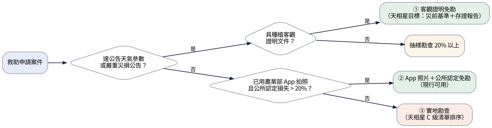

**圖 8　現行免勘路徑與天相星的對應。** 依救助辦法第 12 條與作業要點整理〔77〕〔103〕。

農業部 2025 年 4 月 18 日農糧字第 1141108673 號公告修正了公所得免實地勘查的「種植客觀證明文件」，適用於 2025 年 1 月 1 日以後發生的天然災害〔128〕。依該公告，災損程度符合公告天氣參數或經公告為災損嚴重時，具下列文件之一者，公所得免勘查：其一，農民於當年度或前一年度，以申請救助的土地參與綠色環境給付計畫並領有給付（含農業環境基本給付、轉作獎勵、生產環境維護給付及大專業農轉作獎勵等）、通過糧作物產銷履歷驗證、領有農業天然災害現金救助，或領有農業保險保費補助；其二，農民以農業部「農產業天然災害現地照相 App」拍攝當次災害損失照片，並於公告受理期間內上傳。無上述文件者，公所應抽樣勘查 20% 以上。此一公告使本作品的設計更有依據：平時登錄所連結的綠色環境給付紀錄，本身即屬現行認可的客觀證明；天相星的角色在於協助公所查證這些紀錄是否對應同一坵塊與作物，並在未達天氣參數或缺乏紀錄的案件上提供損失證據。2025 年樺加沙颱風後，花蓮縣政府亦針對光復鄉指定地段公告，經查證具客觀證明者得免勘查〔134〕。

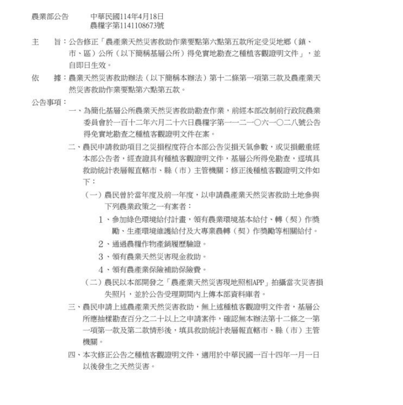

**圖 9　農業部種植客觀證明公告原文。** 2025 年 4 月 18 日農糧字第 1141108673 號〔128〕。

本作品不取代公所的判定，而是使無爭議案件得依客觀證據快速處理，將有限的現勘人力保留給真正需要判斷的田區。

**(7) 證據可信度與防偽的需求**

**公所不敢免勘，是因為採信錯誤的責任落在承辦人員身上；證據必須能說明來源、證明未被改動，並可由他人重算。**

免勘比例偏低的直接原因是溢領疑慮；審計部同一份報告亦指出，未達救助標準仍獲救助者達 2.615 億元〔42〕。採信錯誤的後果不只是追回款項。2015 年蘇迪勒颱風後，彰化竹塘一名農民以已停耕整地的河川地申請香瓜災損救助，領得約 42 萬元；公所承辦人員到場時將乾枯瓜藤與雜草認定為受災作物，一審以圖利罪被判處 5 年 2 個月，法院則以空照圖認定該地災前即為裸地〔138〕。此案說明兩件事：災前的空間紀錄可以在事後分辨真偽；而公所要放心採信一份證據，這份證據必須能回答「從哪裡來、有沒有被改過、換人計算是否得到同樣結果」。

現行可用的數位證據在這些方面仍有缺口（表 8）。農業部現地照相 App 會在照片上套印拍攝時間、上傳時間、經緯度與地段地號，並每小時同步至救助系統，設計重點在於快速保全災損證據〔101〕〔126〕；但 App 僅以手機號碼登入，手機定位約有 ±20 公尺誤差，公開說明亦未提及照片重複上傳或事後編輯的檢核〔101〕。衛星影像同樣可能被替換，已有研究示範以生成模型產生足以亂真的偽造衛星影像〔141〕。存證報告若只是一份可任意編輯的檔案，也會面臨同樣的質疑。

制度面同樣提高了對可驗證性的要求。2024 年修正的《電子簽章法》規定，具憑證機構簽發憑證的數位簽章推定為本人親自簽名或蓋章，行政機關亦不得再以公告排除電子簽章的適用〔139〕；2025 年 12 月三讀通過的《人工智慧基本法》列出透明與可解釋、問責等原則，並要求政府使用人工智慧執行業務時進行風險評估〔140〕。本作品的存證報告將由公所在法定程序中使用，因此必須能說明判斷依據、能查驗真偽、能追溯責任。

**表 8　證據可信度的缺口與本作品的對應**

| 需要回答的問題 | 現況 | 天相星的做法 |
|---|---|---|
| 災前確實有種嗎 | 災後到場只看得到災後的田；竹塘案靠事後調閱空照圖 | 災前 6 個月衛星時序加多年紀錄；災前未見作物生長者列 C 缺失 |
| 證據是否來自本田、本次災害 | App 照片套印時間與座標，定位誤差約 ±20 公尺 | 照片座標與時間對照坵塊與災害期間，並與衛星變化交叉比對 |
| 證據是否被重複使用 | 未見公開的重複照片檢核 | 以感知雜湊比對歷次案件照片 |
| 報告是否被改過、由誰簽發 | 紙本或電子檔可編輯 | 數位簽章、時戳、查驗碼 |
| 換人計算是否得到同樣結果 | 判斷過程多未留存 | 輸入、程式、參數皆記錄雜湊，可重算比對 |
| 系統判讀與人工判定是否分得清 | 同一份紀錄 | 公所判定另行簽章，與系統結果並列、不覆蓋 |

**(8) 題目定位**

**本作品對應題目六的六項要素；題目五雖也涉及災前災後比對，核心是災害應變，本作品服務的是救助勘查與平時農地管理。**

題目五亦涉及災前災後影像比對，惟其核心為災害應變與救援；本作品服務的對象則是公所的農業救助勘查流程與平時的農地管理，對應題目六「作物種類與生長狀態辨識、作物異常、災損或環境變化監測」及「作業範圍廣、人力巡檢成本高」之情境。題目六各要素與本作品的對應關係如表 9。

**表 9　題目六要素與本作品對應**

| 題目六要素 | 本作品對應 |
|---|---|
| 偏鄉農林牧場域、通訊涵蓋不足 | 人到不了的田以衛星存證；B、C 級清單事先離線下載；坡面定位樁與現場回報經衛星通訊回傳 |
| 作業範圍廣、人力巡檢成本高 | 甲等時 A 級書面審核或通知，現勘集中於 B 邊緣；C 級中解析度不足者改派無人機補拍 |
| 衛星遙測、AI 影像辨識 | 雷達與光學時序判讀；作物判釋、淹水、倒伏、埋沒偵測；分位數損失區間 |
| 作物種類與生長狀態辨識 | 災前時序作物判釋與物候檢核，對照申報作物；水稻以雷達插秧訊號判釋 |
| 作物異常、災損或環境變化監測 | 災後分級、延遲性災損追蹤 6 個月、平時作物異常提醒、魚塭停電與池水變化 |
| GNSS 高精度定位、IoT、衛星通訊 | e-GNSS 坡面定位樁；無人機與 App 照片的 GNSS 座標存證；魚塭溶氧與電箱紀錄 |

### 2. 國內外現況分析

**現有方案多缺乏災前紀錄或不處理災後損失，目前沒有為公所勘查設計、可同時證明種植與損失的工具。**

**(1) 國外**

國外已有多國將衛星監測納入農業行政制度（表 10）。最具代表性的是歐盟面積監測系統：愛爾蘭以 Sentinel-1／2 監測全國約 110–130 萬筆申報地塊，綠、黃燈案件照常撥款，僅紅燈案件通知農民補照片，歐盟並自 2023 年起要求會員國採用〔27〕〔28〕。義大利 AGEA 自 2018 年起以衛星監測取代例行實地稽核，使監測與稽核成本降低 30%–40%，實地檢查比例降至 3%–5%〔68〕；德國薩克森的 DGL Monitor 則以衛星與機器學習排定查核順序，最終仍由主管機關判定〔29〕。在保險領域，印度 RIICE 以 Sentinel-1 加稻作模型作為理賠證據，使 20 多萬戶農民取得理賠〔69〕。上述案例證明「衛星分級、行政人員只處理紅燈」可於國家制度中落地；但其目的多為事前稽核或保險，並未處理災後救助的損失認定。

**表 10　國外相關方案**

| 方案 | 做法與數據 | 限制或與本作品差異 | 來源 |
|---|---|---|---|
| 愛爾蘭 AMS（歐盟面積監測系統） | 以 Sentinel-1／2 監測全國約 110–130 萬筆申報地塊；綠、黃燈照常撥款，紅燈才通知農民補照片；歐盟自 2023 年起要求會員國採用 | 屬事前稽核，不處理災後損失 | 〔27〕〔28〕 |
| 義大利 AGEA | 2018 年起以衛星監測取代例行實地稽核 | 監測與稽核成本降低 30%–40%；實地檢查降至 3%–5% | 〔68〕 |
| 德國薩克森 DGL Monitor | Sentinel-1／2 加機器學習找出生長異常田區，協助排定查核順序 | 草地補貼稽核；與本作品「衛星排序、公所判定」邏輯相同 | 〔29〕 |
| 印度 RIICE | Sentinel-1 加稻作模型作為保險理賠證據 | 20 多萬戶農民取得理賠；以保險為對象 | 〔69〕 |
| 印度 PMFBY（YES-TECH） | 國家作物保險以遙測估產，衛星估計至少占產量計算 30% 權重 | 以村為單位，不處理個別農戶 | 〔31〕 |
| 歐盟 GFM 全球洪水監測 | 門檻法、時序異常、變遷偵測三法多數決，Sentinel-1 取像後 8 小時內出圖 | 事件級淹水圖，不到單一田區 | 〔57〕 |
| Copernicus EMS Rapid Mapping | 光學與雷達衛星為全球天災製作災區圖 | 事件級範圍圖，不接救助流程 | 〔30〕 |
| Floodbase（美國） | 多顆衛星淹水圖作為參數型洪水保險理賠依據 | 只看淹水，不處理風倒、落果 | 〔32〕 |

**(2) 國內**

國內現有工具可分為三類（表 11）。第一類為現行救助制度直接使用者，包括災損天氣參數與農災 App：前者可推論「天氣多糟」，卻無法得知「田壞多少」，且受測站盲區與約 40 種適用品項所限〔19〕；後者須有人到場、無災前紀錄，GPS 精度約 ±20 公尺〔20〕〔21〕。第二類為衛星前後期比對已實用、但目標不同者，如水保署 BigGIS 的崩塌判釋〔33〕與國土管理署的國土利用監測〔34〕。第三類為已觸及農業災損、但尚未制度化者：無人機災損判釋曾於 2019 年試辦，惟 2019–2020 年補助 6 件 2,050 萬元全數未執行〔35〕〔42〕；雲林以 Sentinel-2 NDVI 試算的衰退區與核定救助區重疊約 64%，但只用光學且未綁定地號〔4〕。此外，國內研究已證實以 Sentinel-1 時序結合地籍坵塊判釋雲林水稻，各鄉鎮準確率可達 0.8 以上〔55〕，國家太空中心亦以福衛五號監測中美洲約 5,000 公頃香蕉病害逾 3 年〔36〕，顯示以臺灣地籍為判讀單位及以自主衛星進行作物監測均具可行性。

**表 11　國內相關方案**

| 方案 | 做法與數據 | 限制或與本作品差異 | 來源 |
|---|---|---|---|
| 災害性／災損天氣參數（農業部） | 氣象數據達門檻即啟動救助；配合種植證明可免現勘；適用約 40 種品項 | 只知「天氣多糟」，不知「田壞多少」；為本作品的制度接點 | 〔19〕 |
| 農災 App（農業部） | 手機 GPS 拍照比對地籍、離線地圖、多點勘災導航；2023 年三場颱風累積逾 9 萬張影像 | 須有人到場、無災前紀錄；本作品 B、C 級清單匯入其調查專案 | 〔20〕〔21〕 |
| 農業保險（氣象參數型） | 29 品項、44 張保單；鳳梨僅 6 件、木瓜僅 4 件投保 | 依氣象站而非田區實況，投保率低 | 〔11〕〔22〕 |
| 水保署 BigGIS | 每 5 天處理一幅涵蓋全臺的 Sentinel-2 影像，災後判釋疑似崩塌 | 對象為坡地崩塌 | 〔33〕 |
| 國土管理署國土利用監測 | 衛星前後期比對通報變異點；109 年通報 26,224 筆 | 目標為土地違規使用 | 〔34〕 |
| 農業試驗所 UAV 災損判釋 | 無人機判斷香蕉倒伏，2019 年試辦 | 須派員飛行；補助 2,050 萬元全數未執行 | 〔35〕〔42〕 |
| 國家太空中心 中美洲香蕉病害監測 | 以福衛五號監測約 5,000 公頃，運作 3 年以上 | 自主衛星已有作物監測實績 | 〔36〕 |
| 雲林衛星 NDVI 試算 | 以 Sentinel-2 NDVI 找疑似災損熱區，與核定救助區重疊約 64% | 只用光學、未綁地號 | 〔4〕 |
| 國內雷達水稻判釋研究 | Sentinel-1 時序結合地籍坵塊判釋雲林水稻，準確率 0.8 以上 | 證明臺灣地籍可作為判讀單位 | 〔55〕 |

歐盟的經驗最值得參考，因為它已把「衛星全面監測、只對不確定者到場」寫進法規並全面運作。2018 年起歐盟允許以衛星監測取代農業補貼的現場抽查〔150〕；2023 年起依執行規則 2022/1173，所有面積型給付申請都須納入面積監測系統（AMS），以 Sentinel 時序逐塊判讀，只對不確定者到場〔151〕。奧地利約 300 萬塊田每月自動處理一次，可辨識 93 種作物、割草與收割〔154〕；義大利以衛星取代例行稽核，實地檢查降至 3%–5%〔68〕。歐盟查的是整季「有沒有依申報耕作」，本作品處理的是 30 日內的災後損失，所以借鑑的是流程與治理方式（表 12），不是門檻數值。歐洲審計院也指出，2019 年 59 個付款機構中有 52 個擔心執委會是否認可其方法，這是推廣的主要障礙〔150〕；本作品存證報告須先獲公告認可的處境相同，因此以丙、乙等累積的逐類別精確度報告爭取認可。

**表 12　歐盟面積監測系統的作法與本作品借鑑**

| 歐盟作法 | 具體內容 | 本作品借鑑 |
|---|---|---|
| 全面監測、分燈處理 | 每筆申報地塊以 Sentinel 時序判讀，分綠、黃、紅燈；黃燈先由人員看影像與資料，必要時才到場；2019 年需到場的地塊最多 1%〔150〕 | A 達標、A 未達標、B 邊緣、C 缺失四類；C 級先看原因碼再決定補件、派無人機或到場 |
| 誤判上限 | 執委會設「誤判紅燈」（守規農民被判不符）上限 5%〔150〕 | A 達標、A 未達標精確度下界皆須 ≥ 95%，逐類別評定，未達即降等 |
| 先通知、可修正 | 監測發現不符須告知農民，讓其修正申請或補證；愛爾蘭 2023 年首輪通知 4,737 戶，約 91% 於期限內回覆〔151〕〔155〕 | A 未達標於勘查期內通知並附判定理由，C 缺失通知補件 |
| 預填申請 | 規則要求提供預填的申請表〔151〕 | 預填現金救助申請表 |
| 地理標記照片 | 2025 年起照片列為與衛星等值的證據；捷克試辦 App 蒐集逾 1.6 萬張照片，檢查員最多省時 70%；奧地利約 10.7 萬農戶中約 3 萬人註冊官方拍照 App；App 會標示照片是否經修改，外部匯入者標為「非真實」〔151〕〔152〕〔153〕〔154〕 | 照片分「App 內即時拍攝」與「相簿匯入」兩級可信度，並指引拍攝點與方向 |
| 年度品質評估 | 會員國每年提交 AMS 品質評估報告，量化缺失並提出改正措施；連續兩年嚴重缺失須提行動計畫〔151〕 | S8 每場災害後逐類別評等，並統計 C 級原因碼 |
| 判讀標記、相似度 | 標記須多訊號同時出現才採信；斯洛維尼亞以周邊最多 500 塊同作物田比較〔159〕〔160〕 | 雷達與光學須互相印證；植生變化以周邊同作物田為基準 |
| 多年土地紀錄 | AMS 須偵測不符資格的面積及耕地、永久作物、永久草地等土地類別變化〔151〕 | 長時間對照檢核 L1–L4 |

**(3) 缺口**

綜合國內外現況，現有方案或缺乏災前紀錄（天氣參數、農災 App、無人機），或不針對災後農損（AMS、AGEA、BigGIS、國土監測）；國內的衛星試算只用光學且未綁定地號。魚塭方面，文獻已能辨識魚塭並判斷其是否在用〔64〕〔65〕，但尚未應用於災後救助。據此，本作品界定的研究缺口為：目前尚無一套為公所勘查流程設計的工具，能持續保存每筆地號的災前紀錄、於災後同時提供種植與損失證據、預填農民申請，並銜接公所現用的農災 App，且證據本身可查驗真偽。表 13 比較各方案與本作品的差異。

**表 13　現有方案與本作品比較**

| 比較 | 天氣參數 | 農災 App | 氣象參數型保險 | 無人機 | 愛爾蘭 AMS | 天相星 |
|---|---|---|---|---|---|---|
| 觀測依據 | 氣象站 | 人拍照片 | 氣象站 | 航拍 | 衛星 | 衛星＋地面定位樁 |
| 觀測單位 | 一測站代表一區 | 一張照片一塊田 | 一測站代表一區 | 一次一小區 | 每筆申報地塊 | 每一塊實際耕作坵塊 |
| 能證明 | 損失（推論） | 輔助佐證 | 是否理賠 | 損失 | 是否依申報耕作 | 種植＋損失 |
| 公所是否須到場 | 否 | 是 | 否 | 是 | 紅燈才需要 | 甲等時僅 B 級與部分 C 級 |
| 災前紀錄 | 無 | 無 | 無 | 無 | 有 | 有 |
| 給公所的輸出 | 是否啟動救助 | 存證照片 | 是否理賠 | 災損圖 | 是否撥款 | 分級清單＋可溯源存證報告 |
| 給農民的輸出 | 無 | 照片上傳 | 理賠 | 無 | 補照片通知 | 警報、預填申請、補件提醒、A 未達標通知、進度、復查附件 |

## 三、創意構想提案內容

**平時建立災前基準，災後先檢核證據、再以損失區間分級；系統依實測結果在丙、乙、甲三等之間升降，A 級只在甲等參與判定；每份證據可查驗真偽。**

本章先說明本作品的使用對象、場域與兩端運作流程，界定案件分級與系統等級並呈現介面設計；其次論證衛星在本應用中的必要性與概念創新之處；最後從系統架構、資料取得、判讀模型、標準作業流程、可信度與防偽、門檻與系統等級及風險管理等面向，分析技術可行性。

### 1. 創意構想使用情境

**公所為主要使用者，農民自願參與；系統提供分級與存證，最終認定由公所做出。**

**(1) 目標使用對象**

本作品的使用者依其在救助流程中的角色分為四類（表 14）。主要使用者為全國 368 個鄉鎮市區公所農業課的承辦人員與課長，其工作涵蓋平時確認災前基準、災後受理與審核、排定現勘、報送與抽查，以及處理復查。次要使用者為農民與養殖戶，以及縣市政府農業處；延伸使用者則為防檢單位、農會與產險公司。須說明的是，農民登錄採自願原則，未登錄者仍可依現行程序向公所申請，本作品亦可依地籍與影像提供判讀，惟缺少經公所確認的災前基準。

**表 14　目標使用對象與使用方式**

| 角色 | 對象 | 使用方式 | 獲得的價值 |
|---|---|---|---|
| **主要使用者** | 鄉鎮市區公所農業課承辦人員、課長（全國 368 個鄉鎮市區） | 平時確認災前基準；災後受理與文件核對、依分級審核、排定 B、C 級現勘、報送與抽查、處理復查 | 不再超出量能、如期完成勘查、判定有客觀依據 |
| 次要使用者 | 農民與養殖戶 | 手機 App 登錄田區或魚塭、接收警報與公告、確認預填申請表、追蹤進度；無智慧型手機者使用簡訊版或由農會協助 | 不必冒險進田、減少往返公所、掌握期限與進度 |
| 次要使用者 | 22 個縣市政府農業處 | 接收分級清冊副本與異常程度排序，作為抽查參考 | 掌握全縣災情與勘查進度 |
| 延伸使用者 | 防檢單位、農會、產險公司 | 接收作物異常提醒、協助農民登錄、取得田區資料 | 提早處理異常、理賠有佐證 |

**(2) 應用場域**

本作品的應用場域為颱風與豪雨常襲的偏鄉農區公所轄區，涵蓋坡地果園、竹林、平地農田與沿海魚塭，尤以道路易中斷、手機訊號不穩定的山區鄉鎮為主。依近年災例，雲林、嘉義、屏東、臺南、高雄、臺東、南投為優先場域〔14〕〔15〕〔6〕。概念驗證選定丹娜絲颱風登陸的嘉義縣竹崎、中埔一帶（主要受損作物為香蕉、竹筍、木瓜）〔6〕，以及臺南、嘉義沿海魚塭〔49〕。

**(3) 兩端運作流程與時間軸**

**災前基準於平時由公所確認一次；災後依法定期限進行，雷達影像到站後 8 小時內完成分級；系統等級決定結果怎麼交給公所。**

本作品的運作貫穿平時與災後兩個階段（表 15、圖 10）。平時，農民五步登錄，公所於每年 1 月綠色環境給付申報期一併確認範圍並鎖定為「災前基準」；系統持續累積坵塊時序，並對作物異常提出提醒。災後，警報時鎖定災前影像與程式版本並排定取像，B、C 級清單預先下載至公所手機以因應斷網；雷達到站 8 小時內完成分級；公告後預填申請表，並主動通知衛星看到明顯受損、但尚未申請的農民。申請期內，C 缺失的申請人收到補件提醒，可補 App 照片或更正，再以 QR 碼送件，公所掃描後即可調閱預填資料與存證報告。勘查期的處理依系統等級而定：丙、乙等時公所依現行規定勘查，乙等可依分級排定現勘順序；甲等時 A 達標書面審核、A 未達標通知申請人，兩者各抽查 20%，B 邊緣到場確認，C 缺失依原因碼補件、派無人機或到場。其後依序進入報送、縣府抽查、農糧署審核撥款與復查。現勘結果回填後，S8 逐類別重新評等，決定下一場的系統等級；災後 6 個月內則持續追蹤延遲性災損。

**表 15　兩端運作流程與時間軸**

| 時間點 | 系統動作 | 農民端 | 公所端 |
|---|---|---|---|
| 平時 | 收取 Sentinel-1／2、福衛八號影像，建立每塊坵塊的生長時序與多年紀錄；偵測作物異常 | 五步登錄：身分 → 使用權文件 → 田區範圍 → 作物與佐證 → 個資同意 | 於綠色環境給付申報期一併確認範圍，鎖定為災前基準 |
| 颱風警報 | 鎖定每塊田最近一張可用災前影像與程式版本（S2），排定雷達與福衛八號取像；B、C 級清單預先下載至公所手機 | 收到警報：哪幾塊田在風雨範圍內；提醒安全時用農業部 App 拍照、路不通不要進田 | 照常受理通報 |
| 雷達首次過境（約第 1–6 日） | 雷達到站後 8 小時內完成判讀與分級；熱區下單高解析影像 | — | 參考熱區圖提報災情範圍 |
| 救助公告 | 將公告範圍內登錄田區對應到申請；預填現金救助申請表；通知明顯受損但未申請者 | 收到公告與申請截止日；確認預填資料並勾選屬實 | 總覽：登錄田區、已送件、明顯受損未送件、App 照片已上傳 |
| 申請期（10 個工作日） | 乙等起，C 缺失申請人收到補件提醒（原因碼以白話呈現） | 補 App 照片或更正；列印或出示 QR 碼，由本人、農會或受託人送件 | 掃描 QR 碼調閱預填資料與存證報告，核對應附文件 |
| 勘查期（30 日內） | 丙、乙等：分級作參考、排定現勘順序；甲等：A 未達標通知於勘查期內送達；C 缺失依原因碼分流，無人機任務匯出 | 甲等時 A 未達標者收到附理由的通知，可補件或申訴；B、C 級田收到「公所會到田裡確認」或補件提醒 | 丙、乙等全部依現行規定勘查；甲等 A 達標書面審核、A 級各抽查 20%，B 到場、C 補件或到場 |
| 報送與抽查（各 7 日） | 產出救助統計表草稿；分級清冊副本與異常排序交縣府 | 追蹤進度：受理 → 勘查 → 縣府抽查 → 撥款 → 入帳 | 報送縣府；縣府依戶數級距抽查 |
| 結果與復查 | 現勘結果回填；S7 封存、S8 逐類別評等並重新訓練 | 查看核定結果；7 日內申請復查，系統整理附件 | 處理復查、更正增撥（4 個月內）、低利貸款受災證明書 |
| 災後 6 個月 | 追蹤復耕與延遲性災損 | 收到延遲性災損提醒 | 處理延遲申報案件 |

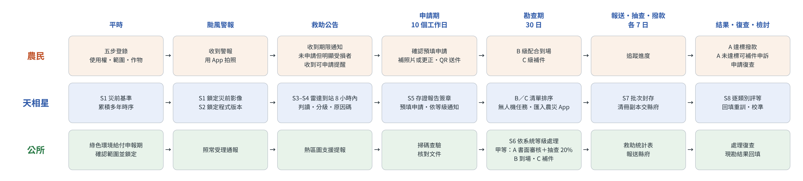

**圖 10　農民、天相星與公所三方的運作流程。** 天相星一列標示標準作業流程 S1–S8；勘查期的公所作業以甲等為例。

**(4) 案件分級與系統等級**

**案件分級回答「這一筆要不要人處理」，系統等級回答「系統的結果能不能交給公所用」；兩者分開，才不會因為少數案件判得準，就讓整套系統提早取代現勘。**

勘查被拆成兩個衛星可回答的問題（表 16）：**證據夠不夠**（災前在生產、影像可用、申報相符），以及**損失是否達 20%**（以第 10、50、90 百分位的損失區間表示）。

**表 16　救助勘查問題與對應的衛星證據**

| 問題 | 衛星證據 |
|---|---|
| 證據夠不夠：災前有沒有在生產、影像可不可用、申報是否相符 | 可信度五項檢核：影像條件、觀測完整、多源一致、申報一致、生產事實（含長時間對照 L1–L4）；有公所確認的災前基準者為強證據 |
| 損失有沒有達 20% | 災前災後變化量，輸出損失區間（第 10、50、90 百分位） |

分級先看證據、再看損失（表 17、圖 11）：可信度五項檢核任一未通過即列 C 缺失，即使損失看起來很明顯也一樣；五項全過才看損失區間，區間整個在 20% 以上（下限 ≥ 40%）為 A 達標，整個在以下（上限 ≤ 10%）為 A 未達標，跨過 20% 為 B 邊緣。這樣 C 的意思很單純：要補資料；B 也一樣單純：資料夠了，但數字太接近。沒有申請的田不列入分級：衛星看到明顯受損者主動通知可以申請，無變化者不處理。農民端不顯示代號，而以「受損明顯」「影像顯示未達 20%」「需公所到場確認」「請補充資料」等白話呈現，並註明以公所認定為準。

**表 17　案件分級**

| 分級 | 判定條件 | 甲等時的處理 |
|---|---|---|
| A 達標 | 五項檢核全過，損失區間下限（第 10 百分位）≥ 40% | 存證報告書面審核、撥款；抽查 20% |
| A 未達標 | 五項檢核全過，損失區間上限（第 90 百分位）≤ 10% | 30 日勘查期內通知，附災前災後影像日期與判定理由，申請人可補件或申訴；抽查 20% |
| B 邊緣 | 五項檢核全過，損失區間跨過 20% | 公所到場確認 |
| C 缺失 | 五項檢核任一未過，例如雲遮、對位不確定、申報作物不符、災前未見作物生長、疑似灌溉 | 依原因碼通知補件，解析度不足者派無人機補拍，必要時到場 |

40% 與 10% 為起始值，依作物以 Learn then Test 校準（本章 4(14)）。判讀元件未達使用門檻時，例如倒伏尚無與現勘比對的精確度，用它判出的案件一律歸 B 或 C。此一設計刻意偏向保守：寧可多列 B、C，也不讓證據不足或數字太接近的案件被直接判定。

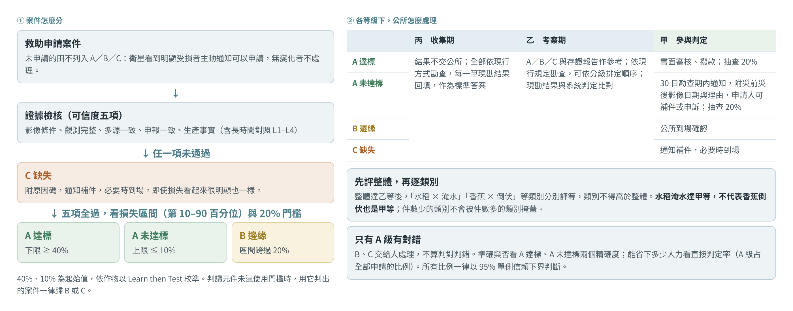

**圖 11　案件分級與各系統等級下的處理方式。** 左：先看證據、再看損失；右：同一個分級結果，在丙、乙、甲三等的用法不同。

證據檢核中的「申報一致」與「生產事實」，另以五項申請交叉檢核規則（R1–R5）執行（表 18）。各項分別記錄「一致、待補件、待確認」及證據來源，與分級並列；差異由承辦人員確認並留存原因碼，處理結果回寫同一案件〔132〕。

**表 18　申請交叉檢核規則（R1–R5）**

| 規則 | 比對欄位 | 承辦處理 |
|---|---|---|
| R1 地號與範圍 | 縣市、段小段、地號、坵塊及公告區域 | 比對地籍版本與實際耕作範圍；差異列待確認 |
| R2 作物一致性 | 申報作物、登記作物、衛星物候及播種日期 | 改種、未登記或模型低信心時，先補紀錄或現地照片 |
| R3 面積與損失 | 申報面積、使用範圍、受影響面積及損失區間 | 扣除農路、水塘與重疊；分列受影響面積及作物損失率 |
| R4 實際經營人 | 申請人、地主、租約或使用同意書有效期間 | 由公所核對合法使用與實際經營；分析端僅使用代碼 |
| R5 重複與歷次案件 | 同災害、期作、地號、作物、申請人與空間交集 | 提示重複送件；依法合併連續災害或保留不同救助項目 |

系統分三等（表 19）。升到甲等要同時滿足三件事：數字達標、連續多場災害驗證、通過政府審核。等級先以全部案件評整體，整體達乙等後，再逐類別（作物 × 災害類型，例如「水稻 × 淹水」「香蕉 × 倒伏」）評等，類別不得高於整體。

**表 19　系統等級**

| 等級 | 條件 | 系統的角色 | 公所的作業 |
|---|---|---|---|
| 丙　收集期 | 未達乙等條件 | 照常分級，結果不交公所使用 | 全部依現行方式勘查；現勘結果回填，作為訓練與驗證資料 |
| 乙　考察期 | 兩種 A 精確度、判定正確率、直接判定率、B 邊緣確認率皆達標，但連續達標場次不足或尚未通過政府審核 | A／B／C 與存證報告作為參考資料 | 依現行規定勘查，系統結果不作免勘依據；可依分級排定現勘順序；現勘結果與系統判定比對 |
| 甲　參與判定 | 乙等條件，加上連續 10 場災害達標並通過政府審核 | A 級直接參與判定 | A 達標書面審核、A 未達標通知，各抽查 20%；B 到場；C 補件或到場 |

丙等也是完整的驗證：公所每一筆都現勘，A、B、C 每一級都有標準答案可比，兩種 A 的精確度和 B 邊緣確認率都量得出來。到了甲等，只剩抽查與 B、C 級有標準答案，因此抽查比例依件數調整（本章 4(14)）。

**A 未達標的制度設計。** 不到場就認定未達標，結構上和公所依財稅資料判定低收入戶資格、申請人不服再申復相同〔187〕。但農損證據會消失，所以本作品配合三件事：判定未達標的通知必須在 30 日勘查期內送達，並給補件期限，讓公所還來得及到場；通知上附災前、災後影像日期與判定理由，讓申請人知道要補什麼；A 未達標和 A 達標一樣抽查 20%，因為 A 達標判錯是溢領，抽查查得到，A 未達標判錯是該給的沒給，申請人如果沒申訴就不會被發現。

**(5) 小田區的解析度試算**

田區面積直接影響判讀可靠度。如表 20 所示，0.1 公頃的田在 Sentinel-2 影像中僅約 10 個像素，在福衛八號影像中則約 1,000 個。為避免田埂與鄰田的混合像素，每塊坵塊向內縮 10 米後取像素統計；內縮後少於 5 個 Sentinel 像素者，改以福衛八號判讀；沒有高解析影像時「影像條件」檢核不通過，列 C 缺失並派無人機補拍。

**表 20　田區面積與可用像素數**

| 田區面積 | Sentinel-2（10 米）像素數 | 福衛八號（1 米）像素數 | 處理方式 |
|---|---|---|---|
| 0.1 公頃 | 約 10 個 | 約 1,000 個 | 以福衛八號判讀；影像不足則列 C 缺失 |
| 0.3 公頃 | 約 30 個 | 約 3,000 個 | 低於此面積改用福衛八號或無人機補拍 |
| 1 公頃 | 約 100 個 | 約 10,000 個 | Sentinel-2 即可判讀 |

**(6) 介面設計：農民端與公所端**

兩端介面已依本構想書的分級與系統等級完成可互動原型，共 12 個畫面（表 21）。設計遵循四項原則：每一步對應現行法定程序與文件，不另創格式；農民端不顯示代號，四類結果以「受損明顯」「影像顯示未達 20%」「需公所到場確認」「請補充資料」呈現，每一類都說明原因與下一步；同一案件在乙等與甲等的畫面不同，乙等時農民只收到補件提醒，其他結果等公所勘查後通知；考量高齡使用者，採大字級、大按鈕與白話用語，並提供簡訊版與農會協助。畫面中的「原型示範」切換鈕可直接比較乙、甲等的差別。

**表 21　可互動原型的 12 個畫面**

| 端 | 畫面 | 內容 |
|---|---|---|
| 農民端 | 平時紀錄 | 每塊田的災前基準狀態與衛星累積紀錄 |
| 農民端 | 颱風過後的結果 | 每塊田的白話結果、原因與下一步 |
| 農民端 | 補充資料 | C 缺失的原因、可補的資料；公所已排無人機時提醒不要上山拍照 |
| 農民端 | 確認送件 | 預填申請、存證報告與查驗碼；勾選確認後才產生送件 QR 碼 |
| 農民端 | A 未達標通知 | 災前災後影像日期、損失區間與判定依據；勘查期內可補件或申訴 |
| 農民端 | 查驗報告 | 掃描查驗碼確認簽章、時戳與封存批次 |
| 公所端 | 總覽 | 法定期限倒數、各級案件數、各類別系統等級 |
| 公所端 | 分級清單 | 類別等級、損失區間、可信度、分級、原因碼與處理方式；可離線下載、匯出 |
| 公所端 | 案件審核 | 證據、五項檢核、損失區間與影響判定最多的特徵；系統判定與本所判定並列 |
| 公所端 | 補件與無人機 | C 缺失依原因碼分流，自動分組派無人機並匯出坵塊邊界檔 |
| 公所端 | 抽查、封存、評等 | 20% 抽查結果、Merkle 根、逐類別下界與下一場等級 |
| 公所端 | 現勘手機 | 離線路線、受害率、照片與 GNSS 座標，恢復連線後回傳 |

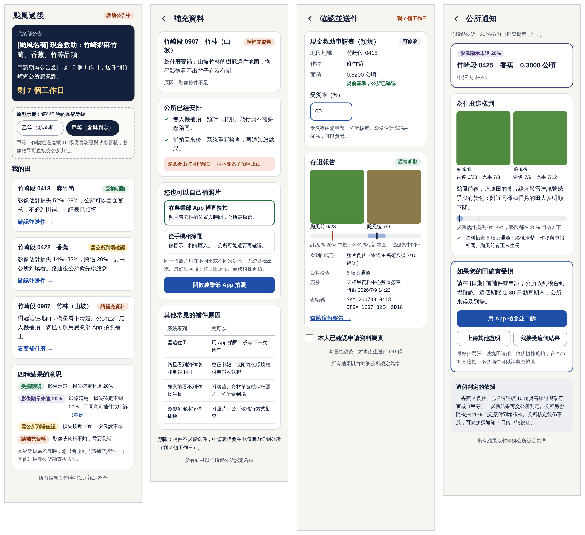

**圖 12　農民端原型畫面（甲等情境）。** 由左至右：颱風過後每塊田的結果，同一農民的三塊田分屬 A 達標、B 邊緣、C 缺失；C 缺失的補充資料頁，說明原因、公所已排無人機，並提醒不要上山拍照；確認預填申請並附存證報告與查驗碼，勾選確認後才產生送件 QR 碼；A 未達標通知，附災前災後影像日期、損失區間與判定依據，申請人可在勘查期內補件或申訴。資料為示意。

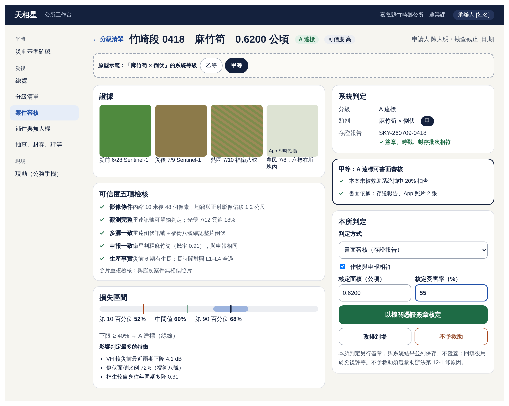

**圖 13　公所端案件審核畫面。** 左側為證據（災前災後雷達、熱區福衛八號、App 照片）、可信度五項檢核與損失區間，並列出影響判定最多的特徵；右側為系統判定與本所判定，本所判定以機關憑證另行簽章，與系統結果並列。上方切換鈕可看同一案件在乙等（依現行規定勘查）與甲等（A 達標書面審核）的差別。資料為示意。

母檔另保留 v7 以前的介面流程、隊友版流程圖與花蓮光復原型畫面（圖 14–圖 21），以及登錄與工作台的畫面規格（表 22–表 24）。這些畫面早於現行的四類分級與三個系統等級，其中「三條免勘路徑逐一判斷」的審核方式，現已改為依系統等級決定的處理方式；登錄、文件與期限的設計則沿用不變。

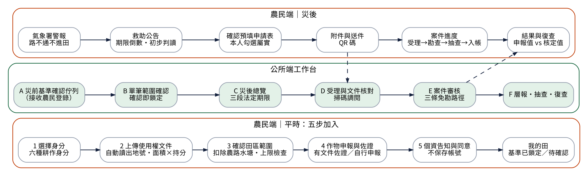

**圖 14　兩端介面流程。** 虛線為兩端之間的資料連動（農民 QR 碼送件→公所受理；公所核定→農民結果頁）。

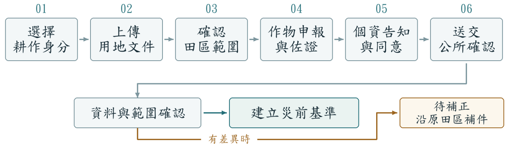{width=86%}

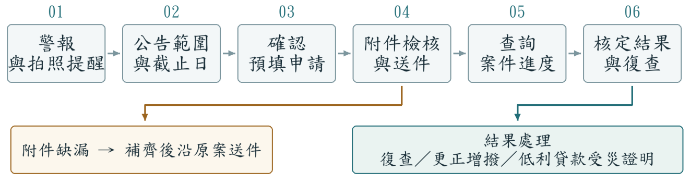{width=86%}

**圖 15　農民端操作流程（隊友版）。** 上：平時登錄，送交公所確認後建立災前基準，資料有差異時沿原田區補件；下：災後申請，附件缺漏時補齊後沿原案送件，核定後可辦理復查、更正增撥或申請低利貸款受災證明。

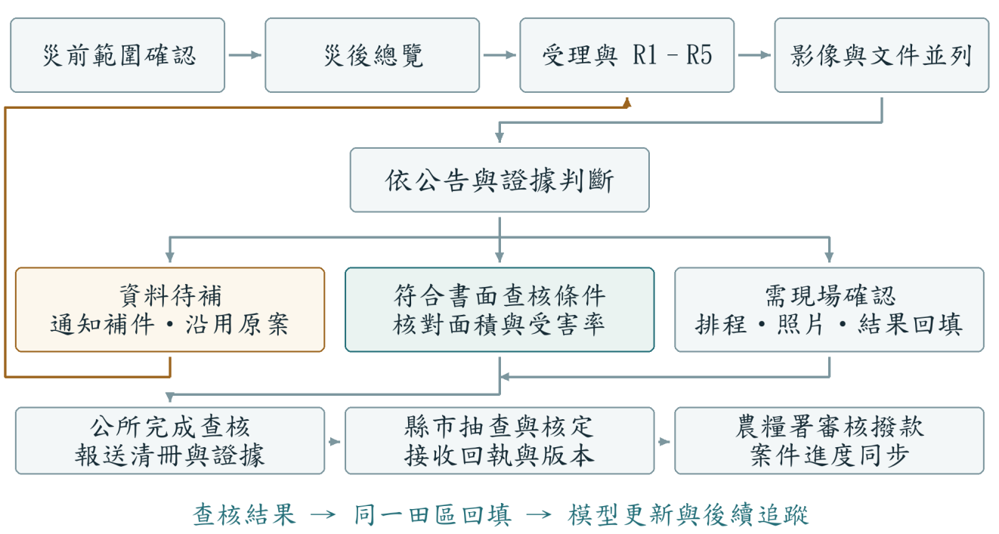{width=74%}

**圖 16　公所端案件處理流程（隊友版）。** 依公告與證據將案件分為資料待補、符合書面查核條件、需現場確認三類；查核結果回填同一田區，供模型更新與後續追蹤。

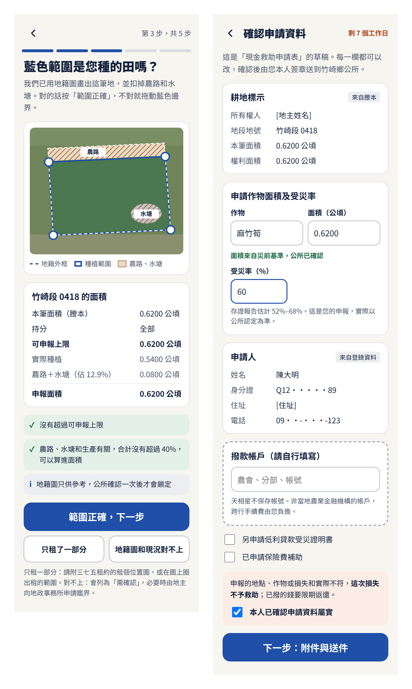

**圖 17　農民端原型畫面。** 左：登錄第 3 步「確認田區範圍」，以地籍外框扣除農路水塘，並檢查可申報上限；右：災後「確認預填申請資料」，耕地標示來自謄本、面積來自公所確認的災前基準，受災率由農民申報並附存證報告估計區間。資料為示意。

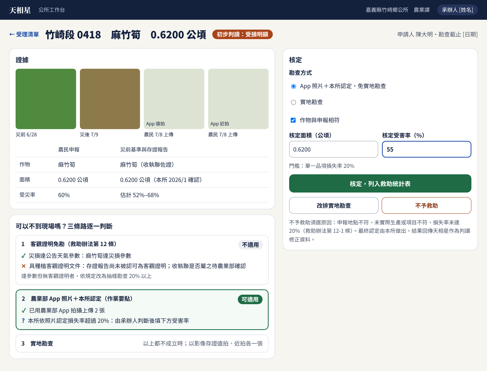

**圖 18　公所端「案件審核與免勘判斷」畫面。** 左側並列災前災後影像、App 照片與申報對照，並逐一判斷三條免勘路徑；右側由承辦人員核定面積與受害率。資料為示意。

團隊另以花蓮光復案例製作三個操作畫面原型（圖 19–圖 21）：勘災初篩畫面以災前災後影像滑動比對，標出疑似受災範圍與初估救助面積；土地資料建檔畫面在地圖選取區塊後，列出地籍、權利與使用紀錄的來源機關；作物登記查驗畫面將申報作物、衛星推定作物與現勘建議對照至同一區塊，並依「一致、不一致、未登記」排出現勘優先清單，銜接 R1–R5 檢核與 A／B／C 工作台〔132〕。

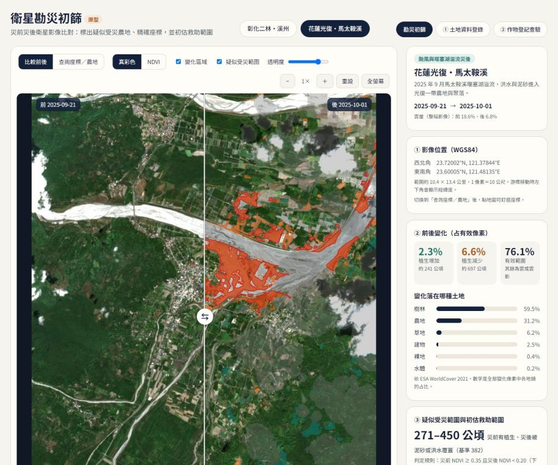

**圖 19　勘災初篩操作畫面（花蓮光復）。** 災前後影像滑動比對、座標查詢、疑似受災範圍（271–450 公頃）與有效像素比例集中於同一畫面。地號與人員為示範資料〔132〕。

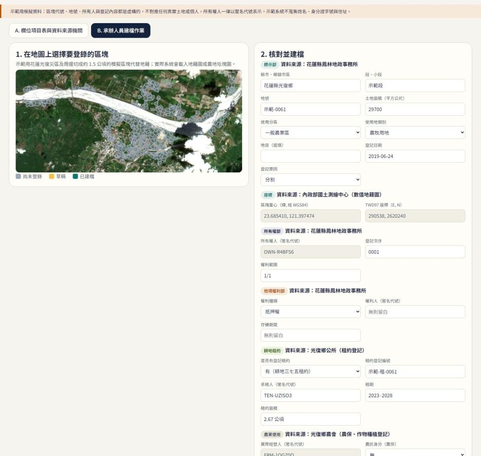

**圖 20　土地資料建檔操作畫面。** 地圖選取區塊後，右側依來源機關列出地籍（內政部國土測繪中心）、所有權（花蓮縣鳳林地政事務所）、租約登記（光復鄉公所）與作物登記（光復鄉農會）。地號與人員為示範資料〔132〕。

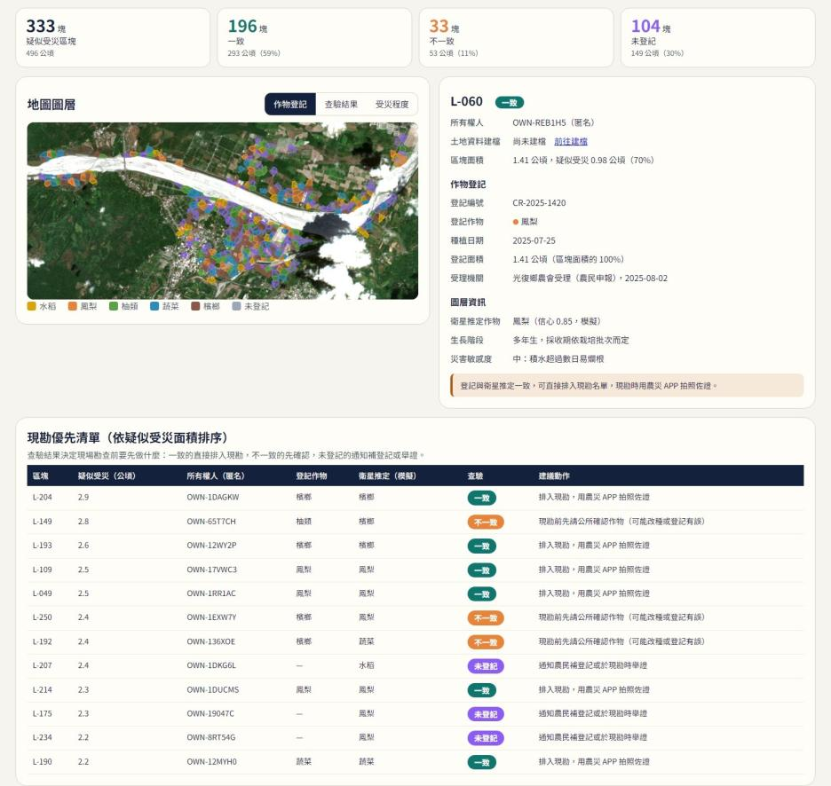

**圖 21　作物登記查驗操作畫面。** 申報作物、衛星推定作物與現勘建議對照至同一區塊，並依疑似受災面積排出現勘優先清單。畫面資料為模擬資料〔132〕。

農民端平時的登錄流程分為五步（表 22）。其設計重點在於「證明實際耕作」而非「證明所有權」：系統依六種身分列出應備文件，並說明第二類土地登記謄本任何人皆可申請、無須地主同意；地籍圖由本作品向國土測繪中心統一取得。上傳文件後，系統自動讀出地段地號、本筆面積 × 持分與所有權人並交叉比對，以「本筆面積 × 持分」作為可申報上限，並於航照底圖上扣除農路水塘後計算種植範圍。個資告知明列用途、提供對象（限受災地公所及縣市政府）與當事人權利，且系統不保存銀行或農會帳號。

**表 22　農民端平時畫面**

| 畫面 | 內容 | 設計重點 |
|---|---|---|
| 1 選擇身分 | 地主、三七五租約、一般承租、借用親友的地、承租公有地、養殖魚塭六種身分，依身分列出應備文件 | 不必是地主，只要能證明實際耕作；地籍圖由天相星向國土測繪中心取得 |
| 2 上傳使用權文件 | 租約與第二類土地登記謄本拍照上傳，系統自動讀出並比對地段地號、面積 × 持分、所有權人 | 第二類謄本任何人皆可申請；文件與申請救助時相同，無須重複準備 |
| 3 確認田區範圍 | 航照底圖上顯示地籍外框與扣除農路水塘後的種植範圍，計算可申報上限 | 申報不得超過「本筆面積 × 持分」；只租一部分或地籍對不上時列為「需確認」 |
| 4 作物申報與佐證 | 選作物、種植起始年；可附綠色環境給付收執聯、上次救助申請表、產銷履歷、App 照片 | 標示「有文件佐證」或「自行申報」；自填資料經公所確認後才算數，切結書不能當作證明 |
| 5 身分與個資同意 | 姓名、身分證、手機；個資蒐集告知與同意 | 不保存銀行或農會帳號 |
| 6 我的田 | 每塊田狀態：基準已鎖定、待公所確認、範圍需確認 | 提醒每年 1 月綠色環境給付申報時公所會一併確認範圍 |

農民端災後流程（表 23）自警報開始，依序為救助公告與期限、確認預填申請資料、附件與送件、案件進度，以及結果與復查。各畫面均呈現法定期限倒數；預填申請表的耕地標示來自謄本、作物面積來自災前基準，受災率欄位則僅列存證報告估計區間作為參考，由農民自行申報。結果畫面同時顯示農民申報值與公所認定值，使差異透明化，並協助農民於 7 日內整理復查附件。

**表 23　農民端災後畫面**

| 畫面 | 內容 | 設計重點 |
|---|---|---|
| 1 氣象署警報 | 哪幾塊田在風雨範圍內；提醒安全時用農業部照相 App 拍照並說明拍攝要點 | 路沒通、坡地不穩時不要進田，颱風前的紀錄已經保存 |
| 2 救助公告與期限 | 公告地區與品項、申請截止倒數、送件地點、損失門檻；每塊田的初步判讀 | 初步判讀只排順序，能否領、領多少以公所認定為準 |
| 3 確認預填申請資料 | 現金救助申請表草稿：耕地標示、作物面積、受災率參考區間、申請人資料 | 每欄可改；帳號自行填寫；明示申報不實不予救助並須返還 |
| 4 附件與送件 | 應附文件清單與狀態；選擇本人、農會協助或委託送件；QR 碼 | 公所查得到地政資料時土地證明可免附 |
| 5 案件進度 | 受理 → 公所勘查（30 日）→ 縣府抽查（7 日）→ 農業部審核（7 日）→ 入帳 | C 缺失田提示補 App 照片 |
| 6 結果與復查 | 核定面積、受害率、救助金額；復查倒數與附件整理；更正增撥與低利貸款說明 | 同時顯示申報值與核定值 |
| 簡訊版 | 無智慧型手機者以簡訊接收警報、公告、期限與進度 | 高齡農民可由農會或公所協助登錄 |

公所端工作台（表 24）分為平時與災後兩部分。平時的「災前基準確認佇列」將農民登錄案件分為待確認、範圍需確認、系統已擋下與已鎖定四類，申報超過權利面積者由系統直接退回；單筆確認畫面套疊地籍外框、農民申報範圍、國土利用調查與鄰地，提供三種確認方式，確認後即鎖定為災前基準，災後不再量面積。災後畫面依法定期限排列：總覽頁呈現三段期限倒數與各類案件數；受理頁以 QR 碼調閱預填資料並列出應附文件狀態，並明確標示存證報告目前為「影像存證參考，尚非種植客觀證明文件」；審核頁將災前災後影像、App 照片、農民申報與存證報告並列，逐一判斷三條免勘路徑；層報頁則試算縣府抽查戶數級距，並將分級清冊與異常排序作為縣府抽查參考，而不取代救助系統的隨機抽選。

**表 24　公所端工作台畫面**

| 畫面 | 內容 | 設計重點 |
|---|---|---|
| A 災前基準確認佇列 | 待確認、範圍需確認、系統已擋下、已鎖定四類；逐筆列出身分、使用權文件、申報／上限、農路水塘佔比、地籍與航照是否相符 | 申報超過權利面積者系統直接退回 |
| B 單筆範圍確認 | 地籍外框、農民申報範圍、國土利用調查與鄰地套疊；系統檢查結果；三種確認方式 | 確認一次即鎖定為災前基準 |
| C 災後總覽與法定期限 | 申請、勘查、報送三段期限倒數；登錄田區、已送件、初步受損未送件、App 照片已上傳；資料交付狀態 | 警報期間天氣參數是否可能達標一併提示，以公告為準 |
| D 受理與文件核對 | 掃描 QR 碼或以地號、身分證查詢；逐項列出應附文件狀態與依據 | 存證報告標示「影像存證參考，尚非種植客觀證明文件」 |
| E 案件審核與免勘判斷 | 影像、App 照片、農民申報與存證報告並列；三條免勘路徑逐一判斷；填核定面積與受害率 | 不予救助須選法定原因；結果回傳天相星修正判讀 |
| F 層報、抽查、復查 | 勘查進度、救助統計表、縣府抽查戶數級距試算、復查與更正增撥、低利貸款受災證明書 | 異常排序僅作縣府抽查參考，不取代隨機抽選 |
| 魚塭分級與審核 | 布袋鎮魚塭情境：在養證據、溢堤、停電天數、水色排序 | 只有間接訊號者列 C 並排序 |

**(7) 情境示例**

陳大明承租的竹崎段 0418 平地麻竹筍園已於 1 月鎖定災前基準。颱風後雷達訊號驟變，熱區高解析影像確認整片倒伏，五項檢核全過，存證報告估計損失 52%–68%，下限超過 40%，判為 A 達標，申請表已預填；他持 QR 碼送件。公所掃描查驗碼，畫面顯示簽章有效、報告與封存批次相符；「麻竹筍 × 倒伏」若已達甲等，此案書面審核即可撥款，承辦的判定另以機關憑證簽章留存。他的香蕉田區間為 14%–33%，跨過 20%，列 B 邊緣，公所路通後到場核定 25%；山上另一塊竹林因樹冠遮蔽、影像條件未過，列 C 缺失，排入無人機補拍。鄰田的林先生也申請了，但災前災後影像幾乎無變化，區間 0%–6%，判 A 未達標；他在勘查期第 12 天收到通知，上面寫著比對的影像日期與理由，他補上一張 App 照片申訴，公所據此到場。同一場災害的不同田區依證據強弱分流，現勘人力集中在需要判斷的案件。全國規模的人力與成本試算見第四章。

### 2. 衛星必要性分析

**災前紀錄無法事後補拍，衛星可持續保存全轄區的災前狀態，雷達可在颱風後穿雲取像。**

**(1) 採用的衛星技術與規格**

本作品整合多源衛星與地面技術，各自承擔不同的觀測任務（表 25）。Sentinel-1 雷達不受雲層影響，為颱風後第一時間的比對來源，負責倒伏、淹水、埋沒、溢堤與魚塭坵塊判釋；Sentinel-2 光學影像負責植生指標、生長時序與作物判釋；福衛八號以 1 米解析度處理小田區與魚塭水車等在養證據；VIIRS 夜間燈光則用於區域級停電判斷。GNSS 定位與衛星通訊用於補足遙測在陡坡、樹冠下與斷網時的缺口。圖 22 呈現各衛星在空間解析度與再訪頻率上的分工。

**表 25　採用的衛星技術與規格**

| 關鍵項目 | 衛星或技術 | 規格與數據 | 在本作品中的用途 |
|---|---|---|---|
| 衛星遙測（雷達） | Sentinel-1 SAR | C 波段 VV＋VH、像素間距 10 米（空間解析度約 20 × 22 米〔129〕）；1C、1D 雙星恢復 6 天再訪、免費〔70〕 | 颱風後雲層未散時仍可取像；倒伏、淹水、埋沒、溢堤、魚塭坵塊 |
| 衛星遙測（雷達，自主） | 福衛九號 | 規劃 2028、2030 年發射〔26〕 | 2028 年後切換為臺灣自主雷達影像 |
| 衛星遙測（光學） | Sentinel-2 | 10–20 米、13 波段；約 5 天，中緯度重疊區 2–3 天〔71〕 | 植生指標、生長時序、作物判釋、水體與水色 |
| 衛星遙測（光學，自主） | 福衛八號 | 1 米（處理後 0.7 米），具紅邊波段；對臺最高一日三次；8 顆星系 2031 年前完成〔24〕〔74〕〔75〕 | 小田區判讀、魚塭水車與餵飼台等在養證據 |
| 衛星遙測（商業高解析） | ICEYE 聚束雷達、Pléiades Neo | 雷達聚束 25 公分–1 公尺；光學 0.3 米〔171〕〔172〕 | 熱區確認倒伏、堤岸與埋沒 |
| 衛星遙測（夜間燈光） | VIIRS Black Marble | 約 500 米、每日〔66〕 | 魚塭區停電範圍與天數 |
| AI 影像辨識 | 時序 Transformer（Presto 微調）、三法投票（含 Prithvi）、LightGBM 分位數迴歸 | 以公所現勘結果每次災後重新訓練 | 作物判釋、災損偵測、損失區間 |
| GNSS 高精度定位 | 坡面定位樁、農民回報座標 | e-GNSS 平面精度優於 5 公分〔87〕；中央地調所 2012 年起以 GNSS 監測坡面〔37〕 | 林木遮蔽、雷達陰影坡地的位移佐證；B、C 級現場位置證據 |
| 衛星通訊與 IoT | 定位樁回傳、手機直連衛星 | 數發部建置約 700 個非同步軌道衛星備援站點〔88〕；國內 2024 年完成首次手機直連低軌衛星測試，尚未商轉〔89〕 | 深山與災後斷網時回傳資料 |

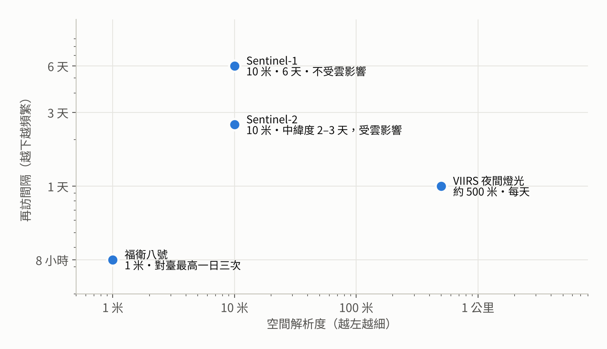

**圖 22　衛星的空間解析度與再訪頻率。** 橫軸為空間解析度、縱軸為再訪間隔，皆為對數刻度；越靠左下代表解析度越高、取像越頻繁。

**(2) 為何非衛星不可**

衛星在本應用中的必要性可由五個面向論證。第一，災前紀錄無法事後補拍：公所不可能於每次颱風前派員記錄轄區每一塊田，災後現勘與無人機亦僅能觀察災後狀態，唯有衛星能事前且持續地保存全轄區紀錄。第二，衛星一次過境即涵蓋整個鄉鎮，所有案件以同一標準比對，可降低不同承辦人員之間的判定落差。第三，臺灣河短坡陡、淹水歷時短，最適合的觀測工具為可穿透雲層的合成孔徑雷達〔39〕；颱風後最需要資料之際，無人機往往無法起飛。第四，衛星觀測不受道路中斷限制，可直接回應古坑竹林因無法到場存證而被判不合格的案例〔8〕。第五，就量體而言，凱米颱風作物受害面積達 21,712 公頃〔14〕；若以無人機飛完丹娜絲的 19,433 公頃，僅飛行費即約 48.6 萬至 68 萬元，尚不含交通與判讀人力〔98〕〔99〕。

**(3) 與替代方案比較**

表 26 比較公所人工勘查、無人機、氣象站參數與衛星四種方案。結果顯示，衛星是唯一同時具備災前紀錄、全轄區覆蓋、颱風後可用且公所無須到場四項條件的方案。據此，本作品將三者的角色界定為：衛星負責判斷「哪些證據已經夠、哪些必須看」，無人機負責「看清楚小田」，公所承辦人員負責「最後認定」。

**表 26　各勘查方案比較**

| 方案 | 災前紀錄 | 全轄區覆蓋 | 颱風後可用 | 公所須到場 | 單次覆蓋 |
|---|---|---|---|---|---|
| 公所人工勘查 | 無 | 否 | 受道路限制 | 是 | 一塊田 |
| 無人機 | 無 | 否 | 受風雨與空域限制 | 是 | 一次飛約 1 平方公里 |
| 氣象站參數 | 不適用 | 點狀 | 是 | 否 | 一測站 |
| **衛星（本作品）** | **有** | **是** | **是（雷達）** | **否** | **整個鄉鎮** |

### 3. 概念創新性分析

**前後期比對技術本身已實用；本作品的創新在於把它轉成可嵌入救助制度、可查驗的證據與流程。**

前後期影像比對技術本身並非新創，國土管理署、水保署與歐盟皆已實用；本作品的創新在於將此技術轉化為可嵌入我國救助制度的證據與流程。創新點摘要如表 27，以下逐點說明。

**表 27　概念創新點**

| 創新點 | 說明 |
|---|---|
| 嵌入流程而非監測圖 | 公所可直接使用的分級清單與審核畫面、農民可直接送件的預填申請表，並銜接農災 App |
| 由監測轉為存證 | 存證報告對準「種植客觀證明」免勘規定；災前基準借用既有綠色環境給付申報時程由公所確認一次 |
| 先看證據、再看損失 | 證據有缺失一律列 C，證據完整才看損失；「要補資料」與「數字太接近」分開處理，公所知道每一筆該做什麼 |
| 輸出損失區間 | 只需判斷區間是否跨越 20%；達標與未達標都能直接判定，逐筆列出影響判定的特徵 |
| 系統分等、逐類別升降 | 丙、乙、甲三等，先評整體再評「作物 × 災害類型」；任一場下界不足即降等，降等只會讓更多案件到場 |
| 長時間對照 | 以衛星多年紀錄檢查物候、作物年齡、損失時點與前次災損後是否恢復，抓出只看災前一個月看不出的不實申請 |
| 可查驗、可重算 | 數位簽章、時戳、查驗碼與雜湊鏈；任何人可離線查驗，審計可重算〔90〕〔91〕〔142〕 |
| 魚塭在養證明 | 不估魚隻數，而證明災前在養與受災方式〔86〕 |

(一) **嵌入流程，而非給專家看的地圖。** 既有系統的產出多為給分析人員的變異圖；本作品的產出則是公所可直接使用的分級清單與審核畫面，以及農民可直接送件的預填申請表，並銜接公所現用的農災 App。

(二) **由「監測」轉為「存證」。** 每筆案件的存證報告對準「種植客觀證明」免勘規定，並附可溯源資料，使衛星影像成為公所處理案件的依據。

(三) **災前基準由公所確認一次。** 本作品借用既有的綠色環境給付申報時程，使公所於平時確認範圍與使用權，災後即無須再量面積，亦不新增作業時程。

(四) **以實際耕作坵塊為判讀單位。** 地號僅作為索引；一地號多作物、一塊田跨多地號、夾雜農路與地籍誤差等落差，一律交由公所判斷，系統不作強制判定。

(五) **先看證據、再看損失。** 證據品質以五項檢核評定，與損失大小分開：任一項未過即列 C 缺失並附原因碼，五項全過才看損失區間。公所拿到的每一筆都知道該補資料、該到場，還是可以直接判定。

(六) **輸出損失區間而非單一數值。** 分級僅需知道區間是否跨越 20%，達標與未達標都能直接判定；樹模型並可逐筆列出影響判定最大的三項特徵，使公所理解判定理由。

(七) **系統分等、逐類別升降。** 系統分丙、乙、甲三等，先評整體、再逐「作物 × 災害類型」評等，類別不得高於整體；任一場災害後精確度下界不足即降一等。降等只會讓更多案件到場，不會產生錯誤的免勘或駁回。

(八) **魚塭在養證明。** 衛星雖無法觀測水下魚群，卻能證明災前在養與受災方式，補足現行「公所只需現場確認養殖事實」的環節〔86〕。

(九) **可查驗、可重算。** 每份報告依 STAC 與 W3C PROV 標準記錄影像、處理、模型版本與人工處理，並附數位簽章、時戳與查驗碼；任何人可查驗真偽，審計與申覆時可調出同一批影像與同一版模型重算〔90〕〔91〕〔142〕。

(十) **分級改變現勘與抽查對象。** 法定抽查比例不變；乙等時依分級排定現勘順序，甲等時 A 達標與 A 未達標各抽查 20%，抽查結果同時作為逐類別評等的樣本。

(十一) **回饋閉環。** 公所每次現勘結果皆回填系統，判讀規則隨各地作物與地形逐步在地化。

(十二) **不需修法即可起步。** 丙、乙等以現行規定為接點，存證報告作為參考資料；甲等前以逐類別精確度報告申請列入種植客觀證明或作業要點，並研議「衛星災損參數」。

(十三) **長時間對照。** 以衛星平時累積、申請人無法改寫的多年紀錄，檢查作物物候、作物年齡、損失時點與前次災損後是否恢復，找出只看災前一個月影像時看不出的不實申請。

上述第 (二) 與 (十二) 點涉及存證效力，本作品依系統等級推進（表 28，與技術可行性的系統等級同一套）：丙等時存證報告不交公所使用，公所全部現勘並回填；乙等時存證報告與 App 照片並列作為參考資料，支援現行「App 照片＋公所認定」免勘路徑，並依分級排定現勘順序；甲等前，以連續 10 場達標的逐類別精確度報告申請將經公所確認的災前基準與存證報告列為種植客觀證明文件或納入作業要點，並取得 A 未達標通知的作業依據，再研議以衛星判讀的損失區間作為免勘條件，比照現行天氣參數。

**表 28　存證效力的推進路徑**

| 等級 | 時程 | 存證報告的地位 |
|---|---|---|
| 準備期 | 試辦前 3–6 個月 | 以過去 2–3 場災害核定清冊回溯驗證，不對外出件 |
| 丙　收集期 | 試辦第 1 年起 | 照常分級與簽發，不交公所使用；累積逐類別精確度 |
| 乙　考察期 | 各項指標達標後，約第 2 年起 | 作為參考資料，與 App 照片並列；依分級排定現勘順序 |
| 甲　參與判定 | 連續 10 場達標並通過政府審核，約第 4–5 年起逐類別進入 | 列入種植客觀證明或作業要點；A 達標書面審核、A 未達標通知；研議「衛星災損參數」 |

### 4. 技術可行性分析

**正式系統的每項判讀都有明確的模型規格與使用門檻，系統依丙、乙、甲三等逐類別取得判定地位；方向已以真實影像、模擬工況與作業流程原型三項示範驗證。**

本節從系統架構、資料來源、判讀單位、判讀模型、魚塭判讀、標準作業流程、可信度檢核、防偽、長時間對照、方向驗證、天地整合、可溯源設計、資料傳遞權責、門檻與系統等級等面向，說明本作品的可行性，並提出既有基礎、元件成熟度、發展路徑與風險對策。以下所列為正式系統的規格與目標；團隊已完成的示範只用來驗證方向，其規模、資料與精度都不是正式系統的規格（本節 (10)）。

**(1) 系統架構與運算規格**

**系統分五層，坵塊化置於判讀之前；全國約 200 萬筆坵塊跑一輪作物判釋，單張 GPU 約 27 分鐘，雷達到站後 8 小時內完成分級。**

系統分為資料、處理、判讀、案件與應用五層，以現勘結果回填形成閉環（表 29、圖 23）。坵塊化置於判讀之前，模型直接處理「一塊坵塊的一條時間序列」，運算量與坵塊數成正比、與影像面積無關；地號、坵塊與實際耕作對不上者列 C 缺失，交公所判斷。

**表 29　系統架構**

| 層 | 功能 | 輸出 |
|---|---|---|
| ① 資料 | 依過境排程收取衛星影像；登錄地籍、申報、App 照片與無人機資料，記錄來源與雜湊（S1） | 輸入清單與原始資料 |
| ② 處理 | 雷達校正去噪、光學去雲、高解析正射；坵塊化，存成每坵塊時序統計值 | 坵塊時序特徵表 |
| ③ 判讀 | 作物、淹水、倒伏、埋沒、植生、魚塭訊號；損失區間（S3） | 各任務機率、變化量與第 10／50／90 百分位 |
| ④ 案件 | 可信度五項檢核、R1–R5、長時間對照 L1–L4；四類分級；存證報告簽發（S4–S5） | A 達標、A 未達標、B 邊緣、C 缺失、原因碼、存證報告 |
| ⑤ 應用 | 公所工作台、農民 App 與簡訊、農災 App 調查專案匯出、查驗介面 | 分級清單、預填申請表、通知、抽查與評等畫面 |
| 回饋 | 現勘結果回填（S7），逐類別評等並重新訓練（S8） | 下一場的系統等級與模型版本 |

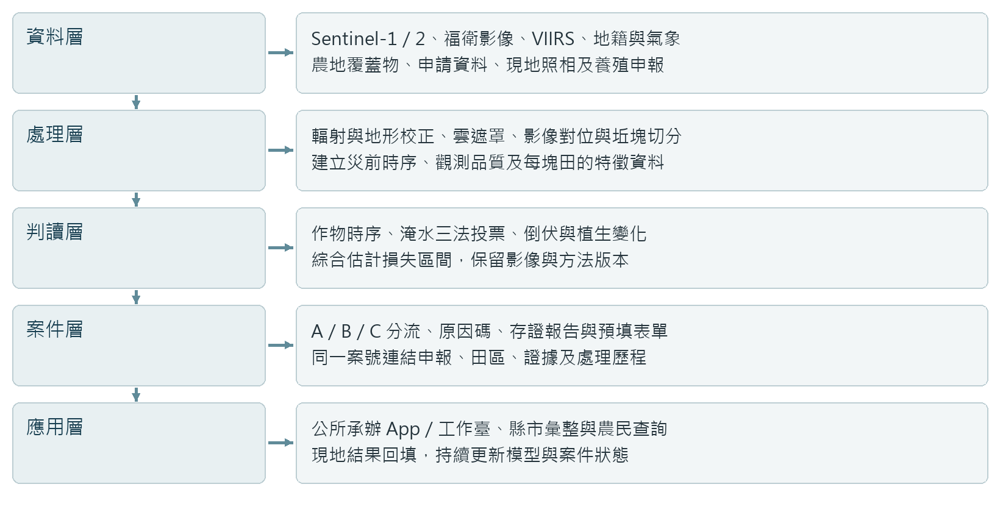{width=88%}

**圖 23　天相星系統架構。** 應用層的現地結果回填後，用於更新模型與案件狀態。

正式系統的運算以雲端執行：常駐 2 台 L4 GPU 處理日常判讀，每年約 500 小時 A100 供災後重新訓練，儲存約 15 TB，年費約 70 萬元〔95〕〔96〕。依 BreizhCrops 的處理速度推算，全國約 200 萬筆坵塊跑一輪作物判釋，單張 GPU 約 27 分鐘〔54〕；簽章與雜湊在一般電腦單核每秒約可處理 2 萬份報告。算力因此不是瓶頸，出件時間取決於雷達到站時間，這也是全國規模下算力成本極低的主因（見四、1）。

**(2) 資料來源與前處理**

本作品使用的資料如表 30 所示，其中衛星影像多為免費開放資料，地籍、作物與救助資料則須經機關介接取得（取得程序詳見本節 (13)）。

**表 30　資料來源**

| 資料 | 規格與頻率 | 用途 | 取得條件 |
|---|---|---|---|
| Sentinel-1 | C 波段 VV＋VH、像素間距 10 米（解析度約 20 × 22 米）、6 天 | 倒伏、淹水、埋沒、溢堤、魚塭坵塊 | 免費，散布時標示來源〔72〕 |
| Sentinel-2 | 10–20 米、約 5 天 | 植生、作物、水體與水色 | 同上 |
| 福衛八號 | 1 米（處理後 0.7 米），具紅邊 | 小田、魚塭在養證據 | 國家太空中心與經銷商；成本以國際商用 1 米影像報價估算上下限 |
| 福衛九號 | 雷達，2028、2030 年發射 | 自主穿雲來源 | 發射後介接 |
| VIIRS 夜間燈光 | VNP46A2，約 500 米、每日 | 停電範圍與天數 | 免費 |
| 地籍圖 | 國土測繪中心地籍圖檔 | 坵塊切分、範圍確認 | 由試辦機關備文申請 |
| 農地覆蓋物資料庫、天氣參數網格 | 坵塊級；1 公里網格 | 作物標註、原因確認 | 與農業部介接〔101〕 |
| 養殖登記與放養申報 | 每口池 | 在養證明、損失基準 | 由公所提供〔82〕 |
| 農民登錄資料 | 使用權文件、範圍、作物、佐證 | 災前基準、預填申請 | 農民同意後蒐集，災後僅提供受災地公所與縣市政府 |

各資料的前處理與坵塊特徵如表 31。

**表 31　前處理與坵塊特徵規格**

| 資料 | 前處理 | 坵塊特徵 |
|---|---|---|
| Sentinel-1 | 精密軌道、熱雜訊去除、輻射校正為 σ⁰；邊緣雜訊修正、Lee 斑點濾波、輻射地形正規化，以消除山區坡向造成的亮暗差異〔53〕；另算災前災後同調性；以地形模型標出雷達陰影與疊置區 | VV、VH、VH／VV（dB）、同調性 |
| Sentinel-2 | L2A 地表反射率；Cloud Score+ 逐像素去雲，門檻 0.60（官方建議 0.50–0.65）〔73〕；雲遮日期內插並加旗標，補值日期不得作為災後證據 | NDVI、NDRE、NDWI、MNDWI、各波段反射率 |
| 福衛八號 | 正射校正、融合至 0.7 米，與地籍套疊檢查對位 | 水車與餵飼台、倒伏與埋沒範圍 |
| VIIRS 夜間燈光 | VNP46A2 每日產品，以災前 30 天中位數為基準〔66〕 | 停電與否、連續天數 |
| 坵塊化 | 坵塊向內縮 10 米取統計；災前即為水面者不做淹水判讀，非農地以農地範圍排除；內縮後少於 5 個 Sentinel 像素者改用熱區高解析影像，沒有則「影像條件」檢核不通過 | 每坵塊每日期一列，含雲與補值旗標 |

**(3) 判讀單位：地號、坵塊與實際耕作**

救助的發放對象為「實際從事生產之自然人」〔77〕，然而衛星觀測的是一塊田，地籍記錄的則是一筆地號，三者未必一致。表 32 整理五類落差及本作品的處理方式。整體原則為：衛星判讀以實際耕作的坵塊為準，地號僅作為索引；凡地號、坵塊與申報三者無法對應者，一律交由公所判斷，系統不作強制判定。

**表 32　地號、坵塊與實際耕作的落差及處理**

| 落差 | 對判讀的影響 | 處理方式 |
|---|---|---|
| 一筆地號種多種作物 | 整筆平均會稀釋單一作物的損失 | 以坵塊為判讀單位，同一地號內不同作物分開判讀 |
| 一塊田跨多筆地號 | 單筆面積太小，像素不足 | 以坵塊判讀，再依面積比例分攤回各地號 |
| 地號內夾雜農路、建物、未種植區 | 申報面積大於實際種植面積 | 農民登錄時即扣除並顯示佔比；差距過大者列 C 缺失（面積不符） |
| 地籍圖本身有誤差 | 部分仍沿用日治時期圖解地籍圖；屏東重測後約三分之一面積增加、三分之一減少〔80〕〔81〕 | 圖解地籍區加大內縮；對位誤差過大者列 C 缺失（對位不確定），必要時由地主申請鑑界 |
| 申請人不是地主 | 承租耕作普遍，2014 年大佃農經營 15,070 公頃、1,670 人〔78〕 | 天相星只證明「這塊地災前有種、災後受損」；使用權由農民上傳文件、公所依受理文件認定〔79〕 |

為使災前基線與申請檢核共用同一筆紀錄，團隊將坵塊資料整理為六組、26 個核心欄位（表 33）〔132〕。

**表 33　災前基線與申請檢核的核心資料欄位**

| 資料組 | 欄位 | 來源與用途 |
|---|---|---|
| 地籍（1–6） | 縣市、鄉鎮、段小段、地號、登記面積、地籍版本 | 地政機關與國土測繪中心；定位受理公所、追溯災時範圍 |
| 耕作（7–11） | 坵塊代碼、幾何範圍、WGS84 中心、TWD97 中心、有效種植面積 | 核准圖資與公所確認；影像對位及排除非耕作範圍 |
| 使用權（12–15） | 經營人代碼、使用權類型、文件編號、有效期間 | 申請人提供、公所查核；對應 R4 |
| 作物（16–19） | 登記作物、種植日期、推定作物、推定生育期 | 政策申報、農會受理紀錄、農民佐證與衛星時序；對應 R2 |
| 觀測（20–23） | 災前影像編號、取像時間、有效像素率、模型版本 | 衛星資料中心；災前基準、品質與重算依據 |
| 案件（24–26） | 災害事件碼、申請案號、檢核及處理紀錄 | 公所救助系統；R1–R5、補件、抽查、復查共用索引 |

**(4) 判讀模型規格與目標**

**以下為正式系統的模型規格與目標：八項判讀任務都採已發表、可取得程式或權重的方法，以公所回填資料微調，每項都有支撐 A 級判定的使用門檻。**

正式系統各判讀任務的模型、輸入、輸出、訓練資料與目標如表 34。選擇模型的原則有三：小樣本也能用（以預訓練模型微調、以物理規則補位）；能說明理由（樹模型逐筆列出影響判定的特徵）；能輸出不確定度（損失以區間表示）。目標欄的指標依名詞解釋統一：作物用準確率，淹水、倒伏、埋沒用精確度（文獻中的使用者準確度），損失用均方根誤差，全部以 95% 單側信賴下界判斷。目標未達時，該任務只作排序或 C 級原因碼，用它判出的案件歸 B 或 C。

**表 34　判讀模型規格與目標**

| 任務 | 模型與架構 | 輸入 | 輸出 | 訓練與校準資料 | 目標（依據） |
|---|---|---|---|---|---|
| 作物判釋 | 時序 Transformer〔54〕；以 Presto 預訓練模型（編碼器 2 層、8 頭、嵌入 128 維，約 40 萬參數，以 2,153 萬筆像素時序預訓練）微調〔165〕 | 災前 12 個月 Sentinel-1／2 時序，加降雨、氣溫與地形 | 各作物機率 | 農地覆蓋物資料庫標註、公所回填作物 | 各作物與現勘相符的坵塊準確率下界 ≥ 80%（約 60 萬坵塊基準中 Transformer 準確率 0.80、kappa 0.75，8 種模型最高〔54〕） |
| 水稻 | 同上，另以插秧前灌水的雷達下降訊號作規則檢核 | 全年 Sentinel-1 VV、VH 時序 | 水稻機率、插秧日期 | 同上；以農糧署鄉鎮稻作面積校正 | 坵塊準確率下界 ≥ 80%；鄉鎮面積偏差 ±20% 以內（Sentinel-1 加地籍判雲林水稻，各鄉鎮準確率 0.8 以上〔55〕） |
| 淹水 | 三法投票，至少兩法同意：Otsu 門檻、時序異常（相對災前 6 期）、微調 Prithvi 地理基礎模型；插秧期作物曆遮罩 | 災前災後 VV、VH | 淹水像素比例 | Sen1Floods11 公開標註〔56〕、公所回填 | 區域 CSI ≥ 70%；單一來源支撐 A 級須坵塊精確度下界 ≥ 95%，否則須雷達與光學一致或有 App 照片（單一門檻洪水 IoU 約 0.29〔56〕，微調 Prithvi 水體 IoU 約 0.83〔58〕；歐盟 GFM 已以多法合併運作〔57〕） |
| 倒伏 | VH 災後與災前對數比值＋隱馬可夫隨機場三級分類〔59〕〔60〕；高解析影像語意分割 | 災前災後 VH、VH／VV；1 公尺以下影像 | 無、中度、嚴重；倒伏面積比例 | 現勘回填 | Sentinel：與現勘比對的精確度下界 ≥ 80% 才作佐證；1 公尺以下影像：精確度下界 ≥ 95% 可支撐 A 級（現有雷達研究只比較了不同資料組合之間的一致率 64%–88%〔163〕，與現勘的精確度於丙等中量測；高分二號判小麥倒伏 F1 85.3%〔179〕） |
| 埋沒、流失 | 災前災後同調性降到 0.5 以下且比災前少 0.3 以上 | 同調性 | 全面改變與否 | 現勘回填 | 坵塊精確度下界 ≥ 95%（菲律賓颱風雷伊判讀與聯合國衛星中心獨立判圖吻合 93%〔61〕，與現勘的精確度於丙等中量測） |
| 植生受損 | 相對自身往年同期與周邊同作物田（最多 500 塊）的標準分數 | NDVI、NDRE | 偏離程度、延遲性災損候選 | 不需標註 | 排序與佐證，不單獨支撐 A 級（斯洛維尼亞相似度標記〔159〕） |
| 損失區間 | LightGBM 分位數迴歸輸出第 10、50、90 百分位〔63〕，以保形分位數迴歸校準〔145〕；與半經驗損傷函數堆疊融合（圖 25） | 上列各項輸出、天氣參數、作物與生育期、面積、坡度與相對高程 | 損失率區間、達 20% 的機率 | 公所歷年核定損失率（試辦前回溯 2–3 場災害） | 每作物均方根誤差 ≤ 10 個百分點；區間覆蓋率 100 件時 72%–88%（Sentinel-2 對照保險現勘 8.2–12.3〔178〕） |
| 魚塭 | 年度 VH 中位數＋Otsu＋形狀過濾；福衛八號水車物件偵測；夜間燈光計停電 | Sentinel-1、福衛八號、VIIRS | 魚塭坵塊、在養、停電天數 | 養殖登記、放養申報 | 與養殖登記一致率下界 ≥ 80%；池水流失支撐 A 級須精確度下界 ≥ 95%（亞洲沿海魚塭準確率 91.9%〔64〕） |

作物判釋在取得標註之前，先以 Presto 預訓練模型加作物曆規則挑出的典型樣本建立基準版，並已以丹娜絲研究區的真實影像實作（本節 (10)）；結果顯示水稻以外的作物目前無法可靠區分，因此在微調完成前，申報一致檢核的作物種類以申報與既有紀錄為準，衛星只查物候是否相符。淹水方面，GFM 品質報告指出淹水的農田與稻田常被漏判〔162〕，丹娜絲實測更發現插秧灌水期的稻田會被判成積水，因此插秧期稻田的積水判讀不通過「多源一致」，列 C 缺失並附原因碼「疑似灌溉」。埋沒與流失的同調性訊號強，雲未散時即可判定，對應樺加沙「作物已無法辨認」的情境。系統並於災後持續追蹤 6 個月，植生偏離若於數週後才擴大，即標記為延遲性災損候選，對應丹娜絲後的彰化葡萄〔23〕與隔年公告的臺南文旦〔52〕。

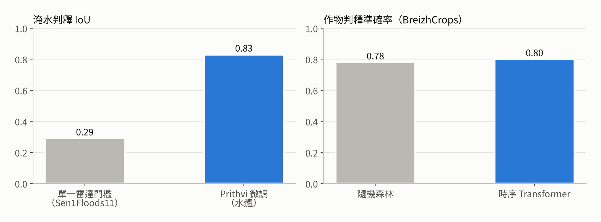

**圖 24　判讀方法的文獻表現。** 左：單一雷達門檻判淹水的洪水 IoU 約 0.29，微調後基礎模型的水體 IoU 約 0.83（兩者評估類別不完全相同，用以說明需多法並用）；右：時序 Transformer 準確率略高於隨機森林。

損失率模型的整體架構如圖 25：以災前基線（歷年同期 NDVI、EVI 異常）、災後變化（ΔNDVI、SAR 後向散射）、淹水範圍與歷時、地形（坡度、相對高程）及作物別與生育期為輸入；模型由具物理意義、小樣本也能使用的半經驗損傷函數，與以公所歷年勘查結果訓練的資料驅動模型（梯度提升樹、時序神經網路）組成，再以堆疊融合並保形預測校準，輸出損失率區間、達 20% 門檻的機率與分級〔132〕。

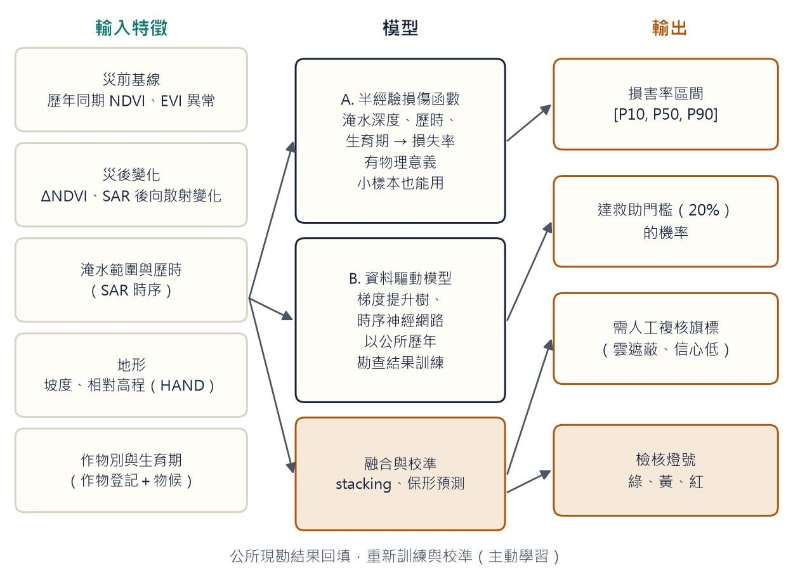{width=80%}

**圖 25　損失率模型的輸入、融合與輸出。** 半經驗損傷函數具物理意義、小樣本也能用；資料驅動模型以公所歷年勘查結果訓練；兩者堆疊後以保形預測校準，公所現勘回填後重新訓練〔132〕。

各模型的門檻與參數都有起始值，並依表 35 的方式校正；所有參數於災害開始時鎖定並記錄雜湊（S2），整場災害不變。

**表 35　主要參數的起始值與校正方式**

| 參數 | 起始值 | 校正方式 |
|---|---|---|
| 判 A 達標區間下限／判 A 未達標區間上限 | 40%／10% | 以 Learn then Test 依作物分別選定，使兩種 A 的誤判率各 ≤ 5%〔182〕 |
| B 邊緣確認範圍 | 10%–30% | 門檻 20% 上下各 10 個百分點，對應損失模型均方根誤差目標；丙等累積一年後校正 |
| 埋沒同調性門檻 | 降到 0.5 以下且比災前少 0.3 以上 | 回溯驗證 |
| 淹水雷達門檻 | Otsu 上限 −15 dB；比災前最近兩期暗 3 dB；低於自身 6 期平均 3 個標準差 | 回溯驗證 |
| 倒伏雷達門檻 | VH 與災前最近兩期相差 2.5 dB 以上 | 回溯驗證 |
| 水稻插秧下降門檻 | 2 dB | 農糧署鄉鎮稻作面積 |
| 植生明顯下降 | NDVI 較往年同期多降 0.2 以上、連片 0.2 公頃以上 | 回溯驗證 |
| 去雲門檻 | Cloud Score+ 0.60 | 官方建議範圍 0.50–0.65〔73〕 |
| 停電 | 夜間燈光低於災前 30 天中位數一半 | 對照台電停電紀錄 |
| 照片重複 | 64 位元 dHash，差異 ≤ 16 位元 | 以真實 App 照片設定 |
| 災前影像新鮮度 | ≤ 10 日 | — |

模型隨系統等級升級，路線有三條：以 Prithvi-EO-2.0（ViT-L 3 億、ViT-H 6 億參數，以 420 萬筆 HLS 時序預訓練，優於其他 6 個地理基礎模型）〔181〕或 Presto 以臺灣標註微調，不重做預訓練；以 1 公尺以下影像語意分割直接圈出倒伏、倒株與埋沒範圍，2 公尺影像判香蕉園已達 F1 0.86〔180〕；多源融合，任一來源結論相反即「多源一致」檢核不通過、列 C。

**(5) 魚塭判讀**

魚塭的損失發生於水下，衛星無法直接觀測魚群，因此本作品不估計魚隻數量，而改為證明三件事：災前在養、災害波及該池，以及受災方式。丹娜絲期間沿海停電使增氧機停擺，造成虱目魚與文蛤大量死亡〔83〕〔84〕；2021 年臺南虱目魚寒害時，主管機關已改以科學數據判定門檻，公所僅需現場確認養殖事實〔86〕，本作品所要取代的正是此一步驟。表 36 列出六種訊號的判斷方法與其證明範圍；各訊號亦明列「看不到」的限制，以避免過度推論。

**表 36　魚塭判讀訊號**

| 訊號 | 判斷方法 | 證明 | 看不到 |
|---|---|---|---|
| ① 魚塭坵塊 | 年度 VH 中位數＋Otsu＋形狀過濾，再套地籍；文獻於亞洲沿海辨識 340 萬口以上、準確率 91.9%〔64〕 | 這是一口魚塭與面積 | 棚架、室內池 |
| ② 在養狀態 | 福衛八號偵測水車浪花、餵飼台〔65〕；災前 90 天內有水且見水車為強證據 | 災前在養 | 養什麼、養多少 |
| ③ 溢堤、潰堤 | Sentinel-1 只能判整片魚塭區溢淹（區域級，列 C 排序）；單口池須以福衛八號或商業雷達看堤岸被淹 ≥ 80% | 災害打到這片或這口池 | 短時溢堤；堤岸僅數公尺寬，Sentinel-1 看不到〔129〕 |
| ④ 池水流失 | 水面少一半以上且無收成申報 | 堤岸破損、魚隨水流走 | 與正常放乾難區分 |
| ⑤ 停電 | 夜間燈光低於災前 30 天中位數的一半，計連續天數〔66〕〔67〕 | 該區增氧機可能停擺 | 單一魚塭是否有發電機 |
| ⑥ 水色異常（研究項目，不列入分級） | 偏離自身正常範圍 3 個標準差 | 可能大量死亡 | 原因；尚無直接文獻，改以停電自動切換電箱與溶氧紀錄佐證〔164〕 |

魚塭的局限要先說清楚：衛星看不到魚，也無法估計死亡數量，Sentinel-1 也看不到數公尺寬的堤岸。本作品因此不以衛星判定魚塭損失，只做三件事：以放養申報為主、衛星為佐證證明災前在養；以區域溢淹與停電天數排定現勘先後；證據明確時判 A 達標，即池水流失且有放養申報、同期無收成申報，或熱區高解析影像（福衛八號或商業雷達）確認整池潰堤、堤岸被淹 ≥ 80% 且有放養申報。Sentinel-1 只判區域溢淹，作為排序依據；僅有停電、區域溢淹或部分溢堤等間接訊號者列 C 缺失（原因碼「僅有間接訊號」），並依停電天數與溢淹面積排序；無放養申報者列 C 缺失。寒害由天氣參數判定，本作品只提供在養證明。

**(6) 標準作業流程：資料輸入、模型計算與輸出**

**每筆案件依三段八步處理，每一步都有檢核點並寫入作業日誌；未通過者停止計算或列 C。**

為使不同公所、不同災害、不同承辦人員得到一致且可查核的結果，本作品將處理程序訂為標準作業流程（圖 26、表 37）。流程分為資料輸入、模型計算、輸出與查驗三段，共八步；每一步完成後寫入一筆作業日誌，每筆記下前一筆的雜湊值，形成雜湊鏈，刪除或改動任何一筆，其後的鏈結即斷開。

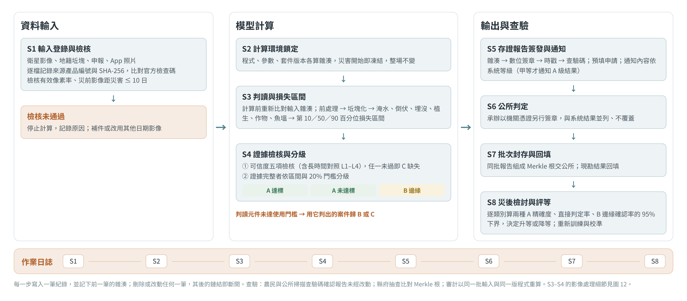

**圖 26　天相星標準作業流程。** 上方三段為處理步驟，下方為貫穿全程的作業日誌（雜湊鏈）。

**表 37　標準作業流程各步驟**

| 步驟 | 做什麼 | 檢核點（未通過的處理） | 留下的紀錄 |
|---|---|---|---|
| S1 輸入登錄與檢核 | 登錄衛星影像、地籍坵塊、申報資料、App 照片與無人機資料的來源、產品編號與 SHA-256 | 比對官方檢查碼、有效像素率、數值範圍、網格一致；災前影像距災害 ≤ 10 日（停止，補件或改用其他日期） | 輸入清單：來源、產品編號、取得時間、SHA-256 |
| S2 計算環境鎖定 | 災害開始時凍結程式、參數與套件版本 | 僅可使用通過前次評等的版本 | 程式、參數、環境雜湊 |
| S3 判讀與損失區間 | 前處理、坵塊化、四項災損判讀加作物與魚塭、第 10／50／90 百分位損失區間 | 計算前重新比對輸入雜湊（不符即中止） | 特徵值、各任務輸出、損失區間 |
| S4 證據檢核與分級 | 可信度五項檢核（含長時間對照 L1–L4）、R1–R5 申請交叉檢核；證據完整者依區間分 A 達標、A 未達標、B 邊緣 | 任一項未通過即 C 缺失並附原因碼；判讀元件未達使用門檻者歸 B 或 C | 可信度等級、未通過項目、分級、原因碼 |
| S5 存證報告簽發與通知 | 固定格式序列化、雜湊、數位簽章、時戳、查驗碼；預填申請；通知 | 簽發前比對輸入與環境雜湊；通知內容依系統等級：乙等起發 C 級補件提醒，甲等才通知 A 級結果 | 報告、簽章、時戳、查驗碼、通知紀錄 |
| S6 公所判定 | 承辦核定面積與受害率 | 以機關憑證簽章，判定指向報告雜湊，與系統結果並列 | 公所判定紀錄 |
| S7 批次封存與回填 | 同批報告組成 Merkle 根交公所；現勘回填 | 封存後不得增刪報告 | Merkle 根、回填資料 |
| S8 災後檢討與評等 | 逐類別計算兩種 A 精確度、判定正確率、直接判定率、B 邊緣確認率及下界；重新訓練與校準；偏差與缺失分析 | 依本節 (14) 決定各類別下一場的等級；下界未達 95% 即降一等 | 評等報告與改正措施 |

S3、S4 的影像處理細節如圖 27：雷達與光學先換算成可比較的數值，再縮成每塊田一張時序表，回答「變成水了嗎、倒了嗎、地表換掉了嗎、植物變少了嗎、種的是什麼、還在養嗎」六個問題，最後輸出損失區間並分級。圖中橘色標示的是團隊以丹娜絲颱風真實影像或模擬工況實際跑出的結果，其餘為正式系統規格。

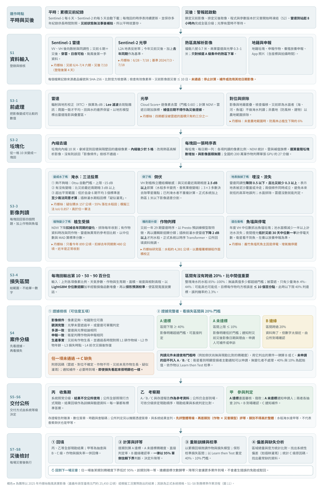

**圖 27　影像處理與判讀流程（S1–S8）。** 由平時累積紀錄、資料輸入、前處理、坵塊化、影像判讀、損失區間、案件分級、交付公所到災後檢討。橘色 ▸ 為團隊以 2025 年丹娜絲颱風真實影像（嘉義布袋至臺南北門約 25,450 公頃）或模擬工況實際跑出的結果〔135〕〔161〕〔124〕。

資料輸入端的原則是只用可追溯的來源。Sentinel 影像自 Copernicus Data Space 下載，平台為產品提供 MD5 與 BLAKE3 檢查碼〔144〕，下載後比對即可確認與官方產品一致；福衛八號影像記錄經銷商交付的產品編號；地籍與申報資料以公所或縣府匯出檔為準；App 照片保留原始檔與套印資訊。以本作品的丹娜絲真實影像測試為例，7 期 Sentinel-1 影像皆以官方產品編號登錄（如 S1A_IW_GRDH_1SDV_20250710T215251），他人可依編號取得同一批影像〔135〕。

模型計算端的原則是同樣的輸入必得同樣的結果。災害事件開始時，系統鎖定當時已通過評等的程式與參數，整場災害使用同一版本；模型於災後以現勘結果重新訓練，新版本只用於下一場災害，舊案件仍可依當時版本重現。每份報告記錄原始影像、處理過程、判讀結果、人工處理與案號對應五層資料來源，格式採用 STAC 與 W3C PROV〔90〕〔91〕。

本流程有三處直接參考歐盟面積監測系統的制度設計（表 38）。第一是先通知、可修正：歐盟規定監測發現不符時，須告知農民並讓其修正申請或補證〔151〕；本作品於 S5 通知申請農民，乙等起 C 缺失可於申請期內補 App 照片或更正申報，甲等時 A 未達標於勘查期內收到附理由的通知，可補件或申訴，減少因資料不足而產生的現勘與事後申覆。第二是以樣本量化品質：歐盟要求會員國每年提交品質評估報告，量化缺失並提出改正措施〔151〕；本作品於 S8 逐類別評等，丙、乙等以全部現勘為樣本，甲等直接使用現行法定的 20% 抽查樣本〔3〕，不另增加現勘；單場樣本不足時，同一類別、同一模型版本的樣本跨災害累積計算。第三是處理強度與金額相稱：歐盟對無法判定的案件依金額決定後續處理，每項補貼未達 50 歐元者不再追查、50 至 250 歐元抽查 5%、逾 250 歐元者全數追查〔150〕；本作品的 B、C 級清單同樣依預估救助金額與不確定程度排序，金額大且損失區間跨越門檻者優先到場，金額小且只是解析度不足者排入後段或改派無人機補拍。

**表 38　歐盟面積監測系統與本作品流程的對應**

| 歐盟規定或作法 | 本作品對應步驟 |
|---|---|
| 地塊層級全面監測，結果分綠、黃、紅燈〔150〕 | S4 先看證據、再看損失，分 A 達標、A 未達標、B 邊緣、C 缺失 |
| 監測結果告知農民，可修正申請或補證（2022/1173 第 7、10 條）〔151〕 | S5 補件提醒與 A 未達標通知 |
| 提供預填申請表（第 5 條）〔151〕 | 預填現金救助申請表 |
| 地理標記照片列為等值證據，App 標示照片是否經修改（第 11 條）〔151〕〔153〕 | S1 照片登錄，區分 App 內即時拍攝與相簿匯入 |
| 年度品質評估、量化缺失、改正措施與行動計畫（第 2 條）〔151〕 | S8 逐類別評等，下界未達 95% 即降等 |
| 無法判定者依金額決定追查比例〔150〕 | B、C 級依預估救助金額與不確定程度排序 |

S4 的結果直接成為公所端的分級清單（圖 28）：每一筆列出類別與該類別的系統等級、損失區間與 20% 門檻、可信度等級、分級、原因碼，以及「這一筆怎麼處理」。同一張清單裡，甲等類別的 A 達標寫「書面審核」或「抽中 20% 抽查」，乙等類別寫「依現行勘查，排序第 3」，C 缺失寫補件或派無人機；B、C 清單可離線下載到公務手機，也可匯出為救助系統的匯入檔。

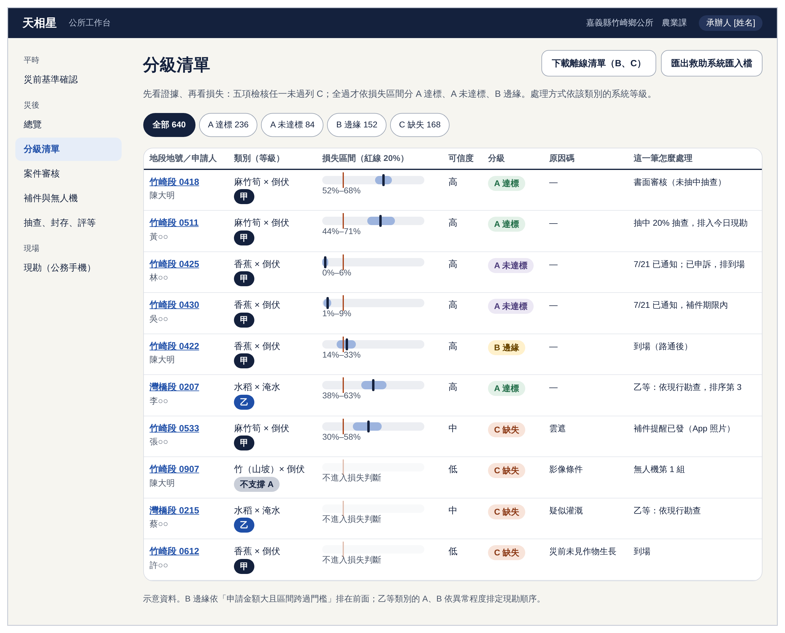

**圖 28　公所端分級清單。** 先看證據、再看損失：五項檢核未過者不進入損失判斷，直接列 C 並附原因碼；處理方式依該筆所屬類別的系統等級而定。資料為示意。

**(7) 可信度檢核：先看證據**

**可信度只評證據品質、不評損失大小；五項全過才進入 A、B 的判斷。模擬中可信度等級「高」的坵塊落在 20% 門檻錯邊的比例為 2.2%，「中」為 11.9%。**

可信度由五項檢核組成（表 39）：五項全過為「高」，一項未過為「中」，生產事實未過或兩項以上未過為「低」。只有「高」的案件進入損失區間的判斷（A 達標、A 未達標或 B 邊緣）；「中」「低」一律列 C 缺失，存證報告與公所畫面列出未通過的項目作為原因碼，承辦人員直接看得到這份證據的弱點。可信度等級不是機率：「高」不代表「有 95% 機率是對的」，只代表這筆證據沒有已知的弱點。

**表 39　可信度五項檢核**

| 檢核 | 通過條件 | 對應的風險 | 未通過的原因碼 |
|---|---|---|---|
| 影像條件 | 坵塊內縮後像素足夠，地籍對位可靠 | 小田混合像素、圖解地籍偏移 | 像素不足、對位不確定 |
| 觀測完整 | 光學未被雲遮過半，或雷達訊號強到可單獨判定 | 颱風後雲遮、只剩單一來源 | 雲遮 |
| 多源一致 | 雷達與光學對「是否受損」結論一致 | 倒伏未積水、灌水整地等誤判 | 來源不一致、疑似灌溉 |
| 申報一致 | 衛星判釋作物與申報作物相同 | 改種、申報錯誤或不實申報 | 作物不符 |
| 生產事實 | 災前 6 期植生顯示有作物生長，並通過長時間對照 L1–L4 | 未種植仍申請（如竹塘案） | 災前未見作物生長、L1–L4 各項 |

可信度的設計也參考歐盟的判讀方式。歐盟聯合研究中心把衛星判讀拆成一個個「標記」，每個標記是衛星訊號上可觀察的狀態變化，例如割草會使植生指數下降、雷達同調性上升，兩者在相近日期同時出現才採信〔160〕。斯洛維尼亞約 100 萬筆地塊在生長季每兩週判讀一次，其中「相似度」標記把每塊田的植生時序與周邊約 7.7 公里內最多 500 塊同作物田比較，換算為百分位分數，不需訓練資料；作物分類則每年以當年 20% 的申報資料微調〔159〕。本作品的「多源一致」檢核與植生受損判讀採用相同原則：雷達與光學須在相近日期互相印證，植生變化以周邊同作物田為基準，模型以每場災害的現勘回填資料更新。歐盟另訂「誤判紅燈」上限，即守規農民被判不符的比例不得超過 5%〔150〕；本作品對應的是 A 達標、A 未達標精確度下界須達 95%，並由 S8 逐類別檢查。

可信度有沒有意義，要以結果驗證。團隊以 10 個模擬工況共 769 筆坵塊比較各等級的實際誤差（表 40）〔149〕。可信度「高」者占 72%，損失中間值落在 20% 門檻錯邊（只看中間值就會把受損判為未受損，或反之）的比例為 2.2%；「中」者為 11.9%，約為前者的 5 倍，而兩者的平均誤差相近（5.4 與 5.5 個百分點）。可見可信度辨識的正是「會不會判錯邊」，也就是救助資格的關鍵，所以只讓「高」進入 A、B。「低」僅 17 筆，樣本過少，不作推論。

**表 40　模擬工況中各可信度等級的實際誤差（10 個工況、769 筆坵塊）**

| 可信度 | 坵塊數 | 中間值平均誤差 | 誤差逾 15 個百分點 | 中間值落在門檻錯邊 | 直接判定件數 |
|---|---|---|---|---|---|
| 高 | 550（72%） | 5.4 個百分點 | 6.2% | 2.2% | 200 |
| 中 | 202（26%） | 5.5 個百分點 | 8.4% | 11.9% | 0 |
| 低 | 17（2%） | 3.5 個百分點 | 0% | 0% | 0 |

損失區間另以現勘回填校準，採用保形分位數迴歸〔145〕：以前幾場災害回填的現勘結果，計算區間需放寬或收窄多少，才能使「現勘損失率落在區間內」的比例達到宣稱的 80%。模擬中以 5 個工況校準、另 5 個工況測試：原規則的覆蓋率已達 87.7%，校準不需調整；若刻意將區間縮窄一半，覆蓋率降至 51.3%，校準後自動放寬 3 個百分點，覆蓋率回到 82.6%。正式系統每場災害後依類別重新校準，覆蓋率或兩種 A 精確度下界未達標的類別即降等（本節 (14)）。

**(8) 防偽設計**

**目標不是讓竄改「不可能」，而是讓任何竄改「會被發現」，並指出發生在哪個環節。**

核心是存證報告的封裝：報告內容以固定格式序列化後計算 SHA-256 雜湊，由資料中心以憑證機構簽發的憑證進行數位簽章，再取得 RFC 3161 時戳，證明報告於該時間點已存在〔142〕；報告上的查驗碼包含報告編號與雜湊前 16 碼，掃描即可比對。同一批報告的雜湊組成 Merkle 樹，根雜湊交公所留存，事後抽換、刪除或補入任何一份，根雜湊即不符。此做法與 C2PA 內容憑證以雜湊綁定內容、以 X.509 憑證簽署來源的原理相同〔143〕。六類對象各有措施（表 41）。

**表 41　防偽對象與措施**

| 對象 | 可能的偽造或竄改 | 措施 |
|---|---|---|
| 衛星影像 | 替換為他日或偽造影像 | 只自官方平台取得；比對官方檢查碼並記錄產品編號〔144〕；與前後期觀測不連續即標出 |
| App 照片 | 重複上傳舊照、他田照片、改定位 | 感知雜湊比對歷次案件〔147〕；App 內即時拍攝與相簿匯入分級；拍攝時的田區狀態對照衛星長期紀錄 |
| 申報資料 | 未種植仍申請、作物不符、災前已收割、重複申請 | 生產事實與申報一致檢核；長時間對照 L1–L4，不符列 C 缺失並附原因 |
| 模型與參數 | 私改門檻、程式未更新版本 | 事件開始時鎖定並記錄雜湊；重算時版本不符即標示 |
| 存證報告 | 改數字、偽造整份報告、事後抽換 | 數位簽章、時戳、查驗碼、Merkle 根 |
| 公所判定 | 事後改核定結果 | 承辦以機關憑證簽章，判定指向報告雜湊，與系統結果並列 |

查驗分為三個層級。農民與公所掃描查驗碼，確認報告由資料中心簽發且未經改動；縣府抽查時比對同批報告與公所留存的 Merkle 根；審計或申覆時，以報告記載的輸入產品編號與程式版本重算，比對是否得到同一份報告。前兩者只需公開的公鑰，不必連線至天相星。資料中心的簽章憑證由憑證機構簽發，公所端使用政府憑證管理中心的機關憑證〔148〕，使數位簽章具《電子簽章法》推定本人簽章的效力〔139〕；簽章金鑰保存於硬體安全模組，外洩時可廢止憑證，廢止前簽發的報告仍可依時戳確認簽發時間。歐盟的地理標記照片 App 已採類似做法，會標示照片是否經修改，外部匯入者標為「非真實」〔153〕；歐盟衛星導航署並指出，手機日後整合 Galileo 導航訊號認證（OSNMA）後，可進一步確認照片定位的真實性〔152〕，本作品的照片登錄格式已預留此欄位。

查驗做成農民與承辦都能用的畫面（圖 29）：掃描查驗碼後，畫面顯示簽章、時戳與封存批次是否相符，並列出系統判讀與公所判定兩份紀錄、這份報告用了哪些輸入檔與官方檢查碼。原型可切換「原本的報告」與「被改過的報告」，被改過的報告會直接指出是哪一項不符。

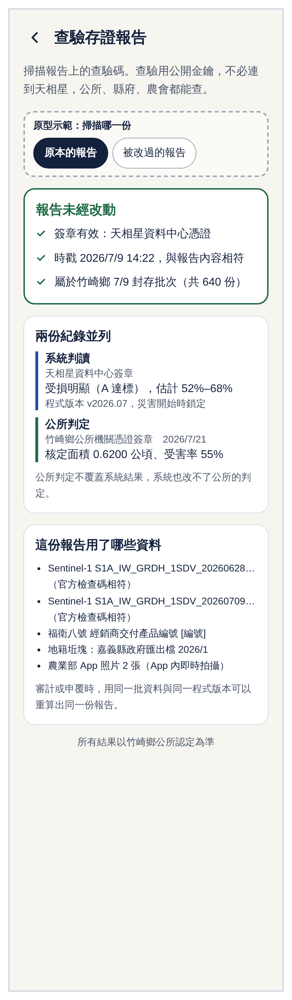{width=36%}

**圖 29　農民端查驗存證報告畫面。** 查驗只用公開金鑰，不必連線至天相星。資料為示意。

**(9) 長時間對照：以多年紀錄檢驗申報**

**衛星平時就為每塊田累積多年紀錄，申請人無法改寫；模擬中四類不實申請的標出率為 78%–100%，誠實申請誤標 2%。**

災前 6 期影像只能看出颱風前一個多月田裡有沒有東西，許多不實申請在這段期間看不出破綻：休耕地長滿雜草時植生指數約 0.4，與作物差距不大；剛種下的果苗也會被看成「有作物」。衛星每 5–6 天經過一次，系統平時就會為每塊田累積多年紀錄，而這份紀錄申請人與系統營運者都無法回頭修改。本作品因此把四項長時間對照併入「生產事實」檢核（表 42），不通過者列 C 缺失並附原因，交公所確認，不直接否決。

**表 42　長時間對照檢核與模擬結果**

| 檢核 | 比對內容 | 可發現的情形 | 標出率（只看災前 6 期 → 加上長時間對照） |
|---|---|---|---|
| L1 耕作物候 | 過去 12 個月是否有申報作物應有的生長週期（如水稻兩期作的升降） | 長期休耕、雜草地申報作物 | 長期未耕作 0% → 100% |
| L2 作物年齡 | 多年生作物自最近一次裸地起算的年數，是否達申報作物應有的年數 | 新植果苗冒充成齡果樹 | 新植冒充成樹 0% → 100% |
| L3 損失時點 | 災前植生下降幅度，扣除這塊田前兩年同時段的正常變化 | 颱風前已收割或已受損，仍申報颱風損失 | 災前已收割 2% → 78% |
| L4 前次災損後恢復 | 曾於前次災害申請者，兩次災害之間是否恢復或補植 | 以同一損失重複申請 | 前次未恢復 72% → 100% |

L3 必須和自己的往年同期比。作物本身就有季節性升降，例如水稻進入成熟期，植生指數本來就會從高峰往下掉；只看「颱風前有沒有下降」，會把正常成熟的稻田誤判為災前已收割，改成「比往年同一時段多降多少」才能扣掉正常變化。這與丹娜絲真實影像案例中，扣除往年同期後植生下降面積由 899 公頃降為 480 公頃，是同一個道理。

同一份長期紀錄也用來檢查照片與影像。App 照片宣稱的拍攝時間，田區狀態應與當時的衛星觀測一致，例如照片顯示淹水，衛星同一時段卻無積水訊號，即可能是舊照片重用；若有人以他日或偽造的影像替換，該影像也會與前後期觀測不連續。這兩項於丙等期間以公所歷年 App 照片建立比對門檻。

團隊以模擬資料測試四項檢核〔149〕：3 年、每 6 天一筆觀測、35% 被雲遮；400 筆誠實申請（含各作物正常物候、颱風後受損、合法新植香蕉、前次受災已補植後再受災等）與四類不實申請各 40 筆。結果如表 43：只看災前 6 期時，除「前次災損未恢復」外幾乎都抓不到；加上長時間對照後，四類不實申請的標出率為 78%–100%，誠實申請誤標 2%（8 筆）。「災前已收割」仍有 22% 未標出，原因是收割到颱風之間剛好被雲遮、沒有可用的光學觀測，正式系統將以雷達補足這段空窗；誠實申請被誤標者多為前次受災後恢復較慢的果樹，列 C 後由公所到場即可釐清。L1–L4 的使用門檻是誠實申請被誤標的比例 ≤ 5%；試辦時以 Sentinel 歷史影像（2015 年起可回溯）與公所歷年申請紀錄逐作物校正門檻，校正完成前，長期檢核只作為列 C 的原因，不作為不予救助的依據。

**表 43　長時間對照模擬測試結果**

| 申請類型 | 件數 | 只看災前 6 期 | 加上長時間對照 | 主要觸發的檢核 |
|---|---|---|---|---|
| 誠實申請（誤標） | 400 | 0% | 2% | L4 5 筆、L2 3 筆 |
| 新植冒充成樹 | 40 | 0% | 100% | L1、L2 |
| 災前已收割 | 40 | 2% | 78% | L3 |
| 前次災損未恢復 | 40 | 72% | 100% | L4 |
| 長期未耕作 | 40 | 0% | 100% | L1 |

**(10) 方向驗證：真實影像、模擬工況與原型測試**

**團隊以真實影像、模擬工況與原型程式驗證了三個方向：雷達與光學比對可行、分級邏輯成立、竄改會被發現。這些是示範，規模、資料與精度都不是正式系統的規格（表 44）。**

**表 44　示範與正式系統的對照**

| 面向 | 示範（驗證方向） | 正式系統 |
|---|---|---|
| 範圍 | 丹娜絲研究區約 25,450 公頃；模擬 83 筆坵塊、40 口魚塭 | 全國約 200 萬筆坵塊、368 個公所，平時持續累積 |
| 影像 | Sentinel-1 7 期、Sentinel-2 4 期 | Sentinel-1／2 自 2015 年起全時序、福衛八號與九號、熱區 ICEYE 與 Pléiades Neo、無人機 |
| 解析度 | 10–20 公尺 | 熱區 0.25–1 公尺、無人機公分級 |
| 標註 | 無官方標註，無法計算精確度 | 回溯 2–3 場災害核定清冊；丙、乙等全部現勘回填，甲等為抽查與 B、C 級回填 |
| 作物 | 雷達粗分水稻與其他 | 逐作物判釋，作物判釋準確率下界 ≥ 80% |
| 損失 | 標出變化面積 | 逐坵塊損失率區間，均方根誤差 ≤ 10 個百分點 |
| 運算 | 單機 CPU | 雲端 GPU，雷達到站 8 小時內完成分級 |
| 防偽 | 示範金鑰、模擬時戳 | 憑證機構憑證、RFC 3161 時戳服務、硬體安全模組、公所機關憑證 |
| 產出 | 研究用判讀圖與測試報告 | 簽章存證報告、預填申請表、公所工作台、B／C 級清單 |

已實作的示範如表 45，以下分項說明。

**表 45　已實作的示範**

| 項目 | 規格 | 結果 |
|---|---|---|
| 丹娜絲變遷偵測 | Sentinel-1 RTC 7 期、Sentinel-2 L2A 4 期，約 25,450 公頃 | 植生下降 480 公頃、疑似積水 157 公頃〔135〕 |
| 作物粗分 | Presto 預訓練權重（MIT 授權）＋scikit-learn 邏輯斯迴歸；29 期雷達、20 公尺解析度；2 核 CPU 約 4 分鐘 | 水稻 4,381 公頃；疑似積水 55% 落在水稻田〔161〕 |
| 模擬工況 | 約 850 行 Python（numpy、scipy）；2.4 × 2.4 公里、10 米像素；83 坵塊、40 口魚塭、10 個工況 | 直接判定案件無一錯邊；淹水三法 IoU 0.857〔124〕 |
| 作業流程原型 | SHA-256、Ed25519 簽章、時戳、Merkle 樹、dHash；八步流程與查驗程式 | 12 項測試全數通過〔149〕 |
| 長時間對照 | 3 年、每 6 天一筆、35% 雲遮的模擬時序；L1–L4 | 不實申請標出 78%–100%、誤標 2%〔149〕 |
| 花蓮光復（隊友原型） | Sentinel-2 L2A，災前災後 NDVI 差分 | 疑似受影響植生 271–450 公頃〔132〕 |

**① 真實影像：丹娜絲颱風（嘉義布袋至臺南北門）**

**以免費衛星影像比對丹娜絲登陸點周邊約 25,450 公頃，標出約 480 公頃植生較往年同期明顯下降、約 157 公頃雷達疑似積水；若不扣除往年同期，植生下降面積為 899 公頃。**

光復案例屬埋沒型災害，雲退後以光學影像即可辨識；丹娜絲在嘉義沿海則以強風、停電與局部積水為主〔83〕〔137〕，颱風後連日有雲，較接近本作品預設的典型情境。團隊以 Microsoft Planetary Computer 提供的 Sentinel-1 RTC 與 Sentinel-2 L2A 影像〔136〕，對 2025 年 7 月 6 日深夜登陸點周邊約 15 × 17 公里（東經 120.10–120.25°、北緯 23.25–23.40°）進行災前災後比對〔135〕。雷達以 6 月 4 日至 7 月 4 日同軌道 6 期影像為災前基準，災後採登陸後第 4 天（7 月 10 日）的第一張影像；光學採 6 月 28 日與 7 月 18 日（登陸後第 12 天，為颱風後首張雲量較少的影像），並以 2024 年 7 月 3 日至 18 日的同期變化作為正常收割的基準（圖 30）。

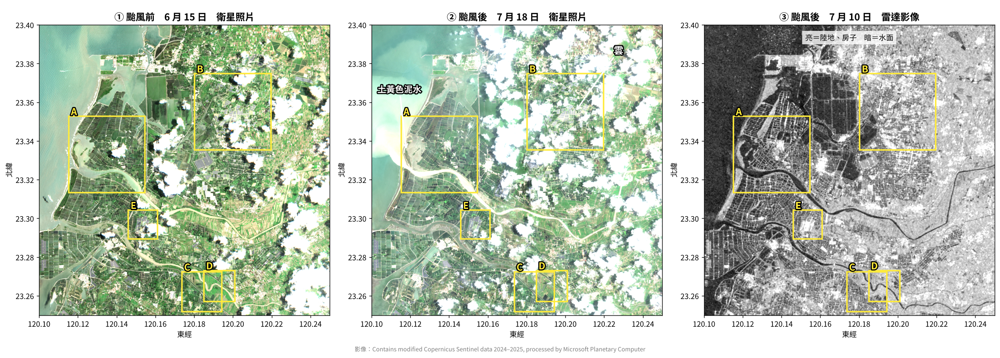

**圖 30　丹娜絲研究區總覽。** 左起為颱風前光學（6/15）、颱風後光學（7/18）、颱風後雷達（7/10）；黃框 A–E 為放大區。颱風後光學影像多處受雲遮蔽，雷達影像完整。影像：Contains modified Copernicus Sentinel data 2024–2025, processed by Microsoft Planetary Computer〔136〕。

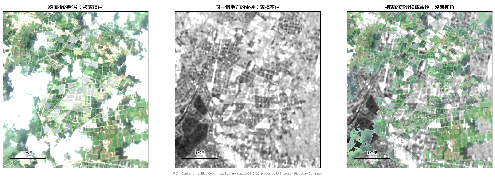

**圖 31　放大區 B：颱風後光學影像受雲遮蔽（左）、同地雷達影像（中），以及以雷達填補雲區的合成（右）。** 颱風後常連續多日有雲，天相星因此以雷達為第一手資料〔135〕。

**表 46　丹娜絲研究區的衛星變遷判讀結果**

| 變化類型 | 判讀方式 | 面積 |
|---|---|---|
| 植生較往年同期明顯下降 | Sentinel-2 NDVI 變化扣除 2024 年同期，多降 0.2 以上且連片約 0.2 公頃以上 | 約 480 公頃（可比較作物 3,164 公頃的 15%） |
| 植生下降（僅看今年） | 未扣除往年同期 | 約 899 公頃 |
| 雷達明顯變暗、疑似積水 | Sentinel-1 災後影像與災前 6 期比較 | 約 157 公頃（約 28% 暗至接近水面） |
| 高反射人造物變暗 | 同上 | 約 26 公頃 |
| 兩種衛星皆標出 | 疊合 | 約 9 公頃 |

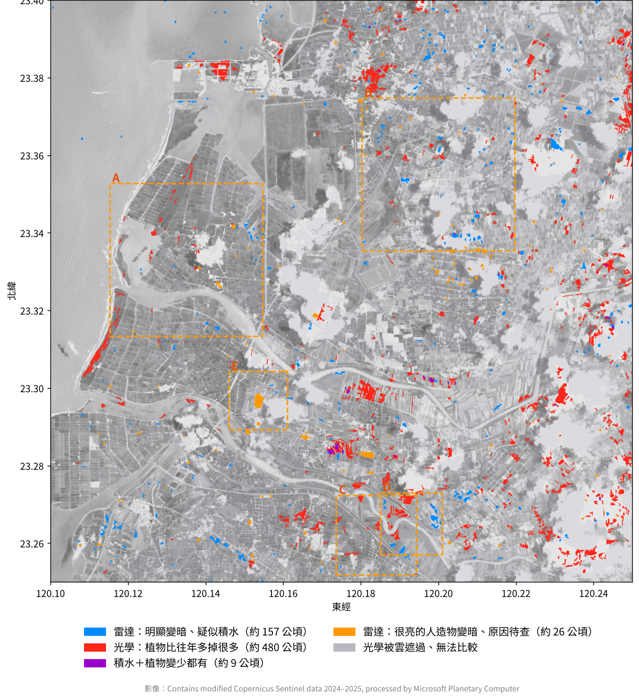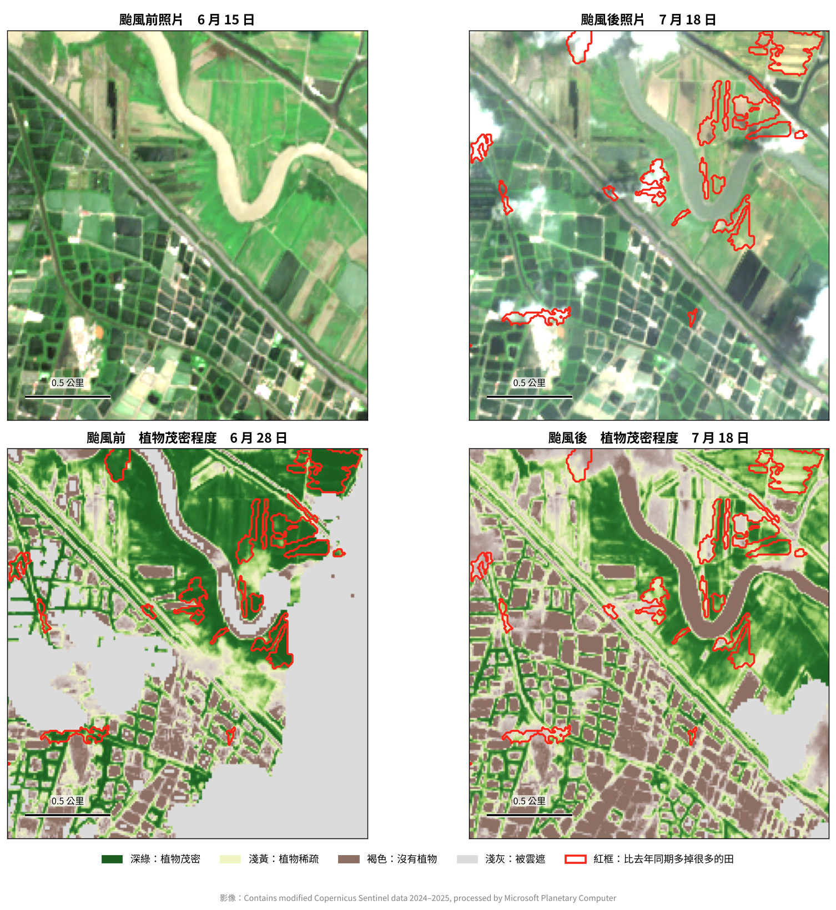

**圖 32　丹娜絲判讀結果總圖（左）與放大區 C 的植生變化（右）。** 左圖紅色為植生較往年同期明顯下降、藍色為雷達疑似積水、橘色為高反射人造物變暗、紫色為兩者皆有，淺灰為光學受雲遮蔽；右圖上排為颱風前後光學影像，下排為 NDVI，紅框為扣除往年同期後仍明顯下降的田〔135〕。

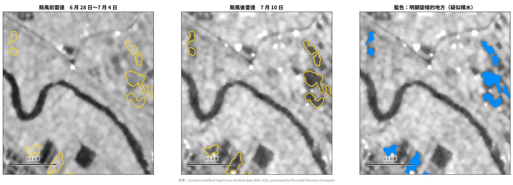

**圖 33　放大區 D（約 1.6 × 1.8 公里）的雷達變化。** 左為災前（6/28–7/4）、中為災後（7/10），黃框內的田由淺灰轉為深灰，右圖藍色為判定的疑似積水範圍〔135〕。

結果顯示三項與系統設計相關的現象（表 46、圖 32、圖 33）。第一，四期光學影像皆無雲、可供比較的面積僅約三分之一，颱風後的第一手資料須仰賴雷達（圖 31）。第二，7 月為一期稻收割期，僅看今年時植生下降面積為 899 公頃，扣除往年同期後為 480 公頃，近半數屬於正常收割，因此判讀以「相對往年同期」為基準〔4〕。第三，雷達與光學標出的範圍僅重疊約 9 公頃：雷達偵測地表轉為有水，光學偵測植生減少，作物倒伏未必積水，灌水整地與颱風前搶收也會產生相同訊號。衛星本身無法區分這些原因，故「多源一致」與「申報一致」檢核要求兩種訊號與申報內容一致才進入損失判斷，其餘列 C 缺失交由公所判斷。另一放大區中，太陽能案場內一塊空地的雷達反射下降約 10 dB，補查颱風前 3 天的影像後確認該處災前已為空地，變化較可能來自物料或機具移動；衛星可指出位置的改變，原因仍須由現勘確認（圖 34）。

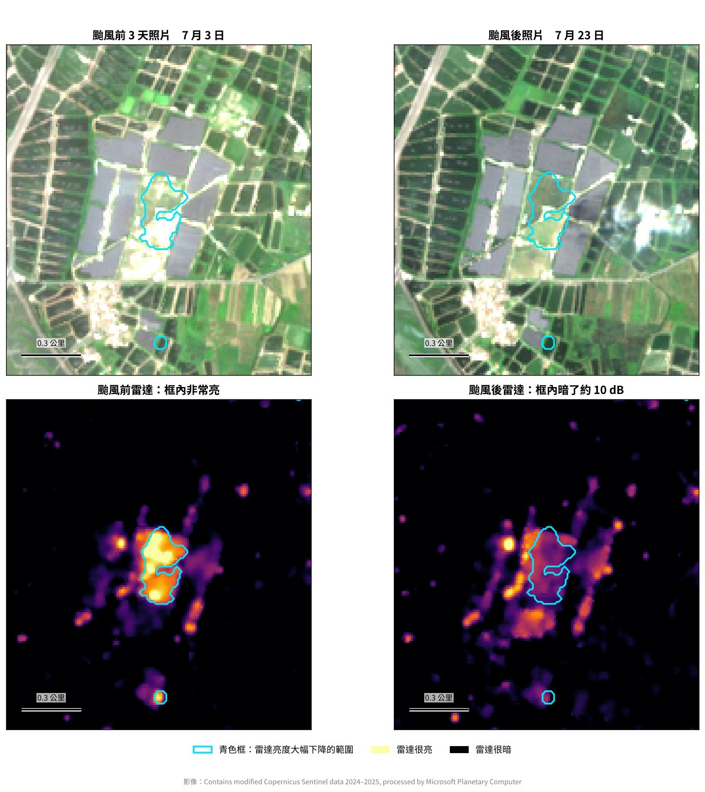

**圖 34　放大區 E：太陽能案場內空地的光學（上，7/3 與 7/23）與雷達（下）變化。** 青色框為雷達亮度大幅下降範圍（約 10 dB）。補查颱風前 3 天影像確認該處災前已為空地，原因須現勘確認〔135〕。

本案例尚有三項限制：未取得公所現勘結果或受災地號，無法計算精確度；雷達與光學分別晚於登陸 4 天與 12 天，最嚴重的積水可能已退；未套用農地範圍圖，海岸防風林等非農地植生約占植生下降面積的 6%。後續將以公所現勘結果校正門檻，並套用農業部農地覆蓋物資料庫限縮判讀範圍。

**作物粗分與受災依作物拆開。** 為了解上述變化落在哪些作物上，團隊另以颱風前一整年（2024 年 7 月 3 日至 2025 年 6 月 28 日）同軌道 29 期 Sentinel-1 影像，將研究區粗分為六類〔161〕。水稻須有插秧前灌水「雷達先變暗、再隨稻株長高變亮」的訊號；插秧期下降門檻設 3.5 dB 時水稻約 1,592 公頃、設 2 dB 時約 4,381 公頃，下文以 2 dB 計，準備期以農糧署鄉鎮稻作面積校正。水面與魚塭依 Ottinger 等人的亞洲魚塭方法：以全年 VH 中位數經 Otsu 定出水面門檻（本區為 −19.5 dB），再依形狀分出魚塭、鹽田與天然水體〔64〕；論文未公布形狀門檻，本測試數值為自訂。陸地以 NASA Harvest 開源的 Presto 預訓練模型〔165〕，把每個像素 12 個月的雷達時序轉為特徵，再以作物曆規則挑出的典型樣本訓練分類器；水稻須有插秧期雷達下降 2 dB 以上的訊號，否則列為「可能是水稻」。結果為水稻 4,381 公頃、可能是水稻 1,513 公頃、其他作物 8,509 公頃、魚塭與鹽田 3,340 公頃、水體 6,700 公頃、建地與道路 1,005 公頃（圖 35）。

**圖 35　丹娜絲研究區颱風前光學影像（左）與作物粗分（右）。** 以颱風前一年 29 期 Sentinel-1 影像判釋，未與官方資料比對〔161〕。

把表 46 的受災範圍依作物拆開（表 47、圖 36），最重要的發現是：雷達疑似積水的約 157 公頃中，約 87 公頃（55%）落在水稻田。該雷達影像攝於 7 月 10 日，正值二期稻插秧前灌水，因此這部分大多很可能是正常灌溉，而非颱風積水。據此，證據檢核新增一條規則：插秧灌水期稻田的積水判讀不通過「多源一致」，列 C 缺失並附原因碼「疑似灌溉」。植生下降的 480 公頃則以其他作物為主（287 公頃）；高反射人造物變暗的 26 公頃，一半以上落在建地，與預期一致。

**表 47　丹娜絲疑似受災面積依作物拆分（公頃）**

| 受災類型 | 水稻 | 可能是水稻 | 其他作物 | 魚塭／鹽田 | 水體與建地 | 合計 |
|---|---|---|---|---|---|---|
| 植生較往年同期明顯下降 | 117 | 62 | 287 | 6 | 8 | 480 |
| 雷達疑似積水 | 87 | 14 | 25 | 13 | 19 | 158 |
| 高反射人造物變暗 | 6 | 1 | 1 | 2 | 16 | 26 |

註：各格分別四捨五入，雷達疑似積水合計與表 46 的 157 公頃差 1 公頃。

**圖 36　丹娜絲疑似受災面積，依颱風前的作物類別拆開〔161〕。**

這項作物粗分只能算基準版：純規則版與 Presto 版判出的水稻面積分別為 1,592 與 4,381 公頃，相差 2.8 倍，差別在「插秧期雷達下降多少才算水稻」；須以官方稻作面積或農地覆蓋物資料庫校正後，才能用於申報一致檢核。香蕉、竹林、果樹在本研究區無法區分，全部歸入「其他作物」。

**② 真實影像：花蓮光復（樺加沙颱風，隊友原型）**

隊友原型另以真實衛星影像完成一組災前災後比對〔132〕；投稿版的衛星概念驗證只採團隊自製的丹娜絲測試與模擬工況，本案例保留於母檔作為參考。2025 年 9 月樺加沙颱風造成花蓮光復一帶洪水與泥砂覆蓋，農業損失 6.04 億元，花蓮占 99%，作物已無法現場辨認〔50〕。本案例使用 Sentinel-2 L2A 圖幅 51QUG，比較 2025 年 9 月 21 日（災前）與 10 月 1 日（災後）影像，以場景分類圖層（SCL）去雲後計算 NDVI 差分。判定規則為災前 NDVI 至少 0.35、災後低於 0.20，且下降超過 0.30；有效觀測約 76.1%。以三組門檻估計疑似受影響植生 271–450 公頃（基準 382 公頃），其中與 ESA WorldCover 農地類別交集者為 104–166 公頃（圖 37）。影像變遷範圍與案件核定面積分欄保存，再由地籍與作物紀錄對應至農業申請範圍。此案例顯示，以免費的 Sentinel-2 影像即可在災後 10 天內圈出受影響農地；樺加沙屬埋沒型災害，光學影像在雲退後即可清楚辨識，與丹娜絲須依賴雷達的情境互補。

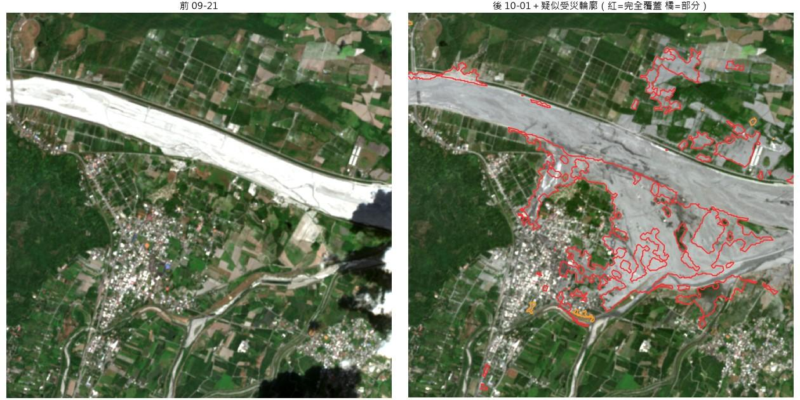

**圖 37　花蓮光復災前（2025-09-21，左）與災後（2025-10-01，右）Sentinel-2 真彩色影像及變遷輪廓。** 紅色為疑似受災範圍。資料來源：團隊原型的 Sentinel-2 比對成果〔132〕。

**③ 模擬工況**

為在取得真實影像前先驗證流程與分級邏輯，本作品撰寫約 850 行、僅需 numpy、scipy 與 matplotlib 的 Python 程式，將「前處理 → 坵塊化 → 判讀 → 證據檢核 → 分級 → 存證報告」完整執行一次，約 5 秒產出結果〔124〕。測試工況設定為 2025 年丹娜絲颱風：左側為嘉義沿海農區（水稻、香蕉、果樹，共 83 個坵塊），右側為臺南沿海魚塭（40 口），範圍 2.4 × 2.4 公里、10 米像素；災損包含淹水、倒伏、埋沒與輕微植生下降，魚塭包含溢堤、池水流失與停電。作物判釋與損失估計刻意採用簡單規則，不使用機器學習，目的在於先驗證流程，正式系統再替換為時序 Transformer 與 LightGBM 分位數迴歸。模擬程式以 v7 的三級規則（A 受損已確認、B 未見受損、C 其餘）執行，以下結果依現行四類分級對應：原 A 對應 A 達標，原 B（損失區間上限 ≤ 10%）對應 A 未達標，原 C 中損失區間跨越門檻者對應 B 邊緣、證據檢核未過者對應 C 缺失。

由於開發環境無法連線至 Sentinel 影像下載來源，主程式採用格式與真實資料一致的模擬影像（表 48）。災損並非隨機標記：程式先產生地形，最低的 18% 區域淹水、河道旁的田遭埋沒，再依淹水或倒伏像素比例計算每塊田的真實損失率；因地真值已知，才能計算精確度。真實影像的下載與判讀已另以 `fetch_crop.py`、`real_danas_analysis.py`、`real_s2_analysis.py` 與作物判釋程式完成，結果見本節 (10) ①。

**表 48　模擬資料與對應的真實資料**

| 模擬資料 | 對應真實資料 | 模擬方式 |
|---|---|---|
| VV、VH 後向散射 | Sentinel-1 | 依地物給 dB 值，再乘上 Gamma 分佈斑點雜訊（4 視數） |
| 災前 6 期時序 | Sentinel-1 六天再訪 | 水稻 VH、NDVI 逐期上升；香蕉穩定且亮；果樹小幅季節變化 |
| 干涉同調性 | Sentinel-1 前後兩期 | 植生約 0.6；水面、淹水、埋沒處降至約 0.2 |
| NDVI | Sentinel-2 | 依災損程度下降，整體再減 0.03（季節效應）；約 30% 面積被殘雲遮蔽 |
| 夜間燈光 | VIIRS VNP46A2 | 三個供電區，停電 0／2／5 天 |
| 在養證據、放養申報 | 福衛八號水車偵測、公所資料 | 以機率模擬（在養池 90% 偵測到水車、90% 有放養申報） |

程式架構對應技術說明的九個步驟（表 49）。

**表 49　模擬程式架構與正式系統對照**

| 步驟 | 函式 | 本示範做法 | 正式系統 |
|---|---|---|---|
| 模擬工況 | `simulate_scene` | 地形決定災損，產生雷達、光學、同調性、夜間燈光 | 真實影像 |
| 前處理 | `lee_filter`、`to_db` | Lee 斑點濾波（5×5），轉 dB | 另加軌道、熱雜訊、地形正規化 |
| 坵塊化 | `inset_mask`、`parcel_features` | 向內縮 10 米取統計值 | 相同，另以福衛八號補小田 |
| 判讀 | `flood_vote`、`lodging_map`、`buried_map`、`add_ndvi_z` | 淹水三法投票、VH 對數比值、同調性下降、NDVI 相對分數 | 第三法換 Prithvi；倒伏加隱馬可夫隨機場 |
| 作物判釋 | `guess_crop` | 三條規則 | 時序 Transformer |
| 損失區間 | `estimate_loss` | 中間值 ± 固定誤差 | LightGBM 分位數迴歸＋保形校準 |
| 分級 | `three_gates` | 證據檢核＋損失區間＋原因碼 | 先看證據、再看損失的四類分級 |
| 魚塭 | `classify_ponds` | 溢堤、池水流失、停電、在養證據 | 另加水色異常 |
| 輸出 | `evaluate`、`make_figures`、`evidence_report` | 驗證指標、圖、坵塊表、存證報告 JSON | 格式改為 STAC／PROV |

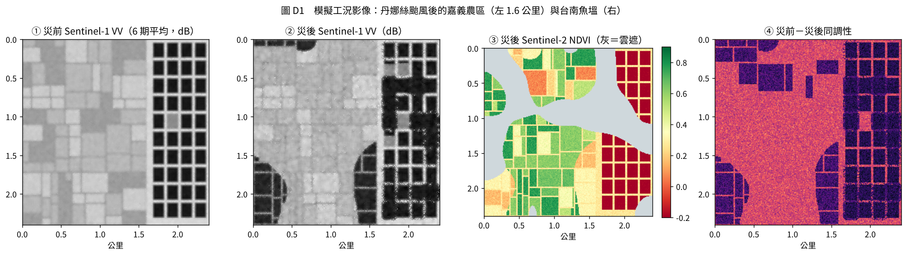

**圖 38　模擬工況影像。** ① 災前雷達，田塊與魚塭清楚可見；② 災後雷達，左下與中下出現大片暗區（淹水），魚塭堤岸部分消失（溢堤）；③ 災後 NDVI，灰色為雲遮；④ 同調性，暗色為同調性下降處〔124〕。

判讀細節如下。前處理以 Lee 濾波在平坦處平均、在邊緣處保留原值，以去除斑點雜訊而不模糊田界，再轉為 dB。淹水採三法投票：Otsu 門檻（不需災前資料，但本來就暗的地物會誤判）、變遷偵測（比災前最近兩期暗 3 dB 以上）、時序異常（低於災前平均 3 個標準差），至少兩法同意才算淹水，並排除災前即為水面者（圖 39）。倒伏以災後 VH 與災前最近兩期的 dB 差絕對值超過 2.5 dB 判定——水稻倒伏 VH 變亮、香蕉與果樹冠層倒塌則變暗——再以 3×3 中位數濾波去除零星點。埋沒以同調性降至 0.5 以下且下降超過 0.3 判定，並先排除淹水像素以區分兩者。植生受損以 NDVI 下降量相對於「同作物且雷達無異常」之參考田的標準分數衡量。作物判釋規則為：災前 NDVI 上升超過 0.2 判為水稻，否則 VV 平均高於 −9 dB 判為香蕉，其餘判為果樹。損失中間值取三種雷達訊號中最嚴重者（淹水比例 × 作物權重：水稻 0.95、香蕉 0.80、果樹 0.65；倒伏比例 × 0.75；埋沒比例 × 0.95），雷達無訊號時改以 NDVI 推估；誤差範圍於雷達有訊號時為 ±15%、無訊號時 ±5%，雲遮過半再加寬 5%。

**圖 39　淹水三法投票。** 中間幾塊田僅法 3 判為淹水，投票後被濾除。10 個工況的淹水像素 IoU：Otsu 0.841、變遷偵測 0.843、時序異常 0.757、三法投票 0.857〔124〕。

結果如表 50 與表 51。主工況中 A 達標、A 未達標精確度均為 100%，區間覆蓋率 83%，損失中間值平均誤差 5.9 個百分點；換 10 個工況重跑，以坵塊計合計直接判定 421 筆（A 達標 201、A 未達標 220），未直接判定 348 筆，直接判定的案件無一落在門檻錯邊。

**表 50　主工況驗證結果**

| 指標 | 結果 | 目標 |
|---|---|---|
| A 達標精確度 | 100%（23／23） | ≥ 95% |
| A 未達標精確度 | 100%（25／25） | ≥ 95% |
| 申請案件未直接判定比例（B＋C） | 56%（25／45） | 直接判定率 ≥ 50% |
| 區間覆蓋率 | 83% | 約 80% |
| 損失中間值平均誤差 | 5.9 個百分點 | — |
| 作物判釋準確率 | 100% | ≥ 80% |
| 魚塭 A 達標精確度 | 100%（4／4） | ≥ 95% |
| 申請魚塭未直接判定比例 | 79%（15／19） | — |

**表 51　10 個工況的穩定性**

| 指標 | 平均 | 最低 | 最高 |
|---|---|---|---|
| A 達標精確度 | 100% | 100% | 100% |
| A 未達標精確度 | 100% | 100% | 100% |
| 申請案件未直接判定比例 | 57% | 46% | 68% |
| 區間覆蓋率 | 87% | 81% | 94% |
| 損失中間值誤差 | 5.4 個百分點 | 4.5 | 6.6 |
| 申請魚塭未直接判定比例 | 56% | 40% | 75% |

**圖 40　模擬地真值（左）與分級結果（右）。** 淹水與埋沒的田多判 A 達標，未受災者多判 A 未達標，倒伏與輕微受損者多落 B、C（圖中仍以 v7 的 A／B／C 標示）；標「申」者為有申請、公所需到場的案件〔124〕。

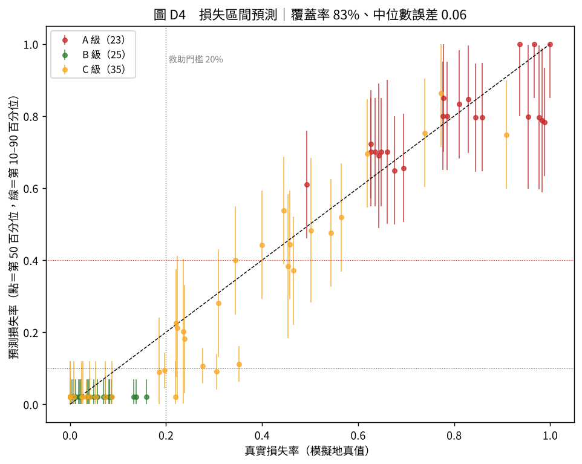

**圖 41　損失區間預測。** A 達標全落於 20% 以上、A 未達標全落於 20% 以下，靠近門檻者均未直接判定（圖中仍以 v7 的 A／B／C 標示）〔124〕。

主工況 25 件未直接判定的申請案件，原因碼分布如表 52（一件可有多個原因碼），其中 80% 源於損失區間落在門檻附近，即現行分級的 B 邊緣，正是需要公所判斷的案件；其餘屬證據缺失，即 C 缺失。

**表 52　申請案件未直接判定的原因（主工況）**

| 原因碼 | 件數 |
|---|---|
| B 邊緣：損失區間跨越門檻附近 | 20 |
| C 缺失：光學被雲遮，雷達訊號不夠強（觀測完整） | 5 |
| C 缺失：雷達與光學結論不一致（多源一致） | 5 |
| C 缺失：作物與申報不符（申報一致） | 5 |
| C 缺失：對位不確定，圖解地籍區（影像條件） | 3 |
| 農民申請但衛星未見變化（現行分級中，五項全過者判 A 未達標並通知） | 1 |

存證報告範例挑選區間下限最高的 A 達標坵塊輸出，內容包含坵塊與面積、判釋與申報作物、損失區間與判定、以白話寫出的主要災害證據、可溯源資料（每期影像編號、處理參數、程式版本），以及整份報告的 SHA-256 雜湊，任何改動皆可被察覺。

本測試的解讀須審慎。第一，模擬資料的產生方式與判讀規則基於同一套物理假設，100% 精確度僅證明流程與分級邏輯可行、保守設計有效，不代表真實精度。第二，開發過程揭示兩項真實系統亦會遇到的陷阱：水稻災前 VH 本即逐期上升，以 6 期平均為基準會將未受災稻田誤判為倒伏，改以災前最近兩期比較後解決；NDVI 參考組若包含受損田，會使基準下降、離散度變大而稀釋訊號，改以「雷達無異常」的田為參考後改善。第三，未直接判定比例 56%–57%，直接判定率略低於乙等門檻 50%，換用正式模型縮小誤差範圍後，部分 B 邊緣可轉為 A。第四，真實損失 20%–35% 的輕微受損田常被低估至 10% 左右，雖因區間跨越門檻而列 B 邊緣、未判錯，但顯示單靠 NDVI 估輕微災損不足，需結合天氣參數。第五，魚塭未直接判定比例高主因在養證據要求嚴格（15 件中 9 件缺少強證據），且相鄰魚塭共用堤岸造成連帶的部分溢堤訊號，表示放養申報的完整度直接影響魚塭免勘比例。第六，未申請的田不必派人；衛星看到明顯受損者，實務上改為主動通知農民可申請，此一修正已併入現行分級。

本示範與正式系統的差異如表 53。下一步為：將丹娜絲真實淹水圖與官方災區比對；取得公所現勘結果以校正作物權重、誤差範圍與 10%／40% 門檻；將規則版作物判釋與損失估計替換為正式模型，其餘程式介面不變。

**表 53　模擬示範與正式系統的差異**

| 項目 | 本示範 | 正式系統 |
|---|---|---|
| 影像 | 模擬（真實影像測試見 ①） | Sentinel-1／2、福衛八號、VIIRS |
| 淹水第三法 | 變遷偵測 | 微調 Prithvi |
| 倒伏空間平滑 | 3×3 中位數 | 隱馬可夫隨機場 |
| 作物判釋 | 三條規則（真實影像另以 Presto 基準版測試，見 ①） | 時序 Transformer |
| 損失區間 | 公式 ± 固定誤差 | LightGBM 分位數迴歸 |
| 魚塭在養證據 | 機率模擬 | 福衛八號水車偵測 |
| 水色異常、面積不符檢查 | 未做 | 面積不符檢查；水色改列研究項目 |
| 可溯源格式 | JSON＋雜湊 | STAC＋W3C PROV |

**④ 作業流程原型與竄改測試**

**團隊已以 Python 實作八步標準作業流程，12 項竄改、偽造與品質評估測試全數通過，同一輸入重算 49 份報告的雜湊完全一致。**

為確認上述流程可以實作，團隊在模擬工況程式之外另寫一層作業流程程式〔149〕：輸入檔一律先登錄雜湊再讀取，計算環境記錄程式、參數與套件版本，每份報告以 Ed25519 數位簽章並附時戳，作業日誌以雜湊鏈串接，同批報告計算 Merkle 根，並提供獨立的查驗程式。原型使用示範金鑰與模擬時戳，正式系統改用憑證機構簽發的憑證與 RFC 3161 時戳服務。以丹娜絲模擬工況（83 筆坵塊）執行一次，簽發 49 份報告（有申請或判 A 者）、發出 46 件通知（其中 26 件為補件提醒）、產生品質評估報告並寫入 57 筆日誌，全程約 0.4 秒；簽章與雜湊在一般電腦單核每秒約可處理 2 萬份報告，全國約 200 萬筆地號約需 100 秒，不構成瓶頸。

每項測試先確認正常情況可以通過，再進行竄改或偽造，確認會被擋下並指出原因（表 54）。T10 將一塊 8.16 公頃的坵塊改為災前 6 期皆為裸地、仍以果樹申請，對應竹塘案型；系統將其列 C 缺失、可信度「低」，原因碼為「災前 6 期未見作物生長」。T11 以 6 張影像模擬照片重複上傳：重新壓縮、縮小、裁切、調亮後的 24 份複本全數標出，6 張不同影像兩兩比對無一誤標。其中裁切 5% 的複本差異最大（64 位元中 14 位元不同），而同一地點的災前與災後影像差異最小（21 位元），因此正式門檻以真實 App 照片設定，比對結果作為列 C 的原因，交由承辦確認。T12 模擬判讀偏差：將水稻 A 達標坵塊的現勘損失改為 12%，S8 評等時水稻類別的精確度下界低於 95%，下一場即降一等；正常情況下則無類別降等。

**表 54　防偽與可重現測試結果**

| 編號 | 測試 | 竄改或偽造方式 | 系統的反應 |
|---|---|---|---|
| T1 | 重算一致 | 另開程序，以同一批輸入與同版程式重算 | 49／49 份報告雜湊完全相同 |
| T2 | 改報告內容 | 將一份 A 達標報告的損失區間下限提高 10 個百分點 | 雜湊不符、簽章驗證失敗 |
| T3 | 改內容並重算雜湊 | 同 T2，並自行重算雜湊與查驗碼 | 簽章驗證失敗、時戳記載的雜湊不符 |
| T4 | 偽造整份報告 | 以非信任金鑰簽發一份格式完全相同的報告 | 簽章與時戳驗證失敗，且不在封存批次內 |
| T5 | 改或刪作業日誌 | 改第 10 筆紀錄；刪除第 21 筆 | 分別指出第 10 筆內容不符、第 21 筆序號斷開 |
| T6 | 抽換輸入影像 | 災後雷達影像 57,600 像素中 1 個調亮 0.1 dB | 計算前即中止：輸入檔雜湊不符 |
| T7 | 私改參數 | 淹水門檻由 −3 dB 改為 −2 dB，未更新版本 | 標示參數版本不一致；1 筆坵塊分級因而改變 |
| T8 | 抽掉一份報告 | 自 49 份封存報告中移除 1 份 | Merkle 根不符 |
| T9 | 改公所核定結果 | 核定受害率由 55% 改為 85% | 公所簽章驗證失敗 |
| T10 | 未種植仍申請 | 8.16 公頃裸地以果樹申請 | 列 C 缺失、可信度低，附「災前未見作物生長」 |
| T11 | 照片重複上傳 | 24 份變造複本與 6 張不同影像 | 複本 24／24 標出；不同影像 0／15 誤標 |
| T12 | 評等觸發降等 | 水稻 A 達標的現勘損失改為 12% | S8 下界低於 95%，水稻類別下一場降一等；正常情況無降等 |

這些測試證明的是「竄改會被發現」；判讀精確度則由本節 (14) 的評等指標把關，兩者分開驗證。

**(11) 天地整合：無人機補拍、GNSS 定位與衛星通訊**

**C 級中只是解析度不夠的案件改派無人機；遙測看不到、訊號傳不出的地方，以 GNSS 定位樁、衛星通訊與離線清單補上。**

C 缺失中有一部分案件不需要人走進田裡，只是衛星解析度不夠或被雲遮：「影像條件」未過的小於 0.3 公頃小田、「觀測完整」未過的雲遮田、道路中斷的山區田，以及香蕉、竹林、網室等需看單株或結構受損的作物。這類案件改派無人機，照片回到 S1 登錄後重新檢核，五項全過即可重新分級。Sentinel-2 一個像素為 10 公尺，4,800 萬畫素的無人機在 30 公尺高度拍攝時每像素約 0.5 公分〔157〕，可看出單株倒伏方向與網室破損位置。其餘 C 缺失，例如使用權有爭議、申報與衛星不符、需查明變化原因者，以及 B 邊緣，仍由公所到場。

無人機本身不需要逐點導航。天相星依優先度匯出「C-無人機」清單與坵塊邊界檔（KML／KMZ），飛行軟體即可據以自動規劃掃描航線；同時把相距 500 公尺內的目標田分為一組，依道路通阻資料選定共用起飛點。操作人員只需導航至起飛點，於視距內完成該組任務（表 55）。

**表 55　無人機補拍的分工與規格**

| 項目 | 內容 |
|---|---|
| 派飛條件 | 「影像條件」未過的小於 0.3 公頃小田、「觀測完整」未過的雲遮田、道路中斷、香蕉竹林與網室 |
| 天相星提供 | 優先排序清單、坵塊邊界檔、起飛點分組與到達路線 |
| 執行方式 | 由天相星合作的合格業者執行並納入服務合約；縣府亦可自行委託或以自有機隊執行 |
| 機型規格 | 非大陸廠牌〔156〕，通過民航局檢驗與註冊〔158〕；可見光 2,000 萬畫素以上，多光譜選配；照片含 GNSS 位置與時間；可匯入區域邊界；優先採照片自帶數位簽章的機型〔157〕 |
| 資料回傳 | 原始照片、正射影像與飛行紀錄，進入 S1 輸入登錄並記錄雜湊；照片時間與位置須與飛行紀錄一致才列為有效；重新檢核後五項全過即重新分級 |
| 無法起飛時 | 風速過大或空域受限者改排福衛八號取像，或改列到場現勘 |

無人機資料有兩個用途：當次案件以高解析影像供公所核定受害程度；累積後作為衛星判讀的高解析參考資料，依作物校正門檻與損失區間，使下一場災害的 C 級比例下降。飛行只用在衛星挑出的目標田上，不必飛遍整個災區；相較之下，若以無人機飛完丹娜絲受害面積，僅飛行費即約 48.6 萬至 68 萬元〔98〕〔99〕。

題目六列出的定位、通訊與感測技術，以表 56 的方式納入。

**表 56　天地整合元件**

| 元件 | 做法 | 補足的缺口 |
|---|---|---|
| 無人機補拍 | 見表 55；資料回到 S1 登錄 | 小田、竹林、網室的解析度 |
| GNSS 坡面定位樁 | 布設於林木遮蔽、雷達陰影坡地，以 e-GNSS 量測坡面位移〔37〕〔87〕，作為鄰近農地受災的佐證與預警；太陽能板加蓄電池獨立供電 | 雷達陡坡陰影、光學看不穿樹冠 |
| 衛星通訊回傳 | 定位樁與現場回報在沒有地面網路時經數發部約 700 個衛星備援站點回傳〔88〕；手機直連衛星商轉後供農民在無訊號處回報〔89〕 | 深山與災後斷網 |
| 離線清單 | B、C 級清單於災前與災後第一時間預先下載至公所手機，離線可作業 | 公所與農民端同時停電 |
| 現場座標存證 | App、簡訊與無人機照片記錄 GNSS 座標與時間，對照坵塊與衛星變化 | B、C 級案件的現場證據 |
| 魚塭感測 | 溶氧感測與停電自動切換電箱紀錄〔164〕 | 衛星看不到魚的死亡 |

定位樁以 30 站計，年費約 330 萬元，單價為本作品假設，試辦時向廠商詢價確定。若公所與農民端同時停電，衛星通訊亦無法使用，因此清單一律事先離線下載。

公所端把這套分工做成兩個畫面（圖 42）：C 缺失依原因碼分流，影像條件不足者自動分組派無人機並匯出坵塊邊界檔，雲遮與作物不符者發補件提醒，災前未見作物生長者排到場；現勘手機在災前與災後第一時間下載 B、C 清單與路線，離線時照常記錄受害率、遠近拍照片與 GNSS 座標，恢復連線後自動回傳，沒有地面網路時經衛星備援站點回傳。

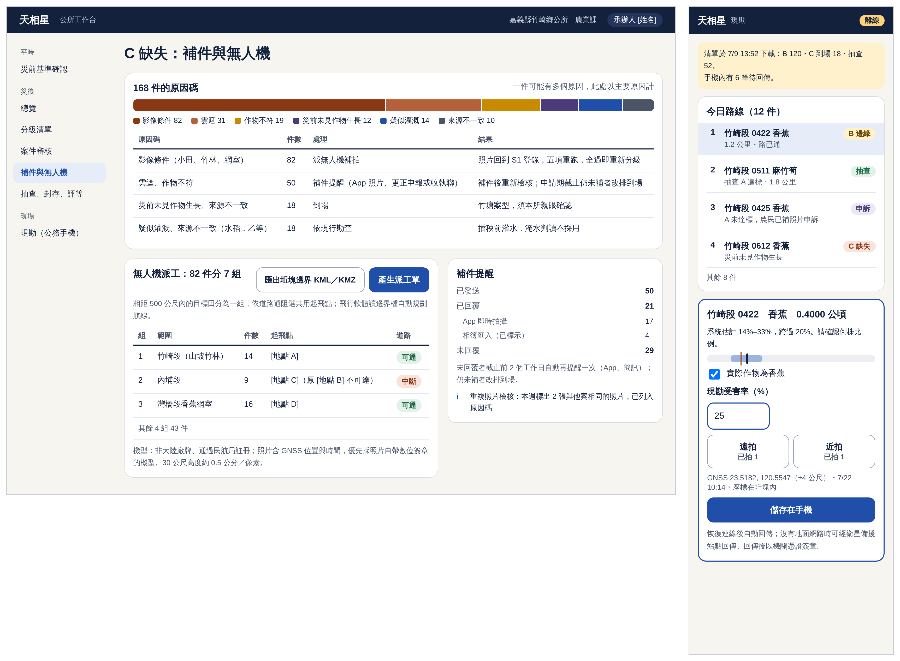

**圖 42　公所端 C 缺失處理（左）與現勘公務手機（右）。** 左：168 件 C 缺失依原因碼分流，82 件分 7 組派無人機；右：今日路線依 B 邊緣、抽查、申訴、C 缺失排序，離線作業。資料為示意。

**(12) 可溯源資料**

存證報告能否作為證據，關鍵不僅在於判讀結果，更在於任何人皆能追查結果的來源與計算過程，並重算得到相同答案。本作品為每份報告建立五個層級的資料來源紀錄（表 57），並採用既有國際標準：影像與衍生資料以遙測業界通用的 STAC 描述〔90〕，處理過程則以 W3C PROV 模型記錄「哪個資料經過哪個處理、由誰或哪個程式產生」〔91〕。

**表 57　可溯源資料的紀錄層級**

| 紀錄層級 | 記錄內容 | 用途 |
|---|---|---|
| 原始影像 | 衛星、影像編號、取像時間、雲量與補值旗標 | 證明用的是哪一天、哪一顆衛星 |
| 處理過程 | 前處理步驟與參數、程式版本 | 確認處理方法一致、可重做 |
| 判讀結果 | 模型版本、輸入特徵、輸出機率與損失區間、證據檢核與分級 | 說明為什麼判成這一級 |
| 人工處理 | 公所現勘結果、承辦人員、時間、照片編號 | 區分系統判讀與人工判定 |
| 對應關係 | 地號、坵塊編號、申請案號 | 一份報告對應哪一筆申請 |

可溯源資料具有三項用途：其一，審計或申覆時可調出同一批影像與同一版模型重算，確認結果未遭改動；其二，模型每次災後重新訓練，舊案件仍可依當時版本重現判定；其三，於衛星無法觀測損失時仍能提供種植證據。對於寒害空果（如臺東芒果〔92〕）、網室與設施作物，或落果但樹冠完整等情形，損失率仍須由公所現勘或天氣參數判定；但可溯源的災前紀錄仍能證明「災前有種、種什麼、面積多大」。依現行規定，達天氣參數且具種植客觀證明者得免勘查〔3〕，故此類案件仍可能走免勘程序，至少可免去「確認有種」這一半的現勘工作。

**(13) 資料傳遞結構與權責單位**

本作品的運作需要三類資料：衛星影像（Sentinel 免費、福衛八號向經銷商購買）、地籍坵塊（內政部國土測繪中心，限制公開資料須由機關備文申請），以及救助申請與作物資料（農業部農糧署「農產業天然災害現金救助系統」與農業部農地資料庫，含個資，須以公所或縣市政府為委託機關才能取得）。產出的存證報告則一律先交公所，再依法定層級往上送，本作品不直接對縣市或中央送件。以下依序說明資料傳遞架構、資料來源與取得單位、資料與文件的索取位置、須送交的申請文件、產出文件與法定表單的對應、各層級接收單位，以及必須經過的法定程序。

如圖 43 所示，資料由左側各供應單位進入天相星資料中心，經判讀後產出存證報告與清單交予公所，公所勘查完成後再依序層報縣市政府與農糧署；現勘結果則回填資料中心，試辦成果與準確度報告另送農業部，作為公告認可客觀證明文件的依據。本作品於法定七步驟中僅接「公所勘查」一步，另於災後以熱區圖作為縣市報請公告的佐證；給縣市的異常排序僅作抽查參考，抽選仍以救助系統隨機為原則〔77〕〔103〕。

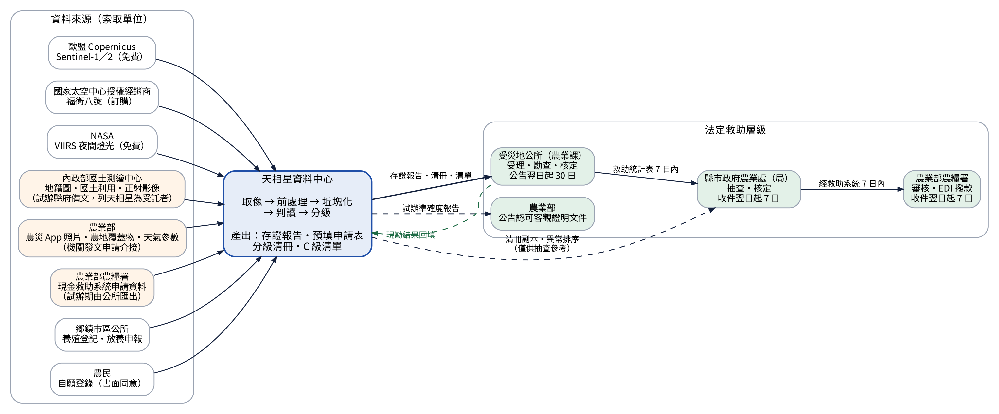

**圖 43　資料傳遞架構。** 左為資料來源與供應單位，中為天相星資料中心，右為法定救助層級與期限。

表 58 依「缺少即無法運作」的程度，列出本作品所需的 13 項資料、主管或供應單位與取得方式。其中僅 Sentinel、VIIRS 與公告資訊可直接取得；地籍、救助與作物資料均須由機關出面。含個資的資料——申請資料、作物申報、App 照片、現勘結果與養殖申報——決定了本作品無法自行蒐集，只能以公所或縣市政府「受託者」的身分使用。此外，國土測繪中心的地籍圖檔申請書規定，未經書面許可不得重製或交付他人，委託他人處理須於備註欄載明並於事後收回，對位成果僅提供 TWD97 SHP 格式〔109〕；因此地籍資料宜由試辦縣市政府申請，並將本作品列為受託者。

**表 58　所需資料與取得單位**

| 資料 | 用途 | 必要程度 | 含個資 | 主管或供應單位 | 取得方式 |
|---|---|---|---|---|---|
| Sentinel-1／2 影像 | 颱風後穿雲取像；災前作物時序 | 必要 | 否 | 歐盟 Copernicus | 免費下載；散布時標示「Contains modified Copernicus Sentinel data [年]」〔72〕 |
| 福衛八號影像 | 小於 0.3 公頃的田、魚塭在養證據 | 重要 | 否 | 國家太空中心（TASA）；經銷商：互動國際、中央大學太空及遙測研究中心、興創知能 | 向經銷商訂購；政府供應向國家太空中心洽辦，試辦期先向經銷商訂購〔110〕〔112〕 |
| 舊福衛（二、五號）影像 | 歷史時序補充 | 輔助 | 否 | 農業部農航所圖資供應平台 ATIS | 線上申購〔111〕 |
| GIS 地籍圖、段籍、國土利用現況調查、正射影像 | 把影像切成坵塊與地號，對應申請案 | 必要 | 地號否；配上所有權人即是 | 內政部國土測繪中心 | e 商城或臨櫃；限制公開資料僅限機關備文；依收費標準付費〔107〕〔108〕 |
| 地號所有權資料 | 核對使用權 | 必要 | 是 | 土地所在地之直轄市、縣（市）地政事務所（登記機關，《土地登記規則》第 3 條〔113〕）；中央主管機關為內政部 | 不對外提供；由受理救助的公所於案件中以「地政資訊查詢系統」查詢〔103〕 |
| 救助申請、勘查與抽查資料 | 申請人、地號、申報作物與損失；作為「申報一致」檢核與 R1–R5 的依據 | 必要 | 是 | 農業部農糧署（救助系統）；公所為登錄端 | 系統介接須農糧署同意；試辦期由公所匯出本轄案件〔103〕 |
| 農災 App 照片 | B、C 級現場佐證、回填校正 | 重要 | 是（座標與拍攝人） | 農業部；每小時同步至「農業現調相片圖臺」與救助系統 | 向農業部申請 API 介接〔101〕 |
| 全國農地覆蓋物動態資料庫 | 作物判釋訓練標註與交叉比對 | 重要 | 是 | 農業部（整合糧政、產銷履歷、救助、農保資料） | 向農業部申請；未查到公開申請窗口〔101〕 |
| 天氣參數、1 公里網格 | 確認天災成因；判斷免勘條件 | 重要 | 否 | 農業部與中央氣象署；參數資料來源為農糧署、漁業署、林業及自然保育署 | 公告公開；網格需申請介接〔19〕〔104〕 |
| 救助公告 | 決定哪些地號要比對 | 必要 | 否 | 農業部 | 公告公開 |
| 養殖登記與放養申報 | 魚塭災前在養佐證 | 魚塭模組必要 | 是 | 鄉鎮市區公所受理；中央為農業部漁業署 | 由公所提供本轄資料〔82〕 |
| VIIRS 夜間燈光 | 沿海停電範圍與天數 | 輔助 | 否 | NASA | 免費下載〔66〕 |
| 公所現勘結果 | 模型驗證與每次災後重新訓練 | 必要（試辦後） | 是 | 公所 | 經平台回填 |

資料的「索取位置」決定了由誰出面、到哪裡申請，以及須攜帶哪些文件。依索取者區分，可分為三組：第一組為天相星資料中心（或其委託機關）向主管機關申請的資料（表 59）；第二組為農民參與登錄時須自行索取的文件（表 60）；第三組為災後各項文件的提交窗口（表 61）。整體而言，農民自己要跑的窗口只有土地所在地地政事務所（謄本、鑑界）與公所或農會（申報、租約登記）；地籍圖、國土利用調查與航照由天相星統一申請；災後所有申請文件均交受災地公所，例外僅有分級清冊副本交縣市政府，以及低利貸款的第二步交貸款經辦機構。

**表 59　天相星資料中心的資料索取位置**

| 資料 | 索取單位 | 索取位置與管道 | 申請資格與應備文件 |
|---|---|---|---|
| Sentinel-1／2 影像 | 歐盟 Copernicus | Copernicus Data Space Ecosystem 線上下載 | 免費；散布時標示來源〔72〕 |
| 福衛八號影像 | 國家太空中心（TASA）授權經銷商 | 互動國際數位、國立中央大學太空及遙測研究中心、興創知能三家經銷商；政府機關供應方式向 TASA 洽詢 | 訂購或合作申請書（取像範圍、頻率、授權範圍）〔110〕〔112〕 |
| 舊福衛（二、五號）影像 | 農業部農航所 | 圖資供應服務平台 ATIS 線上申購 | 線上申購〔111〕 |
| 地籍圖檔（SHP、DXF） | 內政部國土測繪中心 | 國土測繪圖資 e 商城（線上），或臺中售圖站臨櫃（臺中市南屯區大業路 611 巷 19 號，04-22522966 分機 348–350，08:00–12:00、13:00–17:00）；大量串接用「地籍圖 API」 | 機關、團體、個人皆可申請，以段為單位、每筆 2 元；提供給農民看屬加值利用，須附加值利用申請書與同意書、團體設立證明；API 由公司送訂閱申請書並以工商憑證申請；限制公開資料由試辦機關備文，備註欄載明受託者〔108〕〔109〕〔115〕 |
| 國土利用現況調查成果 | 內政部國土測繪中心 | 國土測繪圖資服務雲介接服務：WMS 圖層免申請；可計算資料經 API 申請 | API 訂閱申請書〔116〕 |
| 正射影像 | 內政部國土測繪中心 | 臺中售圖站（須於售圖站訂購） | 申購資格與費用待確認〔108〕 |
| 地號所有權資料 | 土地所在地之直轄市、縣（市）地政事務所（登記機關）；中央主管機關為內政部 | 不對外提供；由受理救助的公所於案件中以「地政資訊查詢系統」查詢；天相星不直接取得，只接收公所核對結果 | 公所查詢帳號的開通單位待向試辦縣市地政局（處）確認〔103〕〔113〕 |
| 救助申請、勘查與抽查資料 | 農業部農糧署 | 農產業天然災害現金救助系統；試辦期由公所匯出本轄案件 | 試辦縣市政府或公所發文申請介接，須農糧署同意〔103〕 |
| 農災 App 照片 | 農業部 | 農業現調相片圖臺（每小時同步）；API 介接 | 向農業部申請 API 介接〔101〕 |
| 全國農地覆蓋物動態資料庫 | 農業部 | 未查到公開申請窗口 | 由試辦機關發文申請〔101〕 |
| 天氣參數、1 公里網格 | 農業部與交通部中央氣象署 | 農業天然災害即時資訊儀表板（公告公開；災害期間每日更新 4 次）；網格須申請介接 | 介接申請〔19〕〔101〕〔104〕 |
| 養殖登記與放養申報 | 鄉鎮市區公所（中央主管為農業部漁業署） | 魚塭所在地公所 | 由公所提供本轄資料〔82〕 |
| VIIRS 夜間燈光 | NASA | Black Marble 產品頁線上下載 | 免費〔66〕 |

**表 60　農民參與登錄時的文件索取窗口**

| 文件 | 誰準備 | 索取窗口 | 誰可以申請 | 要帶什麼 |
|---|---|---|---|---|
| 土地登記謄本第一類 | 地主 | 土地所在地地政事務所 | 登記名義人本人或代理人 | 身分證明；網路申請用自然人憑證 |
| 土地登記謄本第二類 | 非地主 | 土地所在地地政事務所 | 任何人 | 地段地號；申請書簽名或蓋章 |
| 綠色環境給付申報收執聯 | 農民 | 土地所在地公所（任一公所或農會亦可受理；每年 1 月全國統一受理） | 實際耕作者 | 權狀或謄本、使用證明、帳戶 |
| 三七五耕地租約登記 | 出租人與承租人 | 土地所在地公所 | 雙方共同 | 申請書 2 份、租約正本 2 份副本 1 份、自任耕作切結書、土地登記謄本、雙方身分文件、出租人印鑑證明；只租一部分另附地籍圖謄本與租佃位置圖 3 份 |
| 一般租約、使用同意書 | 地主與使用人 | 無機關 | 雙方 | 雙方簽名蓋章 |
| 公有地租約或同意書 | 承租人 | 該筆土地的公地管理機關 | 承租人 | 依管理機關規定 |
| 養殖漁業登記證 | 養殖戶 | 魚塭所在地公所受理、縣市政府核發（高雄為海洋局） | 養殖戶本人；非地主需地主同意書 | 身分證明與印章、申請書 2 份、三個月內土地登記謄本與地籍圖謄本、水權狀 |
| 放養申報紀錄 | 養殖戶 | 魚塭所在地公所 | 實際養殖者；魚塭出租由承租方 | 須於災害前完成 |
| 土地複丈成果圖（鑑界，僅範圍對不上時） | 地主 | 土地所在地轄區地政事務所 | 所有權人或管理人 | 複丈申請書、權利證明、身分證明、印章；本人到場；每筆每公頃 4,000 元，不足 1 公頃以 1 公頃計 |
| 個資告知與同意書 | 天相星提供、農民簽署 | 登錄時線上 | 農民本人 | 無 |

資料來源：謄本分類依《土地登記規則》第 24-1 條〔113〕；身分與憑證依內政部函〔114〕；鑑界依臺中市地政事務所須知〔117〕；三七五租約依新北市八里區公所說明〔118〕；養殖登記證依高雄市政府海洋局〔119〕；綠色環境給付申報依農糧署計畫重點與申報期程〔121〕〔122〕。

**表 61　災後文件的提交窗口**

| 文件 | 誰準備 | 提交給 | 期限 | 備註 |
|---|---|---|---|---|
| 現金救助申請表 | 天相星預填，農民確認簽章 | 受災地公所 | 公告翌日起 10 個工作日 | 逾期不受理 |
| 身分證、私章 | 農民 | 受災地公所 | 同上 | 委託他人送件時由受託人攜帶 |
| 存款簿（農會信用部帳號） | 農民 | 受災地公所 | 同上 | 非當地農業金融機構帳戶，跨行手續費由農民負擔 |
| 土地證明（權狀、謄本或申報收執聯） | 農民（參與時已上傳副本） | 受災地公所 | 同上 | 公所查得到者免附 |
| 土地使用證明（租約、使用同意書） | 非地主 | 受災地公所 | 同上 | 近兩年已登錄農業部系統者免附 |
| 田區存證報告 | 天相星 | 受災地公所（隨申請附上） | 同上 | 現行為參考佐證 |
| 農業部現地照相 App 照片 | 農民 | 自動同步至農糧署救助系統 | 災後儘早，受理期間內 | 公所認定損失率超過 20% 可免實地勘查 |
| 養殖漁業登記證、水權狀、放養申報 | 養殖戶 | 受災地公所 | 同上 | 放養申報須於災前完成 |
| 分級清冊、需現勘清單 | 天相星 | 受災地公所 | 公所 30 日勘查期內，越早越好 | 依農民同意或公所委託 |
| 分級清冊副本（含異常程度排序） | 天相星 | 受災地縣（市）政府農業處（局） | 公所層報救助統計表前 | 供彙整與抽查參考；抽選仍以救助系統隨機為原則 |
| 復查申請 | 農民 | 受災地公所 | 接獲通知後 7 日內 | 天相星可提醒並提供存證報告 |
| 更正增撥申請 | 農民 | 受災地公所 | 公告辦理翌日起 4 個月 | 限統計或登錄錯誤 |
| 低利貸款受災證明書申請 | 農民 | 受災地公所 | 低利貸款公告翌日起 10 個工作日 | 申請表上可一併勾選 |
| 低利貸款申請暨計畫書 | 農民 | 貸款經辦機構 | 受災證明書核發翌日起 30 個工作日 | 附受災證明書 |

以花蓮光復農作物案件為例，各環節的具體窗口為：土地登記及謄本對接花蓮縣鳳林地政事務所〔133〕；數值地籍圖向內政部國土測繪中心申請；農民救助申請、復查與受災證明書交光復鄉公所；公所清冊報花蓮縣政府農業處，再由農糧署辦理農作物救助審核撥款；光復鄉農會協助既有政策申報與送件〔103〕〔134〕。

資料來源：救助辦法第 12、19 條〔102〕；作業要點〔103〕；高雄市公所申辦說明〔120〕；農業部農災 App 說明〔101〕。另須注意，公所公告要求權狀「正本」，與作業要點的「可免附」不一致，實際以受理公所為準；救助申請目前未查到線上受理窗口，「農業數位整合服務」App 可查詢救助紀錄〔123〕。

須提交的文件分為兩類。第一類是為取得資料而送出的申請文件（表 62），多數須由試辦機關出具；第二類是本作品產出、須進入救助流程的文件（表 63），本作品的原則是對齊現行法定表單，不另創格式。

**表 62　取得資料須送的文件**

| 文件 | 內容 | 由誰出具 |
|---|---|---|
| 地籍圖檔申請書 | 申請人、使用目的、縣市鄉鎮與地段代碼、圖檔格式；備註欄載明受託者 | 試辦縣市政府 |
| 加值利用申請書與同意書 | 地籍成果若要另外加值運用，附團體設立證明 | 申請單位 |
| 資料介接申請公文 | 介接救助系統、農災 App、農地覆蓋物資料庫的目的、欄位、期間、個資保護措施 | 試辦縣市政府或公所 |
| 委託契約（或合作備忘錄） | 受託範圍、個資處理規定、資安要求、違約責任 | 機關與天相星雙方 |
| 福衛八號訂購或合作申請 | 取像範圍、頻率、授權範圍 | 天相星向經銷商；政府供應向 TASA 洽詢 |

**表 63　產出文件與法定表單的對應**

| 文件 | 內容 | 對應的法定表單或程序 | 交給 |
|---|---|---|---|
| 田區衛星存證報告（每坵塊一頁） | 地號與面積、災前作物判釋、災前災後影像日期與編號、損失區間、A／B／C、可信度、模型版本、來源標示 | 種植或養殖客觀證明文件（需公告認可）；公所案件附件 | 公所 |
| 影像存證 | 遠拍與近拍各一張，可辨識日期與地段地號；衛星圖可作「遠拍」補充 | 作業要點對公所勘查的影像存證規定 | 公所 |
| 預填現金救助申請表 | 耕地標示、作物面積、申請人資料（不含帳號） | 作業要點附件三現金救助申請表〔79〕 | 農民確認簽章後送公所 |
| A／B／C 分級清冊 | 申請案號、地號、分級、原因碼、損失區間 | 公所「救助統計表」附件 | 公所 → 縣市 |
| B、C 級清單 | 優先序、位置、原因碼、要確認的項目 | 匯入農災 App 調查專案；優先勘查已屆採收期、需即時復耕者 | 公所 |
| 縣市抽查參考名單 | 依異常程度排序的戶別 | 救助系統隨機抽選為原則，只作參考 | 縣市政府 |
| 現勘回填與逐類別精確度報告 | 兩種 A 精確度下界、直接判定率、B 邊緣確認率、作物判釋準確率 | 試辦成果報告，作為申請公告認可的依據 | 農業部（經農糧署） |

各層級接收單位所收到的文件與其法定工作期限如表 64。需特別區分的是兩種性質不同的抽查：縣市抽查依公所申請總戶數決定戶數——未達 100 戶至少 5 戶（10 戶以下抽半數）、100 至未達 500 戶抽 5%、500 至未達 1,500 戶至少 25 戶、1,500 戶以上至少 30 戶，符合率達 90% 為合格，抽查以兩次為限〔103〕；而公所自身「無客觀證明者抽樣勘查 20% 以上」〔3〕則屬另一規定。因此，丙、乙等時公所依現行規定勘查；甲等時 A 達標與 A 未達標各抽查 20%，抽查結果同時作為 S8 評等樣本；縣市抽查則始終以救助系統隨機抽選。

**表 64　各層級接收單位與法定期限**

| 接收單位 | 收到什麼 | 法定工作與期限 |
|---|---|---|
| 鄉（鎮、市、區）公所（農業課、救助專案小組） | 存證報告、分級清冊、B、C 級清單、預填申請 | 受理申請；公告翌日起 30 日內完成勘查，將救助統計表層報縣市；完成勘查後 7 日內報送全部案件 |
| 直轄市、縣（市）政府（農業處／局） | 公所的救助統計表與附件；抽查參考名單 | 災後 7 日內報請中央公告；收件翌日起 7 日內抽查，組抽查小組並邀試驗改良場所與農糧署分署；核定後 7 日內報農糧署 |
| 農業部農糧署 | 縣市的救助統計表與抽查紀錄表（經救助系統） | 收件翌日起 7 日內審核；以 EDI 匯入縣市或公所公庫；彙整災情通報農業部統計處 |
| 農業部 | 試辦成果報告、認可衛星存證的政策建議 | 公告救助地區與品項；公告天氣參數；定「客觀證明文件」的範圍 |
| 農業部各試驗改良場所 | 致災原因有疑義時的衛星佐證 | 與縣市共同認定損失程度（救助辦法第 6 條）；參與縣市抽查 |
| 農業部漁業署 | 魚塭存證的認可申請 | 漁業天災查報及救助作業程序主管 |

最後，本作品自取得資料至產出具效力的證據，須經六個法定程序（表 65、圖 44）。其中第 1 至 3 步為取得資料的前提，第 5 步則是免勘能否成立的關鍵。此外，農民自行於 App 登錄時，本作品屬非公務機關，其蒐集處理依個資法第 19 條以當事人書面同意為依據，故登錄流程與簡訊版均納入個資告知與同意（見三、1(6)）；魚塭首頁亦提醒放養申報須於災害發生前向公所完成，否則衛星證據再完整亦缺乏法定前提。

**表 65　必須經過的法定程序**

| 步驟 | 內容 | 法令依據 |
|---|---|---|
| 1 找到試辦機關，簽委託或合作契約 | 天相星是非公務機關，不能自行蒐集救助申請者個資；由公所或縣市政府委託，在委託範圍內處理 | 個資法第 15、16 條（公務機關）、第 19、20 條（非公務機關）〔105〕 |
| 2 通過資安要求 | 機關委外資通系統須選任適當受託者，受託者應具備完善資安管理措施或通過第三方驗證，並簽書面契約 | 資通安全管理法第 10 條（2025 年 12 月 1 日施行）〔106〕 |
| 3 申請地籍與系統介接 | 機關備文向國土測繪中心申請限制公開地籍資料並備註受託者；向農糧署申請救助系統資料、向農業部申請農災 App 與農地資料庫介接 | 〔107〕〔109〕 |
| 4 公所試辦，丙、乙等只作科學技術輔助 | 丙等結果不交公所，乙等分級只作參考與排序，法定勘查照常；不得以切結取代實地勘查 | 救助辦法第 12 條；作業要點〔102〕〔103〕 |
| 5 申請公告認可為「客觀證明文件」 | 免勘需同時符合「達公告天氣參數或嚴重災損公告」與「具客觀證明」；證明文件範圍由農業部另行公告，以逐類別精確度報告經農糧署申請列入；此即甲等的「政府審核」，並一併取得 A 未達標通知的作業依據 | 救助辦法第 12 條；作業要點 |
| 6 散布影像時標示來源 | 存證報告加註 Copernicus 標示；福衛八號依購買授權條件 | 〔72〕 |

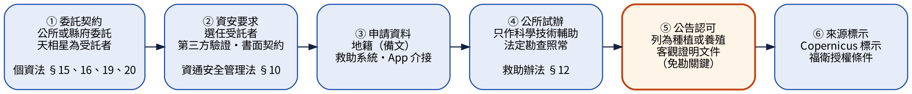

**圖 44　必須經過的六個法定程序。** 第 ⑤ 步為免勘能否成立的關鍵。

本節引用的法規版本為：《農業天然災害救助辦法》2026 年 6 月 29 日修正〔102〕、《農產業天然災害救助作業要點》2025 年 3 月 10 日修正〔103〕，天氣參數修正規定適用於 2026 年 7 月 1 日以後發生的天災〔104〕。種植客觀證明文件的範圍已由 2025 年 4 月 18 日公告明定（見二、1(6)）〔128〕。尚待確認者包括：福衛八號對政府的供應方式與價格、救助系統與農災 App 及農地覆蓋物資料庫的介接窗口、地籍圖資料是否屬限制公開，以及《漁業天然災害災情查報及救助作業程序》原文。

**(14) 門檻與系統等級：從參考資料到參與判定**

**精確度不必等新的災害：準備期以過去災害的核定資料回溯驗證，丙、乙等以全部現勘逐類別量測，甲等以法定 20% 抽查持續監測；所有比例一律看 95% 單側信賴下界，未達即降等。**

存證報告要參與判定，須做到三件事。第一，颱風後拍得到、而且看得到損失本身：以三層取像處理，Sentinel 全區篩選、標出候選 A 級，只對候選 A 級集中的熱區下單 1 公尺以下的商業或福衛八號影像，再以 App 照片、無人機與現勘交叉確認；歐盟同樣以框架契約採購高解析影像作確認〔175〕（本節 (15)）。第二，模型輸出損失率，而不只是「有變化」：Sentinel 影像可回溯至 2015 年，公所每場災害都有核定清冊，試辦前 3–6 個月取得過去 2–3 場災害的核定資料重跑判讀，即可依作物算出兩種 A 的精確度並完成校準；回溯結果併入丙等樣本。第三，精確度有統計保證：依 Clopper–Pearson 信賴區間〔183〕，要以 95% 信心證明某類別精確度至少 95%，59 件無誤判即可；判 A 達標與判 A 未達標的門檻以 Learn then Test 依作物選定〔182〕。

*指標*

只有 A 級有對錯可言：B、C 都交給人處理，不算判對或判錯，所以準確與否只看 A；能省下多少人力，看 A 級占全部申請的比例。評等使用的指標如表 66。

**表 66　評等指標**

| 指標 | 定義 | 層級 |
|---|---|---|
| A 達標精確度 | 判 A 達標的案件中，現勘確實損失 ≥ 20% 的比例 | 類別 |
| A 未達標精確度 | 判 A 未達標的案件中，現勘確實損失 < 20% 的比例 | 類別 |
| 判定正確率 | 全部 A 級案件中，現勘結論和系統判定一致的比例（兩種 A 合計） | 整體或類別 |
| 直接判定率 | A 級占全部申請的比例 | 整體或類別 |
| B 級比例、C 級比例 | B、C 各占全部申請的比例 | 整體或類別 |
| B 邊緣確認率 | 判 B 的案件中，現勘損失確實落在 10%–30% 的比例 | 類別 |

判定正確率和直接判定率要一起看：只判少數最明顯的案件，判定正確率很容易高，但直接判定率低，對公所沒有幫助；判很多 A 但判錯多，直接判定率高也沒有意義。B 邊緣確認率檢查系統「說不準」的時候，是不是真的說不準：判 B 的案件若現勘下來大多是 0% 或 80%，表示損失區間開得太寬，很多本來可以判 A 的案件被浪費。C 級不算精確度，只追蹤 C 級比例和原因碼分布，用來找出最常缺的是什麼資料。一塊田本身沒有精確度，只有可信度等級、損失區間和原因碼；精確度都是累積很多塊田之後才算得出來。看下界而不看觀察值，是因為樣本少時觀察值會高估：抽查 20 件全對，觀察值 100%，下界只有 86%〔183〕。

*升等條件*

**表 67　系統升等條件**

| 條件 | 丙 → 乙 | 乙 → 甲 | 依據 |
|---|---|---|---|
| A 達標精確度（下界） | ≥ 95% | ≥ 95% | 歐盟面積監測系統誤判上限 5%〔150〕 |
| A 未達標精確度（下界） | ≥ 95% | ≥ 95% | 同上；判錯的代價是該給的沒給，和溢領一樣嚴重 |
| 判定正確率（下界） | ≥ 90% | ≥ 90% | 起始值；某一種 A 件數少、單獨算不出可靠下界時的整體下限 |
| 直接判定率 | ≥ 50% | 依丙等實測的 B 級比例訂定，不低於 50% | 公所 30 日量能推導，見表 68 |
| B 邊緣確認率（下界） | ≥ 80% | ≥ 80% | 起始值，比照佐證用途的 80% |
| 連續達標的災害場次 | — | ≥ 10 場 | 不同災害之間差異大，見下文 |
| 政府審核 | — | 通過，列入種植客觀證明或作業要點，並含 A 未達標通知的依據 | 救助辦法第 12 條，客觀證明的範圍由農業部公告〔77〕 |

標為起始值者，丙等累積一年的資料後依實測校正。兩種 A 精確度各自 ≥ 95% 時，合計的判定正確率一定 ≥ 95%；判定正確率 90% 的作用是在其中一類件數很少時提供整體下限。

**直接判定率的下限由公所量能決定。** 以 2021 年 8 月豪雨規模（須現勘 315,266 筆，全國公所 30 日量能 18,564 人日）計算，A 級書面審核或通知每人日 200 筆、抽查每人日 15 筆，B、C 級每人日可處理 c 筆，公所在 30 日內處理完的條件是：

> 315,266 ×〔a ÷ 200 ＋ 0.2a ÷ 15 ＋ (1 − a) ÷ c〕≤ 18,564

**表 68　公所 30 日內處理完所需的直接判定率**

| B、C 每人日可處理 | 直接判定率 a 至少 |
|---|---|
| 15 筆 | 16.1% |
| 12 筆 | 37.6% |
| 10 筆 | 50.3% |

B、C 級是較難的案件，因此取最保守的每人日 10 筆，乙等門檻訂為 50%。直接判定率的上限則由真實損失的分布決定：損失本來就落在 20% 附近的田，模型再準也只能判 B，B 級多寡取決於這場災害有多少田剛好受損 10%–30%，不完全取決於模型。所以甲等的直接判定率目標，以丙等實測的 B 級比例訂定，不設一個與損失分布無關的固定數字。

**連續 10 場的理由與時程。** 同一套系統在不同災害之間差異很大，歐盟洪水監測服務 2023 年 12 個驗證事件中只有 8 個達到目標〔162〕，所以要求多場連續達標；同時檢定十幾個類別時總有一個可能碰巧通過，連續多場也降低了這個風險。2025 年有 5 起颱風豪雨公告救助，其中件數足以驗證的通常 1–3 起；連續場次自試辦起以鎖定版本計算，以每年 2–3 場計，約 3–5 年，甲等約自第 4–5 年起逐類別進入。若丙、乙等期間各場之間的差異小，團隊將以累積的逐類別精確度報告申請縮短場次。

*整體與類別、降等*

類別要分開評，是因為件數多的類別會掩蓋件數少的類別。例：某場災害判 A 共 1,000 筆，水稻 950 筆、精確度 98%，香蕉 50 筆、精確度 70%，整體精確度為（931 ＋ 35）÷ 1,000 ＝ 96.6%，整體達標，香蕉卻每 10 筆錯 3 筆。分類別評等後，香蕉留在丙等，該類全部到場，不影響水稻升等。

降等規則有三條：甲等或乙等的類別，任一場災害後 A 達標或 A 未達標的精確度下界低於 95%，下一場即降一等；降等後連續達標場次歸零，重新累積；降等只會讓更多案件到場，不會產生錯誤的免勘或駁回。

每場災害後的評等在公所端以一個畫面完成（圖 45）：S7 封存批次的根雜湊、甲等類別 20% 抽查的結果，以及 S8 逐類別計算的兩種 A 精確度下界、直接判定率、B 邊緣確認率與連續達標場次，直接決定下一場的等級。圖中「香蕉 × 倒伏」本場抽查出 1 件 A 未達標判錯，A 未達標精確度下界降到 93.6%，下一場即降為乙等、連續場次歸零。

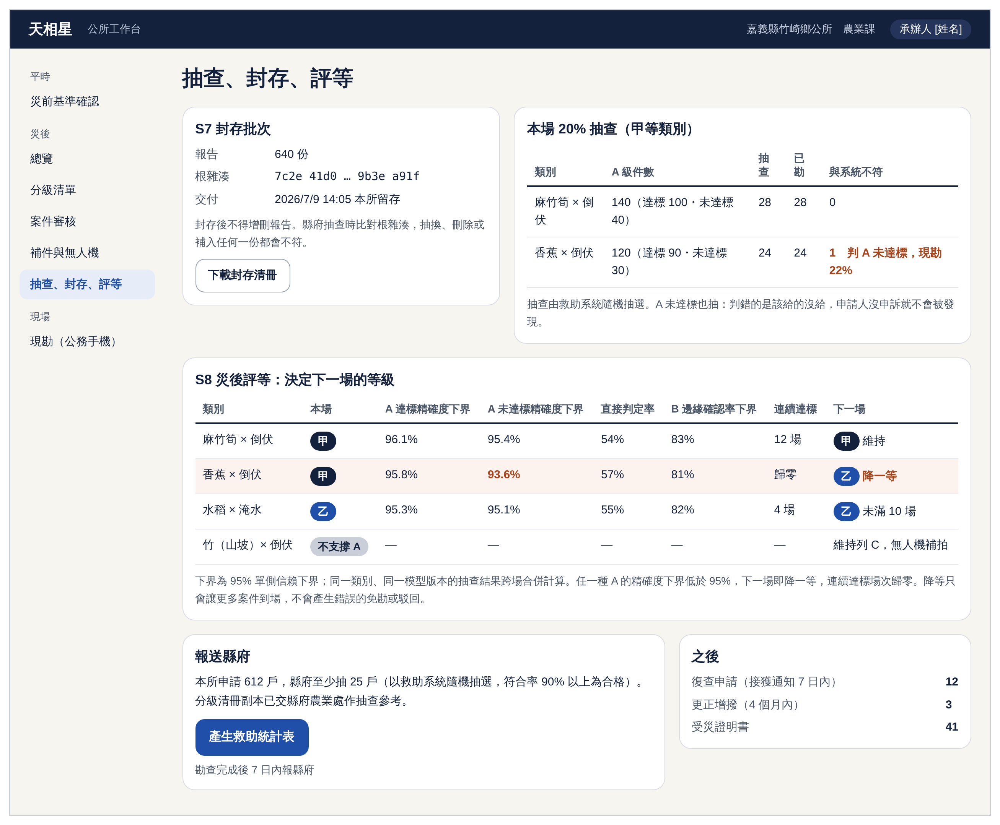

**圖 45　公所端抽查、封存與評等畫面。** 下界為 95% 單側信賴下界；同一類別、同一模型版本的抽查結果跨場合併計算。資料為示意。

*樣本數*

**表 69　以 95% 信心證明比例達標所需的件數（Clopper–Pearson）**

| 要證明的比例 | 0 件判錯 | 1 件判錯 | 3 件判錯 | 10 件判錯 |
|---|---|---|---|---|
| 80% | 14 | 22 | 37 | 82 |
| 90% | 29 | 46 | 76 | 167 |
| 95% | 59 | 93 | 153 | 336 |
| 98% | 149 | 236 | 386 | 845 |
| 99% | 299 | 473 | 773 | 1,693 |

丙、乙等全部現勘，每一筆都是樣本：某類別一場災害有 59 筆以上判 A 而且全對，下界即達 95%。甲等只有抽查的部分是樣本：抽查 20% 時，某類別要有 295 筆以上 A 級（59 ÷ 20%）才能在一場災害內驗證 95%。件數不足的類別有兩種做法：同一類別、同一模型版本的抽查結果跨場合併計算，模型改版後舊樣本不併入；或提高該類別的抽查比例，例如只有 150 筆 A，抽 59 筆（約 39%）。

*判讀元件的使用門檻*

系統等級決定 A／B／C 能不能交給公所；判讀元件的門檻決定某一種衛星訊號能不能拿來支撐 A 級判定（表 70）。元件未達標時，用它判出的案件一律歸 B 或 C。

**表 70　各判讀元件支撐 A 級的條件**

| 元件 | 可支撐 A 級的條件 | 未達時 |
|---|---|---|
| 水稻判釋 | 與現勘相符的坵塊準確率下界 ≥ 80%，且鄉鎮面積偏差 ≤ ±20% | 作物以申報為準，衛星只查物候 |
| 水稻以外作物 | 各作物準確率下界 ≥ 80% | 同上 |
| 淹水 | 單一來源須坵塊精確度下界 ≥ 95%；否則須雷達與光學一致或有 App 照片 | 插秧期稻田歸 C，原因碼「疑似灌溉」 |
| 倒伏（Sentinel） | 與現勘比對的精確度下界 ≥ 80% 才作佐證，不單獨支撐 A | 歸 B 或 C |
| 倒伏、倒株（1 公尺以下影像） | 坵塊精確度下界 ≥ 95% | 歸 B 或 C |
| 埋沒、流失 | 坵塊精確度下界 ≥ 95% | 須 App 照片佐證 |
| 植生異常 | 不單獨支撐 A | 只作排序與佐證 |
| 損失模型 | 每作物均方根誤差 ≤ 10 個百分點 | 該作物的損失區間只作參考，案件歸 B |
| 損失區間 | 第 10–90 百分位覆蓋率落在接受範圍內 | 以保形校準放寬或收窄 |
| 魚塭在養 | 判 A 時須有放養申報 | 無放養申報者歸 C |
| 池水流失、整池潰堤 | 放養申報且同期無收成申報；潰堤須熱區高解析影像確認堤岸被淹 ≥ 80% | 歸 C |
| 山區竹林、網室 | 樹冠遮蔽、倒向雜亂，衛星不支撐 A | 歸 C，無人機補拍後重新檢核 |
| 落果、寒害空果 | 損失由天氣參數判定，衛星只證明種植 | — |
| 長時間對照 L1–L4 | 誠實申請被誤標的比例 ≤ 5% | 只列原因碼 |

**均方根誤差 10 個百分點的由來。** 誤差近似常態、標準差為 σ 時，預測損失 x 的田真實損失低於 20% 的機率是 Φ((20 − x) ÷ σ)。均方根誤差 8、10、12、15 個百分點時，預測 40% 的誤判機率分別約 0.6%、2.3%、4.8%、9.1%；10 個百分點時，以下限 40% 判 A 達標的誤判機率約 2.3%，在 5% 以內。加拿大冰雹研究以 Sentinel-2 對照保險現勘，油菜為 8.2、小麥為 12.3 個百分點，10 個百分點在文獻量級內〔178〕。A 未達標的 10% 門檻距 20% 只有 1 倍 σ，誤判機率約 16%，因此 A 未達標必須同時滿足「上限 ≤ 10%」與實測的精確度下界 ≥ 95%，門檻由 Learn then Test 依作物收緊，10% 只是起始值。

**覆蓋率的接受範圍。** 第 10–90 百分位區間的理論覆蓋率是 80%，以二項分布 95% 範圍為接受標準：樣本 100 件時為 72%–88%，200 件時為 74.5%–85.5%。低於範圍表示區間太窄，A 級可能判錯；高於範圍表示區間太寬，太多案件被歸成 B。

**坵塊層級與區域層級。** 個別案件看精確度，區域總量（熱區圖、縣市提報）看偏差：某鄉鎮實際受損 300 筆，系統判出 300 筆，其中 180 筆判對，坵塊精確度 60%，區域總數偏差卻是 0%。所以系統在丙等時，若區域偏差已在 ±20% 以內，熱區圖和縣市提報即可先使用，個別案件仍全部到場。系統性偏差不會因為田多而抵銷，例如把插秧灌水一律判成積水，所以偏差逐場和官方統計比對。

**現勘本身的誤差。** 評等以現勘結論為標準答案，但現勘本身也有誤差。丙等期間抽一部分案件由兩位承辦分別勘查，量出現勘本身的一致率，作為解讀精確度的基準。

除評等指標外，試辦另以表 71 的作業指標檢查系統是否可用。驗證一律以整場災害為單位留出，避免同場鄰田的資訊外洩；結果並依平地水稻、山區竹林、果園與魚塭等類別報告。

**表 71　作業指標**

| 指標 | 定義 | 目標 |
|---|---|---|
| 出件時間 | 雷達到站至分級完成 | 8 小時內 |
| 災前影像新鮮度 | 最近一張可用災前影像距災害天數 | ≤ 10 日 |
| 勘查完成天數 | 公告日至勘查完成 | 30 日內 |
| 區間覆蓋率 | 現勘損失率落於第 10–90 百分位 | 二項分布接受範圍內（100 件時 72%–88%） |
| 區域偏差 | 系統判出的受損筆數或面積與官方統計之差 | ±20% 以內 |
| 可信度有效性 | 可信度等級「高」與「中」的門檻錯邊比例 | 「高」明顯低於「中」 |
| 查驗與重算 | 抽樣報告重算一致率；查驗失敗件數 | 100%；0 件 |
| 現勘排序（乙等） | B、C 級清單前 30% 涵蓋的實際受損比例 | ≥ 60% |
| R1–R5 檢核品質 | 差異處理率、重複案件辨識率、補件次數 | 丙等中建立基準 |

**(15) 從參考資料到參與判定的技術路徑**

**以 Sentinel 全區篩選、熱區下單 1 公尺以下商業影像確認，並以回溯驗證與現勘回填逐類別證明 A 級精確度，是存證報告由參考資料走到參與判定的技術路徑。**

存證報告要參與判定，除了取得政府審核，技術面需要三件事同時成立：

1. 颱風後拍得到，而且看得到損失本身。
2. 模型輸出的是損失率，而不只是「有變化」。
3. 精確度依類別有統計保證（本節 (14)）。

本節補充前兩件事的做法，模型於丙、乙等期間依此開發。

**① 衛星：比照歐盟「全面篩選、針對性確認」**

歐盟面積監測系統以免費的 Sentinel-1／2 監測每一筆申報地塊〔151〕，但確認時另外採購高解析影像：

- 執委會聯合研究中心與業者簽訂約 2,050 萬歐元、最長 4 年的框架契約，採購約 120 萬平方公里的高解析影像，用於現場查核與地塊資料品質檢核〔175〕。
- Copernicus 也以 Pléiades、Pléiades Neo 等商業衛星，完成全歐洲 2 公尺級的 VHR_IMAGE_2024 影像集，供各國公務機關使用〔176〕。

天相星採用相同的分工。可用的高解析衛星如表 72。

**表 72　可用於確認的高解析衛星**

| 衛星 | 類型 | 解析度 | 取像能力 | 角色 |
| --- | --- | --- | --- | --- |
| Sentinel-1／2（現用） | 雷達、光學 | 10–20 公尺 | 6 天、5 天再訪，免費 | 全國篩選、災前時序 |
| 福衛八號 | 光學 | 1 公尺 | 對臺最高一日三次；第 2 顆預計 2027 年第 1 季升空〔110〕 | 自主來源；小田、魚塭水車 |
| Pléiades Neo | 光學 | 30 公分，具紅邊 | 日內再訪，每日 100 萬平方公里〔171〕 | 雲散後確認倒株、斷竹、潰堤、埋沒 |
| Planet SkySat／Pelican | 光學 | 50 公分；Pelican 第二代 30 公分 | 最多一日 9 次〔173〕；Pelican 規劃最多 32 顆〔174〕 | 同一天多次補拍 |
| ICEYE | X 波段雷達 | 聚束 25 公分–1 公尺；條帶 3 公尺 | 50 顆以上、一日 4 次；標準 8 小時、急件 3 小時出圖〔172〕 | **雲未散時的高解析證據**；保險業已用於理賠驗證〔184〕 |
| 福衛九號 | 雷達 | — | 2028、2030 年發射 | 自主穿雲來源 |

關鍵是 ICEYE 這類 1 公尺以下的商業雷達。颱風後連日有雲，光學再細也拍不到；高解析雷達能在雲未散時看到單口魚塭堤岸（補上 Sentinel-1 看不到的單口溢堤）、成片倒伏的香蕉園與埋沒範圍。

商業影像不買全國，只買熱區。取像分三層：

1. **第一層：Sentinel 全區篩選**，標出候選 A 級。
2. **第二層：熱區下單高解析影像**，只對候選 A 級集中的區域取像。例如 ICEYE 聚束一景 5 × 5 公里，約 2,500 公頃。
3. **第三層：App 照片、無人機與現勘回填**，和高解析影像交叉確認。

商業保險也是這樣用：Ceres Imaging 以災前災後影像替冰雹理賠決定代表性抽樣點，指出傳統抽樣把嚴重受損區高估為 55.8%，實際只占全田 31.4%〔177〕。

**② 模型製作方向**

模型的五個開發方向如表 73。

**表 73　模型製作方向**

| 方向 | 做法 | 參考量級 |
| --- | --- | --- |
| 從「有沒有變化」改成「損失多少」 | 以公所現勘損失率為標的直接迴歸；開發目標為每作物均方根誤差 ≤ 10 個百分點，預測 45% 以上才有機會判 A | 加拿大冰雹：Sentinel-2 時序對照 54 塊田的保險現勘損失，油菜 r = 0.90、均方根誤差 8.2 個百分點，小麥 12.3〔178〕 |
| 高解析影像直接圈出損失 | 1 公尺以下影像語意分割倒伏、倒株、埋沒範圍，以面積比例換算損失率；以整塊田彙總，只收遠高於門檻者 | 高分二號判小麥倒伏 F1 85.3%〔179〕；2 公尺影像判香蕉園 F1 0.86〔180〕 |
| 地理基礎模型微調 | Presto（已用）或 Prithvi-EO-2.0，以公所回填標註微調，不重做預訓練 | Prithvi-EO-2.0 以 420 萬筆 HLS 時序預訓練，優於其他 6 個地理基礎模型〔181〕 |
| 多源融合 | Sentinel 時序、熱區高解析影像、天氣參數、App 照片一起輸入；任一來源結論相反即列 C | — |
| 以統計方法決定 A 級門檻 | 以 Learn then Test 依作物選出判 A 達標與 A 未達標門檻，在有限樣本下保證兩種 A 的誤判率各 ≤ 5%；保證不了的類別留在丙等，案件歸 B 或 C | 〔182〕 |

**③ 回溯驗證：試辦前先用過去的災害校準**

精確度不必等新的災害。Sentinel 影像可回溯至 2015 年，公所每場災害都有勘查核定清冊。試辦前 3–6 個月，向試辦縣市取得過去 2–3 場災害（如凱米、山陀兒、丹娜絲）的核定資料，以當時的衛星影像重跑判讀，即可依作物算出兩種 A 的精確度與損失區間覆蓋率，並完成保形校準〔145〕。回溯結果依表 69 的件數標準併入丙等樣本，等於在試辦前先跑一輪 S8 評等。

**(16) 既有基礎、試辦目標與做法**

表 74 整理本作品各技術環節的既有基礎、試辦目標與達成前的做法；每一項目標在達成前都有可運作的做法，系統不會因任一項延後而停擺。整體而言，前後期變遷偵測、雷達與光學資料、魚塭坵塊辨識與農災 App 介接均已有實用基礎；試辦目標主要在於三方面：一是特定作物（香蕉、竹林）與魚塭在養、水色等判讀尚缺臺灣實測；二是存證報告的法定效力；三是與救助系統的資料介接。前者以丹娜絲案例與丙、乙等的公所回填資料驗證，後二者則依系統等級路徑與試辦機關協調推動。

**表 74　既有基礎、試辦目標與做法**

| 項目 | 已有基礎 | 試辦目標 | 達成前的做法與達成方式 |
|---|---|---|---|
| 前後期變遷偵測 | BigGIS、國土監測、AMS、GFM 已實用 | 針對農作物損失的判讀規則 | 以公所現勘結果回饋修正 |
| 取像頻率 | Sentinel 雙星恢復 | 光學受雲遮擋 | 雷達與光學融合；福衛星系擴充 |
| 小田區辨識 | 福衛八號 1 米 | 小於 0.3 公頃 | 派無人機補拍；無法起飛時到場 |
| 倒伏判釋 | 大田作物文獻（稻田倒伏一致率 64%–88%） | 香蕉、竹林的量化精確度 | 以福衛八號與無人機影像校正，達標前用它判出的案件歸 B 或 C |
| 作物判釋 | Presto 基準版已以真實影像實作 | 水稻面積校正；水稻以外作物的台灣驗證 | 作物種類暫以申報與既有紀錄為準，衛星只查物候；累積回填標註後微調 |
| 魚塭在養與受災 | 魚塭坵塊準確率 91.9%；布袋至北門已實作 | 水車偵測；單口溢堤（Sentinel-1 看不到堤岸） | 在養以放養申報為主證據；單口溢堤改用福衛八號；水色改用電箱與溶氧紀錄 |
| 存證效力 | 免勘規定、App 照片路徑；簽章、時戳、雜湊鏈原型已完成 | 列為種植客觀證明文件 | 丙、乙等作參考資料，「App 照片＋公所認定」路徑照常；以逐類別精確度報告申請政府審核 |
| 與救助系統介接 | 農災 App 已支援調查專案 | 與救助系統直接介接 | 以公所匯出檔銜接，作業完整可行；介接後改為自動同步 |
| 作物異常判讀 | 福衛五號監測中美洲香蕉 | 衛星只能指出異常 | 提醒後由防檢單位採樣確認 |
| 定位樁回傳 | 數發部衛星備援站點 | 手機直連尚未商轉 | 先用既有衛星通訊 |

**(17) 技術元件的成熟度與到位方式**

**26 項技術元件均有可行做法：11 項已可運作，9 項補資料或校準後到位，6 項須商業影像、外部合作或制度認可；各項到位方式與階段列於表 77。**

技術做得出來之後，結果還要足以當證據。團隊因此逐項檢查各技術元件的可行性與可使用性，兩者都達標者列為已可運作，其餘列明到位方式〔166〕。可行性以下列三項任一成立為準：已發表研究有量化驗證、國家或商業系統已實際運作，或本團隊已以真實影像跑出結果。可使用性則依母檔交給該元件的用途分三級檢查（表 75）：判錯的代價越高，要求越嚴。

**表 75　可使用性的三級標準**

| 用途 | 意思 | 判錯的代價 | 通過標準 |
|---|---|---|---|
| U1 排序線索 | 決定先看哪裡、列進 B、C 級清單 | 公所多跑一趟 | 訊號與災損有明確物理關係，且有文獻或實測案例 |
| U2 佐證 | 與照片、申報、現勘並列，由承辦判斷 | 承辦可能採信錯誤證據 | 與地面資料一致率 ≥ 80%（自訂），或已有行政、司法、保險採用同類資料的先例 |
| U3 書面審核依據（A 級） | 公所不到場即認定 | 溢領，承辦負圖利責任 | 法令或公告認可，且依類別兩種 A 精確度下界 ≥ 95%（比照歐盟誤判紅燈上限 5%〔150〕） |

可使用性的先例包括：歐盟以執行規則 2022/1173 將衛星監測寫入給付制度〔151〕；肯亞牲畜保險 KLIP 以衛星植生指數直接理賠、不做現場核損，2017 年 2 月一次撥付約 1 萬戶〔167〕；印度 YES-TECH 的衛星估產占最終產量 30%〔31〕；美國農業部自 2001 年起以資料探勘加衛星影像查作物保險詐欺，每年約 1,500 個農場列入觀察名單〔168〕；國內則有竹塘案法院以空照圖認定災前裸地〔138〕。這些先例證明衛星資料可以進入行政與司法流程，但沒有一例直接以衛星認定個別田區的損失率。

**表 76　技術元件成熟度**

| 成熟度 | 項數 | 項目 |
|---|---|---|
| 已可運作 | 11 | Sentinel 資料取得、埋沒偵測、植生異常（相對往年）、人造物變化（線索）、A／B／C 分級排序、魚塭坵塊、區域停電、長時間對照 L1–L4、可溯源與防偽、衛星通訊備援、雷達到站後 8 小時出件 |
| 補資料或校準後到位 | 9 | 福衛八號（試辦期向經銷商訂購）、坵塊化（試辦機關申請地籍）、水稻判釋（以官方稻作面積校正）、淹水判釋（加插秧期遮罩）、倒伏（以高解析影像校準）、魚塭在養（搭配放養申報）、池水流失（搭配收成申報）、延遲性災損（累積案例後校準）、GNSS 定位樁（坡地預警） |
| 須商業影像、外部合作或制度認可 | 6 | 水稻以外的作物判釋、損失區間校準、存證報告當免勘客觀證明、單口魚塭溢堤、魚塭死亡佐證、手機直連衛星 |

**表 77　須外部資源項目的到位方式**

| 項目 | 目前限制 | 到位方式 | 階段 |
|---|---|---|---|
| 水稻以外的作物判釋 | 香蕉、竹林、果樹缺台灣標註資料 | 以農地覆蓋物資料庫與公所回填標註微調 Presto；完成前作物以申報紀錄為準，衛星查物候（L1） | 準備期至丙等 |
| 損失區間校準 | 需要現勘損失率作校準 | 以試辦縣市過去 2–3 場災害的核定清冊與 2015 年起的 Sentinel 歷史影像回溯校準 | 準備期 |
| 存證報告當免勘客觀證明 | 2025/4/18 公告未列衛星資料〔128〕 | 以丙、乙等累積的逐類別精確度報告申請列入公告；認可前系統停在乙等，「App 照片＋公所認定」路徑照常 | 甲等前 |
| 單口魚塭溢堤 | 堤岸僅數公尺寬，Sentinel-1 約 20 公尺解析度看不到 | 熱區下單 ICEYE 聚束或福衛八號判讀堤岸 | 丙等 |
| 魚塭死亡佐證 | 水色與大量死亡缺對應研究〔169〕 | 改以溶氧感測與停電自動切換電箱紀錄 | 乙等 |
| 手機直連衛星 | 國內尚未商轉〔170〕 | App 與簡訊先存、有訊號時再送；斷網時經衛星備援站點彙整 | 電信商轉後 |

驗證帶出的設計修正已併入本節各處：淹水加插秧期遮罩，並新增原因碼「疑似灌溉」；單口魚塭溢堤改以高解析影像判讀；魚塭死亡改以溶氧與電箱紀錄佐證；作物種類在模型微調完成前以申報紀錄為準。各項的逐條依據見《技術驗證報告》〔166〕。下一步的技術方向見 (15)。

**(18) 發展路徑**

**由單一鄉鎮擴展至颱風常襲縣市；各等級起可交付的功能，不必等到甲等。**

本作品規劃由單一鄉鎮試行擴展至颱風常襲縣市（表 78、圖 46）。試辦前 3–6 個月為準備期，以過去 2–3 場災害的核定資料回溯驗證與校準；試辦第 1 年起以 Sentinel-1／2、福衛八號與熱區商業高解析影像於一個鄉鎮公所試行，系統處於丙等，配合 1 月綠色環境給付申報期建立首批災前基準，熱區圖與縣市提報即可先使用；各項指標達標後進入乙等，擴大至同一縣市內多個公所，導入魚塭與作物異常提醒，分級與存證報告作為參考資料，可依分級排定現勘順序；連續 10 場達標並通過政府審核的類別進入甲等，約第 4–5 年起逐類別進入，期間福衛九號雷達發射後切換自主雷達來源，擴大至颱風常襲縣市，試點布設坡地定位樁，並研議「衛星災損參數」。

**表 78　發展路徑**

| 時程 | 系統等級 | 衛星資料 | 公所與農民導入 | 公所已可使用 |
|---|---|---|---|---|
| 試辦前 3–6 個月 | 準備期 | Sentinel 歷史影像（2015 年起） | 取得試辦縣市過去 2–3 場災害核定資料，回溯驗證與校準 | — |
| 試辦第 1 年起 | 丙　收集期 | Sentinel-1／2＋福衛八號＋熱區商業高解析影像 | 一個鄉鎮公所試行；配合 1 月綠色環境給付申報期建立首批災前基準；全部現勘回填 | 熱區圖、縣市提報（區域偏差 ±20% 以內時） |
| 指標達標後（約第 2 年起） | 乙　考察期 | 加入福衛八號後續衛星 | 一個縣市內多個公所；導入魚塭與作物異常提醒 | 分級與存證報告作參考、現勘排序、預填申請、C 級補件提醒 |
| 連續 10 場達標＋政府審核（約第 4–5 年起逐類別） | 甲　參與判定 | 福衛九號雷達（2028 年起） | 擴大至颱風常襲縣市；試點坡地布設定位樁 | A 達標書面審核、A 未達標通知；研議「衛星災損參數」 |

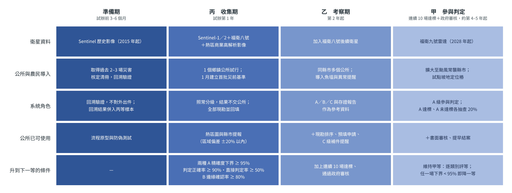

**圖 46　準備期至甲等的發展路徑。** 由單一鄉鎮擴展至颱風常襲縣市；各欄「公所已可使用」為該等級起可交付的功能。

**(19) 資料權責、風險與對策**

**含個資的資料以公所或縣府受託者身分取得，產出先交公所再依法定層級上送；任一環節延後都有可運作的做法。**

本作品可能面臨的風險可分為責任與效力、使用者負擔與誤解、資料品質，以及基礎設施四類，對策如表 79。其中最根本的原則是：系統僅提供分級與存證依據，最終認定一律由公所做出。

**表 79　風險與對策**

| 風險 | 對策 |
|---|---|
| 誤判的責任歸屬 | 最終認定由公所做出；甲等前系統結果只作參考；可信度非「高」一律列 C；類別下界未達 95% 即降等；不予救助須選法定原因 |
| A 未達標判錯而無人發現 | A 未達標與 A 達標一樣抽查 20%；通知附影像日期與理由，申請人可補件或申訴 |
| A 未達標不到場即通知的法規依據 | 列為甲等「政府審核」的必要內容；通知於 30 日勘查期內送達並給補件期限 |
| 增加承辦人員負擔 | 災前基準併入綠色環境給付申報期確認；B、C 級清單直接匯入農災 App；QR 碼調閱預填資料 |
| 農民誤以為初步判讀就是核定 | 農民端每畫面註明以公所認定為準；顯示申報值與核定值 |
| 個人資料 | 受託處理；明確告知用途與提供對象；不保存帳號；可查詢、更正、刪除 |
| 地籍與影像對位誤差 | 對位不確定者「影像條件」不通過、列 C；必要時由地主申請鑑界 |
| 政府審核時程延後 | 系統停在乙等運作，熱區圖、現勘排序、預填申請與 C 級補件提醒不受影響；「App 照片＋公所認定」路徑照常可用 |
| 衛星無法隨時取像 | 多源融合，以影像新鮮度作為服務指標；熱區下單商業雷達 |
| 小田、設施作物與雲遮 | 「影像條件」「觀測完整」未過者列 C 派無人機；雷達光學融合；熱區高解析影像；衛星看不到損失者只提供種植證明 |
| 災後斷網停電 | 清單事先離線下載；定位樁獨立供電；衛星備援站點回傳 |
| 報告遭偽造或竄改 | 數位簽章、時戳、查驗碼、Merkle 根；任何人可離線查驗 |
| 簽章金鑰外洩 | 金鑰存於硬體安全模組；憑證可廢止，時戳可確認簽發時間 |
| 系統與救助系統尚未介接 | 以公所匯出檔銜接，作業完整可行；介接後改為自動同步 |
| 雷達自主衛星要到 2028 年 | 現階段以 Sentinel-1 驗證，2028 年後切換福衛九號 |

## 四、預期效益：社會與商業價值

**以甲等直接判定率 50% 估算，一場大型災害的實地現勘減少約 12.6 萬筆，約 6.7 萬件提早約 28 天完成審核，公所勘查需求回到量能以內；新增支出約為增聘人力方案的二至四成。**

本章分析本作品的預期效益。首先以預算書與審計資料估算公所勘查人力的單位成本與量能缺口，再估算天相星資料中心的營運成本，並將兩者合併比較年度總成本；其次討論社會效益、產業與商業效益；最後說明未來應用、推廣與發展的潛力。須先說明的是，本作品的目的並非減少公所人員，而是減少超出量能的工作與加班，使同樣的人力能於期限內完成勘查，並將時間集中於真正需要判斷的邊緣案件。甲等之前，丙等起即可提供熱區圖與縣市提報，乙等起可依分級排定現勘順序、預填申請與補件提醒。所有推估均標明假設，原始數據均附來源編號。各方得到的價值如表 80。

**表 80　各方得到的價值**

| 對象 | 價值 | 指標（每場大型災害，甲等） |
|---|---|---|
| 公所 | 勘查回到量能以內；難案有更多時間；採信有據 | 實地現勘 315,266 → 約 18.9 萬筆；需求 113% → 86%；每筆難案約 32 → 40 分鐘 |
| 農民與養殖戶 | 結果更快；少跑、少冒險；偏鄉田也有證據 | 約 6.7 萬件提早約 28 天完成審核；全體平均提早 5.4–12.6 天 |
| 縣府與審計 | 抽查有依據；可重算查核 | 每份報告可離線查驗；不當給付可避免約 2,615 萬至 7,845 萬元（推估） |
| 農業部 | 救助經費更準；數據可用於政策 | 田區級災損與作物紀錄；延遲性災損追蹤 |
| 產業 | 自主衛星與無人機的實際需求；產險理賠佐證 | 福衛八號、九號影像進入農業行政；熱區影像與無人機合約 |

### 1. 成本效益分析：公所人力與總成本

**公所勘查需求由量能的 113% 降至 86%，新增支出約為增聘人力方案的二至四成。**

**(1) 公所勘查人員的單位成本**

本作品以臺中市大肚區公所 115 年度單位預算書〔41〕為樣本估算單位成本。該所預算員額 54 人，人事費 6,335.5 萬元，換算每人每年約 117.3 萬元、每人每日約 4,693 元；加計交通費後，每人日勘查成本約 4,773 元（表 81）。值得注意的是，同一份預算書於農林管理業務中僅編列「農情災害查報及業務加班費」6,000 元與「天然災害及農情調查工作經費」20,000 元，前者以每小時 282 元計僅足支付約 21 小時加班。換言之，大型災害的勘查成本實際上由承辦人員的工時、補休與被排擠的其他業務吸收，並未反映於任何預算科目。

另依農業部 112–114 年度單位決算，農業天然災害救助行政作業實支分別為 20,777,013 元、40,816,037 元與 48,515,118 元〔130〕；此為行政經費科目，與上述以人日衡量的公所既有人力時間成本口徑不同。

**表 81　公所勘查人員的單位成本**

| 項目 | 數據 | 計算或來源 |
|---|---|---|
| 每人每年人事成本 | 約 117.3 萬元 | 63,355 千元 ÷ 54 人〔41〕 |
| 每人每日人事成本 | 約 4,693 元 | ÷ 250 個工作日 |
| 加班費每小時 | 約 282 元 | 職員待遇 ÷ 49 人 ÷ 12 月 ÷ 240〔45〕 |
| 加班費支領上限 | 每人每月 20 小時，超過以補休處理 | 〔45〕 |
| 出差交通費 | 自用機車每公里 2 元 | 〔44〕 |
| 每人日勘查成本 | 4,693 元＋交通 80 元（機車 40 公里） | 4,773 元 |

**(2) 現況：一場大型災害超出量能 13%**

以 2021 年 8 月豪雨的規模（申請土地 327,230 筆、221 個公所辦理、須現勘比例 96.3%）作為「一次大型災害」的基準〔42〕，並假設每人日現勘 15 筆，則所需人日為 21,018，而全國農業課 30 日內的量能為 18,564 人日，需求達量能的 113%（表 82）。超出的 2,454 人日約合 19,630 小時，而加班費上限僅能支應約 17,680 小時，其餘只能以補休或延後完成吸收。此一情境下，每次大型災害的勘查人事成本約 1.00 億元。

**表 82　一場大型災害的公所勘查需求與量能**

| 項目 | 計算 | 結果 |
|---|---|---|
| 須現勘筆數 | 327,230 × 96.3% | 315,266 筆 |
| 所需人日 | ÷ 每人日現勘 15 筆（假設） | 21,018 人日 |
| 全國農業課 30 日內量能 | 221 所 × 4 人 × 21 個工作日 | 18,564 人日 |
| 需求 ÷ 量能 | | 113% |
| 超出量能 | 21,018 − 18,564 | 2,454 人日（約 19,630 小時） |
| 加班費可支應上限 | 884 人 × 每月 20 小時 × 282 元 | 約 499 萬元、17,680 小時 |
| 每次大型災害勘查人事成本 | 21,018 × 4,773 | 約 1.00 億元 |

由於每人日現勘筆數會因田區分散程度與地形而異，表 83 以 10、15、20 筆三種情境進行敏感度分析。即使在最樂觀的每人日 20 筆情境下，全國農業課仍須投入 30 日量能的 85%，尚未計入農情調查與推廣業務；此一結果與審計部所統計的撥款平均 55 天超過法定 44 天〔42〕，以及溪州鄉須動員 26 人的情況〔48〕相互一致。

**表 83　每人日現勘筆數的敏感度分析**

| 每人日現勘筆數 | 所需人日 | 需求 ÷ 量能 | 每次災害人事成本 |
|---|---|---|---|
| 10 筆（山區、分散） | 31,527 | 170% | 1.50 億元 |
| 15 筆（基準） | 21,018 | 113% | 1.00 億元 |
| 20 筆（平地、集中） | 15,763 | 85% | 0.75 億元 |

除可量化的人事成本外，現行勘查方式尚有多項難以量化的成本（表 84），包括救助延遲、資金停滯於勘查端、勘災人員安全、認定落差與爭議、重複奔波、業務排擠、縣市不敢簡化，以及判定準確度不足。其中最後一項尤具財政意義：2021 年 8 月豪雨中，未達豪雨標準仍獲救助者計 36,059 件、2.615 億元，其中 11,696 件為免現勘案件〔42〕。

**表 84　難以量化的勘查成本**

| 成本 | 佐證 | 來源 |
|---|---|---|
| 救助延遲 | 撥款平均 55 天；181 件逾 58 天，最長 100 天；嘉義縣平均 72 天 | 〔42〕 |
| 資金卡在勘查端 | 丹娜絲災後 86 天，核撥只占公所初勘合格金額的 59% | 〔46〕 |
| 勘災人員安全 | 2025 年 9 月雲林古坑山區勘災人員受傷送醫 | 〔4〕 |
| 認定落差與爭議 | 溪州鄉 230 戶未通過初勘（12.7%）；香菜田被看成空田 | 〔48〕 |
| 重複奔波 | 分批公告使「一個庄頭要走好多次」 | 〔23〕 |
| 業務排擠 | 農業課須兼辦農情調查、農業推廣，勘災期間其他業務停擺 | 〔42〕 |
| 不敢簡化 | 10 個縣市擔心溢領，幾乎都維持逐筆現勘 | 〔42〕 |
| 判定準確度 | 未達豪雨標準仍獲救助 36,059 件、2.615 億元，其中 11,696 件免現勘 | 〔42〕 |

勘查效率亦與財政紀律相關。如表 85 所示，2017–2022 年救助預算累計 90.5 億元，實際支出卻達 163.71 億元，六年中有五年超支；天災基金近 10 年亦有 9 年超支〔42〕〔43〕。救助經費長期不足，使每一筆救助認定的準確度都直接影響國庫，勘查因此不僅是行政問題，亦是財政問題。

**表 85　救助經費的財政狀況**

| 項目 | 數據 | 來源 |
|---|---|---|
| 2017–2022 年救助預算 vs 實際支出 | 累計預算 90.5 億元，實際支出 163.71 億元，六年中五年超支 | 〔42〕 |
| 天災基金超支 | 近 10 年有 9 年超支；2016 年超支 77.26 億元，達預算的 711.61% | 〔43〕 |
| 2025 年救助預算 | 約 39 億元，年初寒害已用掉約 22 億元 | 〔47〕 |
| 2025 年丹娜絲與 0708 豪雨 | 救助經費 71.23 億元 | 〔46〕 |

**(3) 天相星資料中心的人力與營運成本**

本作品設定由一個專責資料中心營運，可由農業部委託法人或民間團隊設置，負責系統開發、模型維護、全國導入、客服與田野驗證；公所人員不併入此團隊，亦不因系統上線而減少。資料中心常設人力依各職能的工作量估算為 37 人，年人事成本 4,334 萬元（表 86）。年雇用成本以主計總處 2025 年 11 月經常性薪資為基礎——資通訊業每月 69,579 元、專業科學及技術服務業每月 58,334 元〔93〕——乘以 14 個月與 1.2 倍雇主負擔，分別約 117 萬元與 98 萬元，資深職位再乘 1.5；臨時人力以全體平均經常性薪資每月 47,884 元〔94〕乘以 1.2 計算。14 個月與 1.2 倍為本作品假設。

**表 86　資料中心人力**

| 職能 | 人數 | 工作量依據 | 年人事（萬元） |
|---|---|---|---|
| 遙測與 AI 模型 | 6（資深 2） | 作物、淹水、倒伏、魚塭各需專人，另加每場災後重新訓練 | 818 |
| 資料工程與 GIS | 4 | 地籍對位、約 200 萬筆坵塊維護、影像處理流程 | 468 |
| 平台工程 | 6（資深 1） | 公所工作台、農民 App、簡訊、與救助系統及農災 App 介接 | 760 |
| 資安與系統維運 | 3 | 政府系統資安要求、全年無休監控與異地備援 | 351 |
| 公所與縣市導入、教育訓練 | 5 | 368 個鄉鎮市區、22 個縣市；北中南東各 1 人加統籌 | 490 |
| 客服 | 4 | 平時處理公所與農民詢問（含登錄協助） | 392 |
| 田野驗證 | 4 | 北中南東各 1 人，每年 2,000 筆抽樣現勘 | 392 |
| 專案管理與政策法規 | 3（資深 2） | 與農業部、縣市協調；推動存證報告取得效力 | 467 |
| 行政、採購、財務 | 2 | | 196 |
| 常設合計 | 37 | | 4,334 |
| 災時臨時人力 | 每場 20 人 × 1 個月 | 客服與田野支援 | 345（3 場） |

合計人事、影像、雲端、定位樁、資安、差旅、管理與建置攤提後，資料中心年度總成本約 8,430 萬至 1.00 億元（表 87）。每場災害另計熱區商業雷達與無人機補拍：商業雷達以每場 40 景 ICEYE 聚束影像（每景約 25 平方公里，1–0.5 公尺，1,450–2,200 美元〔186〕）計，無人機以每場約 2,000 筆 C 缺失、每組每日 30 筆、每飛行小時 5,000–7,000 元〔98〕計，兩者合計每場約 390 萬至 570 萬元（匯率以 32.5 計）。如圖 47 所示，人事約占四至五成；影像費的範圍最大（247 萬至 1,309 萬元），取決於福衛八號的供應價格；雲端算力每年僅約 70 萬元，原因即在於三、4(1) 所述的坵塊化設計。

**表 87　資料中心年度營運成本**

| 項目 | 計算 | 年費（萬元） |
|---|---|---|
| 常設人事 | 37 人 | 4,334 |
| 災時臨時人力 | 3 場 × 20 人 × 1 個月 | 345 |
| 高解析影像 | 平時 5,630 平方公里 × 每年 4 次 × 2.5–12.5 美元；災害 3 場 × 2,000 平方公里 × 3.5–21.25 美元〔97〕 | 247–1,309 |
| 雲端算力與儲存 | 2 台 L4 GPU 常駐、A100 訓練 500 小時、15 TB 儲存〔95〕〔96〕 | 70 |
| 田野驗證樣本 | 每年 2,000 筆 × 318 元 | 64 |
| GNSS 定位樁與衛星通訊 | 30 站（假設） | 330 |
| 資安檢測 | 第三方弱點掃描、滲透測試（假設） | 100 |
| 差旅 | 每公所每年到訪一次加田野差旅（假設） | 284 |
| 管理與雜支 | 常設人事 10% | 433 |
| 建置攤提 | 首年 3,150 萬元 ÷ 3 年 | 1,050 |
| 熱區商業雷達 | 3 場 × 40 景 ICEYE 聚束 × 1,450–2,200 美元〔186〕 | 566–858 |
| 無人機補拍 | 3 場 × 約 67 組日 × 6 飛行小時 × 5,000–7,000 元〔98〕 | 603–844 |
| 年度總成本 | | 8,426–10,021 |

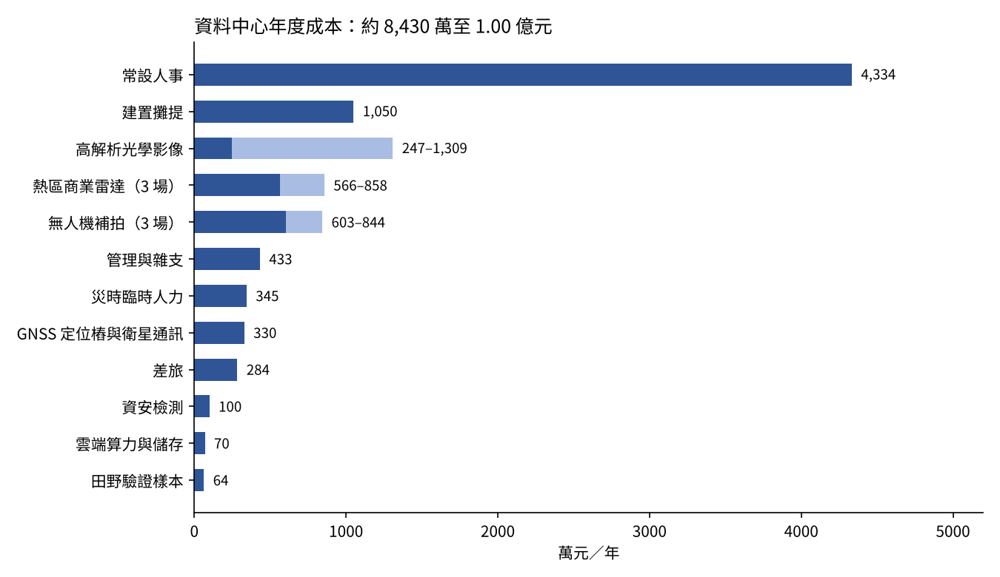{width=72%}

**圖 47　資料中心年度成本結構。** 淺色為影像費上限比下限多出的部分。

**(4) 導入後的公所人力分配**

以甲等直接判定率 50% 為基準（即乙等門檻，由三、4(14) 的公所量能推得），導入本作品後公所的勘查工作分為 A 級書面審核或通知、A 級 20% 抽查現勘與 B、C 級到場或補件三部分（表 88）。由於 B、C 級屬較難的案件（門檻邊緣、山區、小田、申報不符、魚塭），每筆所需時間可能較一般現勘為長，故設定每人日 15、12、10 筆三種效率。

**表 88　導入後的工作分配（甲等、直接判定率 50%）**

| 工作 | 筆數 | 每人日處理量 | 人日 |
|---|---|---|---|
| A 達標書面審核、A 未達標通知 | 157,633 | 200 筆（假設） | 788 |
| A 級 20% 抽查現勘 | 31,527 | 15 筆 | 2,102 |
| B、C 級到場或補件 | 157,633 | 15、12 或 10 筆 | 10,509、13,136 或 15,763 |

結果如表 89 與圖 48。在 B、C 級每人日 12 筆的基準情境下，公所勘查人日由 21,018 降至 16,026，占 30 日量能的比例由 113% 降至 86%，不再超出量能，每場大型災害可釋出 4,992 人日回到農情調查與推廣業務，每筆難案可投入的時間則由約 32 分鐘增至約 40 分鐘。即使 B、C 級每人日僅能處理 10 筆、每筆多花一半時間，總需求亦恰落於量能之內。此外，QR 碼調閱預填申請可減少臨櫃逐欄核對，災後無須再量面積；每筆案件附衛星損失區間，亦可縮小承辦人員之間的判定落差。若以筆數計，實地現勘（B、C 級加上 A 級 20% 抽查）由 315,266 筆降至約 189,160 筆，減少約 12.6 萬筆（約 40%）。

**表 89　導入前後的公所勘查人力比較**

| 指標 | 現行 | B、C 級 15 筆／人日 | B、C 級 12 筆（基準） | B、C 級 10 筆／人日 |
|---|---|---|---|---|
| 公所勘查人日 | 21,018 | 13,399 | 16,026 | 18,653 |
| 占 30 日量能 | 113% | 72% | 86% | 100% |
| 超出量能 | 2,454 人日 | 0 | 0 | 89 人日 |
| 釋出回到其他業務的人日 | 不足 2,454 | 7,619 | 4,992 | 2,364 |
| 每筆難案可投入時間（含交通） | 約 32 分鐘 | 約 32 分鐘 | 約 40 分鐘 | 約 48 分鐘 |

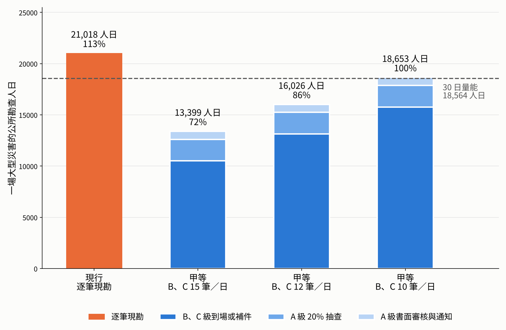{width=72%}

**圖 48　公所勘查人日與 30 日量能（甲等、直接判定率 50%）。** 虛線為全國公所農業課 30 日量能（18,564 人日）。

**(5) 含公所人力的年度總成本**

本作品以「公所勘查人日 × 4,773 元 × 災害場數 ＋ 天相星年度總成本」計算總成本，現行做法則僅有前一項。結果如表 90 與圖 49：每年僅一場大型災害時，本作品將使總成本增加約 4,100 萬至 7,800 萬元；三場時基準情境高 4%–10%；五場以上才明顯降低。2025 年雖有五起颱風豪雨公告救助〔49〕〔50〕，但大型災害的頻率逐年不同。據此，本作品的價值不宜主張為「節省支出」，而應理解為以大致相同的總成本，換取公所不再超出量能、難案有更多時間、每筆案件皆具災前證據，以及直接判定案件提早約 28 天完成審核。

**表 90　含公所勘查人力的年度總成本**

| 每年大型災害場數 | 現行 | B、C 級 15 筆 | B、C 級 12 筆（基準） | B、C 級 10 筆 |
|---|---|---|---|---|
| 1 場 | 1.00 億 | 1.41–1.53 億 | 1.53–1.66 億 | 1.66–1.78 億 |
| 3 場 | 3.01 億 | 2.76–2.92 億 | 3.14–3.30 億 | 3.52–3.67 億 |
| 5 場 | 5.02 億 | 4.11–4.31 億 | 4.74–4.94 億 | 5.37–5.56 億 |

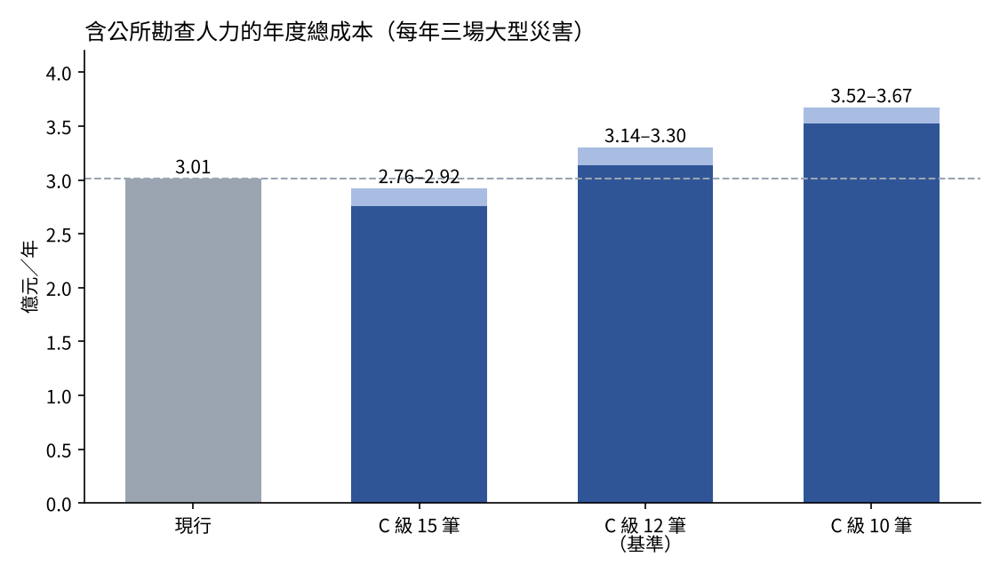{width=72%}

**圖 49　含公所勘查人力的年度總成本（每年三場大型災害）。** 三種 B、C 級效率下，總成本約為現行的 92%–122%。

若政策目標為「公所於 30 日內勘完、不依賴超時工作」，另一個直覺做法是增聘公所人力。表 91 與圖 50 顯示，每個參與勘查的公所增聘 1 人（221 人）每年約需 2.59 億元，全國每個鄉鎮市區增聘 1 人（368 人）則約需 4.32 億元；本作品達到相近的量能改善，新增支出約為增聘方案的二至四成，且增聘人員於災後仍只能觀察災後的田。

**表 91　達成相同目標的方案比較**

| 方案 | 新增年度支出 | 一場災害公所勘查人日 | 占 30 日量能 | 災前證據 |
|---|---|---|---|---|
| 現行 | 0 | 21,018 | 113% | 無 |
| 每個參與勘查的公所增聘 1 人（221 人） | 約 2.59 億元 | 21,018 | 91% | 無 |
| 全國每個鄉鎮市區增聘 1 人（368 人） | 約 4.32 億元 | 21,018 | — | 無 |
| 天相星（基準情境） | 約 0.84–1.00 億元 | 16,026 | 86% | 有 |

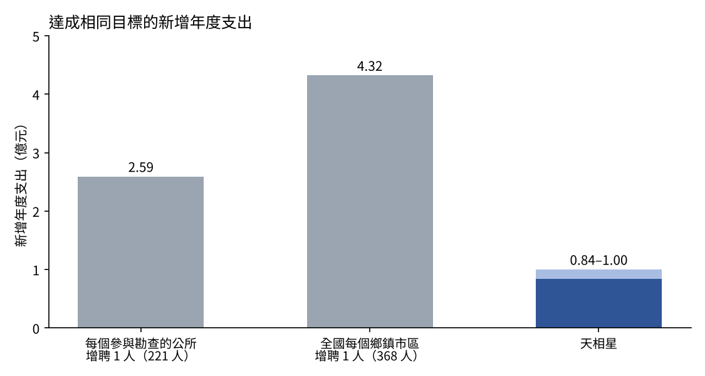

**圖 50　達成相同目標的方案比較。** 左為新增年度支出，右為勘查需求占 30 日量能。

表 92 進一步將本作品與既有勘查方式並列比較。本作品是唯一同時證明種植與損失、具災前紀錄且公所人力落於量能內的方式；每多一場災害的額外成本僅約 23 萬至 137 萬元（取像與算力），另加公所處理 B、C 級案件的人力。

**表 92　與既有勘查方式比較**

| 比較項目 | 公所逐筆現勘 | 災損天氣參數 | 無人機勘災 | 天相星（甲等）＋公所集中處理 B、C 級 |
|---|---|---|---|---|
| 一場大型災害的公所人力 | 21,018 人日，超出量能 13% | 仍須現勘種植事實 | 須派員飛行與判讀 | 13,399–18,653 人日，在量能內 |
| 能證明的事 | 種植＋損失 | 只有損失（推論） | 只有損失 | 種植＋損失 |
| 災前紀錄 | 無 | 不適用 | 無 | 有 |
| 颱風後可用 | 受道路與安全限制 | 是 | 受風雨與空域限制 | 是（雷達穿雲） |
| 覆蓋 | 逐筆 | 測站點 | 一次飛約 1 平方公里〔99〕 | 全國每塊坵塊 |
| 出件時間 | 30 日勘查期，平均撥款 58 天 | 快 | 東石 8,200 公頃牡蠣區約 2 天〔100〕 | 雷達到站後 8 小時內 |
| 每多一場災害的額外成本 | 約 1.00 億元人力 | 低 | 依面積重新出動 | 約 23 萬至 137 萬元＋公所 B、C 級人力 |
| 實績 | 現行做法 | 約 40 種品項 | 補助 2,050 萬元全數未執行 | 義大利 AGEA 同類做法降低成本 30%–40%〔68〕 |

**(6) 提早結案與判定準確度**

直接判定的案件每件約可縮短 28 天（58 天降至 30 天）〔42〕：A 達標者提早撥款，A 未達標者提早收到通知，仍有時間補件或申訴。以一般現勘案件 134,006 件為基礎，平均結案天數 ＝ 55 −（134,006 × 直接判定率）×（58 − 30）÷ 209,189；直接判定率 30%、50%、70% 時，全體平均結案天數分別為 49.6、46.0 與 42.4 天，僅 70% 情境低於法定 44 天（表 93、圖 51）。須注意，本節 (4) 的人日以「申請土地筆數」計，此處的結案天數則以「救助案件件數」計，兩者單位不同。

**表 93　直接判定率與平均結案天數**

| 指標 | 現行 | 直接判定 30% | 直接判定 50% | 直接判定 70% |
|---|---|---|---|---|
| 直接判定的案件 | — | 約 4.0 萬件 | 約 6.7 萬件 | 約 9.4 萬件 |
| 全體平均結案天數 | 55.0 天 | 49.6 天 | 46.0 天 | 42.4 天 |
| 是否低於法定 44 天 | 否 | 否 | 否 | 是 |

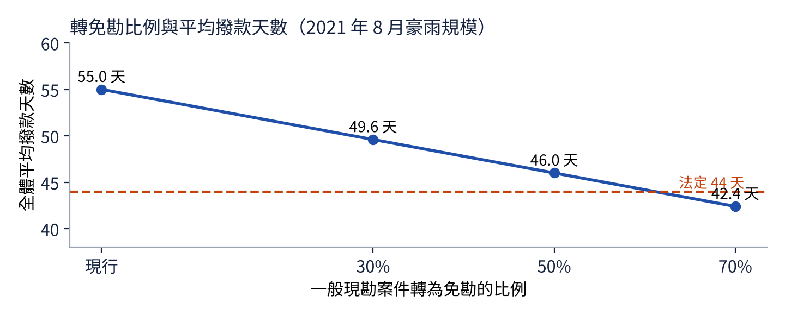{width=72%}

**圖 51　直接判定率與平均結案天數。** 人日以申請土地筆數計，結案天數以救助案件件數計。

在判定準確度方面，若田區級衛星證據能使前述 2.615 億元不當給付中的 10%–30% 被正確複核，單次災害可避免約 2,615 萬至 7,845 萬元的不當給付（推估）；而地號內夾雜農路、申報超過權利面積等情形，於農民登錄時即由系統擋下，亦可自源頭減少溢領。

上述比例具可達成性，理由有四：其一，制度已允許，救助辦法明定「勘查得以科學技術輔助之」，且 App 照片加公所認定的路徑現行可用〔3〕〔42〕〔103〕；其二，國外已落地，愛爾蘭 AMS 僅紅燈案件需補證〔27〕，義大利 AGEA 實地檢查已降至 3%–5%〔68〕；其三，國內已驗證方向，雲林 NDVI 試算的衰退區與核定救助區重疊約 64%〔4〕，本作品再加入雷達、作物判釋與坵塊綁定；其四，本作品採保守設計，門檻邊緣列 B、影像不清與申報不符列 C，故直接判定率反映的是衛星有把握的案件。

**(7) 敏感度分析**

以每年三場大型災害、含公所人力的年度總成本（現行 3.01 億元）為基準，表 94 與圖 52 檢視七種情境。結果顯示，最關鍵的兩個變數為直接判定率與 B、C 級處理效率：直接判定率僅 30% 且 B、C 級每人日 12 筆時，公所仍將超出量能（108%），這也是乙等門檻訂在 50% 的原因。由此可知，兩種 A 的精確度與公所對存證報告的信任，是導入成敗的關鍵。

**表 94　敏感度分析（每年三場大型災害）**

| 情境 | 公所占 30 日量能 | 年度總成本 |
|---|---|---|
| 基準（直接判定率 50%、B、C 級 12 筆） | 86% | 3.14–3.30 億 |
| 直接判定率只有 30% | 108% | 3.73–3.88 億 |
| 直接判定率達 70% | 64% | 2.55–2.71 億 |
| B、C 級 15 筆／人日 | 72% | 2.76–2.92 億 |
| B、C 級 10 筆／人日 | 100% | 3.52–3.67 億 |
| 福衛八號對政府免費 | 86% | 3.12–3.17 億 |
| 資料中心人力增加 20% | 86% | 3.24–3.39 億 |

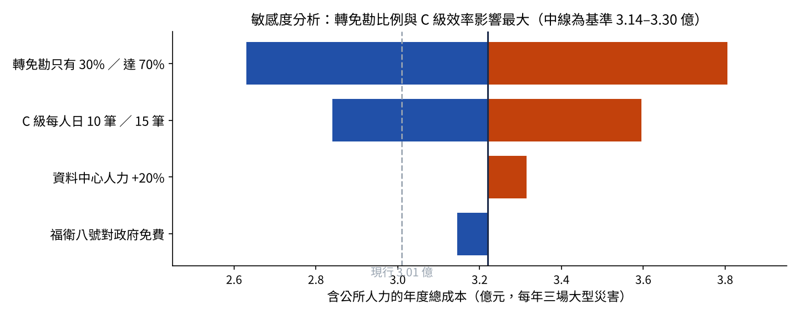{width=72%}

**圖 52　敏感度分析（每年三場大型災害）。****

**(8) 推估假設與限制**

本章推估所採用的主要假設如表 95。其中每人人事成本來自單一公所樣本；每人日現勘筆數、A 級書面審核效率、直接判定率與資料中心薪資倍數均為假設值；大型災害規模則以審計部唯一的逐案統計樣本為準。上述假設將於試辦期間透過訪談公所承辦人員與實際量測校正。

**表 95　推估假設**

| 項目 | 本文採用 | 說明 |
|---|---|---|
| 每人人事成本 | 大肚區公所預算平均 117.3 萬元／年 | 單一公所樣本 |
| 每人日現勘筆數 | 15 筆；B、C 級 10–15 筆 | 假設值，待訪談公所承辦人員校正 |
| A 級書面審核 | 每人日 200 筆 | 假設值 |
| 大型災害規模 | 2021 年 8 月豪雨 | 審計部唯一逐案統計樣本 |
| 直接判定率 | 30%、50%、70% | 情境假設，將於試辦中量測 |
| 資料中心薪資倍數 | 14 個月 × 1.2 | 假設 |
| 福衛八號售價、定位樁單價 | SPOT／Pléiades 國際價格上下限；每站 40 萬元 | 假設，待詢價 |

### 2. 社會效益

**社會效益包括救助時效、農民往返與安全、偏鄉與漁業受災的舉證。**

本作品的社會效益可歸納為九項（表 96）。在救助時效上，直接判定的案件每件提早約 28 天完成審核，全體平均提早 5.4–12.6 天；對農民而言，預填申請與 QR 碼送件可減少往返，道路未通時亦無須冒險進田。在公平性上，人員無法抵達的偏鄉田區亦具災前災後證據；在安全上，道路中斷與山區田區可先以衛星處理。此外，申覆時有影像對照與可溯源紀錄，可減少爭議；魚塭在養與溢堤證據使漁業受災得以證明；判定更準確可減少不當給付，維護財政紀律；時序追蹤則可提早佐證延遲性災損。

**表 96　社會效益**

| 效益 | 量化指標 | 依據 |
|---|---|---|
| 救助更快到位 | 直接判定案件每件提早約 28 天；全體平均提早 5.4–12.6 天 | 〔42〕 |
| 農民少跑、少冒險 | 預填申請、QR 碼送件；路不通不必進田；C 級補件提醒與 A 未達標通知都附理由，減少事後申覆 | 介面設計 |
| 偏鄉公平 | 人到不了的田也有災前災後證據 | 〔8〕 |
| 勘災人員安全 | 道路中斷、山區田區先以衛星處理 | 〔4〕 |
| 爭議減少 | 申覆時有影像對照與可溯源紀錄；溪州初勘未通過率 12.7% | 〔48〕 |
| 漁業受災可證明 | 魚塭在養與溢堤證據；丹娜絲漁產損失約 7.7 億元 | 〔49〕 |
| 財政紀律 | 判定更準確可減少不當給付 | 〔43〕 |
| 承辦有據可查 | 每筆書面審核皆有可查驗的證據與簽章紀錄，承辦人員不必獨自承擔採信風險 | 〔138〕 |
| 延遲性災損 | 時序追蹤 6 個月，丹娜絲文旦延續性災損隔 360 天才公告 | 〔52〕 |

救助額度的提高亦放大了準確勘查的價值。農業部於 2026 年 3 月修正救助辦法，大幅調高多項救助額度（表 97），例如香菇及木耳由每公頃 7.15 萬元提高至 112.5 萬元〔51〕；每筆認定的金額越高，判定錯誤的代價亦越大。

**表 97　2026 年 3 月救助額度調整（每公頃）**

| 品項 | 修正前 | 修正後 |
|---|---|---|
| 香菇及木耳 | 7.15 萬元 | 112.5 萬元 |
| 薑及韭菜 | 5.6 萬元 | 20 萬元 |
| 蝴蝶蘭 | 18 萬元 | 48 萬元 |
| 林業苗圃 | 7 萬元 | 19.5 萬元 |

### 3. 產業與商業效益

**基礎版由政府統一採購、供公所與農民免費使用，進階版供農會與產險採購；影像來源包含國內自主衛星。**

**(1) 價值來源**

本作品的商業價值來自四項可計算的效益（表 98）：替代增聘人力（每年約 2.59 億元）、減少加班與超時（每場最多約 499 萬元加班費）、減少不當給付（每場約 2,615 萬至 7,845 萬元，推估），以及提早結案（直接判定率 30%–70% 時每場約 4.0 萬至 9.4 萬件提早約 28 天）。

**表 98　價值來源**

| 價值來源 | 規模 | 依據 |
|---|---|---|
| 替代增聘人力 | 達到相近量能改善，可避免每年約 2.59 億元的增聘支出 | 本章 1(5) |
| 加班與超時 | 每場大型災害最多約 499 萬元加班費，加上無法支薪的超時 | 本章 1(2) |
| 不當給付減少 | 每場約 2,615 萬至 7,845 萬元（推估） | 本章 1(6) |
| 提早結案 | 每場約 4.0 萬至 9.4 萬件提早約 28 天 | 本章 1(6) |

**(2) 定價依據與收益模式**

本作品建議以資料中心年度營運成本（約 0.84–1.00 億元）作為基礎版全國年費的底價，並使其明顯低於增聘人力方案（約 2.59 億元／年）；實際價格待試辦後依公所需求訂定。作為參照，農業部 2019–2020 年的無人機輔助勘災補助 6 件共 2,050 萬元，全數未執行〔42〕。

收益模式採兩層版本（表 99）。基礎版由農業部或縣市政府統一採購，供各公所與農民免費使用，涵蓋災前基準確認、災後分級、存證報告、預填申請與公所工作台等核心功能；進階版為加值模組，供縣市政府、農會與產險公司採購，包括作物異常提醒、魚塭在養證明、定位樁資料、田區資料授權與農民個人存證報告。救助金額與資格不因版本而改變，公所現勘與農業部 App 拍照照常保留。本服務性質為影像存證服務，補償仍由政府依法支付；若與產險業者合作開發田區級保單，將由保險業或經許可的農會承保〔38〕。

**表 99　版本與收益模式**

| 版本 | 採購者 | 使用者 | 內容 |
|---|---|---|---|
| 基礎版 | 農業部或縣市政府統一採購 | 各公所與農民免費使用 | 災前基準確認、轄區定期取像、災後 A／B／C 分級、存證報告、預填申請、受理與審核工作台、現勘排程與回填、統計報表 |
| 進階版（加值模組） | 縣市政府、農會、產險公司 | 公所、防檢單位、合作單位 | 作物異常提醒、魚塭在養證明、遮蔽區定位樁資料、田區資料授權（產險理賠佐證）、農民個人存證報告、報告查驗介面（產險理賠佐證） |

**(3) 產業效益**

在產業面，本作品可為臺灣自主衛星創造實際的行政使用需求。福衛八號星系預計 2031 年前完成 8 顆〔75〕，福衛九號雷達衛星規劃於 2028、2030 年發射〔26〕；本作品將其影像直接用於農業救助，可增加國內衛星資料的加值應用與經銷需求，並帶動遙測判讀、地理資訊與政府資通系統等相關服務。熱區無人機補拍以服務合約交由合格的非大陸廠牌業者執行，形成在地的災後補拍服務；產險端目前氣象參數型保險僅 29 品項〔11〕，田區級、可查驗的災損紀錄可協助開發新保單並作為理賠佐證。

### 4. 未來應用、推廣與發展潛力

**後續可擴及漁業、保險與海外；若存證報告獲公告認可，可納入救助制度。**

本作品的推廣可沿四個方向展開。第一為公所端的全國擴展：2021 年單次豪雨即有 221 個公所參與勘查〔42〕，全國共 368 個鄉鎮市區，依三、4(18) 的路徑可由單一鄉鎮擴展至颱風常襲縣市。第二為漁業端：全國養殖魚塭約 4.3 萬公頃〔76〕，丹娜絲漁產損失約 7.7 億元，魚塭在養證明可延伸至漁業救助，並向漁業署申請認可。第三為保險端：氣象參數型保單目前僅 29 品項、44 張〔11〕，田區級衛星資料可協助開發以田區實況為依據的新保單。第四為海外輸出：國家太空中心已以福衛五號協助中美洲友邦監測香蕉病害〔36〕，本作品的勘查分流與存證模式可結合我國自主衛星，作為對友邦農業援助的延伸。在制度面，系統達甲等並經公告認可為客觀證明文件後，並進一步發展為「衛星災損參數」，則本作品的分流機制將由輔助工具轉為救助制度的一環，其效益亦將隨每次災害持續累積。試辦期間亦可將判讀與查驗機制送交數位發展部 AI 產品與系統評測中心評測，其評測項目包括準確性、可靠性、透明性與當責性等十項〔146〕，作為公所與農業部採信的第三方依據。

## 名詞解釋

**表 100　本構想書用語**

| 用語 | 意思 |
|---|---|
| A 達標／A 未達標 | 證據完整，損失區間整個落在 20% 門檻以上（下限 ≥ 40%）或以下（上限 ≤ 10%），影像可以直接判定 |
| B 邊緣 | 證據完整，但損失區間跨過 20%，由公所到場確認 |
| C 缺失 | 可信度五項檢核任一未過，須補資料，必要時到場 |
| 丙／乙／甲等 | 系統等級：丙收集資料、結果不交公所；乙作為參考資料；甲的 A 級直接參與判定 |
| 準備期 | 試辦前 3–6 個月，以過去 2–3 場災害核定清冊回溯驗證與校準，不對外出件 |
| 類別 | 作物 × 災害類型，例如「水稻 × 淹水」；逐類別評等，不得高於整體 |
| 可信度等級 | 一筆案件的證據品質，分高、中、低，不是機率；只有「高」進入 A、B 的判斷 |
| 原因碼 | 列 C 時附上的未通過項目，例如雲遮、對位不確定、作物不符、災前未見作物生長、疑似灌溉 |
| 損失區間 | 每塊田損失率的第 10、50、90 百分位；真實損失約有 80% 的機會落在第 10 至第 90 百分位之間 |
| 精確度 | 系統判為某類的案件中，現勘確實如此的比例；文獻中的「使用者準確度」 |
| 準確率 | 全部案件中判對的比例，只用於作物判釋這類每筆都有答案的分類 |
| 與現勘一致率 | 和現勘或地面調查比對的一致比例；與另一個判圖產品或行政範圍比對的數字不能等同視之 |
| 判定正確率 | 全部 A 級案件中，現勘結論和系統判定一致的比例 |
| 直接判定率 | A 級占全部申請的比例，決定能省下多少現勘 |
| B 邊緣確認率 | 判 B 的案件中，現勘損失確實落在 10%–30% 的比例 |
| 95% 單側信賴下界 | 依抽查樣本，有 95% 把握真實值至少有這麼高的數字；所有達標判斷都看下界 |
| 錯邊率 | 系統估的損失和現勘損失落在 20% 門檻兩側的比例 |
| 覆蓋率 | 現勘損失率落在系統損失區間內的比例 |
| 均方根誤差 | 系統估的損失率與現勘相差多少個百分點，大錯會被放大計算 |
| 偏差 | 系統整體多估或少估，用於區域總量；和個別案件判得準不準是兩回事 |
| IoU／CSI | 兩張範圍圖重疊面積 ÷ 合併面積，用於淹水範圍，屬像素層級 |

## 附錄

> 本附錄為母檔保存的補充資料，投稿版（30 頁版）不必納入。

### 附錄一、關鍵數據一覽

**表 101　關鍵數據一覽**

| 指標 | 數據 | 來源 |
|---|---|---|
| 2025 年五起颱風豪雨農業損失 | 合計 50.7 億元；丹娜絲＋0708 豪雨 32.81 億元，占 65% | 〔49〕〔50〕 |
| 丹娜絲災後 86 天資金到位 | 公所初勘合格 51.5 億元，核撥 30.18 億元，僅 59% | 〔46〕 |
| 申請到撥款平均天數 | 55 天（法定 44 天）；須現勘 58 天、免勘 24–30 天 | 〔42〕 |
| 公所農業課平均編制 | 4 人，每人約負擔 370 筆勘查 | 〔42〕 |
| 一場大型災害公所勘查需求 | 21,018 人日，為 30 日量能的 113% | 本文推估 |
| 導入天相星後（甲等、基準情境） | 降至量能的 86%，每場釋出約 4,992 人日 | 本文推估 |
| 天相星資料中心 | 常設 37 人，年度總成本約 8,430 萬至 1.00 億元（含熱區商業雷達與無人機補拍） | 本文推估 |
| 含公所人力的年度總成本 | 每年三場大型災害時約為現行的 92%–122% | 本文推估 |
| 與增聘人力相比 | 新增支出約為增聘方案（2.59–4.32 億元）的二至四成 | 本文推估 |
| 救助門檻與抽查 | 損失率 20% 以上；無種植客觀證明者抽樣勘查 20% 以上 | 〔2〕〔3〕 |
| 模擬工況驗證 | 直接判定案件無一錯邊；區間覆蓋率 83%；淹水三法投票 IoU 0.857 | 〔124〕 |
| 丹娜絲疑似積水落在稻田的比例 | 約 157 公頃中約 87 公頃（55%），多為插秧期灌溉 | 〔161〕 |
| 系統等級 | 丙（收集）→ 乙（考察）→ 甲（參與判定）；甲等須連續 10 場達標並通過政府審核，約第 4–5 年起逐類別進入 | 本文 |
| 技術元件成熟度 | 26 項中 11 項已可運作，其餘依資料、校準或商業影像分階段到位 | 〔166〕 |

### 附錄二、面積認定的現行漏洞與圖資效力

監察院調查報告指出三個與面積有關的漏洞，本作品的登錄流程逐一對應（表 102）〔42〕。三種圖資的法律效力不同，各自用於不同步驟（表 103）。

**表 102　監察院指出的面積漏洞與對策**

| 漏洞 | 現況 | 本作品對策 |
|---|---|---|
| 核定面積超過登記面積 | 系統有提示仍照核；抽查 1,606 件中 44 件有誤 | 登錄步驟 3 由系統擋下，不讓人工放行 |
| 未扣除農路、水塘、農舍 | 抽查 44,904 件中 7,158 件（15.94%）有誤 | 登錄步驟 2 自動扣除並套用 40% 規則 |
| 未種植仍申請 | 或申請已領休耕給付的田 | 公所於災前確認有種；作物以既有紀錄佐證 |

**表 103　三種圖資的效力與用途**

| 圖資 | 證明什麼 | 效力 | 用在 |
|---|---|---|---|
| 土地登記謄本 | 登記面積、所有權人、持分 | 登記簿正式謄本 | 使用權、面積上限 |
| 地籍圖檔 | 地號的形狀與位置 | 只供了解空間相對位置 | 範圍底稿 |
| 土地複丈成果圖 | 現場實際界址 | 涉及實際界址時以地政事務所鑑界成果為準 | 範圍對不上時 |

綠色環境給付申報為每年 1 月全國統一受理（114 年為 1/2–2/8），任一公所或農會皆可受理，公所勘（抽）查合格才核給獎勵；2026 年起「農業數位整合服務」App 在桃園市、嘉義縣東石鄉與中埔鄉試辦線上確認申報〔121〕〔122〕〔123〕。

### 附錄三、待確認事項總表

**表 104　待確認事項與確認對象**

| 事項 | 向誰確認 |
|---|---|
| ~~「種植或養殖客觀證明文件」目前包含的項目~~（已解決：見 2025 年 4 月 18 日公告〔128〕）；存證報告申請列入的程序 | 農業部農糧署 |
| 救助系統是否開放外部系統介接；農災 App、農地覆蓋物資料庫介接窗口 | 農業部農糧署、農業部 |
| 福衛八號對政府機關的供應方式與價格 | 國家太空中心 |
| 地籍圖資料屬限制公開與否；國土利用調查分類細度與更新頻率；正射影像申購資格與費用 | 內政部國土測繪中心 |
| 公所「地政資訊查詢系統」帳號的開通單位 | 試辦縣市地政局（處） |
| 公所是否願意於綠色環境給付申報時一併確認範圍；申報收執聯是否載有面積 | 試辦公所（中埔鄉公所農業課） |
| 委託送件是否需委託書、民間公司可否為受託人；是否接受存證報告作為佐證附件與印出的預填申請表 | 試辦公所 |
| 漁業救助應附文件與期限；《漁業天然災害災情查報及救助作業程序》原文；各縣市養殖登記證核發單位 | 農業部漁業署、各縣市政府 |
| 土地登記謄本規費；《土地登記規則》第 24-1 條是否再修正 | 地政事務所、全國法規資料庫 |
| B、C 級每人日可處理筆數、A 級書面審核時間 | 試辦公所承辦人員訪談 |
| 10%／40% 門檻、各類別兩種 A 精確度、福衛八號水車辨識、魚塭現勘損失率認定方式 | 丹娜絲實際影像驗證與公所現勘資料 |
| 國內手機直連衛星商轉時程；定位樁單價與布設地點 | 電信業者、設備廠商 |
| 嘉義布袋、義竹與臺南北門的一、二期稻作面積（校正作物判釋） | 農糧署、嘉義縣與臺南市政府 |
| 停電自動切換電箱與溶氧紀錄能否上傳作為魚塭佐證 | 農業部漁業署、養殖戶 |

### 附錄四、母檔修訂紀錄

| 日期 | 修訂內容 |
|---|---|
| 2026-10-21 | 以《創意構想書（詳細版・成本效益）》為底，併入《技術說明》、兩端介面 v2、《資料需求與介接流程報告》；依官方格式改寫為論文體例；補入資料索取位置（取自《農民參與天相星》《災後提交》兩份報告） |
| 2026-10-22 | 併入隊友 V4／V5 整合版的新資訊：2025/4/18 種植客觀證明公告、花蓮光復真實影像案例、團隊原型三畫面、R1–R5 檢核、26 欄核心資料、損失率模型架構、行政作業實支、Sentinel-1 解析度修正、光復具名窗口、官方原表與文件原件（附錄五）；總括性開頭句改以撥款時效與公所人力為主軸、數據改用筆數；加入兩端原型截圖（圖 14、11）；摘要後加入圖 1 計畫總覽；各章節開頭加入結論句；併入《衛星測試示範》（三、4(11)）、30 頁版新增的 11 張圖、圖資效力與面積漏洞、待確認事項總表；改名為完整版母檔 |
| 2026-10-22 | 併入丹娜絲真實衛星影像測試（三、4(11)，含 7 張圖與判讀結果表）；新增參考資料 135–137；投稿版另出 v6 |
| 2026-10-22 | 流程與可信度參考歐盟面積監測系統：SOP 擴為八步（S5 先行通知與補證、S8 災後品質評估），新增歐盟流程對應表、判讀標記與相似度標記、誤判上限、依金額排序 C 級、OSNMA 照片定位認證；原型新增 S5、S8 與 T12；新增參考資料 159–160 |
| 2026-10-22 | 立場統一為「本作品提供做法與備案」：留給評審的不確定處改寫為做法＋備案；新增 C 級分流與無人機補拍（非大陸廠牌、規格與分工）；新增參考資料 156–158 |
| 2026-10-22 | 防偽新增長時間對照（L1–L4，含模擬測試）；國內外現況新增歐盟面積監測系統作法與借鑑表；新增參考資料 150–155 |
| 2026-10-22 | v7 新方向「可信度與防偽」：需求分析新增證據可信度與防偽的需求（竹塘案、App 照片、電子簽章法、人工智慧基本法）；技術可行性新增標準作業流程（S1–S7）、可信度評定與驗證、防偽設計，以及作業流程原型與 11 項竄改測試；新增參考資料 138–149；投稿版另出 v7 |
| 2026-10-22 | 併入隊友版農民端平時／災後與公所端流程圖；v6 另改用隊友版救助流程、三道關卡與系統分層圖，衛星概念驗證僅採團隊自製的丹娜絲測試與模擬工況 |
| 2026-10-23 | 新增模型規格：Presto 與 Prithvi-EO-2.0 架構參數、運算規格、主要參數起始值與校正方式（表 30-1）、已實作模型與程式（表 30-2）；v7.1 同步列出完整模型規格表 |
| 2026-10-23 | 衝突清單收尾：表 15 A 級改為依階段開放；三道關卡與可信度五項的對應寫明（表 35 加「所屬關卡」）；圖 1 計畫總覽、圖 9 三方流程、圖 42 敏感度與標準作業流程圖重畫；表 76 改用新成本基準 |
| 2026-10-23 | 成本補入熱區商業雷達與無人機補拍（資料中心年度成本改為約 8,430 萬至 1.00 億元，表 69、72、73 與圖 37、39、40 更新）；魚塭補局限說明；作物粗分補水稻判法與門檻；新增參考資料 186 |
| 2026-10-23 | 併入《可信度門檻與階段目標》：新增三、4(25) 使用階梯、四個階段（第 0–3 階段，避免與 S1–S8 撞名）、C 級比例上限推導、損失模型誤差目標、綜合一致率與逐項門檻；回溯驗證樣本可計入；S8 與驗證指標改以 95% 單側信賴下界計；新增參考資料 185 |
| 2026-10-23 | 依「做得出來即可、精度以階段目標交代」原則改寫：三、4(23) 由通過／未通過改為成熟度與到位方式；三、4(24) 新增回溯驗證（第 0 階段）；第 1 年 A 級改為回溯驗證達標作物開放；魚塭單口溢堤以熱區高解析影像判讀；表 61 新增第 0 階段 |
| 2026-10-22 | 併入作物判釋真實影像測試（三、4(16)，Ottinger 魚塭方法＋Presto，圖 31-1、31-2、表 51-1）與「疑似積水 55% 在稻田」發現；新增三、4(23) 可行性與可使用性驗證（26 項）；淹水加插秧期遮罩、魚塭溢堤降為區域級、水色異常移出分級、倒伏只作佐證；修正模擬段落中真實影像腳本「未實跑」的舊敘述；新增參考資料 161–170 |
| 2026-10-22 | 新增三、4(24) 從佐證到免勘的技術路徑：商業高解析衛星（Pléiades Neo、SkySat／Pelican、ICEYE）與歐盟 VHR 採購做法、分層取像、模型製作方向（損失率迴歸、高解析語意分割、基礎模型微調、Learn then Test 門檻）、以法定 20% 抽查證明精確度；同步更新《技術說明》肆、二至肆、四；新增參考資料 171–184 |
| 2026-10-23 | 整合 v8：案件分級改為 A 達標、A 未達標、B 邊緣、C 缺失（先看證據、再看損失），四個階段改為丙、乙、甲三個系統等級（逐類別評等、連續 10 場加政府審核才進甲等）；摘要、需求分析、使用情境、介面（12 個畫面）、概念創新、技術可行性（模型規格、標準作業流程、可信度、防偽、長時間對照、方向驗證、天地整合、門檻與系統等級、發展路徑、風險）與預期效益依 v8 改寫，圖表全面重新編號；新增名詞解釋與參考資料 187；三道關卡流程圖、六層架構圖、舊版概念驗證規劃、使用階梯與四個階段表由新內容取代；模擬工況結果依新分級對應；計畫總覽重畫 |

### 附錄五、官方文件原件

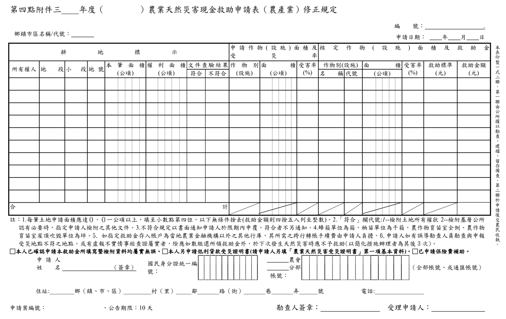

**圖 53　農產業天然災害現金救助申請表原件。** 天相星預填欄位依此格式。資料來源：作業要點附件三〔127〕。

**圖 54　農業天然災害受災證明書（申貸低利貸款專用）。** 資料來源：農業金融署〔131〕。

## 參考資料

1. [2026 衛星數位應用創新大賽申請須知](https://www-api.moda.gov.tw/File/Get/adi/zh-tw/dmERorpZDr3Njtl)
2. [農業部：損失率達 20% 給予現金救助](https://www.moa.gov.tw/ws.php?id=2504685)
3. [2025 年 5 月農業部公告：種植客觀證明免勘與抽樣勘查 20%](https://files.chcg.gov.tw/files/71_20250502104232659_農業部　公告.pdf)
4. [iThome：雲林農損勘查、審計室衛星植生指標](https://www.ithome.com.tw/news/179527)
5. [公視：丹娜絲農業與設施損失 30.7 億元](https://news.pts.org.tw/article/761774)
6. [新頭殼：嘉義縣丹娜絲災損統計](https://newtalk.tw/news/view/2025-07-08/980593)
7. [自由時報：縣府送件後三天內撥款](https://news.ltn.com.tw/news/life/paper/1719891)
8. [公視：古坑竹林勘災不易被判不合格](https://news.pts.org.tw/article/639374)
9. [經濟日報：楊柳颱風臺東 4 品項免現勘](https://money.udn.com/money/story/7307/8942243)
10. [自由時報：2026 年 6 月屏東豪雨農損](https://news.ltn.com.tw/amp/news/life/breakingnews/5486893)
11. [中央社：巴威颱風氣象參數型保單理賠](https://www.cna.com.tw/postwrite/chi/438842)
12. [農業部：近 10 年農業天然災害損失統計](https://www.moa.gov.tw/ws.php?id=2513662)
13. [公視：農業年損約 126 億，現金救助約占 25%](https://news.pts.org.tw/article/390063)
14. [中央社：凱米颱風農業損失](https://www.cna.com.tw/news/aipl/202407310233.aspx)
15. [新頭殼：山陀兒颱風農業損失](https://newtalk.tw/news/view/2024-10-07/939291)
16. [工商時報：丹娜絲南投竹山救助額度](https://www.ctee.com.tw/news/20250716702140-431401)
17. [農業部：2025 年丹娜絲等連續災害損失 43.5 億元](https://www.moa.gov.tw/ws.php?id=2516696)
18. [工商時報：2026 年農業救助額度調整](https://www.ctee.com.tw/news/20260324701965-431401)
19. [農業部：災害性與災損天氣參數](https://www.moa.gov.tw/ws.php?id=2513431)
20. [農業部：農災 App 多點勘災與本機調查專案](https://www.moa.gov.tw/ws.php?id=2517321)
21. [農業部電子報：科技調查與勘災服務](https://www.moa.gov.tw/office_epaper/epaper/infoexplorer/online/71/content_2.html)
22. [聯合報：農業保險投保情形](https://udn.com/news/story/7266/9222420)
23. [中時：彰化葡萄延遲性災損](https://wantrich.chinatimes.com/news/20250712900079-420501)
24. [公視：福衛八號規格與發射時程](https://news.pts.org.tw/article/794885)
25. [行政院：福衛八號運作現況與應用](https://www.ey.gov.tw/Page/9277F759E41CCD91//33227d4a-9a06-4391-9abb-578a72c378ce)
26. [聯合報：福衛九號雷達衛星發射規劃](https://udn.com/news/story/7266/9227232)
27. [愛爾蘭農業部：AMS](https://www.gov.ie/ga/an-roinn-talmha%C3%ADochta-bia-agus-mara/foilseachain/area-monitoring-system-ams)
28. [Agriland：AMS 通知](https://agriland.ie/farming-news/3165-farmers-receive-satellite-inspections-notifications-dafm)
29. [TU Dresden：DGL Monitor](https://tu-dresden.de/bu/umwelt/geo/ipf/envrs/die-professur/news/project-successfully-completed-new-satellite-monitor-supports-the-monitoring-of-permanent-pastures)
30. [Copernicus EMS Rapid Mapping](https://emergency.copernicus.eu/EMSR284)
31. [印度 PIB：PMFBY 與 YES-TECH](https://static.pib.gov.in/WriteReadData/specificdocs/documents/2025/feb/doc2025217504301.pdf)
32. [Floodbase](https://www.floodbase.com/)
33. [台灣英文新聞：水保署 BigGIS 崩塌判釋](https://www.taiwannews.com.tw/zh/news/3769456)
34. [營建署：國土利用監測變異點通報](https://www.nlma.gov.tw/uploads/files/2e4ec854d5c7c1b8fb5e64879ec71385.pdf)
35. [農業部電子報：農試所 UAV 災損判釋](https://www.moa.gov.tw/office_epaper/epaper/infoexplorer/online/52/content_1.html)
36. [Taiwan News：福衛五號中美洲香蕉病害監測](https://www.taiwannews.com.tw/news/5954502)
37. [陳清福（2020）：衛星定位技術應用於潛在大規模崩塌之地表位移研究](https://etds.lib.ntnu.edu.tw/thesis/detail/3e4c7c8580d9657c296743fe6a8cdfbe)
38. [農業保險法](https://6laws.net/6law/law/農業保險法.htm)
39. [學位論文：衛星影像淹水辨識](https://www.airitilibrary.com/Publication/Index/U0002-2707201110231500)
40. [Planet：歐盟農業補貼監測](https://www.planet.com/industries/government/agriculture-monitoring/cap)
41. [臺中市大肚區公所 115 年度單位預算書](https://www.dadu.taichung.gov.tw/media/1268844/02070臺中市大肚區公所單位預算-上傳官網版-1-71-修.pdf)
42. [監察院調查報告：農業天然災害現金救助撥款逾期等問題（依審計部 110 年度決算審核報告）](https://cybsbox.cy.gov.tw/CYBSBoxSSL/edoc/download/61399)
43. [監察院調查報告：農業部農特基金及農再基金管理營運不當案（2025/9/2）](https://cybsbox.cy.gov.tw/CYBSBoxSSL/edoc/download/72762)
44. [行政院修正國內出差旅費報支要點對照表（2025/1/1 生效）](https://tsps.chc.edu.tw/storage/074691/open_files/11會計室/法令規章/國內出差旅費/1130523行政院修正國內出差旅費報支要點部分規定(1140101生效)/1130523國內出差旅費部分規定修正對照%20表.pdf)
45. [臺中市豐原區公所：各機關加班費支給辦法與實務案例](https://www.hfengyuan.taichung.gov.tw/media/1113520/各機關加班費支給辦法與實務案例.pdf)
46. [經濟日報：丹娜絲、0708 豪雨救助經費 71.23 億元與撥付進度](https://money.udn.com/money/story/7307/9066040)
47. [中央社：2025 年農業災害救助預算 39 億元，寒害已用 22 億元](https://www.cna.com.tw/news/ahel/202507210050.aspx)
48. [工商時報：溪州鄉農損勘查爭議](https://www.ctee.com.tw/news/20250905701005-431401)
49. [農業部統計處：丹娜絲颱風及 0708 豪雨農業災情報告](https://www.moa.gov.tw/theme_data.php?theme=news&sub_theme=agri&id=9818)
50. 農業部統計處災情報告：[樺加沙](https://www.moa.gov.tw/redirect_files.php?id=58194)、[楊柳](https://www.moa.gov.tw/theme_data.php?id=9863&sub_theme=agri&theme=news)、[0728 豪雨](https://www.moa.gov.tw/redirect_files.php?id=57397)；[鳳凰（工商時報）](https://wantrich.chinatimes.com/news/20251114900646-420501)
51. [農業部：2026 年 3 月修正農業天然災害救助辦法](https://www.moa.gov.tw/ws.php?id=2517258)
52. [自由時報：丹娜絲延續性災損，臺南文旦救助](https://news.ltn.com.tw/news/life/breakingnews/5490839)
53. [Mullissa et al. (2021). Sentinel-1 SAR backscatter analysis ready data preparation in Google Earth Engine. Remote Sensing 13(10)](https://doaj.org/article/103f5e1094994facba05434cdd914e81)
54. [Rußwurm et al. (2020). BreizhCrops: A time series dataset for crop type mapping](https://arxiv.org/abs/1905.11893)
55. [Mapping of paddy field by Sentinel-1 SAR images and cadastre data. International Journal of Remote Sensing 46(12), 2025](https://scholars.ncu.edu.tw/en/publications/mapping-of-paddy-field-by-sentinel-1-sar-images-and-cadastre-data/)
56. [Bonafilia et al. (2020). Sen1Floods11. CVPR Workshops](https://openaccess.thecvf.com/content_CVPRW_2020/papers/w11/Bonafilia_Sen1Floods11_A_Georeferenced_Dataset_to_Train_and_Test_Deep_Learning_CVPRW_2020_paper.pdf)
57. [Copernicus EMS (2022). GFM ensemble flood product](https://european-flood.emergency.copernicus.eu/sites/default/files/AM/AM2022/1-3_GFM_ensemble%20_flood_product_v1.pdf)
58. [Jakubik et al. (2023). Foundation models for generalist geospatial artificial intelligence](https://arxiv.org/abs/2310.18660)
59. [Ajadi et al. (2020). Landscape-scale crop lodging assessment using SAR images. Remote Sensing 12](https://mdpi-res.com/d_attachment/remotesensing/remotesensing-12-03885/article_deploy/remotesensing-12-03885.pdf)
60. [Chauhan et al. (2020). Understanding wheat lodging using multi-temporal Sentinel-1 and Sentinel-2 data. RSE 243](https://research.utwente.nl/en/publications/understanding-wheat-lodging-using-multi-temporal-sentinel-1-and-s/)
61. [Meneses & Blanco (2022). Rapid mapping of damages due to Typhoon Rai using Sentinel-1](https://philsa.gov.ph/journal/rapid-mapping-and-assessment-of-damages-due-to-typhoon-rai-using-sentinel-1-synthetic-aperture-radar-data/)
62. [Narin et al. (2025). Paddy rice crop height estimation and uncertainty assessment using quantile regression forests. Precision Agriculture 26](https://research.hacettepe.edu.tr/en/publications/integration-of-multi-temporal-sentinel-1-and-sentinel-2-data-for-/)
63. [Ke et al. (2017). LightGBM. NeurIPS](https://proceedings.neurips.cc/paper/2017/file/6449f44a102fde848669bdd9eb6b76fa-Paper.pdf)
64. [Ottinger et al. (2022). Mapping aquaculture ponds for the coastal zone of Asia. Remote Sensing 14(1)](https://opus.bibliothek.uni-wuerzburg.de/files/25220/remotesensing-14-00153.pdf)
65. [Gusmawati et al. (2018). Surveying shrimp aquaculture pond activity using multitemporal VHSR satellite images](https://agris.fao.org/search/en/records/65df666f6eef00c2cea29e19)
66. [NASA Black Marble product](https://viirsland.gsfc.nasa.gov/Products/NASA/BlackMarble.html)
67. [NASA Earth Observatory (2022). Power outages after Hurricane Ian](https://science.nasa.gov/earth/earth-observatory/power-outages-after-hurricane-ian-150431/)
68. [ESPI: Impact case studies – AGEA](https://space-economy.esa.int/documents/ESPI%20Impact%20Case%20Studies%20-%20AGEA_6a3a9e1358da1.pdf)
69. [ESA: Sentinel-1 speeds up crop insurance payouts](https://www.esa.int/Our_Activities/Observing_the_Earth/Copernicus/Sentinel-1/Sentinel-1_speeds_up_crop_insurance_payouts)
70. [Copernicus (2026). Sentinel-1D user data opening and future plans](https://dataspace.copernicus.eu/node/3176)
71. [Planet: Sentinel-2 L1C & L2A](https://docs.planet.com/data/public-data/copernicus/sentinel-2)
72. [European Commission: Copernicus Sentinel data licence](https://ads.atmosphere.copernicus.eu/licences/ec-sentinel)
73. [Pasquarella et al. (2023). Cloud Score+](https://developers.google.com/earth-engine/datasets/catalog/GOOGLE_CLOUD_SCORE_PLUS_V1_S2_HARMONIZED)
74. [工商時報（2026）：福衛八號對臺一日三次取像](https://www.ctee.com.tw/news/20260211701988-431401)
75. [公視（2026）：福衛八號 2031 年前 8 顆升空](https://news.pts.org.tw/article/808282)
76. [農業部（2017）：農業及農地資源盤查成果](https://www.moa.gov.tw/ws.php?id=2508388)
77. [農業天然災害救助辦法（現行條文）](https://6laws.net/6law/law3/農業天然災害救助辦法.htm)
78. [農業部（2015）：推動小地主大佃農](https://www.moa.gov.tw/ws.php?id=2502563)
79. [農業部（2023）：農產業天然災害救助作業要點附件三現金救助申請表](https://www.laws.taipei.gov.tw/lawatt/Law/A040270041026600-20230529-4000-001.pdf)
80. [經濟日報（2026）：地籍圖重測後面積相差快 2 分地](https://money.udn.com/money/story/5621/9459787)
81. [桃園市中壢地政事務所：圖解地籍圖數值化與整合](https://www.zhongli-land.tycg.gov.tw/cp.aspx?n=5546)
82. [高雄市政府海洋局：養殖漁業放養申報與救助資格通知](https://orgws.kcg.gov.tw/001/KcgOrgUploadFiles/281/relfile/66796/268311/9e27b851-9c14-443f-9152-fb83bdab7677.pdf)
83. [公視（2025）：丹娜絲停電、增氧機停擺與發電機補助](https://news.pts.org.tw/article/761566)
84. [公視（2025）：丹娜絲後台南虱目魚、文蛤死亡](https://news.pts.org.tw/article/766684)
85. [聯合報（2026）：大雨不停台西養殖區堤岸掏空](https://udn.com/news/story/7326/9569329)
86. [中央社（2021）：台南虱目魚寒害現金救助](https://www.cna.com.tw/news/aloc/202101140060.aspx)
87. [臺中市政府地政局：e-GNSS 即時動態定位應用研究](https://rdnet.taichung.gov.tw/media/428383/61201875458.pdf)
88. [iThome（2024）：數發部非同步軌道衛星備援站點建置進度](https://www.ithome.com.tw/news/163833)
89. [INSIDE（2024）：台灣大哥大完成國內首次手機直連衛星測試](https://www.inside.com.tw/article/36904-taiwan-mobile-validates-space-base-station-marks-taiwans-first-successful-direct-satellite-to-phone-test)
90. [STAC: SpatioTemporal Asset Catalogs](https://stacspec.org/en)
91. [W3C (2013). PROV-Overview](https://www.w3.org/TR/prov-overview/)
92. [自由時報（2025）：台東改良種芒果寒害現金救助](https://news.ltn.com.tw/news/Taitung/breakingnews/5012857)
93. [1111 人力銀行（2026）：行業薪資差距](https://www.1111.com.tw/news/jobns/164013)
94. [科技新報（2026）：2025 年平均經常性薪資 47,884 元](https://finance.technews.tw/2026/02/11/2025-salary-47884ntd/)
95. [Google Cloud：Accelerator-optimized machine pricing](https://cloud.google.com/products/compute/pricing/accelerator-optimized?hl=en)
96. [AWS S3 價格整理（2026）](https://upstash.com/blog/aws-s3-pricing-explained-2026)
97. [LAND INFO（2026）：Satellite imagery pricing](https://landinfo.com/satellite-imagery-pricing.html)
98. [PRO360：空拍攝影價格](https://www.pro360.com.tw/price/aerial_photography)
99. [DJI：Phantom 4 RTK specs](https://dji.com/phantom-4-rtk/info)
100. [遠見雜誌（2015）：無人機鑑災 農損賠償快速又公平](https://www.gvm.com.tw/article/21160)
101. [農業部：農災 App、天氣參數與農地覆蓋物資料庫](https://www.moa.gov.tw/ws.php?id=2517236)
102. [農業天然災害救助辦法（全國法規資料庫，2026/6/29 修正）](https://law.moj.gov.tw/LawClass/LawAll.aspx?pcode=M0090019)
103. [農產業天然災害救助作業要點（農業部主管法規共用系統，2025/3/10 修正）](https://law.moa.gov.tw/LawContent.aspx?id=GL000268)
104. [天氣參數修正規定（行政院公報 2026/6/30）](https://www.rootlaw.com.tw/Attach/S-Doc/02211506300081-001.pdf)
105. [個人資料保護法全文（國發會）](https://ws.ndc.gov.tw/001/administrator/30/laws/4/1e71c611-d58c-4ff4-8d1e-405987f5a5e4.pdf)
106. [資通安全管理法（臺北市法規查詢系統）](https://laws.gov.taipei/law/LawSearch/LawExport/FL088622?type=2)
107. [國土測繪中心：測繪圖資供應](https://www.nlsc.gov.tw/cl.aspx?n=1546)
108. [國土測繪中心：申請方式、繳費及領取](https://www.nlsc.gov.tw/cp.aspx?n=1550)
109. [國土測繪中心：地籍圖檔申請書](https://ws.moi.gov.tw/001/Upload/OldFile_NLSC/uploadfile/1070301/1070301%E6%B5%81%E9%80%9A%E4%BD%9C%E6%A5%AD%E8%A6%81%E9%BB%9E_%E9%99%84%E8%A1%A8%E5%85%AD_%E5%9C%B0%E7%B1%8D%E5%9C%96%E6%AA%94%E7%94%B3%E8%AB%8B%E6%9B%B8.pdf)
110. [中央社：福衛八號第 2 顆明年第 1 季升空、三家經銷商（2026/10/15）](https://www.cna.com.tw/news/ait/202610150339.aspx)
111. [Cool3c：農航所開放申購福衛二、五號影像（2021/12/30）](https://www.cool3c.com/article/170592)
112. [國家太空中心：福衛影像經銷服務](https://www.tasa.org.tw/zh-TW/service-and-tech/formosat-images/purchase)
113. [土地登記規則（臺北市法規查詢系統）](https://laws.gov.taipei/law/LawSearch/LawPrint/FL003036?type=0)
114. [內政部函：謄本申請身分證明與憑證](https://laws.gov.taipei/law/Interpretation/ContentExport/FE259189?type=5)
115. [國土測繪中心：常見問答](https://www.nlsc.gov.tw/News_Toggle.aspx?n=1564&sms=9708&_CSN=2033)
116. [國土測繪圖資服務雲：介接服務](https://maps.nlsc.gov.tw/S09SOA/homePage.action?Language=ZH)
117. [臺中市地政事務所：土地鑑界複丈申請須知](https://dsland.land.taichung.gov.tw/archive/79/file/%E5%90%84%E9%A0%85%E7%94%B3%E8%AB%8B%E9%A0%88%E7%9F%A5/%E5%9C%9F%E5%9C%B0%E9%91%91%E7%95%8C%E8%A4%87%E4%B8%88%E7%94%B3%E8%AB%8B%E9%A0%88%E7%9F%A5.pdf)
118. [新北市八里區公所：三七五租約訂立或換訂登記](https://www.bali.ntpc.gov.tw/userfiles/3180200/files/37517-%E8%A8%82%E7%AB%8B%E6%88%96%E6%8F%9B%E8%A8%82%E7%99%BB%E8%A8%98.pdf)
119. [高雄市政府海洋局：陸上養殖漁業登記證申請](https://orgws.kcg.gov.tw/001/KcgOrgUploadFiles/286/relfile/67106/113334/19bba7c7-971a-40d1-a274-5021929961b6.pdf)
120. [高雄市公所：農業、漁業、畜牧業天然災害現金救助申請](https://orgws.kcg.gov.tw/001/KcgOrgUploadFiles/388/relfile/72843/183595/68a9ad1c-97d0-446b-a76a-2307fee69ff5.pdf)
121. [農糧署：111 年綠色環境給付計畫內容重點](https://kmweb.moa.gov.tw/files/knowledge_discuss/42914/A02_1.pdf)
122. [114 年綠色環境給付申報作業期程](https://orgws.kcg.gov.tw/001/KcgOrgUploadFiles/273/relfile/67250/458674/1e5de251-13a6-44a7-9ef8-d45c041ac5d9.pdf)
123. [經濟日報：農業數位整合服務上線（2026/1/2）](https://money.udn.com/money/story/7307/9240827)
124. 天相星團隊（2026）。《衛星測試示範：程式報告與解析》。專案內部文件，含 skyaide_demo.py、run_multi_seeds.py 與 fetch_real_s1.py。
125. [監察院調查報告：表 5 地方政府救助案件撥款天數](https://cybsbox.cy.gov.tw/CYBSBoxSSL/edoc/download/72430)
126. [農業部資訊服務通訊第 66 期：現地照相 App 及資料應用](https://www.moa.gov.tw/office_epaper/epaper/infoexplorer/online/66/content_2.html)
127. [農產業天然災害救助作業要點：附件三申請表及其他附件](https://law.moa.gov.tw/LawContent.aspx?id=GL000268)
128. [農業部 2025 年 4 月 18 日農糧字第 1141108673 號公告：種植客觀證明文件](https://gazette.nat.gov.tw/EG_FileManager/eguploadpub/eg031071/ch07/type3/gov88/num27/Eg.pdf)
129. [Copernicus SentiWiki：Sentinel-1 產品、空間解析度與像素間距](https://sentiwiki.copernicus.eu/web/s1-products)
130. [農業部 112–114 年度單位決算：農業天然災害救助行政作業實支](https://www.moa.gov.tw/ws.php?id=17643)
131. [農業金融署：辦理農業天然災害低利貸款要點，受災證明書附件](https://law.afna.gov.tw/files/boaf/law/50/A01_7.pdf)
132. 天相星團隊（2026）。團隊原型（團隊demo）設計資料：花蓮光復影像比對、土地建檔、作物查驗、R1–R5 作業及模型設計。團隊內部專案文件。
133. [花蓮縣鳳林地政事務所：跨所代為收件便民服務計畫與轄區](https://flland.hl.gov.tw/News_Content.aspx?n=3231&s=20735)
134. [花蓮縣政府：光復鄉農產業全品項樺加沙救助與指定地段免勘條件](https://www.hl.gov.tw/News_Content.aspx?n=32725&s=194465)
135. 天相星團隊（2026）。《衛星測試示範：丹娜絲衛星影像分析報告》。專案內部文件，含 Sentinel-1／Sentinel-2 處理程式與結果圖。
136. [Microsoft Planetary Computer：Sentinel-1 RTC 與 Sentinel-2 L2A 資料集（Contains modified Copernicus Sentinel data 2024–2025）](https://planetarycomputer.microsoft.com/catalog)
137. [中央社（2025-07-07）：丹娜絲颱風過後嘉義縣道路積水與災情](https://www.cna.com.tw/news/asoc/202507070072.aspx)
138. [中央社（2018-10-11）：彰化竹塘裸地申請颱風災損救助，公所承辦判圖利](https://www.cna.com.tw/news/asoc/201810110391.aspx)
139. [理律法律事務所（2024）：電子簽章法修正重點](https://www.leeandli.com/TW/Newsletters/7256.htm)
140. [科技新報（2025-12-23）：人工智慧基本法三讀通過](https://technews.tw/2025/12/23/artificial-intelligence-basic-law/)
141. [University of Washington (2021). Zhao et al., deepfake geography: how AI falsifies satellite images. Cartography and Geographic Information Science](https://www.washington.edu/news/2021/04/21/a-growing-problem-of-deepfake-geography-how-ai-falsifies-satellite-images/)
142. [Adams et al. (2001). RFC 3161: Internet X.509 PKI Time-Stamp Protocol. IETF](https://www.rfc-editor.org/rfc/rfc3161)
143. [C2PA (2025). Content Credentials: C2PA Technical Specification 2.2](https://spec.c2pa.org/specifications/specifications/2.2/specs/C2PA_Specification)
144. [Copernicus Data Space Ecosystem (2025). Re-tracing and checksum recalculation for Sentinel products（MD5、BLAKE3）](https://dataspace.copernicus.eu/node/2490)
145. [Romano, Patterson & Candès (2019). Conformalized quantile regression. arXiv:1905.03222](https://arxiv.org/abs/1905.03222)
146. [科技新報（2023-12-07）：數位部 AI 產品與系統評測中心啟動，十項評測項目](https://technews.tw/2023/12/07/ai-product-and-system-evaluation-center-launch/)
147. [Biswas & Blanco-Medina (2021). State of the art: image hashing. arXiv:2108.11794](https://arxiv.org/abs/2108.11794)
148. [政府憑證管理中心：政府機關公開金鑰基礎建設（GPKI）憑證及憑證廢止清冊格式剖繪](https://grca.nat.gov.tw/download/modify-GPKI_Cert_and_CRL_Profiles_v2.4.pdf)
149. 天相星團隊（2026）。標準作業流程原型：sop_pipeline.py、verify.py、tamper_tests.py、credibility_eval.py、longterm_check.py 與測試結果。專案內部文件。
150. [European Court of Auditors (2020). Special report 04/2020: Using new imaging technologies to monitor the Common Agricultural Policy](https://op.europa.eu/webpub/eca/special-reports/new-tech-in-agri-monitoring-4-2020/en/index.html)
151. [Commission Implementing Regulation (EU) 2022/1173（IACS 與面積監測系統，第 2、5、7、10、11 條）](https://eur-lex.europa.eu/eli/reg_impl/2022/1173/oj/eng/pdf)
152. [EUSPA (2025). Transforming agricultural monitoring: space-based smart tech（捷克 SZIF 地理標記照片試辦）](https://www.euspa.europa.eu/newsroom-events/success-stories/transforming-agricultural-monitoring-space-based-smart-tech)
153. [Planet / Sentinel Hub Area Monitoring：Geotagged Photo Application 說明](https://docs.planet.com/data/area-monitoring/applications/geotagged-photo-application/)
154. [AMA (2024). Austria's area monitoring for CAP（ESA Φ-lab 簡報）](https://philab.esa.int/wp-content/uploads/sites/3/2024/12/20241127_ESA_EO_Comm_Austrias_area_monitoring_for_CAP.pdf)
155. [Agriland：DAFM 表示逾 90% 農民回覆衛星監測通知（2023）](https://agriland.ie/farming-news/dafm-over-90-of-farmers-reply-to-satellite-inspection-notices)
156. [iThome：行政院要求公務機關原則上禁止採購及使用大陸廠牌資通訊產品](https://www.ithome.com.tw/news/159731)
157. [Parrot ANAFI Ai 技術規格與測繪功能（48 MP、digitally signed pictures、30 m 高 GSD 0.46 cm）](https://www.parrot.com/us/drones/anafi-ai/technical-documentation/photogrammetry)
158. [數位時代（2024）：民航局遙控無人機檢驗、註冊與資安檢測規劃](https://www.bnext.com.tw/article/79949/drone-regulations-revision)
159. [Copernicus Data Space Ecosystem (2023). CAP monitoring at national scale in Slovenia based on Copernicus data](https://dataspace.copernicus.eu/node/791)
160. [European Commission JRC：Checks by Monitoring — Overview of the marker detection tool](https://jrc-cbm.readthedocs.io/en/latest/md_overview.html)
161. 天相星團隊（2026）。《衛星測試示範：作物判釋測試》。專案內部文件，含 fetch_s1_year.py、crop_classify_v2.py、crop_figures.py。
162. [Copernicus EMS (2024). Global Flood Monitoring: Annual Product and Service Quality Assessment Report 2023](https://civil-protection-knowledge-network.europa.eu/system/files/2024-12/global-flood-monitoring-annual-product-and-service-quality-assessment-report-2023.pdf)
163. [Wu, W., et al. (2019). Cloud-based typhoon-derived paddy rice flooding and lodging detection using multi-temporal Sentinel-1&2. Frontiers of Earth Science 13(4), 682–694](https://agris.fao.org/search/en/records/65dfe0c10f3e94b9e5dd2ea3)
164. [中央社（2022-03-04）：養殖漁業自設發電機並補助更新](https://www.cna.com.tw/news/ahel/202203040243.aspx)
165. [Tseng, G., et al. (2023). Lightweight, Pre-trained Transformers for Remote Sensing Timeseries（Presto）](https://arxiv.org/abs/2304.14065)
166. 天相星團隊（2026）。《技術驗證報告：可行性與可使用性》。專案內部文件。
167. [WOCAT：Kenya Livestock Insurance Program (KLIP)](https://qcat.wocat.net/fr/wocat/approaches/view/permalink/3754)
168. [NBC News：USDA 以衛星影像查作物保險詐欺](https://www.nbcnews.com/id/wbna10839820)
169. [Rodríguez-Benito, C. V., et al. (2020). Using Copernicus Sentinel-2 and Sentinel-3 data to monitor harmful algal blooms in Southern Chile. Marine Pollution Bulletin](https://pmc.ncbi.nlm.nih.gov/articles/PMC7544481)
170. [旺得富（2026-08-31）：低軌衛星下一步朝手機直連衛星發展](https://wantrich.chinatimes.com/news/20260831900484-420501)
171. [Airbus：Pléiades Neo](https://space-solutions.airbus.com/imagery/our-optical-and-radar-satellite-imagery/pleiades-neo/)
172. [UP42：ICEYE 取像模式與規格](https://docs.up42.com/data/iceye)
173. [UP42：Planet SkySat 與 Pelican](https://docs.sa.up42.com/data/planet)
174. [eoPortal：Planet Pelican](https://www.eoportal.org/satellite-missions/planet-pelican)
175. [European Space Imaging (2021). €20.5 million agriculture framework contract by European Commission](https://www.euspaceimaging.com/european-space-imaging-awarded-e20-5-million-agriculture-framework-contract-by-european-commission/)
176. [Copernicus Data Space Ecosystem (2025). VHR_IMAGE_2024 collection](https://dataspace.copernicus.eu/node/3162)
177. [Ceres Imaging：Preventing overpayment in hail damage claims](https://ceres.ai/customer-stories/preventing-overpayment-in-hail-damage-claims)
178. [Ha et al. (2022). Quantifying hail damage in crops using Sentinel-2 imagery. Remote Sensing 14(4), 951](https://mdpi-res.com/d_attachment/remotesensing/remotesensing-14-00951/article_deploy/remotesensing-14-00951.pdf)
179. [Winter wheat lodging area extraction using deep learning with GaoFen-2 satellite imagery. Remote Sensing (2022)](https://doaj.org/article/2008f5ddad924901921c13d4096d20b2)
180. [U-Net for mapping banana crops using CBERS-4A imagery. ISPRS Archives XLIX-B3-2026, 907](https://isprs-archives.copernicus.org/articles/XLIX-B3-2026/907/2026/isprs-archives-XLIX-B3-2026-907-2026.pdf)
181. [Szwarcman et al. (2024). Prithvi-EO-2.0](https://arxiv.org/abs/2412.02732)
182. [Angelopoulos et al. (2021). Learn then Test: Calibrating predictive algorithms to achieve risk control](https://arxiv.org/abs/2110.01052)
183. [Clopper & Pearson (1934). The use of confidence or fiducial limits illustrated in the case of the binomial. Biometrika 26(4)](https://doi.org/10.1093/biomet/26.4.404)
184. [ICEYE (2025). Flood solutions for insurance](https://www.iceye.com/hubfs/_SOLUTIONS/Flood%20Solutions%202025%20-%20ICEYE%20Insurance%20Solutions%202-pager.pdf?hsLang=en)
185. 天相星團隊（2026）。《衛星測試示範：可信度門檻與階段目標》。專案內部文件。
186. [SkyFi (2025). Pricing, August 2025（ICEYE SAR 與 30–50 公分光學影像單價）](https://skyfi.com/files/SkyFi_Pricing_August_2025.pdf)
187. [臺北市政府訴願決定書：低收入戶資格審核案（依財稅資料認定、申請人不服申復）](https://laws.gov.taipei/law/LawDecision/ContentPrint?id=701-001)
