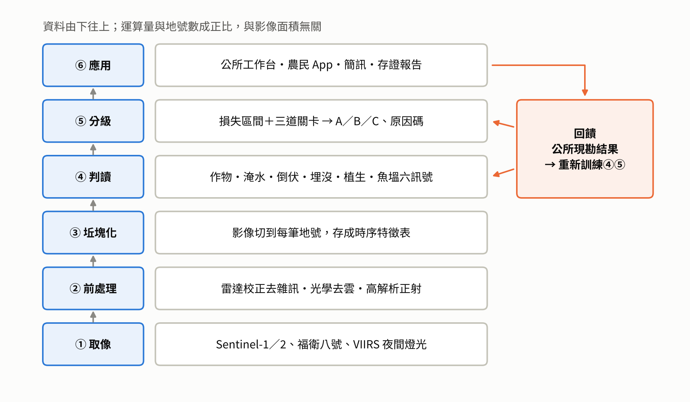
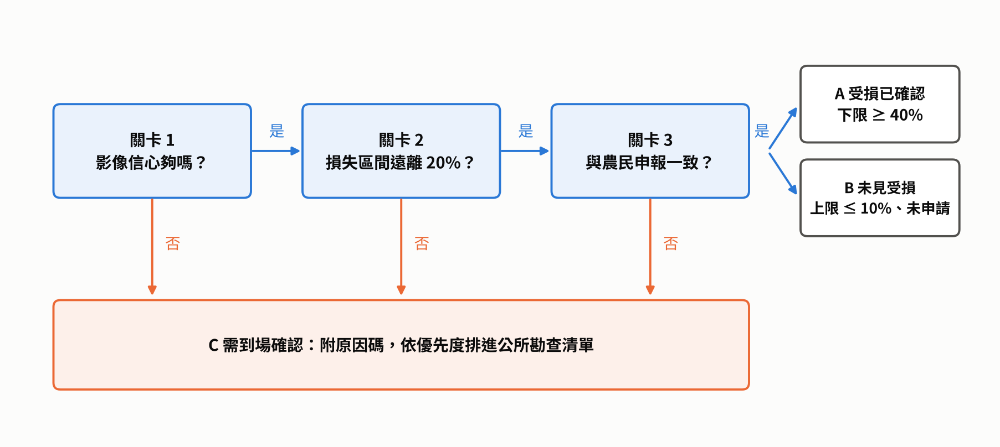
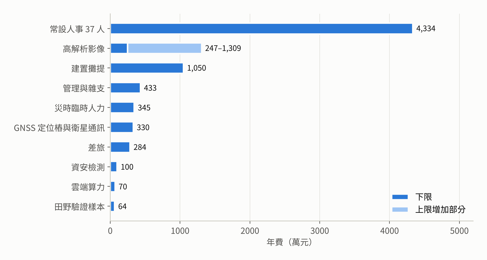
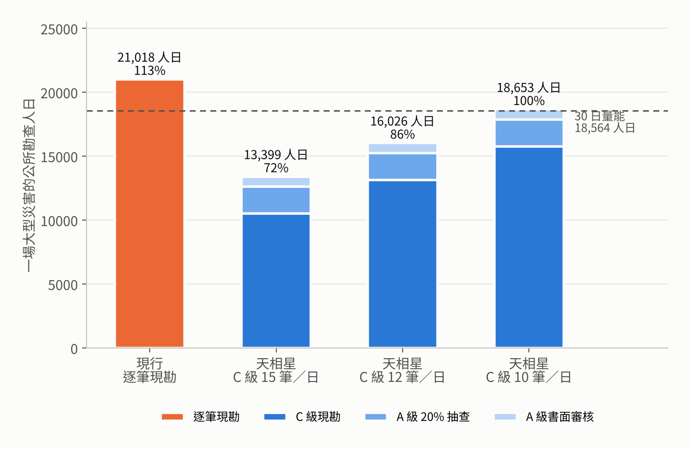
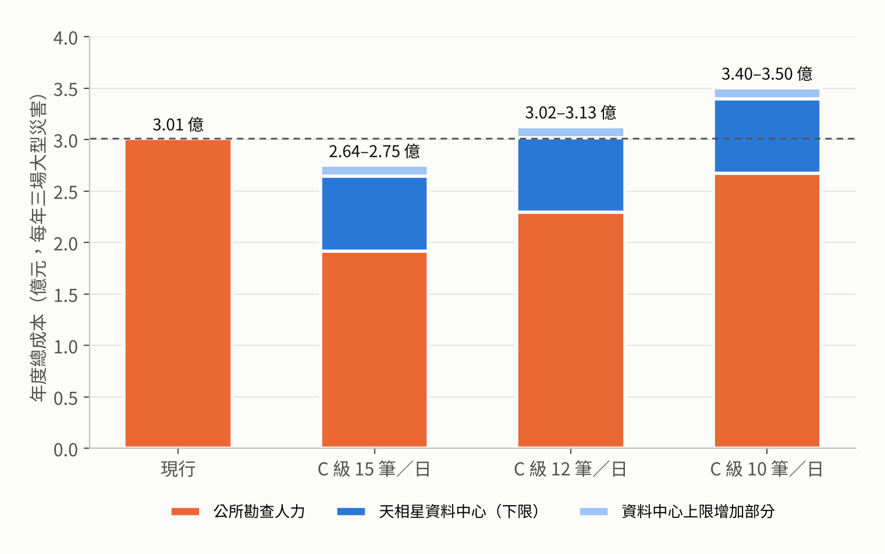

# 以多源衛星影像建構農業天然災害勘查分流與存證系統：天相星 SkyAide

2026 衛星數位應用創新大賽　創意組｜技術說明（小論文格式）｜2026-10-22 修訂

## 摘要

臺灣農業天然災害現金救助的瓶頸不在經費，而在勘查。審計部統計 2021 年 8 月豪雨 20.9 萬件救助案件，申請到撥款平均 55 天，超過法定 44 天；須現勘的案件平均 58 天，免勘案件只要 24–30 天（監察院，2023）。本研究提出「天相星 SkyAide」，以 Sentinel-1 雷達、Sentinel-2 光學、福衛八號高解析影像與夜間燈光資料，替全國農田與魚塭的每一筆地號持續保存災前紀錄，災後以同一地號的前後比對回答救助勘查的兩個問題：災前是否在生產、損失是否達 20%。系統以時序 Transformer 判釋作物、三法投票判定淹水、雷達變遷偵測判定倒伏與埋沒、分位數梯度提升樹估計損失區間，再以三道關卡將案件分為受損已確認（A）、未見受損（B）與需到場確認（C）。本研究已以 2025 年丹娜絲颱風登陸點周邊約 25,450 公頃的真實 Sentinel-1／2 影像執行判讀：扣除去年同期後，植生明顯下降約 480 公頃，雷達疑似積水約 157 公頃；作物粗分後發現其中約 55% 落在插秧灌水期的稻田，多半是灌溉，因此分級規則加上插秧期遮罩。系統的 26 項技術元件逐項檢驗可行性與可使用性，11 項通過、9 項有條件通過、6 項目前無法作為證據；現階段衛星證據足以排序與佐證，要支持免勘，則需以颱風後 1 公尺以下的商業雷達或光學影像直接看到損失，並以公所法定 20% 抽查的結果，依作物證明 A 級精確度達 95%。魚塭因損失發生在水下，改以魚塭坵塊、在養狀態、溢堤、池水流失、停電與水色六種訊號證明「在養」與「受災方式」。另以 GNSS 坡面定位樁與衛星通訊補足遙測看不到、傳不出來的地方，並為每份存證報告建立可溯源資料，讓任何人都能追查與重算判定結果。成本分析將公所人力一併計入：天相星資料中心需常設 37 人，年度總成本約 7,257 萬至 8,319 萬元；公所人員不減少，而是從逐筆現勘改為書面審核 A 級、集中現勘 C 級。以 2021 年 8 月豪雨規模計，公所勘查需求從 30 日量能的 113% 降至 72%–100%，每筆邊緣案件可投入的時間增加 25%–50%，每場大型災害釋出 2,364 至 7,619 人日回到原本業務。含公所人力的年度總成本，在每年三場大型災害時約為現行的 88%–116%；與「每個公所增聘一人」相比，新增支出約為其 1/3 到 1/6。

**關鍵詞**：合成孔徑雷達、變遷偵測、作物判釋、農業天然災害救助、魚塭遙測、證據可使用性

**圖目錄**

| 圖 | 名稱 | 所在章節 |
| --- | --- | --- |
| 圖 1 | 農業天然災害現金救助流程與天相星介入點 | 壹、一 |
| 圖 2 | 不同勘查方式的申請到撥款平均天數 | 貳、一 |
| 圖 3 | 判讀方法的文獻表現 | 貳、三 |
| 圖 4 | 天相星系統架構 | 參、二 |
| 圖 5 | 本研究採用衛星的空間解析度與再訪頻率 | 參、三 |
| 圖 6 | 三道關卡分級流程 | 參、七 |
| 圖 7 | 丹娜絲研究區判讀結果 | 肆、二 |
| 圖 8 | 丹娜絲疑似受災面積依作物拆開 | 肆、二 |
| 圖 9 | 天相星資料中心年度成本結構 | 肆、五 |
| 圖 10 | 一場大型災害的公所勘查人日與 30 日量能 | 肆、六 |
| 圖 11 | 含公所勘查人力的年度總成本 | 肆、七 |

## 壹、前言

### 一、研究背景與動機

2025 年丹娜絲颱風與 0708 豪雨造成農業產物及民間設施損失 32.81 億元（農業部統計處，2025a）。救助經費雖已準備，災後 86 天公所初勘合格 51.5 億元，縣府提報 34.6 億元，核撥只有 30.18 億元，約占初勘合格金額的 59%（經濟日報，2025）。三分之一的金額卡在「公所勘查到縣府提報」之間。

勘查慢的原因是人力。依《農業天然災害救助辦法》，公所須於公告翌日起 30 日內完成勘查；2021 年 8 月豪雨申請土地 327,230 筆，由 221 個公所辦理，農業課平均編制 4 人，每人約負擔 370 筆（監察院，2023）。雲林縣曾在一次風災收到逾一萬筆麻竹筍申請，全所投入仍難如期完成，2025 年 9 月更有勘災人員在古坑山區受傷（iThome，2026）。

現行制度其實已預留加速的接點：救助辦法 2017 年修正後明定「勘查得以科學技術輔助之」（監察院，2023），2025 年 5 月農業部公告具種植客觀證明者得免勘查（農業部，2025）。問題在於，目前沒有一種工具能同時證明「災前有種」與「損失達 20%」，也沒有人能在災前替每一塊田留下紀錄。衛星是唯一能做到這件事的觀測手段。

**圖 1　農業天然災害現金救助流程與天相星介入點。** 救助從災害發生到撥款共六步。天相星只在第 2 步（提供災後熱區圖，支援縣市提報）與第 5 步（A／B／C 分級與勘查清單）介入，其餘法定流程不變。第 5 步公所勘查是整個流程最慢的一段。資料來源：監察院（2023）、農業部（2025）。

### 二、研究目的

1. 設計一套以衛星影像為核心、可嵌入現行救助流程的勘查分流與存證系統。
2. 針對農田與魚塭，建立以已發表方法為基礎的判讀模型與分級規則。
3. 以商轉規模估算資料中心與公所兩端的人力與成本，評估系統能否在不裁減公所人力的前提下，減輕超出量能的工作，並提升邊緣案件的處理品質。

### 三、研究問題

1. 衛星影像能否同時提供種植（養殖）事實與損失率的證據？
2. 魚塭損失發生在水下，衛星可以證明什麼、不能證明什麼？
3. 把公所人力一併計入時，系統能否讓公所在 30 日內勘完、釋出多少人力？總成本與現行做法及增聘人力方案相比如何？

### 四、研究範圍與限制

- **範圍**：全國供農糧生產土地約 52 萬公頃、養殖魚塭 4.3 萬公頃（農業部，2017）；災害類型以颱風、豪雨為主，寒害只提供在養證明。
- **限制**：判讀流程已以丹娜絲颱風的真實衛星影像實際執行（見肆、二），但尚未取得公所現勘結果與受災地號，判讀精度仍引用國內外文獻；寒害空果、網室與設施作物等損失衛星無法直接判斷，這類案件只提供種植證明；成本中的福衛八號售價、全國地號數、定位樁單價等為假設值，均於文中標明。

## 貳、文獻探討

### 一、我國救助制度與勘查瓶頸

救助需確認兩件事：申報作物在災前確實種植，以及單一品項損失率達 20%（農業部，n.d.-a）。審計部統計顯示，勘查方式直接決定撥款速度（監察院，2023）：

| 案件類型 | 件數 | 平均撥款天數 |
| --- | --- | --- |
| 須現勘損失率的一般案件 | 134,006 | 58 |
| 簡化措施但仍現勘種植事實 | 67,535 | 51 |
| 有客觀證明、免勘查 | 5,932 | 30 |
| 無證明、視同具種植事實 | 1,716 | 24 |

**圖 2　不同勘查方式的申請到撥款平均天數。** 須現勘的案件平均 58 天、超過法定 44 天；具客觀證明而免勘的案件只要 24–30 天，相差將近一個月。橘色為須到場的案件，藍色為不必到場的案件。這張圖說明本研究的核心假設：只要能提供公所敢用的客觀證據，撥款就能大幅提前。資料來源：監察院（2023），2021 年 8 月豪雨 209,189 件。

免勘與視同案件合計只占 3.7%。同一份報告也指出，10 個縣市因擔心溢領而維持逐筆現勘，簡化措施效果打折；照相 App 照片只被當成佐證，公所不敢據以免勘（監察院，2023）。換言之，**制度允許免勘，但缺少讓公所敢用的客觀證據**。

### 二、現行勘查工具與其限制

| 工具 | 能證明 | 限制 | 出處 |
| --- | --- | --- | --- |
| 公所逐筆現勘 | 種植＋損失 | 人力不足、目視主觀、道路中斷時無法到場 | 監察院（2023） |
| 災損天氣參數 | 損失率（推論） | 依測站點資料，測站間有盲區；約 40 種品項 | 農業部（n.d.-b） |
| 農災 App | 輔助佐證 | 須有人到場；無災前紀錄；GPS 約 ±20 公尺 | 農業部（n.d.-c） |
| 無人機 | 損失 | 須派員飛行、受風雨限制；2019–2020 年補助 6 件 2,050 萬元全數未執行 | 監察院（2023） |
| 雲林衛星 NDVI 試算 | 疑似受損範圍 | 只用光學，與核定區重疊約 64%；無法判定原因 | iThome（2026） |

### 三、衛星遙測於農業災損的應用

**（一）雷達前處理。** 合成孔徑雷達不受雲層影響，是颱風後最早可用的資料。Mullissa 等人（2021）在 Google Earth Engine 上建立 Sentinel-1 分析就緒資料流程，包含邊緣雜訊修正、斑點濾波與輻射地形正規化，解決山區坡向造成的亮暗差異。

**（二）作物判釋。** Rußwurm 等人（2020）以法國布列塔尼約 60 萬筆坵塊的 Sentinel-2 時序比較 8 種模型，Transformer 準確率 0.80、kappa 0.75 為最高，隨機森林為 0.78。國內研究以 Sentinel-1 時序結合地籍坵塊判釋雲林水稻田，各鄉鎮整體準確率 0.8 以上、kappa 0.64（International Journal of Remote Sensing, 2025），證明臺灣地籍可直接作為判讀單位。

**（三）淹水判釋。** Bonafilia 等人（2020）的 Sen1Floods11 資料集顯示，只用單一雷達門檻，洪水 IoU 僅約 0.29。歐盟全球洪水監測（GFM）因此同時執行門檻法、時序異常與變遷偵測三種演算法，以多數決合併，於 Sentinel-1 取像後 8 小時內出圖（Copernicus Emergency Management Service, 2022）。NASA 與 IBM 開源的 Prithvi 地理基礎模型約 1 億參數，微調後在 Sen1Floods11 水體 IoU 達 0.83（Jakubik et al., 2023）。

**（四）倒伏判釋。** Ajadi 等人（2020）以 Sentinel-1 VH 災前災後對數比值與隱馬可夫隨機場，繪製美國 Derecho 風災的玉米大豆倒伏分布，但僅以 8 個現場點做定性驗證。Chauhan 等人（2020）以義大利小麥田證實 VH 對倒伏最敏感，光學紅邊與近紅外可輔助。

**（五）全面損毀判釋。** 菲律賓太空總署以 Sentinel-1 干涉同調性下降（門檻 0.5）快速繪製颱風雷伊災損，與聯合國衛星中心標記吻合達 93%（Meneses & Blanco, 2022）。

**（六）損失不確定性。** 分位數回歸可輸出預測區間而非單一數字；Narin 等人（2025）以 Sentinel-1／2 結合分位數回歸森林估算水稻株高並量化不確定性。梯度提升樹 LightGBM 支援分位數目標，運算效率高（Ke et al., 2017）。

**圖 3　判讀方法的文獻表現。** 左圖：只用單一雷達門檻判淹水，洪水 IoU 約 0.29（Bonafilia et al., 2020）；微調後的 Prithvi 地理基礎模型水體 IoU 約 0.83（Jakubik et al., 2023）。兩者評估的類別不完全相同（前者為洪水、後者為水體），此圖用來說明單一門檻不足、需要多法並用，而非嚴格的同條件比較。右圖：在約 60 萬筆坵塊上，時序 Transformer 準確率 0.80，略高於隨機森林 0.78（Rußwurm et al., 2020）。本研究據此在淹水判釋採三法投票、作物判釋採時序 Transformer。

### 四、魚塭遙測

Ottinger 等人（2022）以 Sentinel-1 VH 時序中位數加 Otsu 門檻與形狀過濾，在亞洲沿海找出 340 萬口以上魚塭，整體準確率 91.9%。Gusmawati 等人（2018）以高解析影像，依有水、水車、餵飼台、植生四項指標判斷蝦池在用或廢棄。NASA Black Marble 每日 500 米夜間燈光產品已用於颶風後停電判釋（NASA, n.d.; NASA Earth Observatory, 2022）。

### 五、國外制度化案例

| 案例 | 做法 | 成效 | 出處 |
| --- | --- | --- | --- |
| 愛爾蘭 AMS | Sentinel-1／2 監測全國申報地塊，紅燈才通知農民補照片 | 歐盟自 2023 年起要求會員國採用 | 愛爾蘭農業部（n.d.） |
| 義大利 AGEA | 2018 年起以衛星監測取代例行實地稽核 | 監測與稽核成本降低 30%–40%；實地檢查降至 3%–5% | ESPI（n.d.） |
| 德國薩克森 DGL Monitor | 衛星與機器學習排定查核順序，最終由主管機關判定 | 衛星排序、人做判定 | TU Dresden（n.d.） |
| 印度 RIICE | Sentinel-1 加稻作模型作為保險理賠證據 | 20 多萬戶農民取得理賠 | ESA（n.d.） |

### 六、小結：研究缺口

既有工具不是「沒有災前紀錄」（天氣參數、照相 App、無人機），就是「不處理災後損失」（AMS、AGEA）；國內衛星試算只用光學且未綁定地號。目前沒有一套系統能**持續保存每筆地號的災前紀錄、在災後同時提供種植與損失證據，並直接嵌入臺灣救助流程**。魚塭方面，文獻已能找出魚塭與判斷在用，但尚未有研究將其用於災後救助。

## 參、研究方法

### 一、研究架構

本研究把勘查拆成兩個問題，分別對應衛星證據：

| 問題 | 衛星證據 |
| --- | --- |
| 災前有沒有在生產 | 災前 6 個月時序＋作物或在養判釋，綁定地號 |
| 損失有沒有達 20% | 災前災後變化量，輸出損失區間 |

依兩個問題的答案把案件分為三級：

| 分級 | 條件 | 處理 |
| --- | --- | --- |
| A 受損已確認 | 災前在生產（高可信度），且損失區間下限 ≥ 40% | 產出存證報告，書面審核；存證報告獲公告認可前作為 App 照片的佐證，照常列入 20% 抽查母體 |
| B 未見明顯受損 | 農民未申請，且損失區間上限 ≤ 10%、影像無變化 | 不派人 |
| C 需到場確認 | 其餘全部 | 依優先度排進公所勘查清單 |

農民有申請而衛星沒看到變化者一律歸 C。10%／40% 為起始值，以歷史災例與公所現勘結果校正。

### 二、系統架構

| 層 | 功能 | 輸出 |
| --- | --- | --- |
| ① 取像 | 依過境排程收取影像；颱風後優先雷達，排定福衛八號取像 | 原始影像 |
| ② 前處理 | 雷達校正去噪、光學去雲、高解析正射 | 分析就緒影像 |
| ③ 坵塊化 | 影像切到每筆地號，存成時序統計值 | 地號時序特徵表 |
| ④ 判讀 | 作物、淹水、倒伏、埋沒、植生、魚塭訊號 | 各任務機率與變化量 |
| ⑤ 分級 | 損失區間估計＋三道關卡 | A／B／C、原因碼、可信度 |
| ⑥ 應用 | 公所工作台、農民 App 與簡訊 | 存證報告、勘查清單、抽查名單 |
| 回饋 | 現勘結果回傳 | 每次災後重新訓練④⑤ |

坵塊化放在判讀之前，模型直接處理「一筆地號的一條時間序列」，運算量與地號數成正比、與影像面積無關，這也是全國規模下算力成本極低的原因（見肆、五）。

**圖 4　天相星系統架構。** 資料由取像層往上經過前處理、坵塊化、判讀、分級，最後到公所與農民使用的應用層。右側橘色為回饋迴路：公所每次現勘的結果回到判讀與分級層重新訓練模型，讓判讀隨各地作物與地形逐步在地化。

### 三、資料來源

| 資料 | 規格與頻率 | 用途 | 取得條件 |
| --- | --- | --- | --- |
| Sentinel-1 | C 波段 VV＋VH、約 10 米；1C、1D 雙星恢復 6 天再訪（Copernicus, 2026） | 倒伏、淹水、埋沒、溢堤、魚塭坵塊 | 免費，散布時標示來源（European Commission, n.d.） |
| Sentinel-2 | 10–20 米；中緯度 2–3 天（Planet, n.d.） | 植生、作物、水體與水色 | 同上 |
| 福衛八號 | 1 米（處理後 0.7 米），具紅邊；對臺最高一日三次；8 顆星系 2031 年前完成（工商時報，2026；公視，2026） | 小田、魚塭在養證據 | 國家太空中心；售價未公開 |
| 福衛九號 | 雷達，規劃 2028、2030 年發射（聯合報，2025） | 自主穿雲來源 | 發射後介接 |
| VIIRS 夜間燈光 | VNP46A2，約 500 米，每日（NASA, n.d.） | 停電範圍與天數 | 免費 |
| 地籍、農地覆蓋物資料庫、天氣參數網格 | 坵塊級；1 公里網格（農業部，n.d.-c） | 坵塊切分、作物標註、原因確認 | 與農業部介接 |
| 養殖登記與放養申報 | 每口池（高雄市政府海洋局，n.d.） | 在養證明、損失基準 | 與公所介接 |

**圖 5　本研究採用衛星的空間解析度與再訪頻率。** 橫軸為空間解析度、縱軸為再訪間隔，皆為對數刻度，越靠左下代表看得越細、拍得越頻繁。四種資料各有分工：Sentinel-1 不受雲影響，負責颱風後第一時間的比對；Sentinel-2 頻率高但受雲影響，負責植生與水色；福衛八號解析度最高，處理小田與魚塭水車；VIIRS 解析度粗，只用於區域級停電判斷。福衛八號的一日三次為對臺最高取像頻率，實際取決於排程。

### 四、前處理

**（一）Sentinel-1**：精密軌道、熱雜訊去除、輻射校正為 σ⁰；邊緣雜訊修正、斑點濾波、輻射地形正規化（Mullissa et al., 2021）；計算災前災後同調性；以地形模型標出雷達陰影與疊置區。

**（二）Sentinel-2**：使用 L2A 地表反射率；以 Cloud Score+ 逐像素清晰度去雲，門檻 0.60（官方建議 0.50–0.65）（Pasquarella et al., 2023）；計算 NDVI、NDRE、NDWI、MNDWI；雲遮蔽日期內插補值並標記，補值日期不得作為災後證據。

**（三）福衛八號**：正射校正、融合至 0.7 米並與地籍套疊檢查對位；用於小於 0.3 公頃的田（Sentinel-2 一個像素 100 平方公尺，0.1 公頃只有 10 個像素）與魚塭在養證據。

**（四）坵塊化**：每筆地號向內縮 10 米取像素統計，避免田埂與鄰田混合像素；內縮後少於 5 個 Sentinel 像素者改用福衛八號或列 C。每筆地號每日期存一列：VV、VH、VH／VV、同調性、NDVI、NDRE、NDWI、MNDWI、各波段反射率、雲與補值旗標。

**（五）地號、坵塊與實際耕作**

救助是發給「實際從事生產之自然人」（農業天然災害救助辦法第 5 條），但衛星看到的是「一塊田」，地籍記錄的是「一筆地號」，三者不一定對得上：

| 落差 | 現況 | 對判讀的影響 | 處理方式 |
| --- | --- | --- | --- |
| 一筆地號種多種作物 | 申報以品項計算損失率，同一地號可能分種 | 整筆平均會稀釋單一作物的損失 | 以農地覆蓋物資料庫的坵塊為判讀單位，地號只作為索引；同一地號內不同作物分開判讀 |
| 一塊田跨多筆地號 | 實際耕作常把相鄰地號合併經營 | 單筆地號面積太小，像素不足 | 同樣以坵塊判讀，再依面積比例分攤回各地號 |
| 地號內夾雜農路、建物、未種植區 | 審計部指出溢領多與夾雜農路、未種植仍申報有關（監察院，2023） | 申報面積大於實際種植面積 | 以坵塊實際種植範圍計算面積，與申報面積差距過大者列 C（原因碼：面積不符） |
| 地籍圖本身有誤差 | 部分地籍圖仍沿用日治時期的圖解地籍圖，圖紙伸縮使圖、簿、地不符；屏東縣重測後約三分之一土地面積增加、三分之一減少（經濟日報，2026）；圖解數化只保存數化當時的原貌，不能消除累積誤差（桃園市中壢地政事務所，n.d.） | 地號邊界與實際田界偏移 | 圖解地籍區加大內縮距離；對位誤差超過容許值者列 C（原因碼：對位不確定） |
| 申請人不是地主 | 承租耕作普遍，農糧署統計 2014 年大佃農經營規模 15,070 公頃、1,670 人（農業部，2015）；申請表以檢附土地所有權狀為主，其餘由公所指定其他文件（農業部，2023） | 衛星無法判斷誰在耕作 | 天相星只證明「這塊地災前有種、災後受損」，申請人資格仍由公所依受理文件認定；存證報告以地號與坵塊編號對應申請案件 |

這套規則的結果是：衛星判讀以「實際耕作的坵塊」為準，比地號更貼近現場；凡是地號、坵塊、申報三者對不起來的，一律交給公所判斷，不由系統硬判。

### 五、農田判讀模型

| 任務 | 模型 | 輸入 | 輸出 | 依據 |
| --- | --- | --- | --- | --- |
| ① 作物判釋 | 時序 Transformer；基準版為 Presto 預訓練模型＋作物曆規則 | 災前 6 個月雷達＋光學時序（基準版為災前一年 Sentinel-1） | 各作物機率 | Rußwurm et al.（2020）；Tseng et al.（2023） |
| ② 淹水 | 三法投票：Otsu 門檻、時序異常、微調 Prithvi | 災前災後 VV、VH | 淹水像素比例 | GFM（2022）；Jakubik et al.（2023） |
| ③ 倒伏 | VH 對數比值＋隱馬可夫隨機場三級分類 | 災前災後 VH、VH／VV | 無、中度、嚴重 | Ajadi et al.（2020）；Chauhan et al.（2020） |
| ④ 埋沒、流失 | 同調性下降門檻 0.5 | 災前災後同調性 | 全面改變與否 | Meneses & Blanco（2022） |
| ⑤ 植生受損 | 相對於自身往年同期與鄰近同作物田的標準分數 | NDVI、NDRE | 偏離程度 | iThome（2026） |
| ⑥ 損失區間 | 分位數梯度提升樹，輸出第 10、50、90 百分位 | ①–⑤＋天氣參數＋作物＋面積 | 損失率區間 | Ke et al.（2017）；Narin et al.（2025） |

**設計理由：**

- 作物判釋採 Transformer，因其在大規模坵塊基準中準確率最高；標註來自農業部農地覆蓋物資料庫的航遙測判釋成果，以及公所每次回填的作物是否相符。取得標註前，先以 NASA Harvest 開源的 Presto 預訓練模型（Tseng et al., 2023）加作物曆規則建立基準版，已在丹娜絲研究區實際執行（見肆、二）。水稻以外的作物目前分不出來，因此申報一致檢核的作物種類暫以申報與既有紀錄為準，衛星只檢查物候是否相符。
- 淹水採三法投票，至少兩法同意才算淹水，避免單一門檻 IoU 不到 0.3 的問題。Prithvi 只做微調，不需重做預訓練。GFM 的品質報告指出淹水農田與稻田常被漏判（Copernicus Emergency Management Service, 2024）；丹娜絲實測則發現插秧灌水期的稻田會被判成積水，因此插秧期的稻田不以積水單獨判 A，列 C 並附原因碼「疑似灌溉」。
- 倒伏只能靠雷達，因為颱風後雲層未散；但現有文獻只涵蓋大田作物，溫州瑪莉亞颱風研究的稻田倒伏一致率為 64%–88%（Wu et al., 2019），因此倒伏只作佐證、不單獨判 A；香蕉、竹林在取得現勘資料前一律列 C。
- 埋沒、流失的同調性訊號夠強，雲未散時即可單獨判 A，對應樺加沙光復鄉「作物已無法辨認」的情境。
- 植生看相對變化，排除採收、季節造成的正常下降。
- 損失率輸出區間，因為分級只需要知道「區間有沒有跨過 20%」；樹模型也能逐筆列出影響判定的特徵，讓公所看得懂理由。
- 災後持續追蹤 6 個月，任務⑤偏離若數週後才擴大，即標記延遲性災損候選，對應丹娜絲後的彰化葡萄（旺得富理財網，2025）與隔年公告的台南文旦（自由時報，2026）。

### 六、魚塭判讀

魚在水下，衛星看不到魚，所以魚塭不估魚隻數量，而是證明災前在養、災害打到這口池、以及受災方式。丹娜絲漁產損失約 7.7 億元，台南約 5.4 億、嘉義約 2.1 億（農業部統計處，2025a），沿海停電使增氧機停擺（公視，2025a），虱目魚與文蛤大量死亡（公視，2025b）；2026 年 6 月雲林台西魚塭潰堤連成一片（聯合報，2026）。2021 年台南虱目魚寒害時，主管機關已改用科學數據判定門檻，公所只需現場確認養殖事實（中央社，2021），本系統要取代的正是這一步。

| 訊號 | 原理 | 判斷方法 | 證明 | 看不到 |
| --- | --- | --- | --- | --- |
| ① 魚塭坵塊 | 平靜水面把雷達波反射開，呈暗色；堤岸為亮線 | 年度 VH 中位數＋Otsu＋形狀過濾＋低地緩坡遮罩，再套地籍（Ottinger et al., 2022） | 這是一口魚塭與面積 | 棚架、室內池 |
| ② 在養狀態 | 水車打出白色浪花、餵飼台細長結構 | 福衛八號物件偵測，指標沿用 Gusmawati et al.（2018）；災前 90 天內有水且見水車為強證據 | 災前在養 | 養什麼、養多少 |
| ③ 溢堤、潰堤 | 堤岸亮線變暗、相鄰池連成一片 | Sentinel-1 只判整片魚塭區溢淹（區域級）；單口池以 1 公尺以下影像看堤岸被淹 ≥ 80% | 災害打到這片或這口池 | 短時溢堤；堤岸僅數公尺寬，Sentinel-1 看不到 |
| ④ 池水流失 | 池內水面縮小或乾涸 | 水面少一半以上且無收成申報 | 堤岸破損、魚隨水流走 | 與正常放乾難區分 |
| ⑤ 停電 | 夜間燈光變暗 | 低於災前 30 天中位數的一半即停電，計連續天數 | 該區增氧機可能停擺 | 單一魚塭是否有發電機 |
| ⑥ 水色異常（研究項目，不列入分級） | 藻相崩潰、混濁、淡化改變反射 | 偏離自身正常範圍 3 個標準差 | 可能大量死亡 | 原因；尚無直接文獻，改以停電自動切換電箱與溶氧紀錄佐證 |

**魚塭分級**：災前在養（強證據＋放養申報）且整池溢堤、潰堤或池水流失（同期無收成申報）者為 A；在 1 公尺以下影像到位前，整池溢堤無法以 Sentinel-1 判定，A 級只剩池水流失一條路。只有停電、區域溢淹、部分溢堤等間接訊號，或無在養證據者為 C，並依停電天數與溢淹面積排序；未申請且全無變化者為 B。寒害是否達門檻交給天氣參數，本系統只提供在養證明。

### 七、分級決策：三道關卡

1. **影像信心**：坵塊夠大、對位可靠、雷達與光學結論一致（雲未散時，淹水或埋沒的強烈訊號也可）。
2. **遠離門檻**：損失區間第 10 百分位 ≥ 40%，或第 90 百分位 ≤ 10%。
3. **與申報一致**：作物與受損與否皆相符。

任一關未通過即列 C，並附原因碼。

**圖 6　三道關卡分級流程。** 每筆案件依序通過影像信心、遠離 20% 門檻、與申報一致三道關卡；任一關回答「否」就列為 C 級，由公所到場確認。三關都通過後，損失區間下限 ≥ 40% 判 A，上限 ≤ 10% 且農民未申請判 B。設計上寧可多放到 C，以降低把未受損判成受損的風險。

### 八、驗證設計

| 指標 | 定義 | 目標 |
| --- | --- | --- |
| A 級精確度 | A 級中現勘確認損失 ≥ 20% 的比例 | ≥ 95% |
| B 級精確度 | B 級中確實未受損的比例 | ≥ 95% |
| C 級比例 | C 級 ÷ 全部申請 | ≤ 50% |
| 作物判釋準確率 | 與現勘作物相符的比例 | ≥ 0.80 |
| 區間覆蓋率 | 現勘損失率落在第 10–90 百分位內的比例 | 約 80% |
| 出件時間 | 第一張雷達到站至分級完成 | 8 小時內 |

驗證以整場災害為單位留出測試，避免同場災害的鄰田資訊外洩；並依平地水稻、山區竹林、果園、魚塭分類報告，任一類 A 級精確度未達標，該類暫停判 A、全部列 C。

### 九、天地整合：GNSS 定位、衛星通訊與 IoT

題目六除衛星遙測外，也列出衛星通訊、GNSS 定位與 IoT 感測。本系統以三種方式納入，補足遙測看不到或傳不出來的地方：

| 元件 | 用途 | 技術依據 | 對應的遙測缺口 |
| --- | --- | --- | --- |
| GNSS 坡面定位樁 | 布設於林木遮蔽、雷達陰影的坡地，量測坡面位移，作為鄰近農地受災的佐證與預警 | 中央地質調查所自 2012 年起以 GNSS 監測潛在大規模崩塌的地表位移（陳清福，2020）；國土測繪中心 e-GNSS 即時定位平面精度優於 5 公分、高程優於 10 公分（臺中市政府地政局，n.d.） | 雷達在陡坡有陰影、光學看不穿樹冠 |
| 衛星通訊回傳 | 定位樁與現場回報在沒有地面網路時，經衛星傳回資料中心 | 數位發展部建置約 700 個非同步軌道衛星終端站點，供政府部門於災害時維持運作；OneWeb 由中華電信代理（iThome，2024） | 深山與災後地面網路中斷 |
| 手機直連衛星（D2D） | 農民在沒有訊號處以一般手機傳簡訊回報，附 GNSS 座標存證 | 台灣大哥大 2024 年 11 月完成首次手機直連低軌衛星簡訊與語音測試（INSIDE，2024）；國內尚未商轉 | 偏鄉農民無法及時通報 |
| 農民 GNSS 定位存證 | App 與簡訊回報時記錄座標與時間，C 級案件可補現場位置證據 | 農災 App 已套印經緯度與地段號（農業部，n.d.-c） | 補強 C 級案件的現場證據 |

**供電的限制**：定位樁採太陽能板加蓄電池獨立供電，不依賴市電；但公所與農民端若同時停電，衛星通訊也無法使用。因此 C 級勘查清單在災前與災後第一時間就預先下載到公所人員手機的農災 App，離線也能依清單作業。

**定位樁的規模與成本**：定位樁只布設在衛星看不到的關鍵坡地，以 30 站計，每站設備約 40 萬元、5 年攤提，加每站每年通訊與維護約 3 萬元，年費約 330 萬元。單價為本研究假設，需向廠商詢價確認。

### 十、可溯源資料

存證報告要能當作證據，關鍵不只在於判讀結果，而是**任何人都能追查這個結果從哪裡來、怎麼算出來，並且重算得到同樣的答案**。本系統為每份存證報告建立完整的資料來源紀錄：

| 紀錄層級 | 記錄內容 | 用途 |
| --- | --- | --- |
| 原始影像 | 衛星名稱、影像編號、取像時間、雲量與補值旗標 | 證明用的是哪一天、哪一顆衛星拍的影像 |
| 處理過程 | 前處理步驟與參數（濾波、地形校正、去雲門檻）、程式版本 | 確認處理方法一致、可重做 |
| 判讀結果 | 模型版本、輸入特徵值、輸出機率與損失區間、三道關卡的判定 | 說明為什麼判成這一級 |
| 人工處理 | 公所現勘結果、承辦人員、時間、照片編號 | 區分系統判讀與人工判定，回饋時可追溯 |
| 對應關係 | 地號、坵塊編號、申請案號 | 一筆報告對應到哪一筆申請 |

紀錄格式採用既有國際標準：影像與衍生資料以 STAC（SpatioTemporal Asset Catalog）描述，這是遙測業界通用的時空資料目錄格式（STAC, n.d.）；處理過程以 W3C 於 2013 年發布的 PROV 資料來源模型記錄「哪個資料（entity）經過哪個處理（activity）、由誰或哪個程式（agent）產生」（W3C, 2013）。Sentinel 影像本身也要求在散布時標示來源（European Commission, n.d.）。

**可溯源資料的三個用途：**

1. **審計與申覆**：審計單位或農民申覆時，可依紀錄調出同一批影像、同一版模型重算，確認結果沒有被改動。
2. **模型改版不影響舊案**：模型每次災後重新訓練，舊案件仍可依當時的版本重現判定。
3. **在衛星看不到損失時，仍提供種植證據**：見下一段。

**衛星看不到的災害與可溯源資料的補位**

部分農田災損衛星無法直接判斷：寒害造成的無子空果（如台東芒果，自由時報，2025）、網室與設施內的作物、果實掉落但樹冠完整的情況。這些案件的損失率仍須由公所現勘或天氣參數判定，本研究在限制中明確說明。

但即使看不到損失，可溯源資料仍能證明**災前確實種植、種的是什麼、面積多大**，而且每一筆都附原始影像與時間戳記。依現行規定，達災損天氣參數或經公告災損嚴重、且具種植客觀證明者，公所得免勘查（農業部，2025）。也就是說，寒害這類「損失由天氣參數證明、種植由衛星紀錄證明」的組合，仍可能走免勘程序；對公所而言，至少可免去「確認有種」這一半的現勘工作。

### 十一、成本估算方法

以全國農糧與魚塭約 56.3 萬公頃、每年三場大型災害為規模。單價取公開價目：人事依主計總處 2025 年 11 月行業經常性薪資（1111 人力銀行，2026），年雇用成本以「月薪 × 14 × 1.2」估算；雲端依 Google Cloud 與 AWS 價目；高解析影像因福衛八號售價未公開，以 SPOT 6/7 與 Pléiades 國際價格為上下限（LAND INFO, 2026）；匯率以 1 美元兌 32 元計。公所端以人日為單位：每人日 4,773 元、每人日現勘 15 筆、每筆 318 元，沿用成本效益版構想書（依臺中市大肚區公所預算，n.d.）；加班費每小時 282 元、每人每月上限 20 小時（臺中市豐原區公所，n.d.）。總成本 ＝ 公所勘查人日 × 4,773 元 × 災害場數 ＋ 資料中心年度成本。C 級邊緣案件較難勘，另設每人日 15、12、10 筆三種效率；A 級案件保留 20% 抽查，並以每人日 200 筆計入書面審核（假設）。

## 肆、研究結果與分析

### 一、系統輸出

每筆地號產出一頁存證報告，內容包含地號與面積、生產事實（作物判釋或在養證據）、災前災後影像日期與編號、災害證據、A／B／C 與損失區間、影響判定最大的三項特徵，以及依參、十建立的可溯源資料（影像編號、處理參數、模型版本、人工處理紀錄）；格式對齊種植客觀證明，比照農災 App 同步進救助系統（農業部，n.d.-d）。介面分為農民手機端（含魚塭與簡訊版）與公所工作台（分級總覽、勘查優先清單、案件審核、抽查與提報），已完成設計原型。

### 二、真實影像測試：丹娜絲颱風

**（一）研究區與資料**

研究區為 2025 年 7 月 6 日丹娜絲颱風登陸點周邊，嘉義布袋、義竹至臺南北門沿海，約 15 × 17 公里（約 25,450 公頃）。資料取自 Microsoft Planetary Computer（Microsoft, n.d.），全部為免費的 Sentinel 影像：

- **雷達**：Sentinel-1 RTC，同軌道 6 期災前影像（6 月 4 日至 7 月 4 日），災後採登陸後第 4 天（7 月 10 日）的第一張影像。
- **光學**：Sentinel-2 L2A，比較 6 月 28 日與 7 月 18 日（登陸後第 12 天，颱風後首張雲量較少的影像），並以 2024 年同期的變化作為正常收割的基準。
- **作物粗分**：颱風前一整年同軌道 29 期 Sentinel-1（天相星團隊，2026a、2026b）。

**（二）災前災後比對結果**

| 變化類型 | 判讀方式 | 面積 |
| --- | --- | --- |
| 植生較往年同期明顯下降 | NDVI 變化扣除 2024 年同期，多降 0.2 以上且連片約 0.2 公頃以上 | 約 480 公頃 |
| 植生下降（只看今年） | 未扣除往年同期 | 約 899 公頃 |
| 雷達明顯變暗、疑似積水 | 災後影像與災前 6 期比較，淹水三法投票 | 約 157 公頃 |
| 高反射人造物變暗 | 同上，災前即很亮的地物 | 約 26 公頃 |
| 兩種衛星皆標出 | 疊合 | 約 9 公頃 |

**圖 7　丹娜絲研究區判讀結果。** 紅色為植生較往年同期明顯下降，藍色為雷達疑似積水，橘色為高反射人造物變暗，紫色為兩者皆有，淺灰為光學受雲遮蔽。影像：Contains modified Copernicus Sentinel data 2024–2025, processed by Microsoft Planetary Computer（天相星團隊，2026a）。

比對結果和系統設計有三點直接關係：

1. **颱風後要靠雷達。** 四期光學影像都無雲、可供比較的面積只有約三分之一。
2. **要和往年同期比。** 7 月是一期稻收割期，只看今年時植生下降 899 公頃，扣除去年同期後剩 480 公頃，近半是正常收割。
3. **雷達和光學看到的是不同的事。** 兩者重疊只有約 9 公頃：雷達看到地表變濕，光學看到植生減少，倒伏未必積水，灌水整地和搶收也會產生相同訊號。所以三道關卡要求兩種訊號和申報一致才判 A。

**（三）作物粗分與受災依作物拆開**

作物粗分分兩部分做：

- **水面與魚塭**：依 Ottinger 等人（2022）的方法，以全年 VH 中位數經 Otsu 定出水面門檻（本區為 −19.5 dB），再以形狀分出魚塭、鹽田與天然水體。論文沒有公布形狀門檻，本測試的數值為自訂。
- **陸地**：以 Presto 預訓練模型（Tseng et al., 2023）把每個像素 12 個月的雷達時序轉為特徵，再以作物曆規則挑出的典型樣本訓練分類器。水稻須有插秧期雷達下降 2 dB 以上的訊號，否則列為「可能是水稻」。

結果為水稻 4,381 公頃、可能是水稻 1,513 公頃、其他作物 8,509 公頃、魚塭與鹽田 3,340 公頃、水體 6,700 公頃、建地與道路 1,005 公頃。把受災範圍依作物拆開如下表：

| 受災類型（公頃） | 水稻 | 可能是水稻 | 其他作物 | 魚塭／鹽田 | 水體與建地 | 合計 |
| --- | --- | --- | --- | --- | --- | --- |
| 植生較往年同期明顯下降 | 117 | 62 | 287 | 6 | 8 | 480 |
| 雷達疑似積水 | 87 | 14 | 25 | 13 | 19 | 158 |
| 高反射人造物變暗 | 6 | 1 | 1 | 2 | 16 | 26 |

註：各格分別四捨五入，疑似積水合計與上表差 1 公頃。

**圖 8　丹娜絲疑似受災面積，依颱風前的作物類別拆開。** 作物粗分以颱風前一年 29 期 Sentinel-1 影像判釋，未與官方資料比對（天相星團隊，2026b）。

最重要的發現是：雷達疑似積水的約 157 公頃中，約 87 公頃（55%）落在水稻田。這張雷達影像攝於 7 月 10 日，正值二期稻插秧前灌水，因此這部分大多很可能是正常灌溉，而不是颱風積水。分級規則據此加上一條：插秧灌水期的稻田不以積水單獨判 A，列 C 並附原因碼「疑似灌溉」。植生下降的 480 公頃則以其他作物為主（287 公頃）。

**（四）限制**

1. 沒有公所現勘結果或受災地號，無法計算精確度。
2. 雷達與光學分別晚於登陸 4 天與 12 天，最嚴重的積水可能已退。
3. 作物粗分的兩個版本（純規則與 Presto）判出的水稻面積分別為 1,592 與 4,381 公頃，相差 2.8 倍；須以官方稻作面積校正後，才能用於申報一致檢核。
4. 香蕉、竹林、果樹在本研究區無法區分。

另以模擬工況將完整流程執行一次（天相星團隊，2026d）：10 個工況合計 A 級 201 件、B 級 220 件，無一判反，淹水三法投票的 IoU 為 0.857。模擬資料和判讀規則出自同一套假設，這個結果只證明流程與分級邏輯可行，不代表真實精度。

### 三、可行性與可使用性驗證

技術能做出來，不代表結果足以當證據。本研究把系統拆成 26 項技術元件，逐項檢查兩件事，兩者皆達標才算通過（天相星團隊，2026c）：

- **可行性**：以下三項任一成立即可——已發表研究有量化驗證、國家或商業系統已實際運作，或本研究已以真實影像跑出結果。
- **可使用性**：依該元件在系統中的用途分三級檢查，判錯的代價越高，要求越嚴。

| 用途 | 意思 | 判錯的代價 | 通過標準 |
| --- | --- | --- | --- |
| U1 排序線索 | 決定先看哪裡、列進 C 級清單 | 公所多跑一趟 | 訊號與災損有明確物理關係，且有文獻或實測案例 |
| U2 佐證 | 與照片、申報、現勘並列，由承辦判斷 | 承辦可能採信錯誤證據 | 與地面資料一致率 ≥ 80%（本研究自訂），或已有行政、司法、保險採用同類資料的先例 |
| U3 書面審核依據（A 級） | 公所不到場即認定 | 溢領，承辦負圖利責任 | 法令或公告認可，且依作物類別 A 級精確度 ≥ 95%（比照歐盟誤判紅燈上限 5%；European Court of Auditors, 2020） |

結果如下：

| 結論 | 項數 | 項目 |
| --- | --- | --- |
| 通過 | 11 | Sentinel 資料取得、埋沒偵測、植生異常（相對往年）、人造物變化（線索）、A／B／C 分級排序、魚塭坵塊、區域停電、長時間對照、可溯源與防偽、衛星通訊備援、雷達到站後 8 小時出件 |
| 有條件通過 | 9 | 福衛八號（供應方式未定）、坵塊化（待取得地籍）、水稻判釋（面積待校正）、淹水判釋（加插秧期遮罩）、倒伏（只作佐證）、魚塭在養（以放養申報為主）、池水流失（須無收成申報）、延遲性災損（只作提醒）、GNSS 定位樁（限坡地預警） |
| 未通過 | 6 | 水稻以外的作物判釋、損失區間校準、存證報告當免勘客觀證明、單口魚塭溢堤、魚塭水色異常、手機直連衛星 |

未通過的 6 項，處理方式如下：

| 項目 | 未通過原因 | 改採做法 |
| --- | --- | --- |
| 水稻以外的作物判釋 | 香蕉、竹林、果樹沒有臺灣驗證，本次實測也分不出來 | 作物種類以申報與既有紀錄為準，衛星只查物候是否相符 |
| 損失區間校準 | 沒有公所現勘資料，覆蓋率無從驗證 | 第 1 年區間只作參考；A 級限埋沒或非插秧期整塊積水，並須 App 照片 |
| 存證報告當免勘客觀證明 | 2025 年 4 月 18 日種植客觀證明公告未列衛星資料 | 第 1 年當 App 照片的佐證；以試辦精確度申請列入公告 |
| 單口魚塭溢堤 | 堤岸僅數公尺寬，Sentinel-1 約 20 公尺解析度看不到 | 降為區域溢淹（C 級排序）；單口改用 1 公尺以下影像 |
| 魚塭水色異常 | 找不到水色與大量死亡對應的研究（Rodríguez-Benito et al., 2020 為海上箱網藻華，且只有定性比對） | 移出分級，改以停電自動切換電箱與溶氧紀錄佐證；漁業署已補助更新備用發電機（中央社，2022） |
| 手機直連衛星 | 國內尚未商轉（旺得富理財網，2026） | App 與簡訊先存、有訊號時再送 |

可使用性的先例包括：

- **歐盟**：以執行規則 2022/1173 將衛星監測寫入給付制度（European Commission, 2022）。
- **國內法院**：彰化竹塘案以空照圖認定災前裸地（中央社，2018）。

這些先例證明衛星資料可以進入行政與司法流程，但沒有一例直接以衛星認定個別田區的損失率。因此結論是：**現階段衛星證據足以排序與佐證（U1、U2），還不足以讓公所免勘（U3）。** 下一節說明要跨過這一步的技術方向。

### 四、從佐證到免勘的技術路徑

要讓衛星證據撐起免勘，需要三件事同時成立：

1. 颱風後拍得到，而且看得到損失本身。
2. 模型輸出的是損失率，而不只是「有變化」。
3. 精確度有統計保證，並且依作物分別證明。

以下分別從衛星與模型兩方面說明。

**（一）目前卡在哪裡**

Sentinel-1／2 的像素是 10–20 公尺，在一塊田裡看到的是「訊號」，不是損失本身：

- 雷達變暗、植生下降，各有多種可能原因（淹水、灌溉、收割、倒伏），丹娜絲實測的「55% 疑似積水在稻田」就是例子。
- 文獻中雷達判倒伏的一致率為 64%–88%（Wu et al., 2019），離 95% 還有一段距離。
- 損失區間沒有臺灣現勘資料可以校準。

**（二）衛星：提高解析度與颱風後的取像能力**

歐盟的做法可以分兩層看：

- **全面篩選用免費的 Sentinel**：面積監測系統以 Sentinel-1／2 監測每一筆申報地塊（European Commission, 2022）。
- **確認用高解析影像**：
  - 執委會聯合研究中心另與業者簽訂約 2,050 萬歐元、最長 4 年的框架契約，採購約 120 萬平方公里的高解析影像，用於現場查核與地塊資料品質檢核（European Space Imaging, 2021）。
  - Copernicus 也以 Pléiades、Pléiades Neo 等商業衛星，完成全歐洲 2 公尺級的 VHR_IMAGE_2024 影像集，供各國公務機關使用（Copernicus Data Space Ecosystem, 2025）。

本研究採用相同的分工。可用的高解析衛星如下：

| 衛星 | 類型 | 解析度 | 取像能力 | 在免勘證據中的角色 |
| --- | --- | --- | --- | --- |
| Sentinel-1／2（現用） | 雷達、光學 | 10–20 公尺 | 6 天、5 天再訪，免費 | 全國篩選、災前時序 |
| 福衛八號 | 光學 | 1 公尺（處理後 0.7 公尺），具紅邊 | 對臺最高一日三次；第 2 顆預計 2027 年第 1 季升空（中央社，2026） | 自主來源；小田、魚塭水車 |
| Pléiades Neo | 光學 | 30 公分，具紅邊與深藍波段 | 日內再訪；每日可取像 100 萬平方公里（Airbus, n.d.） | 雲散後確認香蕉倒株、斷竹、潰堤、埋沒範圍 |
| Planet SkySat／Pelican | 光學 | 50 公分；Pelican 第二代 30 公分 | 最多一日 9 次（UP42, n.d.-b）；Pelican 至 2026 年 7 月已發射 11 次，規劃最多 32 顆（eoPortal, n.d.） | 同上，適合同一天多次補拍 |
| ICEYE | X 波段雷達 | 聚束模式 25 公分–1 公尺；條帶模式 3 公尺 | 50 顆以上，一日 4 次再訪，標準 8 小時、急件 3 小時出圖（UP42, n.d.-a） | **颱風後雲未散時的高解析證據**；保險業已用於理賠驗證與提前預付（ICEYE, 2025） |
| 福衛九號 | 雷達 | — | 規劃 2028、2030 年發射 | 自主穿雲高解析來源 |

這張表的關鍵是 ICEYE 這類商業雷達。颱風後連日有雲，光學再細也拍不到；1 公尺以下的雷達能在雲未散時看到單口魚塭的堤岸、成片倒伏的香蕉園與埋沒範圍，把證據從「訊號」推進到「看得到的損失」。

商業影像不必買全國。比照歐盟「全面篩選、針對性確認」的分工，取像分三層：

1. **第一層：Sentinel 全區篩選。** 雷達到站後 8 小時內標出候選 A 級的田與熱區。
2. **第二層：熱區下單高解析影像。** 只對候選 A 級集中的熱區下單，例如 ICEYE 聚束模式一景 5 × 5 公里，約 2,500 公頃。
3. **第三層：App 照片與法定 20% 抽查。** 和高解析影像交叉確認。

商業保險的經驗也指向同樣的用法：

- Ceres Imaging 以災前災後航遙測影像，替冰雹理賠決定具代表性的抽樣點，指出傳統抽樣高估了嚴重受損區（占抽樣面積 55.8%，實際只占全田 31.4%）（Ceres Imaging, n.d.）。
- 本研究同樣把高解析影像用在「確認候選 A 級」與「決定抽查點」，而不是取代現勘。

**（三）模型製作方向**

1. **從「有沒有變化」改成「損失多少」。** 以公所現勘的損失率作為訓練標的，直接迴歸損失率，不只做分類。文獻已有可參考的量級：加拿大一場冰雹後，以 Sentinel-2 植生指數時序對照 54 塊田的保險現勘損失率，油菜相關係數 0.90、均方根誤差 8.2 個百分點，小麥 12.3 個百分點（Ha et al., 2022）。若臺灣主要作物能做到均方根誤差 10 個百分點以內，預測損失 45% 以上的田距離 20% 門檻超過 2.5 倍誤差，才有機會判 A。本研究以「每作物均方根誤差 ≤ 10 個百分點」作為損失模型的開發目標。

2. **高解析影像的損失辨識。** 在 1 公尺以下影像上，以語意分割直接圈出倒伏、倒株與埋沒範圍，再以面積比例換算損失率。可參考的量級：
   - 高分二號影像判小麥倒伏，F1 為 85.3%、IoU 為 74.4%（Remote Sensing, 2022）。
   - 2 公尺影像判香蕉園，F1 為 0.86（ISPRS Archives, 2026）。

   這些都是像素層級的結果。判 A 時是以整塊田彙總，且只收損失遠高於門檻的田，田區層級的精確度可望高於像素層級，但須以臺灣現勘資料證明。

3. **以地理基礎模型微調，減少需要的標註。** 本研究已使用 Presto（Tseng et al., 2023）。NASA 與 IBM 的 Prithvi-EO-2.0 以 420 萬筆 HLS 時序樣本預訓練，加入時間與位置嵌入，在多項任務上優於其他 6 個地理基礎模型（Szwarcman et al., 2024）。兩者都只需以臺灣標註微調，不需重做預訓練。標註來自公所每次現勘回填。

4. **多源融合，不一致就列 C。** 每塊田的輸入包括 Sentinel 時序、熱區高解析影像、天氣參數與 App 照片。任一來源和其他來源結論相反，就列 C 並附原因碼，不由模型硬判。

5. **以統計方法決定 A 級門檻，而不是固定 40%。** Learn then Test 方法（Angelopoulos et al., 2021）可以在不重新訓練模型的情況下，用一組校準資料選出判 A 的門檻，並在有限樣本下保證「A 級的誤判率不超過 5%」在指定信心水準下成立。做法是依作物分別校準：
   - 保證得到的範圍就判 A，其餘列 C。
   - 能保證的範圍越大，A 級越多；保證不了的作物（如竹林）就一直留在 C。

6. **用法定 20% 抽查證明精確度。** 要以 95% 信心證明某一作物的 A 級精確度至少 95%，依 Clopper–Pearson 信賴區間（Clopper & Pearson, 1934）計算，所需的抽查件數如下：

| 抽查中發現的誤判件數 | 需要的抽查件數 |
| --- | --- |
| 0 | 59 |
| 1 | 93 |
| 3 | 153 |
| 10 | 336 |

在存證報告被認可之前，A 級案件本來就要由公所抽樣勘查 20% 以上。以某一作物有 500 件 A 級為例，20% 抽查就是 100 件；只要其中誤判不超過 1 件，就能以統計方式證明該作物 A 級精確度至少 95%。也就是說，法定抽查本身就能產生申請公告認可所需的證據，不必另外安排驗證。

**（四）各類災損的可達程度**

| 災損類型 | 可走到免勘的條件 | 預計時程 |
| --- | --- | --- |
| 埋沒、流失 | Sentinel-1 同調性下降加光學確認；訊號強、遠離門檻 | 第 1 年起 |
| 非插秧期的整塊淹水 | Sentinel-1 加作物曆遮罩，並有 App 照片或高解析影像 | 第 1–2 年 |
| 香蕉倒株、成片倒伏 | 颱風後 1 公尺以下雷達或光學直接看到倒株，加現勘回填校準 | 第 2 年 |
| 水稻倒伏 | 高解析影像語意分割，加作物曆與現勘回填 | 第 2 年 |
| 魚塭潰堤、池水流失 | 高解析影像看堤岸，加放養申報與無收成申報 | 第 2 年 |
| 竹林 | 樹冠遮蔽、倒伏方向雜亂 | 維持 C 級，以無人機補拍或現勘 |
| 落果、寒害空果、網室作物 | 衛星看不到損失 | 以天氣參數判損失，衛星只提供種植證明 |
| 魚隻死亡 | 衛星看不到 | 衛星提供在養與受災方式，損失依漁業署程序 |

**（五）時程**

- **第 1 年**：Sentinel 加 App 照片。A 級只限埋沒與非插秧期整塊積水，同時以 20% 抽查累積各作物的標註。
- **第 2 年**：熱區下單商業高解析影像，以臺灣標註微調地理基礎模型，再以 Learn then Test 決定各作物的 A 級門檻；把各作物的精確度報告送農業部，申請列入種植客觀證明。
- **第 3 年**：切換福衛九號自主雷達，並以累積的精確度紀錄提案「衛星災損參數」。

### 五、天相星資料中心的人力與營運成本

天相星由一個專責的資料中心營運，可由農業部委託法人或民間團隊設置，負責系統開發、模型維護、全國導入、客服與田野驗證。**公所人員不併入這個團隊，也不因系統上線而減少**；公所端的人力另於本章第六節計算。

**（一）資料中心人力**

| 職能 | 人數 | 工作量依據 | 年人事（萬元） |
| --- | --- | --- | --- |
| 遙測與 AI 模型 | 6（資深 2） | 作物、淹水、倒伏、魚塭各需專人，另加模型營運與每場災後重新訓練 | 818 |
| 資料工程與 GIS | 4 | 地籍對位、約 200 萬筆坵塊維護、影像處理流程 | 468 |
| 平台工程 | 6（資深 1） | 公所工作台、農民 App、簡訊、與農業部救助系統及農災 App 介接 | 760 |
| 資安與系統維運 | 3 | 政府系統資安要求、全年無休監控與異地備援 | 351 |
| 公所與縣市導入、教育訓練 | 5 | 368 個鄉鎮市區、22 個縣市；北中南東各 1 人加 1 位統籌 | 490 |
| 客服 | 4 | 平時處理公所與農民詢問；災時由臨時人力擴充 | 392 |
| 田野驗證 | 4 | 北中南東各 1 人，每年 2,000 筆抽樣現勘，校正模型 | 392 |
| 專案管理與政策法規 | 3（資深 2） | 與農業部、縣市協調；推動存證報告取得效力 | 467 |
| 行政、採購、財務 | 2 | | 196 |
| **常設合計** | **37** | | **4,334** |
| 災時臨時人力 | 每場 20 人 × 1 個月 | 客服與田野支援；一場大型災害約 20 萬件以上申請 | 345（3 場） |

年雇用成本以主計總處 2025 年 11 月經常性薪資估算：資通訊業每月 69,579 元、專業科學及技術服務業每月 58,334 元（1111 人力銀行，2026），乘以 14 個月（含年終與獎金）再乘 1.2（雇主負擔的勞健保、就保與 6% 勞退提撥），分別約 117 萬元與 98 萬元；資深職位乘 1.5，約 175 萬元。臨時人力以全體平均經常性薪資每月 47,884 元（科技新報，2026）× 1.2 計算。14 個月與 1.2 倍為本研究假設。

**（二）年度營運成本**

| 項目 | 計算 | 年費（萬元） |
| --- | --- | --- |
| 常設人事 | 37 人，見上表 | 4,334 |
| 災時臨時人力 | 3 場 × 20 人 × 1 個月 | 345 |
| 高解析影像 | 平時：農地與魚塭 5,630 平方公里 × 每年 4 次 × 每平方公里 2.5–12.5 美元；災害：3 場 × 2,000 平方公里 × 3.5–21.25 美元（LAND INFO, 2026） | 247–1,309 |
| 雲端算力與儲存 | 2 台 L4 GPU 常駐、A100 訓練 500 小時、災時擴充、15 TB 儲存（Google Cloud, n.d.-a；AWS S3 價格整理，2026） | 70 |
| 田野驗證樣本 | 每年 2,000 筆 × 318 元 | 64 |
| GNSS 定位樁與衛星通訊 | 30 站 × 設備 40 萬元 ÷ 5 年，加每站每年通訊與維護 3 萬元（假設） | 330 |
| 資安檢測 | 第三方弱點掃描、滲透測試（假設） | 100 |
| 差旅 | 每個公所每年到訪一次約 5,000 元，加田野差旅 100 萬元（假設） | 284 |
| 管理與雜支 | 常設人事 10% | 433 |
| 建置攤提 | 首年 22 名研發與管理人員建置 3,150 萬元 ÷ 3 年 | 1,050 |
| **年度總成本** | | **7,257–8,319** |

**圖 9　天相星資料中心年度成本結構。** 人事是最大項目，約占五到六成；影像費的範圍最大（247 萬至 1,309 萬元），取決於福衛八號的供應價格，淺藍色為上限比下限多出的部分。雲端算力每年只有約 70 萬元，因為模型處理的是每筆地號的時間序列，而非整張影像：全國約 200 萬筆地號跑一輪作物判釋，依 BreizhCrops 的處理速度，一張 GPU 約 27 分鐘（Rußwurm et al., 2020）。

### 六、公所人力：從逐筆現勘到集中處理邊緣案件

本研究的目的不是減少公所人員，而是**減少超出量能的工作與加班，讓同樣的人力在期限內勘完，並把時間集中在真正需要判斷的邊緣案件**，釋出的人力回到農情調查、農業推廣等原本業務。

**（一）現況：量能不足**

以 2021 年 8 月豪雨規模計（須現勘 315,266 筆，監察院，2023）：

| 項目 | 計算 | 結果 |
| --- | --- | --- |
| 須現勘人日 | 315,266 筆 ÷ 每人日 15 筆 | 21,018 人日 |
| 30 日內量能 | 221 個公所 × 4 人 × 21 個工作日 | 18,564 人日 |
| 需求 ÷ 量能 | | **113%** |
| 超出量能 | 21,018 − 18,564 | 2,454 人日（約 19,630 小時） |
| 加班費可支應上限 | 884 人 × 每月 20 小時 × 每小時 282 元 | 約 499 萬元、17,680 小時；其餘只能補休或延後完成 |

每人日成本 4,773 元與每筆 318 元沿用成本效益版構想書，依據為臺中市大肚區公所預算（每人每年 117.3 萬元 ÷ 250 個工作日，加交通 80 元）；加班費每小時 282 元與每月 20 小時上限見臺中市豐原區公所（n.d.）。

**（二）導入天相星後的工作分配**

以轉免勘比例 50% 為基準，公所的工作變成三部分：

| 工作 | 筆數 | 每人日處理量 | 人日 |
| --- | --- | --- | --- |
| A 級書面審核存證報告 | 157,633 | 200 筆（假設） | 788 |
| A 級 20% 抽查現勘 | 31,527 | 15 筆 | 2,102 |
| C 級現勘（邊緣案件） | 157,633 | 15、12 或 10 筆 | 10,509、13,136 或 15,763 |

C 級是比較難的案件（門檻邊緣、山區、小田、申報不符、魚塭），每筆需要的時間可能比一般現勘長，因此設定三種效率：

| 指標 | 現行 | C 級 15 筆／人日 | C 級 12 筆／人日（基準） | C 級 10 筆／人日 |
| --- | --- | --- | --- | --- |
| 公所勘查人日 | 21,018 | 13,399 | 16,026 | 18,653 |
| 占 30 日量能 | 113% | 72% | 86% | 100% |
| 超出量能（加班、補休或延誤） | 2,454 人日 | 0 | 0 | 89 人日 |
| 釋出回到其他業務的人日 | 不足 2,454 | 7,619 | 4,992 | 2,364 |
| 每筆難案可投入時間（含交通） | 約 32 分鐘 | 約 32 分鐘 | 約 40 分鐘 | 約 48 分鐘 |

**圖 10　一場大型災害的公所勘查人日與 30 日量能。** 虛線為全國公所農業課 30 日內的量能（18,564 人日）。現行逐筆現勘需要 21,018 人日，超出量能 13%，只能靠加班、補休或延後完成。導入天相星後，深藍為 C 級現勘、中藍為 A 級 20% 抽查、淺藍為 A 級書面審核；即使 C 級每人每天只能勘 10 筆、每筆多花一半時間，總需求也剛好落在量能內。

**（三）公所端的效益**

- **不再超出量能**：基準情境下需求降到量能的 86%，不必再靠超過上限的加班與補休趕工；一場大型災害可省下最多約 499 萬元加班費，以及其餘無法支薪的超時工作。
- **難案有更多時間**：每筆 C 級案件可投入的時間從約 32 分鐘增加到 40–48 分鐘，而且到場前就有原因碼與災前影像，知道要看什麼。
- **人力回到原本業務**：每場大型災害釋出 2,364 至 7,619 人日，回到農情調查與農業推廣，不再因勘災停擺。
- **判定更一致**：每筆附衛星估計的損失區間，不同承辦人員的判定落差變小，申覆時有客觀依據。

### 七、總成本比較：把公所人力算進來

**（一）含公所勘查人力的年度總成本**

總成本 ＝ 公所勘查人日 × 4,773 元 × 災害場數 ＋ 天相星年度總成本。現行只有前一項。

| 每年大型災害場數 | 現行 | C 級 15 筆 | C 級 12 筆（基準） | C 級 10 筆 |
| --- | --- | --- | --- | --- |
| 1 場 | 1.00 億 | 1.37–1.47 億 | 1.49–1.60 億 | 1.62–1.72 億 |
| 3 場 | 3.01 億 | 2.64–2.75 億 | 3.02–3.13 億 | 3.40–3.50 億 |
| 5 場 | 5.02 億 | 3.92–4.03 億 | 4.55–4.66 億 | 5.18–5.28 億 |

結果要誠實解讀：**一年只有一場大型災害時，天相星會讓總成本增加約 3,600 萬至 7,200 萬元；三場時大致持平（基準情境高 0%–4%）；五場以上才明顯降低。** 2025 年就有五起颱風豪雨公告救助（農業部統計處，2025a、2025b），但大型災害的頻率逐年不同。因此，天相星的價值不應主張為「省錢」，而是**用大致相同的總成本，換到公所不再超出量能、難案有更多時間、每筆都有災前證據、轉免勘案件撥款提早約 28 天**。

**圖 11　含公所勘查人力的年度總成本（每年三場大型災害）。** 橘色為公所勘查人力成本，藍色為天相星資料中心成本。三種 C 級效率下，總成本約為現行的 88%–116%；差別在於公所的工作從「每一筆都去看、而且做不完」變成「集中處理邊緣案件、在期限內完成」。

**（二）達成同一目標的方案比較**

若目標是「公所在 30 日內勘完、不靠超時工作」，另一個直覺做法是增聘公所人力：

| 方案 | 新增年度支出 | 一場災害公所勘查人日 | 占 30 日量能 | 災前證據 | 判定一致性 |
| --- | --- | --- | --- | --- | --- |
| 現行 | 0 | 21,018 | 113% | 無 | 依個人目視 |
| 每個參與勘查的公所增聘 1 人（221 人） | 約 2.59 億元 | 21,018 | 91% | 無 | 依個人目視 |
| 全國每個鄉鎮市區增聘 1 人（368 人） | 約 4.32 億元 | 21,018 | — | 無 | 依個人目視 |
| **天相星（基準情境）** | **約 0.73–0.83 億元** | **16,026** | **86%** | **有** | **衛星損失區間作為共同參考** |

增聘人力以每人每年 117.3 萬元計。天相星達到相近的量能改善，新增支出約為增聘方案的 1/3 到 1/6，而且增聘的人員在災後仍然只能看到災後的田。

### 八、與既有勘查方式的比較

| 比較項目 | 公所逐筆現勘 | 災損天氣參數 | 無人機勘災 | **天相星＋公所集中處理 C 級** |
| --- | --- | --- | --- | --- |
| 一場大型災害的公所人力 | 21,018 人日，超出量能 13% | 仍須現勘種植事實 | 須派員飛行與判讀 | **13,399–18,653 人日，在量能內** |
| 能證明的事 | 種植＋損失 | 只有損失（推論） | 只有損失 | **種植＋損失** |
| 災前紀錄 | 無 | 不適用 | 無 | **有** |
| 颱風後可用 | 受道路與安全限制 | 是 | 受風雨與空域限制 | **是（雷達穿雲）** |
| 覆蓋 | 逐筆 | 測站點，測站間有盲區 | 一次飛約 1 平方公里 | **全國每筆地號** |
| 出件時間 | 30 日勘查期，平均撥款 58 天 | 快 | 嘉義東石 8,200 公頃牡蠣區約 2 天 | **雷達到站後 8 小時內** |
| 每多一場災害的額外成本 | 約 1.00 億元人力，且超出量能 | 低 | 依面積重新出動 | **資料中心約 23 萬至 137 萬元（取像與算力）＋公所 C 級人力** |
| 實績 | 現行做法 | 約 40 種品項適用 | 補助 2,050 萬元全數未執行 | 義大利 AGEA 同類做法降低監測稽核成本 30%–40% |

依據：公所現勘見監察院（2023）；無人機以空拍行情每小時 5,000–7,000 元（PRO360，n.d.）、Phantom 4 RTK 每次 30 分鐘飛行約 1 平方公里（DJI, n.d.）推算，以丹娜絲作物被害 19,433 公頃計，僅飛行費約 48.6 萬至 68 萬元，不含交通與判讀人力；東石案例見遠見雜誌（2015）；AGEA 見 ESPI（n.d.）。

### 九、天相星的優勢

1. **解決量能不足，而不是裁減人力**：公所需求從量能的 113% 降到 72%–100%，同一批人在期限內完成，不必靠超時工作。
2. **把人力用在需要判斷的地方**：A 級改為書面審核，B 級不必處理，邊緣案件每筆多出 25%–50% 的時間。
3. **唯一能同時證明兩件事**：天氣參數只推論損失、種植證明只證明有種、無人機只拍到災後；天相星同時提供「災前有種」與「損失多少」，正是公所免勘所需的兩項證據；在存證報告獲公告認可前，先作為佐證使用（見肆、三、肆、四）。
4. **災前紀錄無法事後補**：衛星每 5–6 天自動留下紀錄，不需要任何人在災前行動。
5. **颱風後最先到**：雷達不怕雲，GFM 已證明取像後 8 小時可出圖；同一時段無人機往往無法起飛，公所人員也進不了山區。
6. **比增聘人力便宜**：達到相近的量能改善，新增支出約為每公所增聘一人方案的 1/3 到 1/6。
7. **有國際制度先例**：義大利 AGEA 以衛星監測取代例行稽核，成本降低 30%–40%、實地檢查降至 3%–5%（ESPI, n.d.）；愛爾蘭 AMS 已在歐盟全面採用（愛爾蘭農業部，n.d.）。
8. **保守設計降低誤判成本**：不確定者一律列 C，A、B 級精確度目標 95%，並保留 20% 抽查。

### 十、敏感度分析

以每年三場大型災害、含公所勘查人力的年度總成本計（現行 3.01 億元）：

| 情境 | 公所占 30 日量能 | 年度總成本 |
| --- | --- | --- |
| 基準（轉免勘 50%、C 級 12 筆） | 86% | 3.02–3.13 億 |
| 轉免勘只有 30% | 108% | 3.61–3.71 億 |
| 轉免勘達 70% | 64% | 2.43–2.54 億 |
| C 級 15 筆／人日 | 72% | 2.64–2.75 億 |
| C 級 10 筆／人日 | 100% | 3.40–3.50 億 |
| 福衛八號對政府免費 | 86% | 3.00 億 |
| 資料中心人力增加 20% | 86% | 3.12–3.22 億 |

**最關鍵的兩個變數是轉免勘比例與 C 級勘查效率。** 轉免勘只有 30% 時，公所仍會超出量能（108%），系統效益有限；因此 A、B 級的精確度與公所對存證報告的信任，是導入能否成功的關鍵。C 級每人每天能勘幾筆，目前為本研究假設，需訪談公所承辦人員校正。

## 伍、結論與建議

### 一、結論

1. 衛星影像可以同時提供種植事實與損失證據：前者靠災前 6 個月時序與作物判釋，後者靠雷達與光學的災前災後變化，並以損失區間交由三道關卡分級。
2. 魚塭雖無法估計魚隻損失，但可證明災前在養與受災方式。以 Sentinel-1 而言，目前只有「池水流失且無收成申報」可直接判 A；單口溢堤要 1 公尺以下的影像才看得到堤岸；水色異常缺乏研究支持，已移出分級；其餘以停電天數與溢淹面積排定現勘順序。
3. 天相星資料中心需常設 37 人、年度總成本約 7,257 萬至 8,319 萬元。把公所人力一併計入後，系統的主要效益不是減少總支出，而是在不裁減公所人力的前提下，讓勘查需求從量能的 113% 降到 72%–100%、邊緣案件每筆多出 25%–50% 的時間、每場釋出 2,364 至 7,619 人日；每年三場大型災害時總成本與現行大致持平，且新增支出僅為增聘公所人力方案的 1/3 到 1/6。
4. 以 GNSS 坡面定位樁與衛星通訊補足遙測在陡坡、樹冠下與災後斷網時的缺口；可溯源資料讓每一份判定都能被追查與重算，即使衛星看不到損失（如寒害空果），仍能提供災前種植的客觀證據。
5. 丹娜絲真實影像測試與 26 項技術元件的逐項驗證顯示，衛星證據現階段足以排序與佐證，尚不足以單獨支持免勘。要撐起免勘，需要三件事同時成立：颱風後以 1 公尺以下的商業雷達或光學影像直接看到損失；以公所現勘損失率訓練損失模型並依作物校準；以法定 20% 抽查的結果，依作物證明 A 級精確度的統計下界達 95%（見肆、四）。

### 二、建議

- **政策面**：將衛星存證報告列為「種植客觀證明」的一種，並寫入救助作業要點，讓公所敢用；中長期研議以衛星判讀損失作為「衛星災損參數」，比照現行天氣參數。
- **資料面**：與國家太空中心確認福衛八號對政府機關的供應方式；與農業部介接農地覆蓋物資料庫作為作物標註；與商業衛星業者（如 ICEYE、Airbus Pléiades Neo、Planet）簽訂災時熱區取像框架契約，比照歐盟執委會聯合研究中心向業者採購高解析影像的做法。
- **公所面**：釋出的人力回到農情調查與推廣；A 級抽查可研議改由縣市抽查小組執行，進一步減輕公所負擔。
- **後續研究**：以已完成判讀的丹娜絲研究區（嘉義布袋至臺南北門）向公所取得現勘結果與受災地號，計算各作物的 A 級精確度並校正 10%／40% 門檻；以官方稻作面積校正作物判釋；建立福衛八號水車偵測的標註資料；訪談公所承辦人員，量測一般案件與邊緣案件每人每天可勘筆數。

### 三、後續驗證的做法與備案

| 項目 | 做法 | 備案 |
| --- | --- | --- |
| 10%／40% 門檻與損失區間 | 以第一場試辦災害的公所現勘結果校準，A 級門檻改由 Learn then Test 依作物決定 | 校準前 A 級限埋沒與非插秧期整塊積水，並須 App 照片 |
| 作物判釋 | 以官方稻作面積與農地覆蓋物資料庫校正，累積回填標註後微調 Presto 或 Prithvi | 作物種類以申報紀錄為準，衛星只查物候 |
| 香蕉、竹林倒伏 | 颱風後以 1 公尺以下影像判讀，現勘回填後量化 | 一律列 C，排入現勘或無人機補拍 |
| 魚塭溢堤與在養 | 福衛八號或商業雷達看堤岸與水車 | 在養以放養申報為準；溢堤降為區域級排序 |
| 水色異常 | 移出分級，改列研究項目 | 以停電自動切換電箱與溶氧紀錄佐證 |
| 福衛八號與商業影像價格 | 熱區抽樣下單，控制在既有影像預算（247 萬至 1,309 萬元）內 | 以 Sentinel 為主，候選 A 級改由 App 照片確認 |
| C 級每人日可勘筆數、A 級書面審核時間 | 訪談試辦公所承辦人員並實際量測 | 以 10、12、15 筆三種情境估算（見肆、六） |
| GNSS 定位樁單價與布設地點 | 向廠商詢價，選雷達陰影最多的坡地試點 | 先以既有地調所監測站資料佐證 |
| 手機直連衛星 | 電信業者商轉後接入 | App 與簡訊先存、有訊號時再送 |
| 魚塭現勘損失率認定方式 | 向漁業署與試辦公所確認 | 天相星只提供在養與受災方式證據 |

## 陸、參考文獻

**制度、災情與統計**

- 1111 人力銀行（2026）。薪資差距曝光！科技金融領跑 餐飲住宿悄悄落後。https://www.1111.com.tw/news/jobns/164013
- iThome（2026）。雲林縣以衛星植生指標試算災損熱區。https://www.ithome.com.tw/news/179527
- 中央社（2021）。台南虱目魚寒害現金救助。https://www.cna.com.tw/news/aloc/202101140060.aspx
- 公視（2025a）。丹娜絲停電、增氧機停擺與發電機補助。https://news.pts.org.tw/article/761566
- 公視（2025b）。丹娜絲後台南虱目魚、文蛤死亡。https://news.pts.org.tw/article/766684
- 公視（2026）。福衛八號 2031 年前 8 顆升空。https://news.pts.org.tw/article/808282
- 工商時報（2026）。福衛八號對臺一日三次取像。https://www.ctee.com.tw/news/20260211701988-431401
- 自由時報（2026）。丹娜絲延續性災損，臺南文旦救助。https://news.ltn.com.tw/news/life/breakingnews/5490839
- 旺得富理財網（2025）。彰化、屏東縣長談分批公告與延遲性農損。https://wantrich.chinatimes.com/news/20250712900079-420501
- 高雄市政府海洋局（n.d.）。養殖漁業放養申報與救助資格通知。https://orgws.kcg.gov.tw/001/KcgOrgUploadFiles/281/relfile/66796/268311/9e27b851-9c14-443f-9152-fb83bdab7677.pdf
- 經濟日報（2025）。丹娜絲、0708 豪雨救助經費 71.23 億元。https://money.udn.com/money/story/7307/9066040
- 聯合報（2025）。福衛九號雷達衛星發射規劃。https://udn.com/news/story/7266/9227232
- 聯合報（2026）。大雨不停台西養殖區堤岸掏空。https://udn.com/news/story/7326/9569329
- 遠見雜誌（2015）。無人機鑑災 農損賠償快速又公平。https://www.gvm.com.tw/article/21160
- 科技新報（2026）。2025 年平均經常性薪資 47,884 元。https://finance.technews.tw/2026/02/11/2025-salary-47884ntd/
- 臺中市大肚區公所（n.d.）。115 年度單位預算。https://www.dadu.taichung.gov.tw/media/1268844/02070臺中市大肚區公所單位預算-上傳官網版-1-71-修.pdf
- 臺中市豐原區公所（n.d.）。各機關加班費支給辦法與實務案例。https://www.hfengyuan.taichung.gov.tw/media/1113520/各機關加班費支給辦法與實務案例.pdf
- INSIDE（2024）。台灣大哥大完成國內首次手機直連衛星測試。https://www.inside.com.tw/article/36904-taiwan-mobile-validates-space-base-station-marks-taiwans-first-successful-direct-satellite-to-phone-test
- iThome（2024）。數發部非同步軌道衛星備援站點建置進度。https://www.ithome.com.tw/news/163833
- 自由時報（2025）。台東改良種芒果寒害現金救助。https://news.ltn.com.tw/news/Taitung/breakingnews/5012857
- 桃園市中壢地政事務所（n.d.）。圖解地籍圖數值化與整合。https://www.zhongli-land.tycg.gov.tw/cp.aspx?n=5546
- 陳清福（2020）。衛星定位技術應用於潛在大規模崩塌之地表位移研究（碩士論文）。https://etds.lib.ntnu.edu.tw/thesis/detail/3e4c7c8580d9657c296743fe6a8cdfbe
- 經濟日報（2026）。地籍圖重測後面積相差快 2 分地。https://money.udn.com/money/story/5621/9459787
- 臺中市政府地政局（n.d.）。e-GNSS 即時動態定位應用研究。https://rdnet.taichung.gov.tw/media/428383/61201875458.pdf
- 農業天然災害救助辦法（現行條文）。https://6laws.net/6law/law3/農業天然災害救助辦法.htm
- 農業部（2015）。推動小地主大佃農，提升經營規模與效益。https://www.moa.gov.tw/ws.php?id=2502563
- 農業部（2023）。農產業天然災害救助作業要點附件三：現金救助申請表。https://www.laws.taipei.gov.tw/lawatt/Law/A040270041026600-20230529-4000-001.pdf
- 監察院（2023）。農業天然災害現金救助撥款逾期等問題調查報告。https://cybsbox.cy.gov.tw/CYBSBoxSSL/edoc/download/61399
- 農業部（2017）。農業及農地資源盤查成果。https://www.moa.gov.tw/ws.php?id=2508388
- 農業部（2025）。種植客觀證明免勘與抽樣勘查公告。https://files.chcg.gov.tw/files/71_20250502104232659_農業部　公告.pdf
- 農業部（n.d.-a）。損失率達 20% 給予現金救助。https://www.moa.gov.tw/ws.php?id=2504685
- 農業部（n.d.-b）。災害性與災損天氣參數。https://www.moa.gov.tw/ws.php?id=2513431
- 農業部（n.d.-c）。農災 App、天氣參數與農地覆蓋物資料庫。https://www.moa.gov.tw/ws.php?id=2517236
- 農業部（n.d.-d）。農災 App 多點勘災與本機調查專案。https://www.moa.gov.tw/ws.php?id=2517321
- 農業部統計處（2025a）。114 年丹娜絲颱風及 0708 豪雨農業災情報告。https://www.moa.gov.tw/theme_data.php?theme=news&sub_theme=agri&id=9818
- 農業部統計處（2025b）。114 年樺加沙颱風農業災情報告。https://www.moa.gov.tw/redirect_files.php?id=58194
- 愛爾蘭農業部（n.d.）。Area Monitoring System。https://www.gov.ie/ga/an-roinn-talmha%C3%ADochta-bia-agus-mara/foilseachain/area-monitoring-system-ams

**衛星資料與產品**

- STAC（n.d.）。SpatioTemporal Asset Catalogs。https://stacspec.org/en
- W3C（2013）。PROV-Overview。https://www.w3.org/TR/prov-overview/

- Copernicus（2026）。Sentinel-1D user data opening and future plans。https://dataspace.copernicus.eu/node/3176
- Copernicus Emergency Management Service（2022）。GFM ensemble flood product。https://european-flood.emergency.copernicus.eu/sites/default/files/AM/AM2022/1-3_GFM_ensemble%20_flood_product_v1.pdf
- European Commission（n.d.）。Copernicus Sentinel data licence。https://ads.atmosphere.copernicus.eu/licences/ec-sentinel
- NASA（n.d.）。NASA Black Marble product。https://viirsland.gsfc.nasa.gov/Products/NASA/BlackMarble.html
- NASA Earth Observatory（2022）。Power outages after Hurricane Ian。https://science.nasa.gov/earth/earth-observatory/power-outages-after-hurricane-ian-150431/
- Planet（n.d.）。Sentinel-2 L1C & L2A。https://docs.planet.com/data/public-data/copernicus/sentinel-2

**判讀方法**

- Ajadi, O. A., et al. (2020). Landscape-scale crop lodging assessment across Iowa and Illinois using SAR images. *Remote Sensing, 12*, 3885. https://mdpi-res.com/d_attachment/remotesensing/remotesensing-12-03885/article_deploy/remotesensing-12-03885.pdf
- Bonafilia, D., et al. (2020). Sen1Floods11: A georeferenced dataset to train and test deep learning flood algorithms for Sentinel-1. *CVPR Workshops*. https://openaccess.thecvf.com/content_CVPRW_2020/papers/w11/Bonafilia_Sen1Floods11_A_Georeferenced_Dataset_to_Train_and_Test_Deep_Learning_CVPRW_2020_paper.pdf
- Chauhan, S., et al. (2020). Understanding wheat lodging using multi-temporal Sentinel-1 and Sentinel-2 data. *Remote Sensing of Environment, 243*, 111804. https://research.utwente.nl/en/publications/understanding-wheat-lodging-using-multi-temporal-sentinel-1-and-s/
- Gusmawati, N., et al. (2018). Surveying shrimp aquaculture pond activity using multitemporal VHSR satellite images. *Marine Pollution Bulletin, 131*, 49–60. https://agris.fao.org/search/en/records/65df666f6eef00c2cea29e19
- International Journal of Remote Sensing (2025). Mapping of paddy field by Sentinel-1 SAR images and cadastre data, *46*(12), 4533–4558. https://scholars.ncu.edu.tw/en/publications/mapping-of-paddy-field-by-sentinel-1-sar-images-and-cadastre-data/
- Jakubik, J., et al. (2023). Foundation models for generalist geospatial artificial intelligence. https://arxiv.org/abs/2310.18660
- Ke, G., et al. (2017). LightGBM: A highly efficient gradient boosting decision tree. *NeurIPS*. https://proceedings.neurips.cc/paper/2017/file/6449f44a102fde848669bdd9eb6b76fa-Paper.pdf
- Meneses, S. F., & Blanco, A. C. (2022). Rapid mapping and assessment of damages due to Typhoon Rai using Sentinel-1 SAR data. https://philsa.gov.ph/journal/rapid-mapping-and-assessment-of-damages-due-to-typhoon-rai-using-sentinel-1-synthetic-aperture-radar-data/
- Mullissa, A., et al. (2021). Sentinel-1 SAR backscatter analysis ready data preparation in Google Earth Engine. *Remote Sensing, 13*(10), 1954. https://doaj.org/article/103f5e1094994facba05434cdd914e81
- Narin, O. G., et al. (2025). Integration of multi-temporal Sentinel-1 and Sentinel-2 data for paddy rice crop height estimation and uncertainty assessment using quantile regression forests. *Precision Agriculture, 26*(6), 94. https://research.hacettepe.edu.tr/en/publications/integration-of-multi-temporal-sentinel-1-and-sentinel-2-data-for-/
- Ottinger, M., et al. (2022). Mapping aquaculture ponds for the coastal zone of Asia with Sentinel-1 and Sentinel-2 time series. *Remote Sensing, 14*(1), 153. https://opus.bibliothek.uni-wuerzburg.de/files/25220/remotesensing-14-00153.pdf
- Pasquarella, V. J., et al. (2023). Comprehensive quality assessment of optical satellite imagery using weakly supervised video learning. *CVPR Workshops*, 2125–2135. https://developers.google.com/earth-engine/datasets/catalog/GOOGLE_CLOUD_SCORE_PLUS_V1_S2_HARMONIZED
- Rußwurm, M., et al. (2020). BreizhCrops: A time series dataset for crop type mapping. https://arxiv.org/abs/1905.11893

**國外案例**

- ESA（n.d.）。Sentinel-1 speeds up crop insurance payouts。https://www.esa.int/Our_Activities/Observing_the_Earth/Copernicus/Sentinel-1/Sentinel-1_speeds_up_crop_insurance_payouts
- ESPI（n.d.）。Impact case studies: AGEA。https://space-economy.esa.int/documents/ESPI%20Impact%20Case%20Studies%20-%20AGEA_6a3a9e1358da1.pdf
- TU Dresden（n.d.）。New satellite monitor supports the monitoring of permanent pastures。https://tu-dresden.de/bu/umwelt/geo/ipf/envrs/die-professur/news/project-successfully-completed-new-satellite-monitor-supports-the-monitoring-of-permanent-pastures

**成本單價**

- AWS S3 價格整理（2026）。https://upstash.com/blog/aws-s3-pricing-explained-2026
- DJI（n.d.）。Phantom 4 RTK specs。https://dji.com/phantom-4-rtk/info
- Google Cloud（n.d.-a）。Accelerator-optimized machine pricing。https://cloud.google.com/products/compute/pricing/accelerator-optimized?hl=en
- Google Cloud（n.d.-b）。Google Earth Engine pricing。https://cloud.google.com/earth-engine/pricing
- LAND INFO（2026）。Satellite imagery pricing。https://landinfo.com/satellite-imagery-pricing.html
- PRO360（n.d.）。空拍攝影價格。https://www.pro360.com.tw/price/aerial_photography

**真實影像測試、驗證與技術路徑**

- 天相星團隊（2026a）。衛星測試示範：丹娜絲衛星影像分析報告。專案內部文件。
- 天相星團隊（2026b）。衛星測試示範：作物判釋測試。專案內部文件。
- 天相星團隊（2026c）。技術驗證報告：可行性與可使用性。專案內部文件。
- 天相星團隊（2026d）。衛星測試示範：程式報告與解析。專案內部文件。
- 中央社（2018）。彰化竹塘裸地申請颱風災損救助，公所承辦判圖利。https://www.cna.com.tw/news/asoc/201810110391.aspx
- 中央社（2026）。福衛八號第 2 顆明年第 1 季升空。https://www.cna.com.tw/news/ait/202610150339.aspx
- 中央社（2022）。養殖漁業自設發電機並補助更新。https://www.cna.com.tw/news/ahel/202203040243.aspx
- 旺得富理財網（2026）。低軌衛星下一步朝手機直連衛星發展。https://wantrich.chinatimes.com/news/20260831900484-420501
- Airbus（n.d.）。Pléiades Neo。https://space-solutions.airbus.com/imagery/our-optical-and-radar-satellite-imagery/pleiades-neo/
- Angelopoulos, A. N., Bates, S., Candès, E. J., Jordan, M. I., & Lei, L. (2021). Learn then Test: Calibrating predictive algorithms to achieve risk control. arXiv:2110.01052. https://arxiv.org/abs/2110.01052
- Ceres Imaging（n.d.）。Preventing overpayment in hail damage claims。https://ceres.ai/customer-stories/preventing-overpayment-in-hail-damage-claims
- Clopper, C. J., & Pearson, E. S. (1934). The use of confidence or fiducial limits illustrated in the case of the binomial. *Biometrika, 26*(4), 404–413. https://doi.org/10.1093/biomet/26.4.404
- Copernicus Data Space Ecosystem（2025）。The VHR_IMAGE_2024 collection from Copernicus Contributing Missions is now completed。https://dataspace.copernicus.eu/node/3162
- Copernicus Emergency Management Service（2024）。Global Flood Monitoring: Annual product and service quality assessment report 2023。https://civil-protection-knowledge-network.europa.eu/system/files/2024-12/global-flood-monitoring-annual-product-and-service-quality-assessment-report-2023.pdf
- eoPortal（n.d.）。Planet Pelican。https://www.eoportal.org/satellite-missions/planet-pelican
- European Commission（2022）。Commission Implementing Regulation (EU) 2022/1173。https://eur-lex.europa.eu/eli/reg_impl/2022/1173/oj/eng/pdf
- European Court of Auditors（2020）。Special report 04/2020: Using new imaging technologies to monitor the Common Agricultural Policy。https://op.europa.eu/webpub/eca/special-reports/new-tech-in-agri-monitoring-4-2020/en/index.html
- European Space Imaging（2021）。European Space Imaging awarded €20.5 million agriculture framework contract by European Commission。https://www.euspaceimaging.com/european-space-imaging-awarded-e20-5-million-agriculture-framework-contract-by-european-commission/
- Ha et al. (2022). Quantifying hail damage in crops using Sentinel-2 imagery. *Remote Sensing, 14*(4), 951. https://mdpi-res.com/d_attachment/remotesensing/remotesensing-14-00951/article_deploy/remotesensing-14-00951.pdf
- ICEYE（2025）。Flood solutions for insurance。https://www.iceye.com/hubfs/_SOLUTIONS/Flood%20Solutions%202025%20-%20ICEYE%20Insurance%20Solutions%202-pager.pdf?hsLang=en
- ISPRS Archives（2026）。Applying a U-Net convolutional neural network for mapping banana crops in the Atlantic Forest region of Brazil using CBERS-4A high spatial resolution imagery, XLIX-B3-2026, 907。https://isprs-archives.copernicus.org/articles/XLIX-B3-2026/907/2026/isprs-archives-XLIX-B3-2026-907-2026.pdf
- Microsoft（n.d.）。Planetary Computer data catalog（Contains modified Copernicus Sentinel data 2024–2025）。https://planetarycomputer.microsoft.com/catalog
- Remote Sensing（2022）。Winter wheat lodging area extraction using deep learning with GaoFen-2 satellite imagery。https://doaj.org/article/2008f5ddad924901921c13d4096d20b2
- Rodríguez-Benito, C. V., et al. (2020). Using Copernicus Sentinel-2 and Sentinel-3 data to monitor harmful algal blooms in Southern Chile during the COVID-19 lockdown. *Marine Pollution Bulletin*. https://pmc.ncbi.nlm.nih.gov/articles/PMC7544481
- Szwarcman, D., et al. (2024). Prithvi-EO-2.0: A versatile multi-temporal foundation model for Earth observation applications. arXiv:2412.02732. https://arxiv.org/abs/2412.02732
- Tseng, G., et al. (2023). Lightweight, pre-trained transformers for remote sensing timeseries（Presto）. arXiv:2304.14065. https://arxiv.org/abs/2304.14065
- UP42（n.d.-a）。ICEYE。https://docs.up42.com/data/iceye
- UP42（n.d.-b）。Planet SkySat and Pelican。https://docs.sa.up42.com/data/planet
- Valerio et al. (2025). Identifying activity status of Amazonian fishponds using remote sensing. *SBSR 2025*. https://www.alice.cnptia.embrapa.br/alice/bitstream/doc/1175329/1/sbsr-2025-valerio.pdf
- Wu, W., Wang, W., Meadows, M. E., Yao, X., & Peng, W. (2019). Cloud-based typhoon-derived paddy rice flooding and lodging detection using multi-temporal Sentinel-1&2. *Frontiers of Earth Science, 13*(4), 682–694. https://agris.fao.org/search/en/records/65dfe0c10f3e94b9e5dd2ea3
