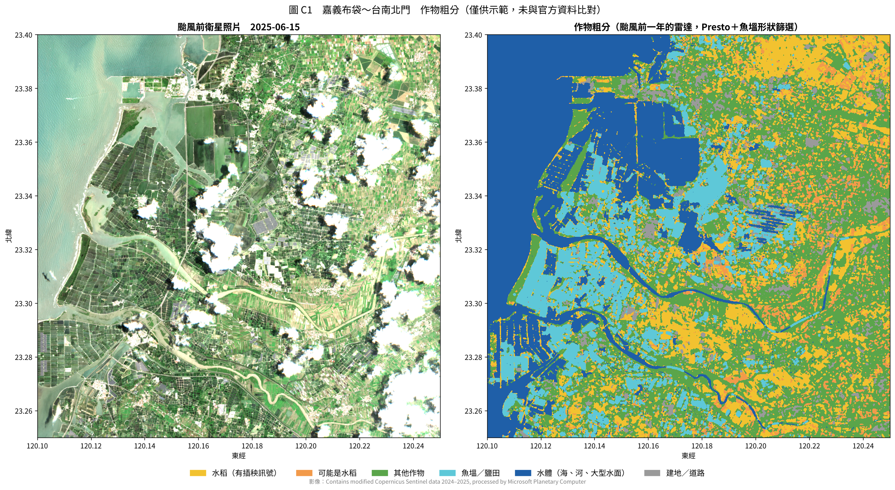
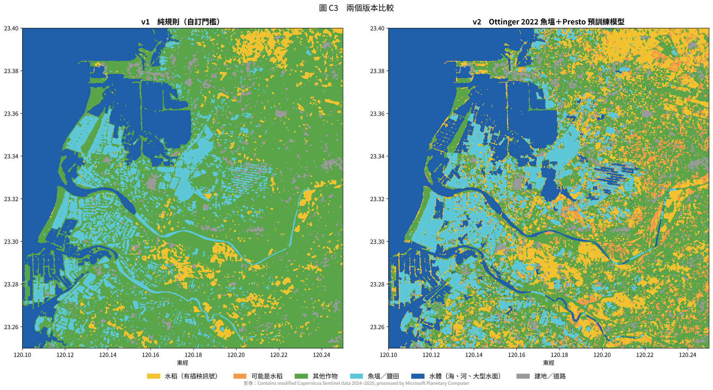
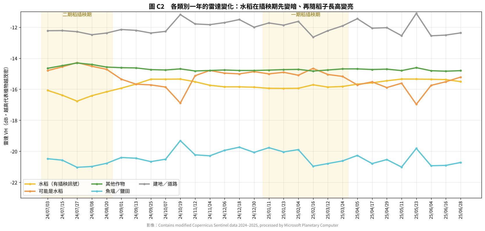
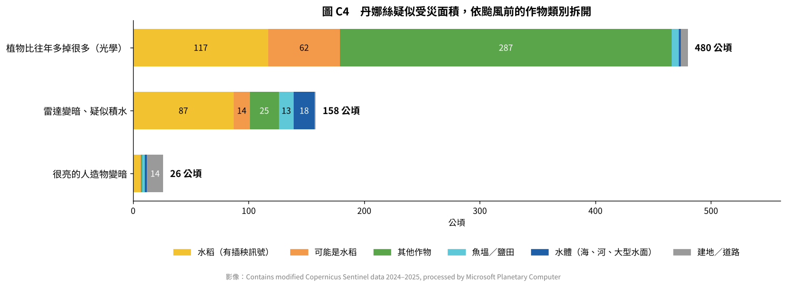

# 作物判釋測試（粗分）

天相星 SkyAide｜2026-10-22｜測試紀錄，尚未放進報告

## 一、目的

先前的丹娜絲真實影像分析，只看了「變成水」和「植物變少」，不知道這些田原本種什麼。這次用颱風前一整年的雷達影像，把研究區粗分成幾類，再把受災面積依類別拆開。

- 範圍：嘉義布袋、義竹到台南北門沿海，約 15 × 17 公里
- 資料：Sentinel-1 雷達，軌道 105，2024-07-03 到 2025-06-28，共 29 期（約 12 天一期）
- 只用雷達、不用光學，因為雷達不受雲影響，一年 12 個月都有資料

## 二、方法與依據

| 部分 | 做法 | 依據 |
| --- | --- | --- |
| 水面、魚塭 | 全年 VH 中位數，用 Otsu 自動找水面門檻（本區算出 −19.5 dB）；把水面切成一個個物件，依形狀分成魚塭／鹽田（方正）和天然水體（和海相連、細長的河道） | Ottinger 等人（2022），亞洲沿海魚塭辨識，準確率 91.9%。論文沒有公布形狀門檻，本測試的數值為自訂 |
| 陸地特徵 | 每個像素 12 個月的 VV、VH 月平均，輸入 NASA Harvest 的開源預訓練模型 Presto，轉成 128 個特徵 | Presto（Tseng 等人，2023，MIT 授權）；也是歐洲太空總署 WorldCereal 的核心模型 |
| 陸地分類 | 用作物曆規則挑出「很典型」的樣本（水稻、其他作物、建地），訓練一個邏輯斯迴歸分類器，推到所有陸地 | 水稻依插秧前灌水「雷達先變暗、再隨稻子長高變亮」的訊號，同法國 Camargue 研究（Bazzi 等人，2019）與中央大學雲林水稻研究 |
| 水稻分兩級 | 分類器判為水稻、而且插秧期雷達下降超過 2 dB 的，才算「水稻」；沒有下降的列為「可能是水稻」 | 本測試自訂，保守做法 |

另外加了兩個處理：

- 濾波會把池子之間的堤岸抹糊，相鄰池子連成一片，所以切水面物件前先內縮 2 像素，切完再長回來。
- 周圍四分之一以上是池子的地方，整區算魚塭，不判成作物。

為了在 2 核 CPU 上幾分鐘內跑完，陸地分類在 20 公尺解析度進行。

## 三、結果

| 類別 | v1 純規則（自訂門檻） | v2 魚塭論文方法＋Presto |
| --- | --- | --- |
| 水稻（有插秧訊號） | 1,592 公頃 | 4,381 公頃 |
| 可能是水稻 | — | 1,513 公頃 |
| 其他作物 | 14,595 公頃 | 8,509 公頃 |
| 魚塭／鹽田 | 2,828 公頃 | 3,340 公頃 |
| 水體（海、河、大型水面） | 5,655 公頃 | 6,700 公頃 |
| 建地／道路 | 778 公頃 | 1,005 公頃 |

兩版差最多的是水稻：v1 只收插秧期下降超過 3.5 dB 的田，v2 收到 2 dB。哪一版比較接近真實，要有官方資料才能判斷。v2 把河道正確判成水體（v1 誤判成魚塭），魚塭也抓得比較完整，但結果比較零碎。

各類別一年的雷達曲線：

- **水稻**：7 月二期稻插秧時掉到約 −16.8 dB，之後逐月回升到 −15.4。1～3 月一期稻的變化不明顯，這一區可能有不少田一年只種一期稻，或一期作不是種水稻。
- **其他作物**：全年平穩，維持在 −14.5 到 −15 dB。
- **魚塭**：全年在 −20 到 −21 dB，很暗。
- **建地**：全年最亮。
- **可能是水稻**：在 10/19 和 5/23 兩期出現明顯低點，剛好是全區整體亮度跳動最大的兩期，所以這一群的判讀比較不可靠。

## 四、受災面積依作物拆開

| 受災類型 | 水稻 | 可能是水稻 | 其他作物 | 魚塭／鹽田 | 水體 | 建地 | 合計 |
| --- | --- | --- | --- | --- | --- | --- | --- |
| 植物比往年多掉很多（光學） | 117 | 62 | 287 | 6 | 2 | 6 | 480 |
| 雷達變暗、疑似積水 | 87 | 14 | 25 | 13 | 18 | 1 | 158 |
| 很亮的人造物變暗 | 6 | 1 | 1 | 2 | 2 | 14 | 26 |

單位：公頃。

**最重要的發現：「疑似積水」有 55%（87 公頃）落在水稻田。** 雷達那張是 7 月 10 日拍的，正好是二期稻插秧前灌水的時期（圖 C2 黃線在 7 月的低點）。所以這 87 公頃很可能大部分是正常灌溉，不是颱風造成的積水。報告裡寫的「積水和灌溉分不出來」，現在有了具體數字。

這也說明作物判釋在天相星裡的用處：

- 在插秧期，水稻田的「變暗」要先打折扣，或直接列 C 交給公所確認。
- 植物變少的 480 公頃，主要在其他作物（287 公頃）。

「很亮的人造物變暗」有一半以上落在建地，和預期一致。

## 五、限制

1. **沒有官方答案比對**：國土測繪中心的國土利用調查、農業部的資料，這個環境都連不到。訓練樣本來自規則，不是人工標註，所以不能說準確率。
2. **兩版水稻面積差將近 3 倍**：關鍵在「插秧期下降多少 dB 才算水稻」，需要用官方的水稻面積統計（例如義竹鄉一期、二期稻作面積）校正。
3. **魚塭形狀門檻是自訂的**：論文沒有公布數值。
4. **只用雷達**：Presto 也能吃光學、氣象、地形資料，這次都遮掉了；加進去應該會更準。
5. **解析度**：陸地分類在 20 公尺進行，小於約 0.1 公頃的田會被混掉。

## 六、下一步

1. 取得官方標註：請隊友從國土測繪中心下載嘉義縣、台南市的國土利用調查資料，或請公所提供丹娜絲申報的作物與地號，就能算出真正的準確率。
2. 有了標註之後，改用標註直接訓練（Presto 微調，或構想書寫的時序 Transformer）。
3. 加入 Sentinel-2 光學與地形資料。

## 七、檔案

放在「衛星測試示範」資料夾：

| 檔案 | 內容 |
| --- | --- |
| `fetch_s1_year.py` | 下載颱風前一整年的 Sentinel-1（約 4 分鐘） |
| `crop_classify.py` | v1 純規則版 |
| `crop_classify_v2.py` | v2：Ottinger 魚塭方法＋Presto（第一次約 4 分鐘，之後約 20 秒） |
| `crop_figures.py` | 圖 C1～C4、受災依作物拆分 |
| `third_party/` | Presto 單檔程式、預訓練權重、MIT 授權（取自 github.com/nasaharvest/presto） |
| `output_crop/` | 圖、面積統計、受災拆分 |

需要的套件：`numpy scipy scikit-learn scikit-image torch einops matplotlib tifffile`

## 參考資料

- Ottinger, M., et al. (2022). Mapping aquaculture ponds for the coastal zone of Asia with Sentinel-1 and Sentinel-2 time series. *Remote Sensing*, 14(1), 153. https://opus.bibliothek.uni-wuerzburg.de/frontdoor/index/index/docId/25220
- Tseng, G., et al. (2023). Lightweight, Pre-trained Transformers for Remote Sensing Timeseries（Presto）. https://arxiv.org/abs/2304.14065 ；程式：https://github.com/nasaharvest/presto
- Bazzi, H., et al. (2019). Mapping paddy rice using Sentinel-1 SAR time series in Camargue, France. https://hal.archives-ouvertes.fr/hal-02137627
- 中央大學（2025）. Mapping of paddy field by Sentinel-1 SAR images and cadastre data. *International Journal of Remote Sensing*, 46(12). https://scholars.ncu.edu.tw/en/publications/mapping-of-paddy-field-by-sentinel-1-sar-images-and-cadastre-data/
- ESA WorldCereal：https://ost.ecosyste.ms/projects/128407

影像來源：Contains modified Copernicus Sentinel data 2024–2025, processed by Microsoft Planetary Computer.
