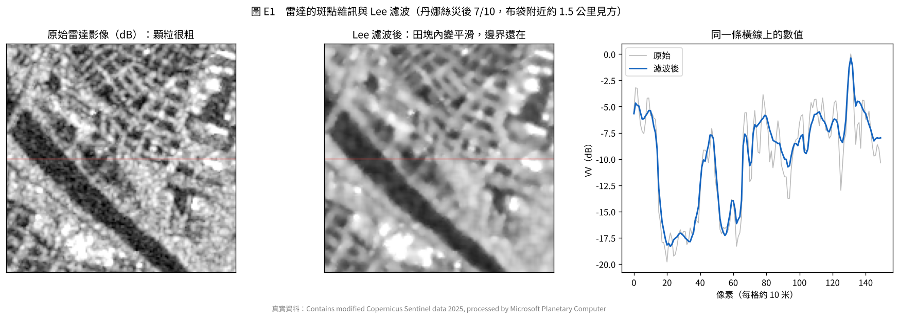
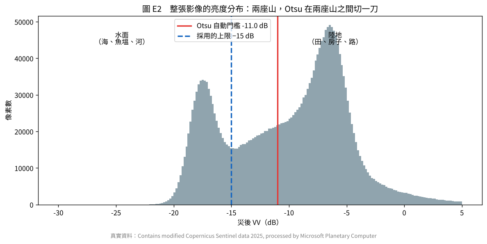
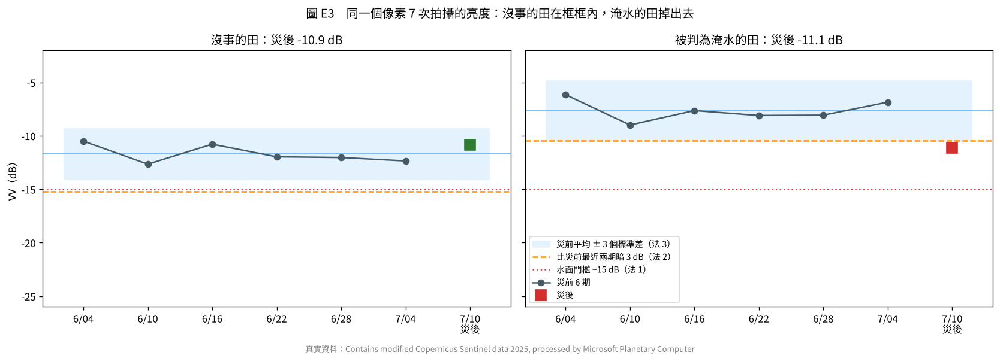
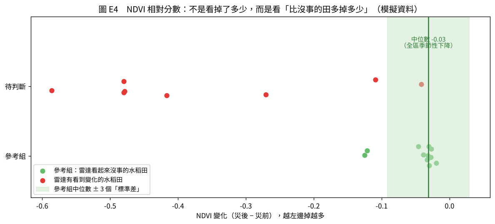

# 天相星演算法原理：白話說明

這份不講程式怎麼寫，只講每個方法在想什麼。

整套程式其實只在回答同一塊田的四個問題：

1. 這塊田**變成水**了嗎？（淹水）
2. 這塊田的作物**倒了**嗎？（倒伏）
3. 這塊田的地表**整個換掉**了嗎？（被泥沙蓋住、被水沖走）
4. 這塊田的植物**變少**了嗎？（植生受損）

回答完之後，再問最後一個問題：**這個答案有多大把握？** 有把握的直接給 A 或 B，沒把握的交給公所到場看（C）。

下面照順序說明。圖 E1～E3 用的是丹娜絲颱風的真實 Sentinel-1 資料，圖 E4 用的是模擬資料。

---

## 一、雷達怎麼「看」地面

Sentinel-1 是雷達衛星，自己往地面打微波，再收回彈回來的訊號。彈回來越多，影像上越亮。它不靠陽光，所以晚上、陰天、颱風雲層都能拍，這是颱風後第一時間只能靠它的原因。

地面的樣子決定彈回來多少：

| 地面 | 微波碰到後 | 影像上 |
| --- | --- | --- |
| 平靜的水面 | 像鏡子，訊號往另一邊反射走，幾乎沒回來 | **很暗**（約 −17 到 −20 dB） |
| 作物、草地 | 在葉子和莖之間亂彈，一部分回來 | 中等（約 −8 到 −12 dB） |
| 房子、堤岸 | 牆面和地面形成直角，訊號直接彈回 | **很亮** |

所以「淹水」在雷達上的樣子很單純：**原本中等亮度的田，變暗了**。

**VV 和 VH 是什麼？** 雷達打出去和收回來的波可以是不同方向的振動。VV 是「直著打、直著收」，對水面最敏感，用來判淹水。VH 是「直著打、橫著收」，要經過葉子和莖多次亂彈，方向才會轉過來，所以 VH 對**植物的立體結構**特別敏感，用來判倒伏。

**dB 是什麼？** 雷達收到的原始數值差距很大（水面可能是 0.01，房子可能是 10，差一千倍），直接比很不方便。換成 dB（取對數再乘 10）之後，每差 10 倍就是差 10 dB，數字變成 −20、−10、0 這種好比的範圍。後面說「暗了 3 dB」，意思是收到的訊號只剩一半。

---

## 二、斑點雜訊與 Lee 濾波



雷達影像天生有一種顆粒感，叫**斑點雜訊**：同一塊田裡，每一格的亮度忽高忽低（圖 E1 左）。這不是田真的有差，而是微波在一格裡碰到很多小東西、彈回來互相干擾造成的。右圖灰線就是原始數值，同一塊田裡可以跳 3～5 dB。

如果不處理，單一格亂跳一下就可能被誤判成淹水。

**最直覺的做法是取平均**：每一格都換成自己和周圍 5×5 格的平均。雜訊會被平均掉，但問題是田和水的交界也會被平均成一片模糊。

**Lee 濾波的想法**：先看這一格周圍的數值差多少。

- 周圍差不多（平坦的田中間）→ 差異大多是雜訊，**用平均值**
- 周圍差很多（田和水的交界）→ 那是真的邊界，**保留原值**

圖 E1 中間是濾波後：田塊內變平滑，河道和田的邊界還在。右圖藍線也看得出來，平坦處的鋸齒被抹平，但從 −7 dB 掉到 −18 dB 那個陡坡（陸地到河道）沒有被抹緩。

---

## 三、淹水：三種方法投票

淹水只看一件事：**這一格是不是變成水了**。但「是不是水」可以從三個角度問，各有優缺點，所以三個都問，至少兩個說是才算。

### 法 1：夠不夠暗（水面門檻）



把整張影像每一格的亮度畫成分布圖（圖 E2），會看到兩座山：左邊是水（海、魚塭、河，約 −17.5 dB），右邊是陸地（約 −7 dB）。只要在兩座山中間切一刀，比這刀暗的就是水。

**Otsu 方法**就是自動找這一刀的位置：試遍每一個切點，挑一個讓「左右兩群各自很集中、兩群之間差很遠」的位置。

**會出錯的地方**：這個研究區有大片魚塭和潮濕的田，在兩座山中間形成一段緩坡（−15 到 −10 dB）。Otsu 把刀切在 −11 dB，落在緩坡中間，很多潮濕的田都會被當成水。所以程式另外設了上限 −15 dB，也就是兩座山之間的谷底。

這個方法的優點是不需要災前資料；缺點是**它不管這格以前是不是就很暗**。

### 法 2：有沒有變暗（變遷偵測）

拿災後和**災前最近兩期**比，暗了 3 dB 以上（訊號剩不到一半）就算。

它問的是「有沒有變」，不是「是不是水」，所以本來就暗的地方不會誤判。但它只有一個比較對象，如果災前那兩期剛好有雜訊，就可能誤判。

**為什麼是「最近兩期」而不是全部 6 期？** 開發時發現，水稻在災前一個月會一直長高，雷達亮度逐期上升。拿 6 期平均當基準，等於拿「一個月前的矮稻子」來比，沒受災的稻田也會被判成有變化。

### 法 3：有沒有超出平常的範圍（時序異常）



每一格自己有 6 期災前紀錄。算出這 6 期的平均和**標準差**（平常會上下跳多少），畫出「平均 ± 3 個標準差」的框框（圖 E3 淺藍色）。統計上，正常情況下 99.7% 的數值會落在框內，**掉到框框下面就是異常**。

這個方法的好處是**每一格用自己的標準**：本來就跳很大的地方，框框比較寬，不會因為正常波動被誤判；本來很穩定的地方，框框窄，一點變化就抓得到。

### 為什麼要投票

圖 E3 是丹娜絲真實資料裡的兩格：

- **左邊（沒事的田）**：災後 −10.9 dB，三條線都沒越過，三法都說「沒淹水」。
- **右邊（被判為淹水的田）**：災前一直在 −6 到 −9 dB，災後掉到 −11.1 dB。
  - 法 1：−11.1 dB 沒有比 −15 dB 暗 → **不是水**
  - 法 2：比災前最近兩期暗了 3.7 dB → **有變暗**
  - 法 3：低於平均 3.8 個標準差，掉到框框外 → **異常**
  - 兩票對一票 → **判為淹水**

這一格很能說明問題：它明顯變暗了，但沒暗到水面那麼暗。可能是部分積水、土壤泡水，也可能是剛收割、田裡灌水準備插秧。**雷達只能說「這裡變了」，說不出「為什麼變」**。這也是為什麼後面還要三道關卡和申報比對。

投票的意義是：每個方法都有自己會犯的錯，但三個方法同時犯同一個錯的機會比較小。至少兩個同意，才比較可靠。

**災前就是水的地方**（海、魚塭、河）一律排除，因為它本來就暗，不能算「淹水」。

---

## 四、倒伏：植物的立體結構變了

前面說過，VH 對植物的立體結構特別敏感。作物直立時，微波在葉子和莖之間來回彈，VH 有一定的亮度。作物倒下後，結構整個改變：

- **水稻倒伏**：稻子平躺、交疊成一層，VH 常會**變亮**（程式裡的設定；實際方向會隨生長期改變）
- **香蕉、果樹倒伏**：大片葉子和枝幹折斷掉落，立體結構消失，VH **變暗**

所以程式不管變亮還是變暗，只看**變化的大小**：VH 和災前最近兩期比，差超過 2.5 dB 就算倒伏。

最後一步是**中位數平滑**：每一格看自己和周圍 3×3 共 9 格，多數是倒伏才算倒伏。倒伏通常是一片一片的，單獨一格亂跳多半是雜訊，這樣就能去掉。

已經判為淹水的格子不重複算倒伏，因為淹水也會讓 VH 大幅變化。

---

## 五、埋沒、流失：地表整個換掉了

**同調性**是雷達的另一種量測：比較兩次拍攝之間，地表的細微結構有沒有變。

想像對同一片地拍兩張照片，再把兩張疊起來比對。如果地面沒動，兩張的細節完全對得上，同調性接近 1；如果地表被泥沙整個蓋過、或被水沖成另一個樣子，兩張完全對不上，同調性接近 0。

程式的判斷是：災後同調性**降到 0.5 以下**，而且**比災前少 0.3 以上**，就是地表整個換掉了。

為什麼要兩個條件？因為有些地方本來同調性就低（例如風吹會動的高草），只看「低於 0.5」會誤判；要同時「比以前低很多」，才確定是災害造成的。

**水面同調性也很低**（水一直在動），所以淹水的格子會排除，避免和埋沒混在一起。

這個方法的強項是：**被泥沙埋掉的田，雲還沒散時就能確定**，不需要等光學影像。

（這次真實資料只下載了亮度，沒有下載同調性，所以埋沒只在模擬資料上示範。）

---

## 六、植物變少：NDVI 和「跟誰比」

### NDVI 是什麼

Sentinel-2 是光學衛星，像相機一樣拍，但能拍到人眼看不到的近紅外光。

健康的葉子有一個特性：**紅光大部分被吃掉**（拿去行光合作用），**近紅外光大部分被反射**（葉子內部的結構會把它彈回來）。植物越健康、越茂密，這個差距越大。

NDVI 就是把這個差距變成一個數字：

```
NDVI = (近紅外 − 紅光) ÷ (近紅外 + 紅光)
```

茂密的作物約 0.7～0.9，稀疏或剛插秧約 0.3，裸地約 0.1，水面是負的。

**光學的限制是會被雲擋住**，颱風後常常好幾天都拍不到地面。

### 為什麼不能只看「掉了多少」



NDVI 下降不一定是災害。季節變化、收割、作物自然老化，都會讓 NDVI 下降。如果只要掉了 0.1 就算受損，收割季會整片誤判。

所以程式問的是：**這塊田比「沒事的同類田」多掉了多少？**

圖 E4 是一個例子：

1. 先找出「同樣是水稻、雷達看起來也沒事」的田當參考組（綠點）
2. 參考組大多掉了 0.03 左右，這就是這段期間的正常下降（季節、天氣）
3. 算出參考組的正常範圍（淺綠色帶）
4. 待判斷的田（紅點）掉出這個範圍越遠，分數越負，越可能受損

這個分數叫**標準分數**：「比正常多掉幾個標準差」。程式用中位數和 MAD（中位數絕對偏差）代替一般的平均和標準差，因為中位數不容易被少數極端值拉走。

**為什麼參考組只放雷達看起來沒事的田？** 如果把受損的田也放進去，正常範圍會被拉寬、拉低，受損的田反而看起來沒那麼糟。這是開發時實際遇到的問題。

### 真實資料用的是「去年同期」

真實資料沒有作物分類，沒辦法找「同作物的田」來比，所以改用**同一格去年同期**的變化當基準：

```
異常 = 今年這段期間掉了多少 − 去年同一段期間掉了多少
```

7 月是收割季，每年都會掉。扣掉去年同期之後，剩下的才是今年特別的部分。丹娜絲的結果：只看今年會標出 899 公頃，扣掉去年同期剩 480 公頃，將近一半是正常收割。

---

## 七、從「一格」變成「一塊田」

前面的方法都是一格一格判斷（每格 10 × 10 米）。但救助是以「一塊田」為單位，所以要把格子的結果整理到每塊田上。

**先向內縮一圈。** 田的邊緣那一格，可能有一半是田埂、一半是隔壁田，訊號是混在一起的，所以先拿掉。太窄的田縮完就沒了，這種田衛星看不清楚，直接列 C。

**再算比例。** 例如一塊田內縮後剩 200 格，其中 130 格判為淹水，淹水比例就是 65%。

---

## 八、損失區間：為什麼給範圍、不給一個數

救助的門檻是損失 20%。如果系統只說「這塊田損失 25%」，公所會問：你有多確定？會不會其實是 15%？

所以系統給的是一個範圍，例如「損失在 15% 到 45% 之間」。範圍的寬窄代表把握的大小：

- 整塊淹水的水稻 → 85%～100%，很窄，很有把握
- 被雲遮、只有一點淹水 → 4%～44%，很寬，沒什麼把握

**範圍有沒有跨過 20%，比中間值更重要。** 85%～100% 不管真實是多少都超過 20%，可以放心給 A；15%～45% 可能低於 20%、也可能高於，就該讓人去看。

（目前用的是簡單公式：中間值看淹水、倒伏、埋沒哪個最嚴重，範圍固定加減一段。正式系統會用歷史災害資料訓練模型，讓範圍更準。）

---

## 九、三道關卡：有沒有把握

最後一步不再判讀影像，而是問「能不能相信前面的答案」。任何一關說不行，就交給公所（C）。

**關卡 1：影像本身可不可靠？**

- 田夠不夠大（縮完還有 5 格以上）
- 地籍圖和影像對得準不準（老舊的地籍圖可能偏移）
- 雷達和光學說法一不一致（一個說有事、一個說沒事，就不確定）
- 光學被雲遮時，雷達訊號夠不夠強

**關卡 2：離 20% 夠不夠遠？**

- 範圍下限 ≥ 40% → 確定受損，A
- 範圍上限 ≤ 10% → 確定沒事，B
- 中間 → 不確定，C

用 40% 和 10%，而不是剛好 20%，是為了留安全距離。

**關卡 3：和農民申報的一不一致？**

- 衛星判的作物和申報的不同 → C
- 農民有申請，衛星卻看不到變化 → 不能直接說沒事，C

這樣設計的結果是：**系統寧可多放一些到 C，也不輕易判錯**。A 和 B 的件數少一點沒關係，但給出去的 A 和 B 要可靠，公所才敢用。

---

## 十、一張表整理

| 方法 | 看什麼 | 判斷規則 | 會出錯的情況 |
| --- | --- | --- | --- |
| Lee 濾波 | 每格和周圍的差異 | 周圍一樣就平均，差很多就保留 | 小田的細節會被抹掉 |
| 法 1 水面門檻 | 災後 VV 夠不夠暗 | 暗過 Otsu 門檻（上限 −15 dB） | 本來就暗的地方；海面多時門檻偏高 |
| 法 2 變遷偵測 | 比災前最近兩期暗多少 | 暗 3 dB 以上 | 災前那兩期剛好有雜訊 |
| 法 3 時序異常 | 有沒有超出自己平常的範圍 | 低於平均 3 個標準差 | 災前紀錄太少 |
| 倒伏 | VH 變化大小 | 變化超過 2.5 dB | 收割、整地也會讓 VH 變化 |
| 埋沒 | 同調性 | 降到 0.5 以下且少 0.3 以上 | 淹水也會降（已排除） |
| NDVI 相對分數 | 比沒事的同類田多掉多少 | 標準分數越負越糟 | 被雲遮；搶收 |
| 損失區間 | 上面全部 | 給範圍，不給單一數字 | 目前是簡單公式 |
| 三道關卡 | 影像品質、離門檻多遠、和申報是否一致 | 任一關不過就 C | 設計上寧可多放 C |

---

## 十一、名詞對照

| 名詞 | 白話 |
| --- | --- |
| 後向散射 | 雷達訊號彈回衛星的量，影像上的亮度 |
| dB | 把差很多倍的數字換成好比較的尺度，每差 10 倍差 10 dB |
| 斑點雜訊 | 雷達影像天生的顆粒感，不是地面真的有差 |
| 標準差 | 一組數字平常上下跳多少 |
| 中位數、MAD | 排序後中間那個數、離中間多遠的典型距離；不容易被極端值影響 |
| 同調性 | 兩次拍攝之間地表細節對不對得上，0 到 1 |
| NDVI | 用紅光和近紅外光算出的植物茂密程度，−1 到 1 |
| 坵塊 | 實際耕作的一塊田（不一定等於一筆地號） |
| 門檻 | 判斷「是／不是」的那條線 |
