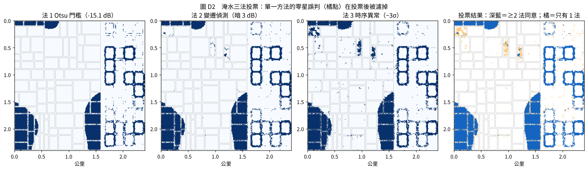
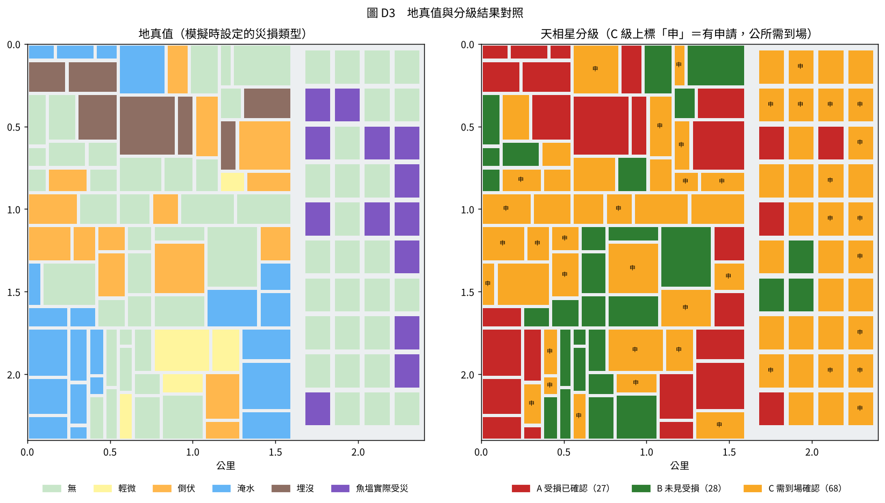
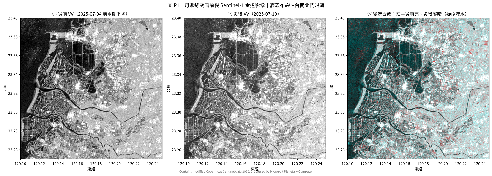
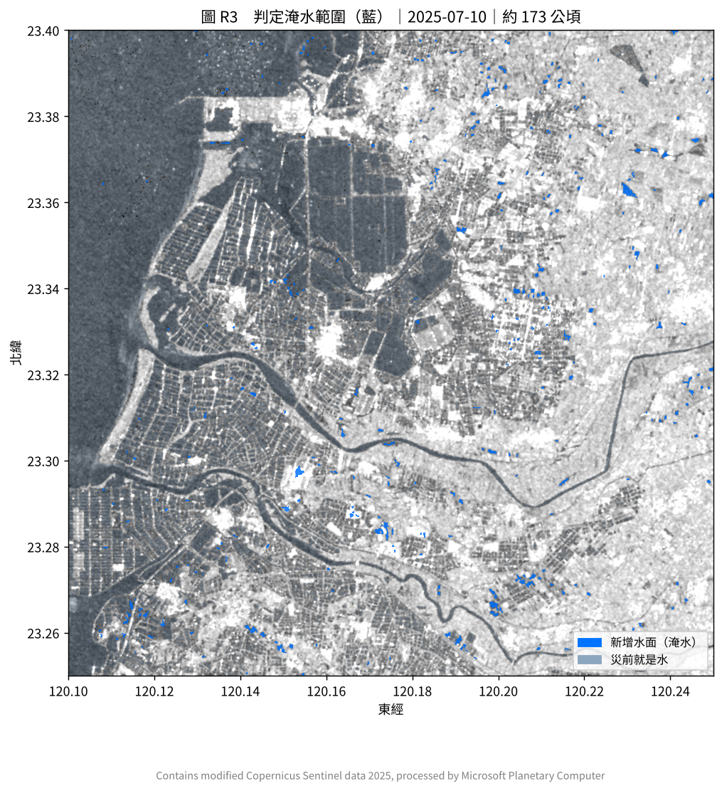
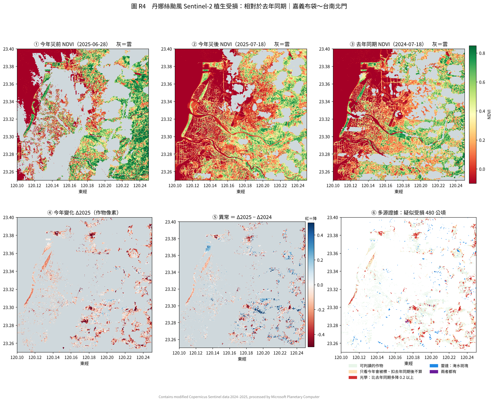

# 天相星 SkyAide 衛星影像測試示範：程式報告與解析

2026-10-21｜對應《技術說明》參、四～八

## 一、這份示範做了什麼

用一支約 850 行、只需要 numpy／scipy／matplotlib 的 Python 程式，把技術說明裡「災前災後比對 → 判讀 → 三道關卡 → A／B／C 分級 → 存證報告」整條流程實際跑一遍，結果約 5 秒產出。

**測試工況**：2025 年丹娜絲颱風，左側為嘉義沿海農區（水稻、香蕉、果樹，共 83 個坵塊），右側為台南沿海魚塭（40 口），範圍 2.4 × 2.4 公里、10 米像素。災損包含淹水、倒伏、埋沒（河道旁泥沙）、輕微植生下降；魚塭包含溢堤、池水流失、停電。

**模型刻意保持簡單**：作物判釋與損失估計都用一兩行就能說清楚的規則，不用機器學習、不需要訓練資料。目的是先驗證「流程與分級邏輯」行得通，正式系統再換成技術說明裡的時序 Transformer 與分位數梯度提升樹。

## 二、資料：為什麼用模擬影像

開發環境連不到 Sentinel 影像的下載來源，所以主程式用**模擬影像**。模擬的格式與真實資料一致：

| 模擬資料 | 對應真實資料 | 模擬方式 |
| --- | --- | --- |
| VV、VH 後向散射（線性強度） | Sentinel-1 | 依地物給 dB 值，再乘上 Gamma 分佈的斑點雜訊（4 視數） |
| 災前 6 期時序 | Sentinel-1 六天再訪 | 水稻 VH、NDVI 逐期上升；香蕉穩定且亮；果樹小幅季節變化 |
| 干涉同調性 | Sentinel-1 前後兩期 | 植生約 0.6；水面、淹水、埋沒處降到約 0.2 |
| NDVI | Sentinel-2 | 依災損程度下降，再整體減 0.03（季節效應）；約 30% 面積被颱風殘雲遮蔽 |
| 夜間燈光 | VIIRS VNP46A2 | 三個供電區，停電 0／2／5 天 |
| 在養證據、放養申報 | 福衛八號水車偵測、公所資料 | 以機率模擬（在養池 90% 偵測到水車、90% 有放養申報） |

災損不是亂貼標籤：先產生一張地形圖，最低的 18% 區域會淹、河道旁的田會被埋，再依淹水或倒伏的像素比例算出每塊田的真實損失率（加上雜訊）。因為地真值已知，才能算精確度。

**真實資料版（已實際執行）**：`fetch_crop.py` 從 Microsoft Planetary Computer 下載丹娜絲前後的**真實 Sentinel-1 影像**（嘉義布袋到台南北門），`real_danas_analysis.py` 用**同一套**前處理與淹水三法投票函式分析，結果見第十一節。

## 三、怎麼執行

```bash
pip install numpy scipy matplotlib
python skyaide_demo.py        # 主示範，約 5 秒，結果在 output/
python run_multi_seeds.py     # 換 10 個工況重跑，看結果穩不穩
# 真實資料（需網路，不用額外套件，tifffile 讀圖）：
pip install tifffile
python fetch_crop.py            # 下載丹娜絲前後 7 期 Sentinel-1，約 45 秒
python real_danas_analysis.py   # 真實淹水判釋，結果在 output_real/
```

## 四、程式架構

| 步驟 | 函式 | 這版的做法 | 正式系統（技術說明） |
| --- | --- | --- | --- |
| 一、模擬工況 | `simulate_scene` | 地形決定災損，產生雷達、光學、同調性、夜間燈光 | 換成真實影像 |
| 二、前處理 | `lee_filter`、`to_db` | Lee 斑點濾波（5×5），轉 dB | 加上軌道、熱雜訊、地形正規化（參、四） |
| 三、坵塊化 | `inset_mask`、`parcel_features` | 坵塊向內縮 10 米，取每塊的統計值 | 相同，另加福衛八號補小田 |
| 四、判讀 | `flood_vote`、`lodging_map`、`buried_map`、`add_ndvi_z` | 淹水三法投票、VH 對數比值、同調性下降、NDVI 相對分數 | 相同概念；第三法換成 Prithvi，倒伏加隱馬可夫隨機場 |
| 五、作物判釋 | `guess_crop` | 三條規則 | 時序 Transformer |
| 六、損失區間 | `estimate_loss` | 公式算中間值 ± 固定誤差 | 分位數梯度提升樹 |
| 七、分級 | `three_gates` | 三道關卡＋原因碼 | 相同 |
| 八、魚塭 | `classify_ponds` | 溢堤、池水流失、停電、在養證據 | 相同，另加水色異常 |
| 九、輸出 | `evaluate`、`make_figures`、`evidence_report` | 驗證指標、四張圖、坵塊表、存證報告 JSON | 相同，格式改為 STAC／PROV |

## 五、逐步解析

### 1. 前處理：Lee 濾波

雷達影像天生有「斑點雜訊」，同一塊田的像素亮度會忽高忽低。Lee 濾波在平坦處取周圍平均、在邊緣處保留原值，所以能去雜訊又不會把田界糊掉。之後轉成 dB，因為雷達的變化在 dB 尺度上比較好設門檻。


**圖 D1**：① 災前雷達，田塊與魚塭（黑色方格、白色堤岸）清楚可見。② 災後雷達，左下與中下出現大片暗區（淹水），魚塭的白色堤岸有部分消失（溢堤）。③ 災後 NDVI，灰色是雲遮，看不到的地方只能靠雷達。④ 同調性，暗色是同調性下降處（水面、淹水、埋沒）。

### 2. 坵塊化：向內縮 10 米

每塊田的邊緣像素會混到田埂或隔壁田的訊號，所以先向內縮 1 個像素再取平均。內縮後少於 5 個像素的小田無法可靠判讀，直接列 C（原因碼「小田」）。

### 3. 淹水：三法投票

| 方法 | 判斷方式 | 優點 | 弱點 |
| --- | --- | --- | --- |
| 法 1 Otsu 門檻 | 災後 VV 低於自動算出的門檻就是水 | 不需災前資料 | 本來就暗的地物會誤判 |
| 法 2 變遷偵測 | 比災前最近兩期暗 3 dB 以上 | 只抓「變暗」 | 單期雜訊會造成零星誤判 |
| 法 3 時序異常 | 低於災前時序平均 3 個標準差 | 考慮每個像素自己的變動幅度 | 時序變動大的田不敏感 |

至少兩法同意才算淹水；災前就是水的地方（魚塭、埤塘）排除。



**圖 D2**：中間幾塊田只有法 3 判為淹水（右圖橘點），投票後被濾掉。10 個工況的淹水像素 IoU：Otsu 0.841、變遷偵測 0.843、時序異常 0.757、**三法投票 0.857**，投票比任一單法好。模擬資料的雜訊比較單純，所以差距不大；文獻中真實資料只用單一門檻時，洪水 IoU 只有約 0.29（Bonafilia et al., 2020），多法並用的效益會更明顯。

### 4. 倒伏、埋沒、植生

- **倒伏**：災後 VH 與災前最近兩期的 dB 差，絕對值超過 2.5 dB 就算倒伏。水稻倒伏 VH 會變亮，香蕉與果樹冠層倒塌則會變暗，所以取絕對值。再用 3×3 中位數濾波去掉零星點，取代正式版的隱馬可夫隨機場。
- **埋沒、流失**：同調性降到 0.5 以下且下降超過 0.3。淹水也會讓同調性下降，所以先排除淹水像素，這樣兩者才分得開。
- **植生受損**：NDVI 的下降量，和「同作物、雷達看起來沒事」的其他田比較，算成標準分數。全區都下降一點（季節、採收）會被抵銷，只留下特別異常的田。

### 5. 作物判釋（規則版）

災前 NDVI 上升超過 0.2 的判為水稻（正在長）；否則 VV 平均高於 −9 dB 的判為香蕉（大葉片很亮）；其他判為果樹。

### 6. 損失區間（規則版）

- **中間值**：取三種雷達訊號中最嚴重的一個。淹水比例 × 作物權重（水稻 0.95、香蕉 0.80、果樹 0.65），倒伏比例 × 0.75，埋沒比例 × 0.95。
- 雷達完全沒訊號時改看 NDVI，每低 1 個標準差約多 2% 損失。
- **誤差範圍**：雷達有訊號時 ±15%，沒訊號時 ±5%；被雲遮一半以上再加寬 5%。

### 7. 三道關卡

| 關卡 | 檢查 | 原因碼 |
| --- | --- | --- |
| 1 影像信心 | 內縮後像素 ≥ 5；地籍對位可靠；雷達與光學結論一致（雲遮時需雷達強訊號：淹水或埋沒 ≥ 50%） | C1 |
| 2 遠離門檻 | 區間下限 ≥ 40% → A 候選；上限 ≤ 10% → B 候選；其他列 C | C2 |
| 3 與申報一致 | 判釋作物 = 申報作物；有申請卻沒看到變化的不能判 B | C3 |

任一關未通過即列 C，原因碼全部列出，讓公所知道到場要看什麼。

### 8. 魚塭

- **在養強證據**：災前水面 > 70%、偵測到水車、有放養申報，三項都成立。
- **直接受災**：堤岸被淹 ≥ 80%（整池溢堤），或池水少一半以上。
- **A**：有申請、在養強證據、直接受災。**B**：未申請、沒有任何訊號。其餘列 **C**，並依停電天數、溢堤比例、池水流失算現勘優先分數（見 `ponds.csv`）。

## 六、結果

### 主工況（丹娜絲模擬）

| 指標 | 結果 | 技術說明目標 |
| --- | --- | --- |
| A 級精確度（A 中真實損失 ≥ 20%） | 100%（23／23） | ≥ 95% |
| B 級精確度（B 中真實損失 < 20%） | 100%（25／25） | ≥ 95% |
| 申請案件 C 級比例 | 56%（25／45） | ≤ 50% |
| 區間覆蓋率（真實值落在區間內） | 83% | 約 80% |
| 損失中間值平均誤差 | 5.9 個百分點 | — |
| 作物判釋準確率 | 100% | ≥ 80% |
| 魚塭 A 級精確度 | 100%（4／4） | ≥ 95% |
| 申請魚塭 C 級比例 | 79%（15／19） | — |



**圖 D3**：左為模擬時設定的災損，右為天相星分級。淹水與埋沒的田幾乎都判 A（紅）；沒受災的田多為 B（綠）；倒伏、輕微、部分淹水的田多落在 C（黃）。C 上面標「申」的是有申請、公所需要到場的案件。


**圖 D4**：橫軸是真實損失、縱軸是預測。紅點（A）全部在 20% 以上，綠點（B）全部在 20% 以下，代表分級沒有判反；靠近 20% 門檻的田都被放到 C（黃）。

### 申請案件被列 C 的原因（主工況，25 件）

| 原因碼 | 件數 |
| --- | --- |
| C2 損失區間跨越門檻附近 | 20 |
| C1 光學被雲遮，雷達訊號不夠強 | 5 |
| C1 雷達與光學結論不一致 | 5 |
| C3 作物與申報不符 | 5 |
| C1 對位不確定：圖解地籍區 | 3 |
| C3 農民申請但衛星未見變化 | 1 |

一件可能同時有多個原因碼。

### 換 10 個工況重跑（`run_multi_seeds.py`）

| 指標 | 平均 | 最低 | 最高 |
| --- | --- | --- | --- |
| A 級精確度 | 100% | 100% | 100% |
| B 級精確度 | 100% | 100% | 100% |
| 申請案件 C 級比例 | 57% | 46% | 68% |
| 區間覆蓋率 | 87% | 81% | 94% |
| 損失中間值誤差 | 5.4 個百分點 | 4.5 | 6.6 |
| 申請魚塭 C 級比例 | 56% | 40% | 75% |

10 個工況合計：A 201 件、B 220 件、C 348 件，沒有任何一件判反。

### 存證報告範例（`output/evidence_report_example.json`）

挑區間下限最高的 A 級坵塊輸出，內容包含：坵塊與面積、判釋作物與申報作物、損失區間與判定、**主要災害證據**（白話寫出，例如「雷達淹水投票：100% 的像素至少兩法判為淹水」）、可溯源資料（每一期影像編號、處理參數、程式版本），最後是整份報告的 SHA-256 雜湊，任何人改過一個字都對不上。影像編號為模擬值（SIM-…）。

## 七、解讀與發現

1. **100% 精確度不代表真實準確度。** 模擬資料的產生方式和判讀規則是同一套物理假設（淹水就變暗、倒伏 VH 就變化），所以判得準是預期中的事。作物判釋 100% 也是因為模擬的三種作物時序差異很明顯。這份示範能證明的是**流程與分級邏輯行得通**、**保守設計有效**（靠近門檻的一律進 C），不能證明真實精度。真實精度要用丹娜絲實際影像加公所現勘結果驗證。

2. **開發過程中抓到兩個真實系統也會遇到的陷阱：**
   - **作物生長會被誤判成倒伏。** 水稻災前 VH 本來就逐期上升，一開始用 6 期平均當基準，沒受災的稻田也被判為倒伏。改成「與災前最近兩期比較」後解決。真實系統要用最接近災害的影像當基準，或先扣掉生長趨勢。
   - **NDVI 的比較對象不能包含受損田。** 一開始拿同作物的所有田當基準，受損田把基準拉低、把離散度撐大，受損訊號被稀釋。改成只拿「雷達看起來沒事」的田當參考組後，受損田的標準分數才明顯。

3. **C 級主要來自「真的不確定」的案件。** 申請案件的 C 有 80% 是因為損失落在 20% 門檻附近，這正是需要公所判斷的邊緣案件；其次是雲遮、雷達與光學不一致、作物不符。C 級比例 56%–57%，略高於技術說明 50% 的目標；用正式模型縮小誤差範圍後，部分 C2 可以轉成 A 或 B。

4. **輕微災損會被低估。** 真實損失 20%–35% 的輕微受損田，規則版只能從 NDVI 推估，常估到 10% 左右（圖 D4 左下的黃點）。因為區間跨過門檻，這些田大多仍被放到 C，沒有判錯；但這也說明單靠 NDVI 估輕微災損不夠，需要正式模型結合天氣參數。

5. **魚塭的 C 比例高，主因是在養證據的要求很嚴。** 主工況 15 件申請魚塭列 C，其中 9 件是缺少在養強證據（三項之一不成立，例如沒偵測到水車或沒有放養申報），即使衛星看到整池溢堤也不判 A。另外相鄰魚塭共用堤岸，一池溢堤會讓隔壁池也出現「部分溢堤」訊號，這類案件也列 C。這符合技術說明「寧可多放到 C」的設計，但也表示放養申報的完整度直接影響魚塭的免勘比例。

6. **未申請但列 C 的案件不必派人。** 圖 D3 中沒有標「申」的黃色坵塊與魚塭，是衛星看到疑似變化、但農民沒有申請的案件。實務上可以改成「主動通知農民可申請」，不列入公所的現勘清單。

## 八、與技術說明的差異

| 項目 | 本示範 | 技術說明 |
| --- | --- | --- |
| 影像 | 模擬（分級流程）＋真實 Sentinel-1（淹水判釋，第十一節） | Sentinel-1／2、福衛八號、VIIRS |
| 淹水第三法 | 變遷偵測 | 微調 Prithvi |
| 倒伏空間平滑 | 3×3 中位數 | 隱馬可夫隨機場 |
| 作物判釋 | 三條規則 | 時序 Transformer |
| 損失區間 | 公式 ± 固定誤差 | 分位數梯度提升樹 |
| 魚塭在養證據 | 機率模擬 | 福衛八號水車偵測 |
| 水色異常 | 未做 | 有 |
| 面積不符檢查 | 未做 | 有 |
| 可溯源格式 | JSON＋雜湊 | STAC＋W3C PROV |

## 九、下一步

1. 真實資料已跑通 Sentinel-1 淹水判釋（第十一節）與 Sentinel-2 植生受損（第十二節）。下一步是取得農業部或公所的丹娜絲受災地號與農地範圍圖，對照衛星標出的田是災損、正常灌溉還是搶收。
2. 取得一批公所現勘結果，校正 `estimate_loss` 的作物權重與 ±15% 誤差範圍，以及 10%／40% 門檻。
3. 把規則版的 `guess_crop`、`estimate_loss` 換成正式模型；介面不變，其他程式不用改。

## 十、檔案清單

| 檔案 | 內容 |
| --- | --- |
| `skyaide_demo.py` | 主程式（模擬、判讀、分級、輸出） |
| `run_multi_seeds.py` | 10 個工況穩定性測試與淹水 IoU 比較 |
| `fetch_crop.py` | 下載真實 Sentinel-1（丹娜絲前後 7 期，研究區裁切） |
| `real_danas_analysis.py` | 真實資料淹水三法投票 |
| `output_real/figR1～R3_*.png`、`real_stats.json` | 真實資料的圖與統計 |
| `fetch_real_s1.py` | 舊版下載腳本，已由 `fetch_crop.py` 取代 |
| `output/figD1～D4_*.png` | 四張圖 |
| `output/parcels.csv` | 83 個農田坵塊的特徵、區間、等級、原因碼 |
| `output/ponds.csv` | 40 口魚塭的訊號、等級、現勘優先分數（已依優先度排序） |
| `output/evidence_report_example.json` | 存證報告範例 |
| `output/metrics.json`、`multi_seed_log.txt` | 驗證指標 |

## 十一、真實資料測試：丹娜絲颱風 Sentinel-1

### 1. 資料

| 項目 | 內容 |
| --- | --- |
| 來源 | Microsoft Planetary Computer `sentinel-1-rtc`（已做輻射地形校正，線性 γ0），免費、不需帳號 |
| 範圍 | 東經 120.10–120.25、北緯 23.25–23.40，約 15 × 17 公里，涵蓋布袋港、鹽田魚塭區、八掌溪、義竹農田、北門 |
| 解析度 | 1600 × 1600 像素，每像素約 10 米 |
| 災前 | 軌道 105（下降軌道），2025-06-04、06-10、06-16、06-22、06-28、07-04，共 6 期（Sentinel-1A、1C 交替，6 天一期） |
| 災後 | 2025-07-10（Sentinel-1A，同軌道）——颱風 7/6 深夜登陸後最早的一張，沒有更早的 |
| 下載方式 | 用 Planetary Computer 的裁切服務只抓研究區（每期約 20 MB），不必下載整張約 1 GB 的影像 |

### 2. 結果



**圖 R1**：真實雷達影像清楚可見布袋港、大片鹽田與魚塭（暗色方格）、八掌溪。右圖為變遷合成，紅色是「災前亮、災後變暗」的地方。



| 項目 | 數值 |
| --- | --- |
| 災前就是水（海、魚塭、河道） | 70.4 平方公里 |
| 法 1 水體門檻 | 2.3 平方公里 |
| 法 2 變遷偵測 | 5.3 平方公里 |
| 法 3 時序異常 | 3.3 平方公里 |
| 三法投票（≥ 2 法同意） | 2.8 平方公里 |
| 去除小於約 0.2 公頃的零星點 | **173 公頃** |

### 3. 解讀

1. **這張影像本來就不該看到大面積淹水。** 對照新聞，丹娜絲在這一區的災損主要是強風與停電：義竹新店村魚塭因停電、增氧機停擺而大量死魚，美濃瓜溫室受損（公視，2025）；嚴重淹水（150 公分）發生在台南七股西寮，不在本研究區內。7/7 時嘉義縣只剩 3 件道路積水未退（中央社，2025）。災後影像又晚了三天半，所以只判出 173 公頃零星斑塊是合理的。
2. **斑塊是一塊一塊的田，不是連成一片的洪水。** 這些田在 7/4 到 7/10 之間變成有水，可能是低窪田積水，也可能是二期稻插秧前的正常灌水（嘉義一期稻 6–7 月收割、隨即灌水整地）。**雷達本身分不出來**，必須對照申請資料、作物曆或現勘——這正是三道關卡要求「與申報一致」、不確定就列 C 的原因。
3. **自動門檻在沿海會失準。** 研究區有大片海面與魚塭，Otsu 自動門檻被拉到 −11 dB，連潮濕的田都會被當成水。改用文獻常見的上限 −15 dB 後才合理。正式系統的門檻要依地區設定，不能全國同一個自動值。
4. **各期整體亮度會浮動。** 災前 6 期的 VV 中位數在 −9.1 到 −11.1 dB 之間跳動，差到 2 dB，接近變遷偵測 3 dB 的門檻。正式系統做變遷偵測前，應先以不變地物（建物、道路）把各期亮度校正一致。
5. **對天相星的意義：** 這次真實測試反而支持了技術說明的兩個設計——(1) 魚塭要另外用**停電**訊號（夜間燈光），因為這一區的死魚來自停電、不是淹水，雷達看不到；(2) 颱風後第一張雷達影像可能要等好幾天，所以「災前紀錄＋災後持續追蹤」比單靠某一張災後影像可靠。

**參考來源**：[中央社（2025-07-07）](https://www.cna.com.tw/news/asoc/202507070072.aspx)、[公視新聞網（2025）丹娜絲災後義竹、七股](https://news.pts.org.tw/article/761163)

影像來源標示：Contains modified Copernicus Sentinel data 2025, processed by Microsoft Planetary Computer.

## 十二、真實資料測試：丹娜絲颱風 Sentinel-2 植生受損

### 1. 做法

丹娜絲在這一區主要是強風災害，所以改用光學影像看作物有沒有被吹壞。照技術說明 參、五 ⑤「相對於自身往年同期」：

| 項目 | 日期 | 用途 |
| --- | --- | --- |
| 今年災前 | 2025-06-28 | 颱風 7/6 登陸前最近、雲較少的一張 |
| 今年災後 | 2025-07-18 | 颱風後雲最少的一張（7/8 全雲、7/13 約六成雲） |
| 去年同期 | 2024-07-03 → 2024-07-18 | 同季節、沒有颱風，當作「正常會降多少」的基準 |

**異常 ＝ 今年 NDVI 變化 − 去年同期 NDVI 變化**。只看四期都沒被雲遮、今年災前 NDVI > 0.4（有作物）的像素；比去年同期多降 0.2 以上、且連成至少約 0.2 公頃的，標為疑似受損。研究區跨 4 個 Sentinel-2 圖幅，程式自動拼接，並用 L2A 的場景分類（SCL）去除雲與雲影。

### 2. 結果



| 項目 | 數值 |
| --- | --- |
| 四期都無雲的面積比例 | 33% |
| 可分析的作物面積 | 3,164 公頃 |
| 作物 NDVI 變化中位數：今年 | −0.14 |
| 作物 NDVI 變化中位數：去年同期 | −0.10 |
| 只看今年、下降超過 0.2 | 899 公頃 |
| **扣除去年同期後疑似受損** | **480 公頃**（可分析作物的 15%） |
| 與 Sentinel-1 淹水斑塊重疊 | 9 公頃 |

### 3. 解讀

1. **今年作物確實比往年掉得多。** 同樣是 7 月收割季，今年作物 NDVI 的變化中位數比去年同期多降 0.04，符合強風造成的整體受損。
2. **「往年同期」這一步很重要。** 只看今年會標出 899 公頃，扣除去年同期後剩 480 公頃，將近一半的下降是每年收割都會發生的。沒有這一步，會把正常收割當成災損，大量誤判。
3. **雷達與光學看到的是不同的田。** 兩者重疊只有 9 公頃，有兩個原因：(a) 雷達淹水斑塊中只有 33% 剛好沒被雲遮，能用光學檢查；(b) 雷達抓的是「變成有水」，光學抓的是「植物變少」，強風吹倒作物不一定積水，灌水整地也不一定在 7/18 前讓 NDVI 明顯下降。這正是技術說明要求「雷達與光學一致」才判 A、不一致就列 C 的原因。
4. **要小心「搶收」。** 颱風來前農民常提前收割，收割後 NDVI 一樣會下降，衛星分不出是被吹壞還是提早收。這類田需要對照申請資料：有申請且損失、還是已經收成，交給公所判斷。
5. **需要農地範圍圖。** 西側沿海一條狹長帶（防風林或海岸植生）也被標成疑似受損，約占 6%。它是被強風、鹽霧打到的真實變化，但不是農地。正式系統會先套農業部的農地覆蓋物資料庫，只分析農地。
6. **雲是光學最大的限制。** 颱風後 12 天才有一張能用的光學影像，而且四期都無雲的面積只有三分之一。颱風後第一時間仍要靠雷達，光學只能作為後續補充與交叉確認。

### 4. 檔案

| 檔案 | 內容 |
| --- | --- |
| `fetch_s2.py` | 下載 4 期 Sentinel-2，拼接 4 個圖幅、去雲、算 NDVI（約 2 分鐘） |
| `real_s2_analysis.py` | 相對於去年同期的植生異常，並與 Sentinel-1 淹水斑塊比對 |
| `output_real/figR4_ndvi_anomaly.png`、`real_s2_stats.json` | 圖與統計 |
