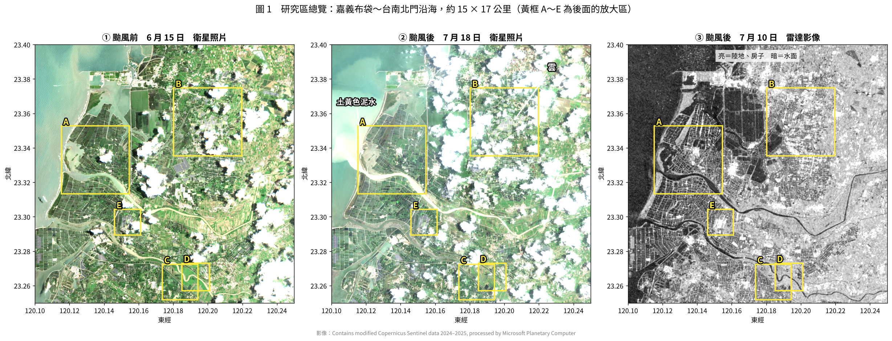
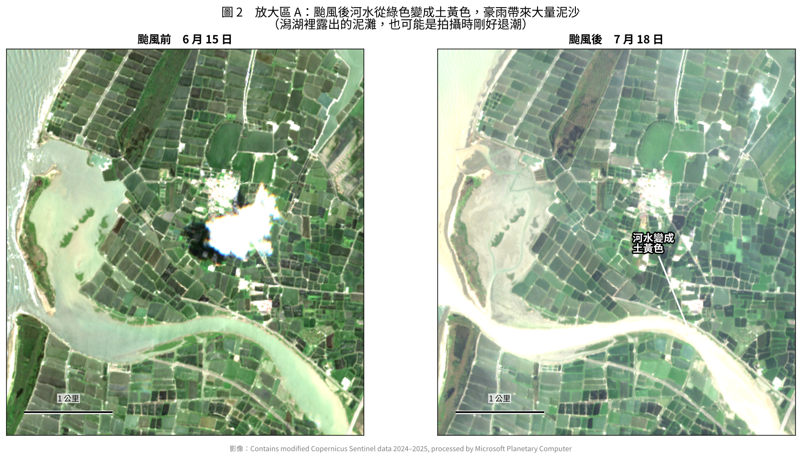
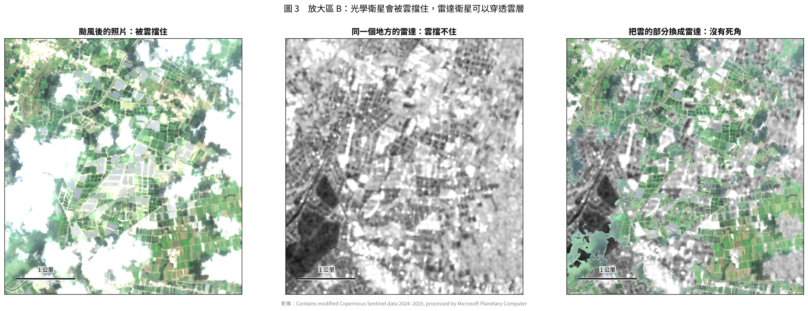
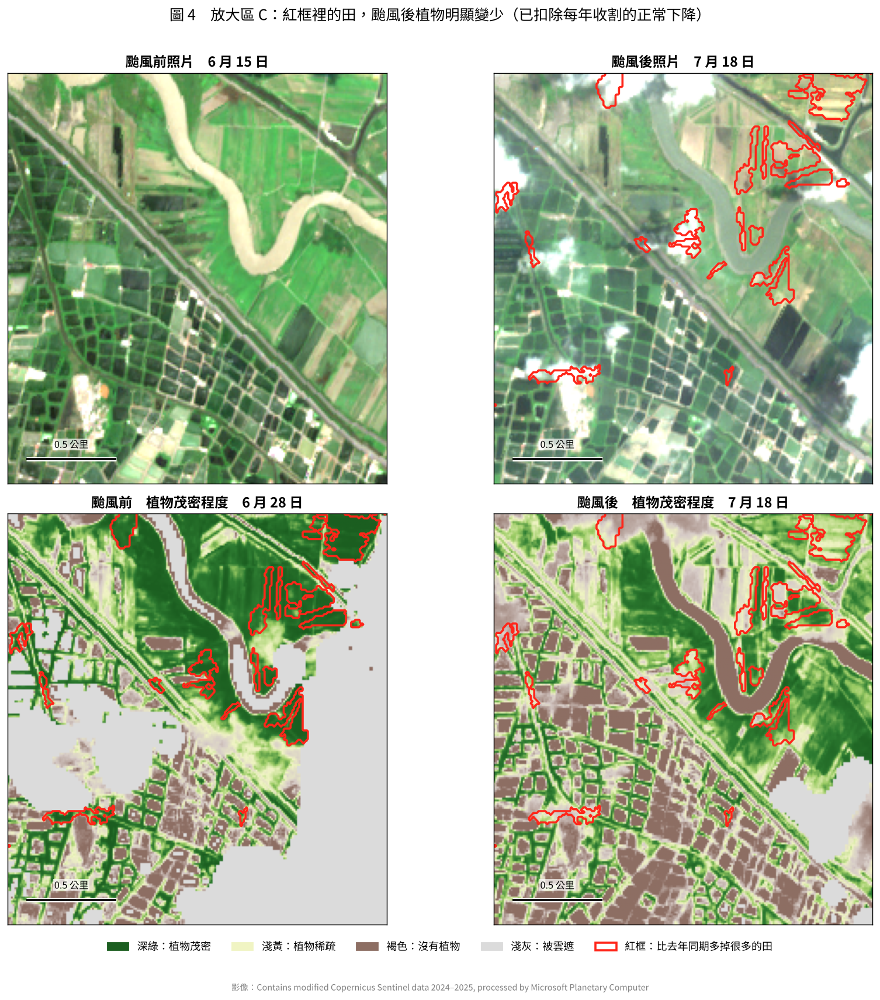
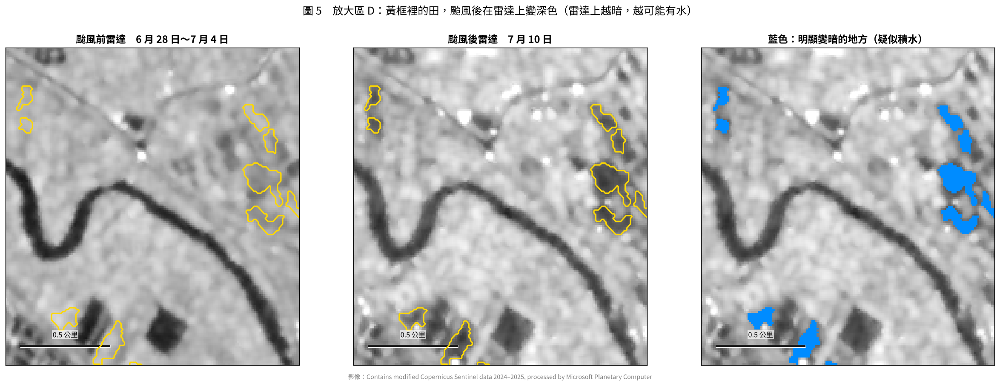
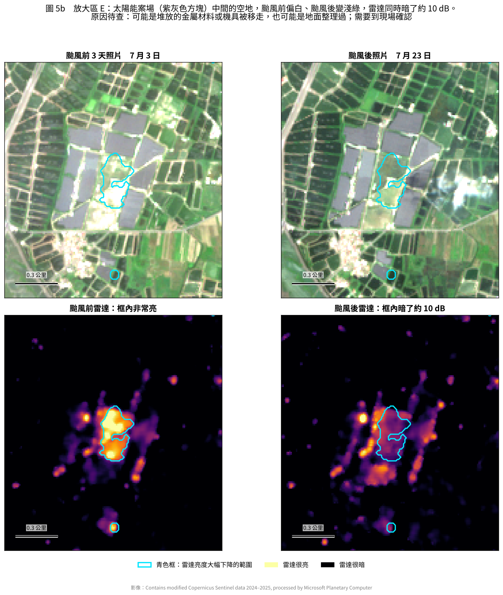
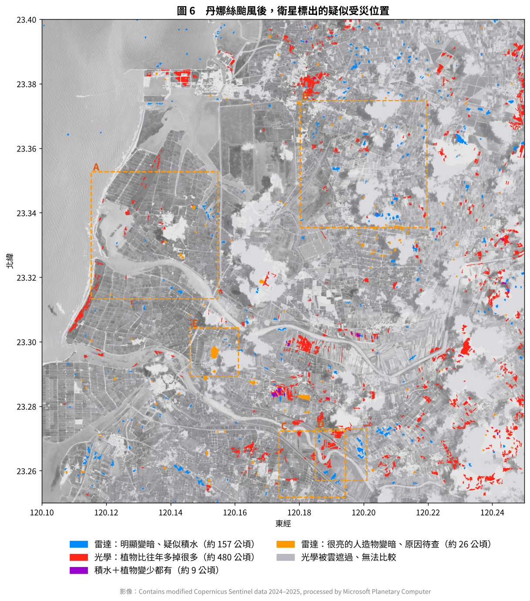
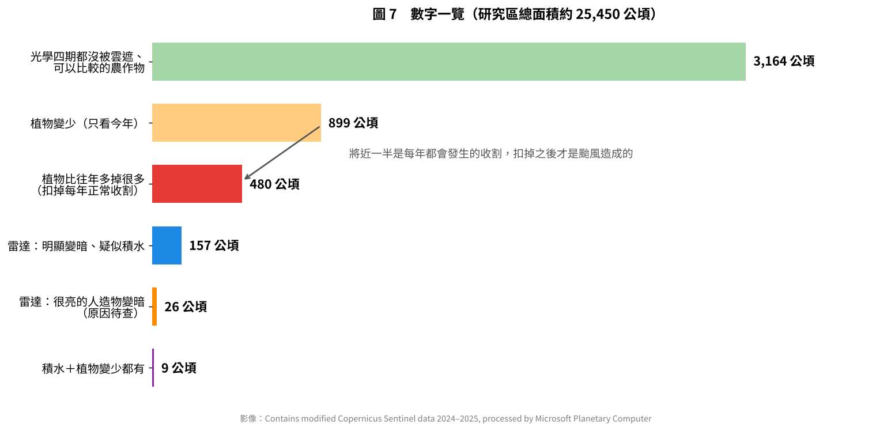

# 丹娜絲颱風衛星影像分析報告

天相星 SkyAide｜2026-10-22

2025 年 7 月 6 日深夜，丹娜絲颱風從嘉義布袋登陸。本報告使用歐盟免費公開的 Sentinel-1 雷達衛星與 Sentinel-2 光學衛星，比對登陸點附近約 15 × 17 公里（約 25,450 公頃）範圍颱風前後的變化。範圍為嘉義布袋、義竹至台南北門沿海（東經 120.10–120.25°、北緯 23.25–23.40°），每格約 10 公尺。

互動版（可拖動滑桿比較前後）另見 Artifact「丹娜絲颱風衛星影像分析」。圖檔在 `衛星測試示範/output_report/`。

## 一、這次看到什麼

| 變化 | 面積 | 說明 |
| --- | --- | --- |
| 植物比往年同期多掉很多 | 約 480 公頃 | 能比較的 3,164 公頃作物中，扣掉每年 7 月收割的正常下降後剩下的部分，約占 15% |
| 雷達明顯變暗、疑似積水 | 約 157 公頃 | 只有約 28% 暗到接近水面，其餘比較像土壤泡水或部分積水 |
| 原本很亮的人造物變暗 | 約 26 公頃 | 原因從衛星看不出來，需要到現場確認 |
| 積水＋植物變少都有 | 約 9 公頃 | 兩種衛星都標出的位置 |

另外，河水和河口從綠色變成土黃色，是豪雨帶來大量泥沙。

這些都是「衛星看到的變化」，還沒有和公所的實際勘查結果比對，只能說是疑似受災。

## 二、兩種衛星影像怎麼看

- **光學衛星（Sentinel-2）**：像從太空拍照，會被雲擋住。可算出「植物茂密程度」（NDVI）：深綠＝茂密、淺黃＝稀疏、褐色＝沒有植物。
- **雷達衛星（Sentinel-1）**：衛星自己發出微波再收回來，雲和夜晚都擋不住。黑白影像：亮＝房子、陸地、作物；暗＝水面。原本灰色的田變暗，就可能積水。

## 三、總覽

**圖 1**　颱風前照片（6/15）、颱風後照片（7/18）、颱風後雷達（7/10）。黃框 A～E 為放大區。颱風後照片雲很多，雷達則完整。

## 四、放大區

### A　河水變成土黃色

**圖 2**　約 4 × 4 公里。颱風前河水是綠色，颱風後變成土黃色，是豪雨把上游泥沙沖下來。潟湖裡露出的泥灘水道，也可能只是拍攝時剛好退潮。

### B　照片被雲擋住，雷達照樣看得到

**圖 3**　同一地點的照片、雷達，以及把雲的部分換成雷達的合成圖。颱風後常連續多天有雲，所以天相星以雷達為第一手資料。

### C　植物變少的田

**圖 4**　約 2 × 2 公里。紅框是扣掉往年同期後仍明顯變少的田，由深綠變成淺綠或淺黃。

**怎麼排除正常收割**：拿同一塊田去年同期（2024 年 7 月 3 日到 18 日）的變化當基準。只看今年會標出 899 公頃，扣掉往年同期後剩 480 公頃，將近一半是正常收割。

### D　雷達上變暗的田：疑似積水

**圖 5**　約 1.6 × 1.8 公里。黃框和藍色是颱風後在雷達上由淺灰變深灰的田。

只說「疑似」的原因：雷達只能說「這裡變暗了」，說不出為什麼。7 月是二期稻插秧前灌水整地的時候，正常灌溉也會變暗；而且雷達是颱風後第 4 天拍的，最嚴重的積水可能已經退了。

### E　原本很亮的人造物變暗了

**圖 5b**　太陽能案場（紫灰色方塊）中間的一塊空地，颱風前偏白、颱風後變淺綠，雷達同時暗了約 10 dB（反射訊號只剩十分之一左右）。

一開始以為是光電板被吹壞，因為丹娜絲確實在布袋一帶造成水面型光電嚴重損壞（布袋新塭滯洪池約 15 MW 受損）。但補看颱風前 3 天（7/3）的照片後發現，這一塊本來就是空地。比較可能是空地上原本堆放金屬材料或停著機具，前後被移走或整理過。衛星只能指出「這裡有東西變了」，原因要靠人去看，這類地點適合列入公所的現勘清單。

## 五、結果總圖

**圖 6**　紅＝植物比往年多掉很多、藍＝雷達變暗疑似積水、橘＝很亮的人造物變暗、紫＝積水與植物變少都有、淺灰＝照片被雲遮過無法比較。

雷達和光學標出的位置幾乎不重疊（9 公頃）。一部分是雷達標出的田有三分之二在照片上被雲遮住，無法用照片檢查；另一部分是兩種衛星看的東西不同：雷達看「有沒有變成水」，照片看「植物有沒有變少」，作物被吹倒不一定會積水。

## 六、限制

1. **沒有地面的正確答案**：目前沒有公所或農業部的受災地號可比對，算不出準確度。
2. **時間差**：颱風 7/6 深夜登陸，雷達最早 7/10，照片 7/18，最嚴重的積水可能已退。
3. **灌溉和搶收**：7 月是收割與插秧季，灌水整地會讓雷達變暗，提早收割會讓植物變少，衛星分不出來。
4. **不分農地與非農地**：沒有套用農地範圍圖，西側海岸防風林等非農地植生也被標出，約占植物變少面積的 6%。
5. **雲**：四期照片都沒被雲遮的面積只有約三分之一。

## 七、對天相星的意義

- **颱風後先靠雷達**：這次能用的照片是第 12 天拍的，雷達第 4 天就有完整影像。
- **一定要和往年同期比**：不扣掉每年的收割，疑似受損面積會多將近一倍。
- **不確定的交給人判斷（C 級）**：積水還是灌溉、受損還是搶收、人造物為什麼變暗，衛星說不出原因，但能標出地點，讓公所知道先去哪裡看。
- **魚塭要另外看停電**：報導指出這一區魚塭大量死魚是停電、增氧機停擺造成，雷達看不到，需要夜間燈光等資料。

## 附錄：使用的影像

| 衛星 | 用途 | 颱風前 | 颱風後 |
| --- | --- | --- | --- |
| Sentinel-1 雷達 | 積水、人造物變化 | 6/4、6/10、6/16、6/22、6/28、7/4 | 7/10 |
| Sentinel-2 光學 | 植物茂密程度 | 6/28 | 7/18 |
| Sentinel-2 光學 | 去年同期基準 | 2024/7/3 | 2024/7/18 |
| Sentinel-2 照片 | 對照用 | 6/15（E 區 7/3） | 7/18（E 區 7/23） |

影像經 Microsoft Planetary Computer 取得。方法細節見《演算法原理白話說明》；重製圖表：`fetch_crop.py`、`fetch_s2.py`、`fetch_truecolor.py`、`real_danas_analysis.py`、`real_s2_analysis.py`、`report_figures.py`。

影像來源：Contains modified Copernicus Sentinel data 2024–2025, processed by Microsoft Planetary Computer.

災情對照：[中央社 2025-07-07](https://www.cna.com.tw/news/asoc/202507070072.aspx)、[公視：義竹魚塭停電死魚、七股淹水](https://news.pts.org.tw/article/761163)、[公視：布袋新塭滯洪池光電受損](https://news.pts.org.tw/article/760267)、[公視：嘉義光電板破損統計](https://news.pts.org.tw/article/761035)
